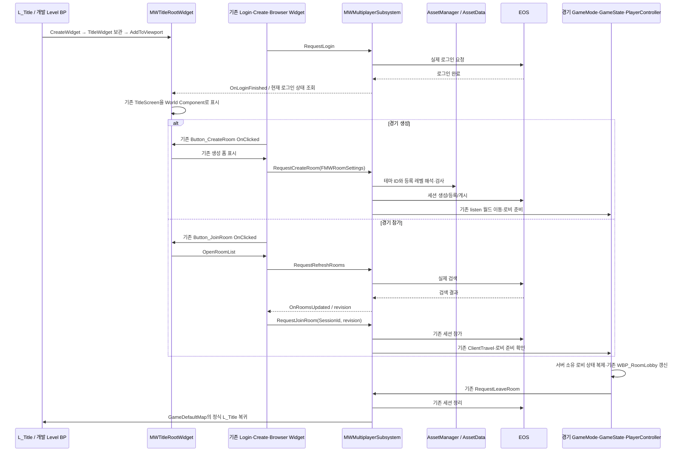

# ProjectMW P3 타이틀 World Space UI 구현·검증 보고서

2026-10-29 / UE 5.8.4, CL 58902052

## 1. 결과와 완료 판정

실제 `C:/workspace/UE/ProjectMW/MW.uproject`의 개발 레벨 `/Game/Levels/L_Title_WorldUI_Dev`에 경기 생성·참가 표지판을 World Space Widget으로 구현했다. 독립 프로젝트 사본이나 worktree에서 작업하지 않았다. 원본 타이틀, 정식 Widget Blueprint, 기본 맵 설정은 보존했다.

실제 EOS 인증 후 마우스로 두 표지판과 뒤로가기를 조작했고, 방 이름 입력·정원 선택·실제 검색·테스트 방 생성·경기 월드 로비 진입·방 종료·정식 타이틀 복귀를 확인했다. Editor/Game 빌드와 개발 BP 컴파일은 통과했다.

**이번 P3의 두 World Space 표지판 구현과 단일 계정 기능 검증을 완료했다.** 사용자가 실제 마우스를 길게 누른 Pressed 정지 이미지와 네이티브 `IsPressed=true`도 최종 확보했다. 이 이미지는 추가 EOS 인증 없이 수행한 별도 레이아웃 검증이며 실제 인증·세션 시험과 구분한다. 유효한 연속 영상은 확보하지 못했다. 중간 정지 이미지 확보용 임시 엔진 자동화 캡처 호출에서는 에디터 크래시가 발생했다. 해당 호출은 저장된 프로젝트 코드·BP에 포함되지 않는다. 크래시 후 새 에디터에서 일반 PIE 진입·종료·재진입을 다시 확인했고, 최종 Pressed 이미지는 일반 screenshot 요청으로 안전하게 확보했다. 2계정 참가·원격 동기화 및 Cook/패키지 실행은 이번 검증에서 수행하지 않았다.

검토할 맵은 `L_Frontend`나 정식 `L_Title`이 아닌 **`L_Title_WorldUI_Dev`**다. GameDefaultMap/EditorStartupMap은 계속 `L_Title`이므로 프로젝트를 기본 실행하면 기존 화면이 나오는 것이 현재 의도된 상태다. 개발 맵을 직접 열고 PIE를 실행해야 변경된 화면이 보인다. 에디터는 개발 맵을 연 상태로 두었으며 PIE는 종료했다.

## 2. 기준·작업 규칙·협업 상태

| 항목 | 실제 확인 결과 |
|---|---|
| 작업 프로젝트 | `C:/workspace/UE/ProjectMW/MW.uproject` |
| Git 브랜치 | 기존 `feature/title-world-ui` 유지 |
| 시작·현재 HEAD | `3db9c5d15e5496a4b699cb48e7796d826622bfb4` |
| 원격 main | 시작/종료 `git ls-remote` 모두 같은 SHA |
| UVCS workspace | `ProjectMW-Young`, 실제 ProjectMW 경로 |
| UVCS repository/branch | `ProjectMW/ProjectMW`, `/main` |
| 로컬 changeset / 서버 최신 | 16 / 17. 17의 기존 변경 범위 확인 후 기존 파일을 초기화하지 않음 |
| 현재 UVCS pending | 신규 에셋 10개 AD. 기존 에셋 CH/CO 없음 |
| 원본 맵 잠금 | `/Content/Levels/L_Title.umap`, item 955/revision 970, `rlaalswo155@gmail.com`, workspace `ProjectMW`, `/main` |
| 수행하지 않은 협업 작업 | Git stage/commit/push/PR, 브랜치 생성·전환, UVCS checkin, main 병합, 타인 잠금 해제 |

신규 경로는 생성 전에 로컬과 UVCS 서버 트리에서 중복 여부를 확인했다. **로컬 AD 등록은 중앙 Checkout/Lock 또는 팀 공유 예약 확정과 다르다.** 신규 경로의 중앙 예약이 완료됐다고 주장하지 않는다. 후속 공유 전에 팀 공용 예약 기록 및 최신 중복 여부를 확인해야 한다.

적용 분야는 Client + Art + TA다. `AGENTS.md`, `.agents/skills/mw-task-routing/SKILL.md`, Shared 직속 문서, Engineering 직속 및 Client, Shared/Client,Server, Art, Shared/TA 필독 문서와 최신 13번 통합 문서를 기준으로 작업했다. 같은 대화에서 이미 전체 확인한 문서는 변경 여부를 확인해 재사용했다. 과거 Frontend 문서의 구형 구조보다 현재 코드·BP를 우선했다. C++ 검토 기준은 기존 스타일과 [Epic Unreal C++ Coding Standard](https://dev.epicgames.com/documentation/unreal-engine/epic-cplusplus-coding-standard-for-unreal-engine)다.

기존 Source/Config/정식 Lobby WBP/원본 맵 등 55개 기준 파일의 전후 해시를 비교했다. 변경된 기준 파일은 의도한 소스·모듈 설정 8개뿐이다. 원본 맵 SHA-256은 다음 값으로 동일하다.

`844e37bd881e91ebd1487f4dd354b172f1ca24656caf1d21a5632d5bd345cf67`

전체 근거: [보존 해시 및 신규 에셋 해시](C:/Users/user/Documents/Codex/2026-10-27/make-way-ue-0-make-way-2/work/p3-title/preservation-final.json), [Git 상태](C:/Users/user/Documents/Codex/2026-10-27/make-way-ue-0-make-way-2/work/p3-title/git-status.txt), [UVCS 상태](C:/Users/user/Documents/Codex/2026-10-27/make-way-ue-0-make-way-2/work/p3-title/uvcs-status.txt), [실제 잠금](C:/Users/user/Documents/Codex/2026-10-27/make-way-ue-0-make-way-2/work/p3-title/uvcs-locks.txt).

## 3. 현재 L_Title과 기존 구현 분석

원본 `L_Title`은 `BP_MWTitleGameMode`를 사용한다. 타이틀의 PlayerController는 기본 Engine PlayerController이고 DefaultPawn은 None이다. 경기 월드의 `AMWPlayerController`와 구분했다.

원본 배치 Actor는 DirectionalLight, SkyAtmosphere, SkyLight, ExponentialHeightFog, VolumetricCloud, PlayerStart, SM_SkySphere, Floor의 8개다. CameraActor, 복구 트랙·차량·메뉴 지지대는 없다. 원본 PlayerStart는 `(0,0,92)`다. 개발 맵에서 CameraActor와 UI Actor만 추가해 10개가 됐다. P1/UCM 장면이나 테스트 조명을 가져오지 않았다.

Level Blueprint가 BeginPlay에서 기존 Root를 CreateWidget하고 `TitleWidget` 변수에 보관한 뒤 AddToViewport, UIOnly 입력 및 커서를 설정한다. EndPlay에서 기존 제거 경로를 사용한다. 개발 맵에서는 **CreateWidget 클래스 핀 1개만 개발 Root 클래스로 변경**했다. 생성 주체와 기존 수명 경로는 유지했다.

| 기존 클래스/BP | 현재 책임 및 이번 재사용 |
|---|---|
| `WBP_TitleRoot` / `UMWTitleRootWidget` | 로그인/타이틀 자식, 생성·검색 화면 생성, 메뉴 선택, 기존 Delegate 연결. 메뉴 전환 책임 유지 |
| `WBP_LoginTest` / `UUserWidget` | 기존 로그인 EventGraph의 RequestLogin·상태·결과 이벤트 연결. 개발 복제본에서 Designer만 변경 |
| `WBP_Title` / `UUserWidget` | `Button_CreateRoom`, `Button_JoinRoom`, `Text_EntryStatus`. Root의 기존 네이티브 핸들러가 바인딩 |
| `WBP_CreateRoom` / `UMWCreateRoomWidget` | 이름/인원/테마 입력, 기존 설정 검사·생성·뒤로 이벤트 |
| `WBP_RoomBrowser` / `UMWRoomBrowserWidget` | 실제 검색, 결과 재구성, SessionId+목록 revision 선택·참가, 뒤로 |
| `WBP_RoomListEntry` / `UMWRoomListEntryWidget` | 한 결과의 표시와 기존 OnRoomSelected 전달 |
| `WBP_RoomLobby` / `UMWRoomLobbyWidget` | 현재 경기 월드의 서버 상태 표시, 기존 방 종료/나가기. 디자인은 변경하지 않음 |
| `UMWMultiplayerSubsystem` | EOS 로그인·세션 상태·요청 세대·검색 결과·생성/참가/정리·복귀 소유. 수정 없음 |
| `AMWPlayerController` | 경기 월드에서 GameState/Subsystem 변경 구독 및 기존 BP 로비 생성·갱신·해제. 수정 없음 |
| `UMWAssetManager`, `UMWAssetData` | 기존 카탈로그·GameplayTag 기반 테마→레벨 참조 해석. 수정·중복 카탈로그 없음 |

현재 로그인 및 일반 양식의 ParentClass/Widget Tree/BindWidget 이름, 그래프, 이미지·폰트 의존성은 원본 및 개발 BP 텍스트 export로 확인했다. 개발 로그인 그래프는 복제로 달라지는 GUID·패키지 이름·로컬라이제이션 식별자 등을 정규화한 노드/핀 비교에서 원본과 일치했다. 바이트 동일 그래프라는 뜻은 아니다.

`MWFrontendWidget`, `MWFrontendConnection`, `MWFrontendPlayerController`, `MWFrontendAuthoring`, `L_Frontend`를 새 실행 경로로 복원하지 않았다.

다이어그램 중 참가/ClientTravel/원격 복제는 **현재 소스 분석 결과**이며 이번 2계정 실행 증거가 아니다. 호스트 생성·로비·종료·정식 타이틀 복귀는 실제 실행했다.

## 4. 개발 자산 격리와 소유권

`EditorAssetLibrary.duplicate_asset`을 통한 Unreal 에셋 복제로 개발 맵과 필요한 WBP를 만들었다. 운영체제 파일 복사로 원본 맵을 교체하지 않았다. 복제 직후 변경 전 PIE에서는 원본 Root 1개, switcher 4개, 기존 로그인 화면으로 동등하게 실행됐다.

신규 자산 전체 경로:

| 경로 | 용도 |
|---|---|
| `C:/workspace/UE/ProjectMW/Content/Levels/L_Title_WorldUI_Dev.umap` | 원본을 보존한 개발 맵 |
| `C:/workspace/UE/ProjectMW/Content/UI/Lobby/WBP_TitleRoot_WorldDev.uasset` | 개발용 화면/Actor 클래스 참조 격리 |
| `C:/workspace/UE/ProjectMW/Content/UI/Lobby/WBP_Login_WorldDev.uasset` | 기존 로그인 동작 + 정렬 보정 |
| `C:/workspace/UE/ProjectMW/Content/UI/Lobby/WBP_Title_WorldDev.uasset` | 재사용하는 두 표지판의 Designer |
| `C:/workspace/UE/ProjectMW/Content/UI/Lobby/WBP_CreateRoom_WorldDev.uasset` | 입력 폼 및 피드백 정렬 |
| `C:/workspace/UE/ProjectMW/Content/UI/Lobby/WBP_RoomBrowser_WorldDev.uasset` | 검색 화면 및 피드백 정렬 |
| `C:/workspace/UE/ProjectMW/Content/UI/Lobby/WBP_RoomListEntry_WorldDev.uasset` | 개발 검색 결과 행 폰트/배치 |
| `C:/workspace/UE/ProjectMW/Content/UI/Lobby/BP_TitleWorldMenu_Dev.uasset` | 단일 WidgetComponent의 에디터 설정 |
| `C:/workspace/UE/ProjectMW/Content/UI/Common/F_NotoSansKR_Bold_TitleDev.uasset` | 개발 전용 FontFace 메트릭 설정 |
| `C:/workspace/UE/ProjectMW/Content/UI/Common/F_NotoSansKR_Bold_TitleDev_Font.uasset` | 개발 전용 Composite Font 참조 |

정식 RoomLobby WBP는 복제·편집하지 않았다. 기존 Common 텍스처를 그대로 참조했다. 메뉴 테두리/볼트/화살표나 로그인 보드를 다시 그리지 않았다. 기존 `T_MW_MenuSign`, `T_MW_Arrow`, `T_MW_DisclaimerFrame`, `T_MW_DisclaimerBorder`, `T_MW_SignBolt`, 결과 행의 `T_MW_PlayerSlotSign` 등 현재 프로젝트 리소스에 의존한다. 기존 원작 리소스 provenance는 `Docs/Engineering/Client/FrontendOriginalAssets.json` 및 기존 통합 문서에 있다. 외부 Codex 사본 경로에 대한 런타임 의존성을 만들지 않았다.

개발 Root는 기존 방식의 클래스 프로퍼티로 개발 Create/Browser를 참조하며 개발 Browser는 개발 Entry를 참조한다. 정식 Root는 WorldMenuActorClass가 설정되지 않아 기존 Screen Space 경로를 사용한다.

Root가 소유하는 **기존 TitleScreen 인스턴스 하나**를 Component에 연결한다. 별도 World용 Title Widget을 추가 생성하지 않는다. Component의 WidgetClass는 의도적으로 None이다. 에디터 정지 Viewport에 메뉴가 미리 나타나지 않더라도, PIE에서 Root가 연결하면 표시된다.

## 5. 정렬 원인과 변경 위치

| 화면/문제 | 확인한 원인 | 저장된 해결 위치 |
|---|---|---|
| 로그인 | SizeBox의 디자인 크기와 배치 기준 불일치, 폰트 라인 메트릭 | 개발 로그인 SizeBox, 중심 Anchor/Alignment. 기존 측정 위치·540×100 버튼 크기를 보존하며 Anchor 변환 |
| 생성·참가 및 일반 버튼 | 텍스트와 화살표의 가로 배분, ButtonSlot과 스타일 Padding의 중복, 폰트 라인 높이 | 개발 WBP의 Overlay. 캡션은 버튼 전체 기준 중앙, 화살표는 오른쪽 정렬. 기존 ButtonSlot Padding 유지 |
| 글자의 위아래 치우침 | Noto OTF hhea/잉크 범위 차이. BoundingBox 모드는 글꼴 전체 극단값으로 라인이 지나치게 커짐 | 개발 FontFace만 Metrics 모드 + ascend/descend override. 원본 Face는 유지 |
| Hover/Pressed 색·클릭 영역 | 자식 Text/Image의 색 상속, Button 자체의 HitTest 설정 | 개발 Button Visible, 장식 HitTestInvisible, 전경색 상속 및 기존 브러시 상태 재사용 |
| 생성/검색 상태·오류 | 고정 영역에 상태와 오류를 함께 표시할 때 잘림·충돌 가능 | 개발 WBP SizeBox→ScrollBox→VerticalBox, 줄바꿈과 폰트 28. 기존 액션 영역 아래 공간 사용 |
| 경기 로비 | 기존 참가자 슬롯·정보판 및 작은 보조 텍스트의 제한 확인 | 이번 단계에서 정식 로비 디자인은 보존. 실제 로비 캡처를 후속 대상으로 제출 |

표지판의 원래 Render Angle -8/-10도는 유지했다. 텍스트만 임의 Render Offset/Scale로 밀어 맞추지 않았다. 로그인 버튼의 측정된 디자인 크기는 540×100으로 유지했다. 이번 변화로 임의 확대했다고 보고하지 않는다.

FontFace의 실제 OTF em=1000, 기존 hhea=1160/-288, 전체 bbox=-1046..1806을 확인했다. 현재 라벨의 한글 잉크 범위 -86..838, 라틴 j의 -229..811을 근거로 개발 Face에 ascend=16, descend=-4(엔진 내부 변환 후 1024/-256)를 설정했다. FontFace 에디터 설정값이며 C++ 상수가 아니다. 모든 Unicode 조합 문자를 검증한 것은 아니다. 중간 BoundingBox 실험은 폐기했다.

피드백 영역은 기존 Designer 액션 경계와 디자인 높이에서 계산한 `(150,938)~(1760,1080)` 범위다. 숫자는 자산의 Designer 설정이며 런타임 해상도 if문으로 배치하지 않는다. 실제 정원 항목 2/3/4와 `Asset.MapTheme.DevDefault`는 기존 시스템의 결과를 사용했다. 새로운 테마 배열이나 상태 문자열 계약을 만들지 않았다.

세 해상도 비교는 다음과 같다. `before/after`는 레이아웃 비교용으로 화면을 선택했으며 로그인·세션 성공을 가장하지 않았다. 별도 `actual-*` 증거가 실제 인증·기능 실행 결과다. PNG는 운영체제 창 테두리를 포함하므로 파일 크기가 viewport보다 크다. JSON의 viewport가 실제 렌더 해상도 기준이다.

| Viewport | 로그인 전/후 | 표지판 전/후 | 생성 전/후 | 검색 전/후 |
|---|---|---|---|---|
| 1920×1080 | [전](C:/Users/user/Documents/Codex/2026-10-27/make-way-ue-0-make-way-2/work/p3-title/before-login-1920x1080.png) / [후](C:/Users/user/Documents/Codex/2026-10-27/make-way-ue-0-make-way-2/work/p3-title/after-login-1920x1080.png) | [전](C:/Users/user/Documents/Codex/2026-10-27/make-way-ue-0-make-way-2/work/p3-title/before-title-1920x1080.png) / [후](C:/Users/user/Documents/Codex/2026-10-27/make-way-ue-0-make-way-2/work/p3-title/after-title-1920x1080.png) | [전](C:/Users/user/Documents/Codex/2026-10-27/make-way-ue-0-make-way-2/work/p3-title/before-create-1920x1080.png) / [후](C:/Users/user/Documents/Codex/2026-10-27/make-way-ue-0-make-way-2/work/p3-title/after-create-1920x1080.png) | [전](C:/Users/user/Documents/Codex/2026-10-27/make-way-ue-0-make-way-2/work/p3-title/before-browser-1920x1080.png) / [후](C:/Users/user/Documents/Codex/2026-10-27/make-way-ue-0-make-way-2/work/p3-title/after-browser-1920x1080.png) |
| 1280×720 | [전](C:/Users/user/Documents/Codex/2026-10-27/make-way-ue-0-make-way-2/work/p3-title/before-login-1280x720.png) / [후](C:/Users/user/Documents/Codex/2026-10-27/make-way-ue-0-make-way-2/work/p3-title/after-login-1280x720.png) | [전](C:/Users/user/Documents/Codex/2026-10-27/make-way-ue-0-make-way-2/work/p3-title/before-title-1280x720.png) / [후](C:/Users/user/Documents/Codex/2026-10-27/make-way-ue-0-make-way-2/work/p3-title/after-title-1280x720.png) | [전](C:/Users/user/Documents/Codex/2026-10-27/make-way-ue-0-make-way-2/work/p3-title/before-create-1280x720.png) / [후](C:/Users/user/Documents/Codex/2026-10-27/make-way-ue-0-make-way-2/work/p3-title/after-create-1280x720.png) | [전](C:/Users/user/Documents/Codex/2026-10-27/make-way-ue-0-make-way-2/work/p3-title/before-browser-1280x720.png) / [후](C:/Users/user/Documents/Codex/2026-10-27/make-way-ue-0-make-way-2/work/p3-title/after-browser-1280x720.png) |
| 960×540 | [전](C:/Users/user/Documents/Codex/2026-10-27/make-way-ue-0-make-way-2/work/p3-title/before-login-960x540.png) / [후](C:/Users/user/Documents/Codex/2026-10-27/make-way-ue-0-make-way-2/work/p3-title/after-login-960x540.png) | [전](C:/Users/user/Documents/Codex/2026-10-27/make-way-ue-0-make-way-2/work/p3-title/before-title-960x540.png) / [후](C:/Users/user/Documents/Codex/2026-10-27/make-way-ue-0-make-way-2/work/p3-title/after-title-960x540.png) | [전](C:/Users/user/Documents/Codex/2026-10-27/make-way-ue-0-make-way-2/work/p3-title/before-create-960x540.png) / [후](C:/Users/user/Documents/Codex/2026-10-27/make-way-ue-0-make-way-2/work/p3-title/after-create-960x540.png) | [전](C:/Users/user/Documents/Codex/2026-10-27/make-way-ue-0-make-way-2/work/p3-title/before-browser-960x540.png) / [후](C:/Users/user/Documents/Codex/2026-10-27/make-way-ue-0-make-way-2/work/p3-title/after-browser-960x540.png) |

## 6. World Space 구조·설정

두 표지판의 기존 상대 배치와 클릭을 유지하기 위해 단일 Canvas형 WidgetComponent를 선택했다. 표지판 별 Actor/Widget을 중복 생성하지 않는다. 지지대 Mesh와 복구 트랙은 이 컴포넌트와 별개이며 이번에 추가하지 않았다.

| 설정 | 저장 위치 및 실제 값 |
|---|---|
| Actor | 개발 맵 `WORLD_TitleMenu_Dev` / `BP_TitleWorldMenu_Dev` |
| Actor Location | X=0, Y=0, Z=400 |
| Actor Rotation | Pitch=4.763642, Yaw=180, Roll=0 |
| Actor Scale | 0.65, 0.65, 0.65 |
| Component | `MenuSurface`, 상대 위치/회전 0, 상대 Scale 1 |
| Space / DrawSize | World / 1920×1080 |
| WidgetClass | None. 기존 Root가 기존 TitleScreen을 연결 |
| Receive Hardware Input | True |
| Window Focusable | True |
| Gamma Correction | False |
| 충돌 | 기존 UI 프로파일. 메뉴 표시 시 QueryOnly, 입력 폼 표시 시 NoCollision |
| Camera | 개발 맵 `CAM_TitleWorldUI_Dev` |
| Camera Location | X=-1200, Y=0, Z=500 |
| Camera Rotation | Pitch=-4.763642, Yaw=0, Roll=0 |
| FOV / Aspect | 60 / 16:9, 화면비 제한 |
| Camera 지정 | 레벨 CameraActor AutoActivateForPlayer=Player0 |
| 추가 조명·Sequence | 없음 |

설정 출처: [최종 Component](C:/Users/user/Documents/Codex/2026-10-27/make-way-ue-0-make-way-2/work/p3-title/component-final.json), [맵/자산 감사](C:/Users/user/Documents/Codex/2026-10-27/make-way-ue-0-make-way-2/work/p3-title/final-asset-audit.json), [카메라 실행 시험](C:/Users/user/Documents/Codex/2026-10-27/make-way-ue-0-make-way-2/work/p3-title/camera-runtime-test.json).

카메라를 실행 중에만 `(-1200,180,500)`으로 평행 이동했다. World UI Transform은 그대로 둔 상태에서 표지판이 화면 왼쪽으로 이동하고 바닥과의 상대 위치가 바뀌었다. 새 위치에서 실제 생성 표지판 클릭도 성공했다. 원래 카메라 위치로 복구했고 이동값을 맵에 저장하지 않았다. 저장된 이동 애니메이션이나 Cinemachine Dolly 복원은 없다.

원작 영상 `C:/Users/user/Videos/2026-10-27 15-15-13.mp4`의 실제 40/46/48초 프레임을 확인했다. 46초의 원작에는 큰 루프·차량·지지대와 여섯 메뉴가 보인다. 이번 개발 맵은 현재 ProjectMW의 하늘·바닥과 구현된 두 기능만 사용하므로 배경·화면 점유율·카메라 구도가 다르다. 기존 원작 텍스처와 기울기를 재사용했지만 원작 전체 화면과 동일하게 복원했다고 주장하지 않는다. 월드 렌더 타깃·톤매핑을 거친 노란색도 Screen Space 및 원작 영상과 차이가 남는다.

## 7. 입력·전환·수명

배포되는 구현은 방법 A(WidgetComponent Receive Hardware Input)만 사용한다. 데스크톱 마우스와 기존 Button Delegate를 바로 연결할 수 있고 새로운 Pointer 수명이나 입력 주체가 필요 없기 때문이다. 방법 B는 별도의 WidgetInteraction, 추적, VirtualUser/Pointer 및 press/release 수명이 필요하다. 최종 자산에는 WidgetInteraction이 없다. 보조 캡처를 위해 실행 중 잠시 시도한 가상 포인터 검증은 유효 결과로 채택하지 않았고 PIE 종료로 제거했다.

1. 기존 Root의 `InitializeWorldMenu`가 BP 설정 클래스에 해당하는 유일한 Actor와 단일 World Component를 확인한다. 잘못되거나 모호한 설정에서는 기존 Screen 메뉴를 유지한다.
2. Root의 기존 TitleScreen을 Component로 옮긴다. switcher의 빈 WorldMenuPlaceholder를 사용한다.
3. 메뉴에서는 GameAndUI, 표시/충돌 활성. Screen 폼에서는 UIOnly, 메뉴와 충돌 비활성으로 폼 뒤의 메뉴가 클릭되지 않도록 한다.
4. 기존 `HandleCreateRequested`/`HandleJoinRequested`의 로그인·세션 상태 검증과 화면 전환을 그대로 사용한다.
5. 기존 OnBackRequested가 Root의 메뉴 상태로 복귀시킨다. Delegate는 AddUniqueDynamic/RemoveDynamic의 기존 방식을 유지한다.
6. Root 종료 시 Component 연결을 비우고, 유효한 재부착 상황에서는 TitleScreen을 switcher로 돌려놓는다. GC 파괴 중에는 재부착하지 않는다.

실제 제거·재부착 3회에서 switcher 자식 수는 계속 4였고 Component는 매번 해제됐다. null Create 버튼 상태의 NativeDestruct 재현도 살아남았다. PIE 중 Editor helper의 컴파일 요청이 거절되는 것도 검증했다. [수명 회귀 결과](C:/Users/user/Documents/Codex/2026-10-27/make-way-ue-0-make-way-2/work/p3-title/lifetime-regression.json).

## 8. 실제 기능 검증과 미실행 항목

| 시험 | 실행 결과 / 근거 |
|---|---|
| 실제 EOS 로그인 | 사용자 브라우저 인증 후 네이티브 `IsLoggedIn=true`. 인증 자동화·가짜 성공 없음 |
| 두 월드 버튼 실제 마우스 | 1920×1080, 1280×720, 960×540에서 생성/참가 진입. native Pressed→Released→Clicked 기록 |
| Hover/Unhover | 실제 커서 이동으로 파란 표지판·흰 캡션/화살표 및 기본색 복귀 확인 |
| Pressed | 실제 `IsPressed=true`와 Pressed/Released/Clicked 순서 확인. 사용자의 실제 2초 누르기에서 눌림 정지 이미지 최종 확보. 미인증 레이아웃 보조 실행이며 세션 성공 시험과 구분 |
| 뒤로가기/입력 모드 | 생성/검색→월드 메뉴 복귀, 다시 버튼 클릭 가능. 생성 폼 이름 필드 실제 키보드 포커스·입력 확인 |
| 빈 이름 오류 | 실제 생성 버튼 클릭→기존 오류 문구, 세션 None 유지 |
| 실제 폼 입력 | `UI P3 확인`, 정원 4 선택, 실제 제공 테마 `Asset.MapTheme.DevDefault` 확인 |
| 실제 방 검색 | Searching→None, EOS 검색 완료/결과 없음, 참가 비활성 유지. 새로고침·뒤로 상태 복구 |
| 실제 방 생성 | Hosting, `/Game/Levels/L_Dev_Default` 이동, 정식 `WBP_RoomLobby` 생성, 1/4명 표시 |
| 실제 방 종료 | 세션 None/오류 빈 값, 정식 `/Game/Levels/L_Title`와 정식 Root 1개로 복귀 |
| Ready / Start | 기존 비활성 상태 유지. 서버 기능 추가 없음 |
| 카메라 이동 | 실행 중 Y+180, 메뉴 위치 변화 및 이동 후 실제 클릭 성공, 원상 복구 |
| 재진입/중복 | Root 1개/switcher 4개, Component 연결·해제 및 새 PIE에서 임시 포인터 0개 |
| 2계정 참가/ClientTravel | 이번에 미실행. 실제 검색 결과가 비어 있었고 별도 참가 계정을 사용하지 않음 |
| 원격 로비 동기화/WAN | 이번에 미실행. 과거 13번 문서의 검증을 이번 결과로 재표기하지 않음 |
| 강제 실패/시간 초과/정리 재시도 | 이번 실제 네트워크 실패 주입은 미실행. 기존 코드는 보존 |
| Cook/패키지/게임 바이너리 실행 | 미실행. Game C++ 빌드 성공과 구분 |

입력 기록에 1920 브라우저 Back 1회는 Hover→Unhover 후 Pressed/Released만 있고 Clicked가 없었다. 해당 시도는 성공 횟수에서 제외했다. 이후 정상 복귀를 확인했고, 새 실행에서 정확한 MW 창을 활성화한 1920 Back 단일 클릭도 정상 처리됐다. 후자는 미인증 레이아웃 보조 시험이므로 결과가 LoginScreen인 점을 명시한다. 이 한 번의 취소 원인을 게임 코드 결함이나 도구 문제로 확정하지 않았다.

실제 기능 자료:

- [실제 마우스 이벤트 전체](C:/Users/user/Documents/Codex/2026-10-27/make-way-ue-0-make-way-2/work/p3-title/actual-mouse-events.json)
- [Hover 캡처](C:/Users/user/Documents/Codex/2026-10-27/make-way-ue-0-make-way-2/work/p3-title/actual-hover-main-1280x720.png)
- [최종 실제 길게 누른 Pressed 캡처](C:/Users/user/Documents/Codex/2026-10-27/make-way-ue-0-make-way-2/work/p3-title/actual-held-pressed-world.png), [눌림 확인 메타데이터](C:/Users/user/Documents/Codex/2026-10-27/make-way-ue-0-make-way-2/work/p3-title/actual-held-pressed-world.json)

- [생성 폼 실제 클릭](C:/Users/user/Documents/Codex/2026-10-27/make-way-ue-0-make-way-2/work/p3-title/actual-create-1280x720.png), [1920](C:/Users/user/Documents/Codex/2026-10-27/make-way-ue-0-make-way-2/work/p3-title/actual-create-1920x1080.png), [960](C:/Users/user/Documents/Codex/2026-10-27/make-way-ue-0-make-way-2/work/p3-title/actual-create-960x540.png)
- [실제 검색 완료](C:/Users/user/Documents/Codex/2026-10-27/make-way-ue-0-make-way-2/work/p3-title/actual-search-result-1280x720.png)
- [빈 이름 오류](C:/Users/user/Documents/Codex/2026-10-27/make-way-ue-0-make-way-2/work/p3-title/actual-empty-name-error.png), [실제 입력 값](C:/Users/user/Documents/Codex/2026-10-27/make-way-ue-0-make-way-2/work/p3-title/actual-form-input.json)
- [실제 생성 상태](C:/Users/user/Documents/Codex/2026-10-27/make-way-ue-0-make-way-2/work/p3-title/actual-session-create.json), [정식 로비](C:/Users/user/Documents/Codex/2026-10-27/make-way-ue-0-make-way-2/work/p3-title/actual-host-lobby.png)
- [실제 종료 상태](C:/Users/user/Documents/Codex/2026-10-27/make-way-ue-0-make-way-2/work/p3-title/actual-session-exit.json), [정식 타이틀 복귀](C:/Users/user/Documents/Codex/2026-10-27/make-way-ue-0-make-way-2/work/p3-title/actual-return-original-title.png)
- [새 PIE 재진입](C:/Users/user/Documents/Codex/2026-10-27/make-way-ue-0-make-way-2/work/p3-title/clean-reentry-final.json), [Back 재확인](C:/Users/user/Documents/Codex/2026-10-27/make-way-ue-0-make-way-2/work/p3-title/browser-back-recheck.json)

## 9. 빌드·BP·오류 기록

| 검증 | 결과 |
|---|---|
| 최종 Editor Development Win64 빌드 | Succeeded, 10.05초 |
| 최종 Game Development Win64 빌드 | Succeeded, 28.92초 |
| 개발 WBP 6개 + Actor BP 1개 | 최종 감사 모두 compiled=true |
| 개발 Level Blueprint | 별도 최종 compile=true |
| 로그인 그래프 의미 비교 | true |
| Git diff --check | 통과 |
| 빌드 경고 | XGE License not activated. 최종 빌드는 성공 |

[Editor 빌드 로그](C:/Users/user/Documents/Codex/2026-10-27/make-way-ue-0-make-way-2/work/p3-title/EditorBuild-final.log), [Game 빌드 로그](C:/Users/user/Documents/Codex/2026-10-27/make-way-ue-0-make-way-2/work/p3-title/GameBuild-final.log), [BP 감사](C:/Users/user/Documents/Codex/2026-10-27/make-way-ue-0-make-way-2/work/p3-title/final-asset-audit.json), [Level BP](C:/Users/user/Documents/Codex/2026-10-27/make-way-ue-0-make-way-2/work/p3-title/level-final-compile.json).

실제 인증·검색·생성·로비·종료 구간(UTC 05:53~06:07)의 timestamped 로그에서 Error/Fatal은 발견되지 않았다. 이 범위를 명시한 [발췌](C:/Users/user/Documents/Codex/2026-10-27/make-way-ue-0-make-way-2/work/p3-title/authenticated-regression-excerpt.log)와 **오류를 포함하는 전체 원본 로그** [Final-verification.log](C:/Users/user/Documents/Codex/2026-10-27/make-way-ue-0-make-way-2/work/p3-title/Final-verification.log)를 모두 보관한다. 전체 로그가 무오류라고 보고하지 않는다. EOSRTC TickTracker 지연 경고와 외부 연결 경고도 존재한다.

| 발견 문제 | 조치·현재 상태 |
|---|---|
| 초기 맵 변경 중 Python의 이전 World 참조로 GC 크래시 | 이전 World 핸들 보관 제거, 저장된 개발 맵 재로드 검증. 원본 맵 보존 |
| Designer 편집 중 구조 변경 알림/중간 컴파일로 GUID ensure 및 자식 저장 문제 | Widget GUID 등록, 변경 알림 조정, 트리 완성 후 컴파일. 저장 자산 재로드/실제 캡처로 확인 |
| PIE에서 WBP 재컴파일 때 CreateRoom NativeDestruct null 버튼 크래시 | UI 클래스의 해제 시 IsValid 보호, Root GC 재부착 보호, Editor helper에서 PIE 컴파일 금지. 수명 재현 통과 |
| NullRHI에서 FontFace PostEdit가 Slate를 요구 | 에디터에서 개발 Face 설정. 전역 BoundingBox 실험은 채택하지 않음 |
| PIE/월드 정리 시 엔진 FAppTime RenderThread ensure | 전체 로그에 남김. 새 일반 PIE 회귀에서 Fatal/Blueprint Runtime Error/Accessed None은 재현하지 않음. 엔진 수정 없음 |
| 눌림 이미지용 임시 AutomationLibrary 캡처 | UTC 06:10에 `Begin dynamic resolution event should be fired exactly once` assertion으로 에디터 종료. 콜백은 저장된 코드/BP에 없음. 새 프로세스에서 콜백 없는 일반 PIE 및 재진입 확인 |
| 탐색 Python의 미노출 프로퍼티/함수 조회 오류 | 올바른 editor property로 재조회해 최종 설정 저장. Blueprint 런타임 오류와 구분 |
| 연속 영상 시도 | gdigrab 결과가 정지 프레임/잘린 화면이어서 검증 영상으로 채택하지 않음 |

`actual-pressed-world.png`는 요청 시점 뒤 생성 폼이 캡처된 파일이므로 **Pressed 이미지로 사용하면 안 된다**. `actual-menu-return-960x540.png`도 비동기 resize와 겹쳐 PNG가 1280 viewport 창을 포함하므로 960 증거로 사용하지 않는다. 오래된 BoundingBox 설정 JSON/중간 캡처 및 두 MP4는 최종 증거에서 제외한다. 유효한 최종 비교는 `after-layout-captures.json`과 위 표에 연결한 파일이다.

## 10. 실제 코드 변경과 설정 소유권

수정한 기존 파일:

- `C:/workspace/UE/ProjectMW/Source/MW/UI/MWTitleRootWidget.h`
- `C:/workspace/UE/ProjectMW/Source/MW/UI/MWTitleRootWidget.cpp`
- `C:/workspace/UE/ProjectMW/Source/MW/UI/MWCreateRoomWidget.cpp`
- `C:/workspace/UE/ProjectMW/Source/MW/UI/MWRoomBrowserWidget.cpp`
- `C:/workspace/UE/ProjectMW/Source/MW/UI/MWRoomListEntryWidget.cpp`
- `C:/workspace/UE/ProjectMW/Source/MW/UI/MWRoomLobbyWidget.cpp`
- `C:/workspace/UE/ProjectMW/Source/MWEditor.Target.cs`
- `C:/workspace/UE/ProjectMW/MW.uproject`

신규 Editor 모듈:

- `C:/workspace/UE/ProjectMW/Source/MWEditor/MWEditor.Build.cs`
- `C:/workspace/UE/ProjectMW/Source/MWEditor/MWEditor.cpp`
- `C:/workspace/UE/ProjectMW/Source/MWEditor/MWTitleUIEditorLibrary.h`
- `C:/workspace/UE/ProjectMW/Source/MWEditor/MWTitleUIEditorLibrary.cpp`

신규 문서: `C:/workspace/UE/ProjectMW/Docs/Engineering/Client/TITLE_WORLD_UI_P3_REPORT.md`.실제 신규 에셋은 4절 10개다. Source의 untracked 신규 파일까지 포함한 [전체 소스 Diff](C:/Users/user/Documents/Codex/2026-10-27/make-way-ue-0-make-way-2/work/p3-title/P3-source.diff)를 제공한다. 현재 Commit은 기준 Commit과 같고 작업 변경은 아직 커밋하지 않았다.

재사용한 주요 함수는 Root의 기존 NativeConstruct/NativeDestruct/RefreshEntryScreen/HandleCreateRequested/HandleJoinRequested/HandleBackRequested, 기존 폼 HandleCreateClicked·RefreshForm, Browser OpenRoomList·HandleRefresh·HandleJoin·HandleRoomSelected, 기존 로그인 RequestLogin/OnLoginFinished 및 세션 API다.

새 런타임 클래스는 없다. 기존 Root에만 `InitializeWorldMenu`, `UpdateWorldMenuPresentation`, `ReleaseWorldMenu`와 선택적 BP 클래스 프로퍼티·Weak Component 참조를 추가했다. 인증/방 상태를 새 변수에 복제하지 않았다. 다른 네 UI .cpp의 변경은 NativeDestruct 유효성 보호뿐이며 요청·게임 규칙을 변경하지 않았다.

새 Editor 전용 `UMWTitleUIEditorLibrary`는 WidgetTree 접근, Designer Widget 생성/GUID 등록, Level BP 접근, 객체 생성 노드의 클래스 핀 교체, Graph export, BP compile, PIE 창 크기 조정, 단일 Typeface Face 연결을 노출한다. 공개 Python API만으로 필요한 클래스 핀·Font 내부 참조를 수정할 수 없어 기존 엔진 API를 최소 노출했다. 설정·에셋·크기는 호출자가 전달한다. Game 타깃에 Editor 의존성을 넣지 않았다. 기존 MWFrontendAuthoring은 복구하지 않았다. 사전 설계 근거는 [IMPLEMENTATION_DECISION.md](C:/Users/user/Documents/Codex/2026-10-27/make-way-ue-0-make-way-2/work/p3-title/IMPLEMENTATION_DECISION.md)에 있다.

| 값/책임 | 관리 위치 |
|---|---|
| 폰트·브러시·레이아웃·각도·크기·Padding | 개발 WBP Designer / 개발 FontFace |
| World Component 클래스 참조 | 개발 Root BP의 WorldMenuActorClass |
| DrawSize·Space·Hardware Input·Gamma | Actor BP Component defaults |
| World 위치/회전/Scale·카메라/FOV | 개발 맵 Actor 설정 |
| 메뉴 표시·입력 모드·Delegate·수명 | 기존 Root C++의 최소 확장 |
| 인증/세션 상태·테마 ID·정원 검증 | 기존 Subsystem/DataAsset 계약 |
| 경기 로비 데이터·권한·복제 | 기존 GameMode/GameState/PlayerState/Controller |

추가된 소스 줄 전체에서 `/Game/`, ConstructorHelpers, LoadObject, 카메라·DrawSize·RenderTransform 리터럴 설정, 새 테마/Subsystem 소유 패턴은 발견되지 않았다. 기존 GetWidgetFromName 3개는 기존 계약을 유지했으며 새 런타임 이름 검색을 늘리지 않았다. 기존 코드에 이미 있는 정원/상태 문구 상수까지 이번에 제거했다고 주장하지 않는다. [하드코딩 검사 범위와 결과](C:/Users/user/Documents/Codex/2026-10-27/make-way-ue-0-make-way-2/work/p3-title/hardcode-audit.json).

## 11. 다음 통합 순서와 남은 검증

1. 단발 취소 입력의 반복 재현 여부를 후속 회귀에서 확인한다. Pressed 정지 이미지는 실제 길게 누르기와 일반 엔진 screenshot 요청으로 확보했다. 연속 영상이 필요하면 실제 렌더 출력을 지원하는 녹화 경로를 별도로 검증한다. 엔진 자동화 스크린샷을 입력 콜백 안에서 재호출하지 않는다.
2. 다른 계정의 테스트 클라이언트로 실제 검색 결과 선택→SessionId 참가→ClientTravel→원격 로비 동기화→양측 나가기/호스트 종료를 검증한다. 기존 함수/데이터 계약을 유지한다.
3. 원본 트랙/차량 복구본이 승인되면 Actor/카메라 설정만 옮겨 구도를 다시 조정한다. 개발 맵 전체 덮어쓰기를 필수 이식 방식으로 사용하지 않는다. P1/UCM 프로젝트는 이번에 변경하지 않았다.
4. 표지판 색 파이프라인·원작 대비 화면 점유율을 실제 배경에서 맞추고, 지지대 Mesh와 Widget을 별도로 연결한다. 메뉴 전환 카메라/시네마틱/Level Sequence는 후속 구현이다.
5. 정식 로비 디자인의 작은 보조 텍스트와 슬롯 정렬은 별도 범위에서 개발 복제본을 격리해 개선한다. 이번 정식 로비 화면은 보존했다.
6. 승인 후 정식 Root에 개발 설정/디자인을 선택적으로 반영한다. 기존 `L_Title` 잠금 소유자 및 팀 협업 절차를 먼저 확인한다. 이번 작업에서는 정식 맵·기본 맵 설정을 전환하지 않았다.
7. 후속 Cook에서 개발 맵 및 해당 Widget/Font 의존성 포함 여부를 확인한다. 소스 빌드 성공만으로 배포 가능 판정을 내리지 않는다.

팀 공유 전 신규 경로 예약과 최종 Git/UVCS 상태를 다시 확인해야 한다. Git/UVCS 제출 작업은 이번 지시대로 수행하지 않았다.
