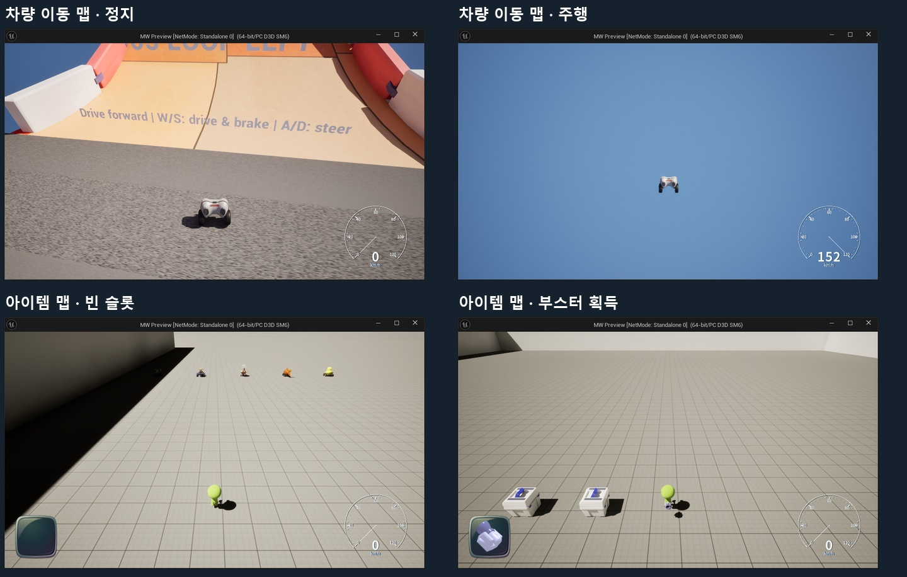
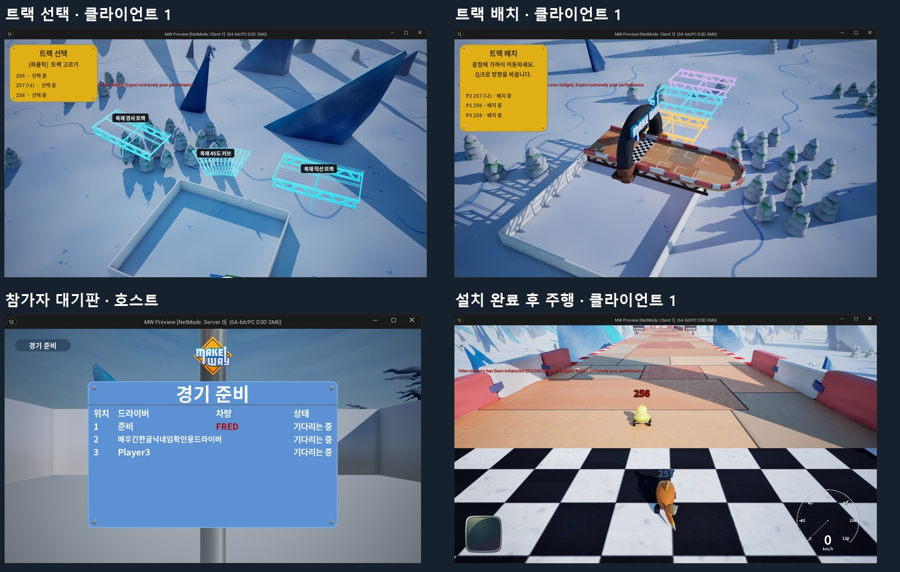

# 최신 main과 통합한 경기 HUD 검증

2026-11-19 · UE 5.8 Win64 Development · 작업 브랜치 `fix/track-ui-dpi-verification`. 통합 전 작업 커밋은 `5df3798`, 가져온 `origin/main`은 `03dc60b`, 공통 조상은 `5bf3308`이다.

**HUD 화면 검증과 에디터·게임 빌드는 통과했다. 차량 이동 자동화는 9개 중 8개 통과, 1개 실패다.** 실패한 `CollisionAndGround`는 별도 프로세스에서 단독 실행해도 같은 두 단언에서 실패했다.

## 충돌을 해결한 위치

| 파일 | 해결 방식 |
|---|---|
| `Source/MW/UI/Gameplay/MWGameplayHUDSubsystem.cpp` | 맵 패키지 이름을 조회하는 `OnWorldBeginPlay`에서 계기판·아이템 슬롯의 PIE 설정을 각각 계산한다. 이 결과로 경기 상태가 없는 개발 맵에서도 HUD를 부착한다. 기존 `MatchPanelsClass`, WBP에 연결한 슬롯·명단, 첫 화면 준비 조건인 `HasWaitingBoard` 경로를 유지했다. |
| `Source/MW/UI/Gameplay/MWRaceHUDWidget.h` | 맵별 모드 소유자는 서브시스템이다. 위젯에 별도 setter나 맵 상태 변수를 추가하지 않고 기존 위젯 선언을 유지했다. |
| `Source/MW/UI/Gameplay/MWRaceHUDWidget.cpp` | `NativeTick`이 `GetPIEPreview()`로 해당 월드의 모드를 읽는다. 로컬 차량에서 미리보기의 계기판 플래그 또는 실제 주행 단계가 활성화될 때 속도를 표시한다. 개발 맵에서는 단계 배지를 숨긴다. |
| `Config/DefaultGame.ini` · `[/Script/MW.MWGameplayHUDSubsystem]` | 차량 이동 맵 `/Game/Developers/user/L_VehicleMovement_Test.L_VehicleMovement_Test`를 `PIESpeedometerMaps`에만 추가했다. 기존 `L_Dev_Drive_ItemPickup`은 계기판·아이템 슬롯 두 목록에 있다. |
| `Source/MW/Tests/MWVehicleMovementTests.cpp` | Git의 3방향 병합으로 양쪽 테스트가 합쳐졌다. 최신 main 대비 추가된 것은 트랙 서브시스템 include와 `MW.Vehicle.CheckpointVelocity` 테스트다. 충돌·접지의 기존 단언과 차량 이동 구현은 main과 동일하다. |

세 HUD 소스는 통합 결과가 기존 작업 브랜치의 구현과 같다. main에서 추가한 차량 테스트 맵의 동작은 설정 한 줄로 보존했다. 맵, 차량, WBP 에셋은 이번 통합에서 편집하지 않았다.

## Cua Driver 실제 화면

| 실행 | 확인한 결과 |
|---|---|
| 차량 이동 테스트 맵 · 단독 PIE | 맵 기본 차량 `BP_MWVehiclePawn_Smiet_C`를 그대로 사용했다. 정지 화면은 0km/h였고 W 전진 입력을 유지하는 동안 계기판 숫자가 152km/h까지 갱신됐다. 슬롯·대기판·트랙 단계판·단계 배지는 모두 접힘이었다. 152는 이 실행에서 관측한 표시값이다. 차량 기본 최고속도 측정용 시험은 별개다. |
| 아이템 테스트 맵 · 단독 PIE | 실제 계기판과 빈 슬롯이 함께 표시됐다. 시험 스크립트로 Pawn을 기존 픽업 상자 위치로 옮겨 오버랩을 발생시켰다. 아이템 컴포넌트가 `BOOSTER`로 바뀌었고, 같은 슬롯에 부스터 아이콘이 표시됐다. |
| 일반 경기 · 3인 PIE | 로비·차량·트랙 선택 확정을 시험 스크립트로 진행했다. 세 월드가 트랙 선택 카메라를 첫 화면으로 공개했다. P1→P2→P3 순서로 Cua Driver에서 실제 스냅 지점을 가리켜 좌클릭 설치했다. 서버에 각각 조각 2·3·4가 기록됐고 세 월드 모두 `Racing`에 도달했다. 경기 화면에서 주행 계기판·아이템 슬롯과 참가자 이름표를 확인했다. |
| 경기 준비 대기판 · 별도 3인 PIE | 대기판이 사라지기 전 명단을 관찰할 수 있도록 이 실행에서만 건설 후보를 비우고 한 명만 차량 확정 후 경기 맵으로 이동했다. 호스트 창에서 `PreparingRace`와 Pawn 미소유를 확인했다. 대기판의 로고·세 명의 행·차량명·기다리는 상태 및 긴 한글 이름이 표시됐다. |

개발 맵은 각각 960×540 게임 뷰포트에서 확인했다. 일반 경기는 960×540, 1280×722, 1600×902의 리슨 서버·클라이언트 창에서 실행했다. Play, 설치 조작, 창별 원본 PNG 캡처에는 Cua Driver를 사용했다. 일부 경기 원본의 빨간 영문 줄은 에디터 비디오 메모리 경고다.

## 차량 자동화

`MWEditor Win64 Development`와 `MW Win64 Development`를 통합 소스로 빌드했다. 자동화는 새 에디터 프로세스에서 `-NullRHI`로 `Automation RunTests MW.Vehicle.`를 실행했다. GUI 확인은 렌더링이 켜진 별도 프로세스에서 수행했다.

| 결과 | 테스트 |
|---|---|
| 통과 (8) | `CheckpointVelocity`, `ConfigValidation`, `FrameRateAndReset`, `LocalControls`, `OverspeedRecovery`, `VehicleContact`, `WallBounce`, `WallGroundContact` |
| 실패 (1) | `CollisionAndGround` · 전체 실행과 단독 재실행에서 동일한 두 실패 |

`CollisionAndGround`는 접지한 상태에서 `Velocity = FVector(0, 0, 600)`을 직접 대입하고 0.1초 뒤의 접지 해제와 상승을 검사한다. 두 실행 모두 `Upward impulse releases ground`와 `Upward impulse is not erased`에서 실패했다. 이 두 실패는 main의 [차량 이동 검증 이력](VEHICLE_PAWN_LOCAL_MOVEMENT.md)에도 기록돼 있다. 프로덕션의 명시적 외력 API는 별도의 `ApplyExternalVelocityChange` 경로를 거친다. 이번에 실행한 테스트는 기존의 직접 대입 경로다. 실패 상태를 PR 리뷰에 그대로 전달한다.

## 다시 재현할 때 쓰는 로컬 에셋

| 에셋 | 이 실행의 SHA-256 |
|---|---|
| `Content/UI/Race/WBP_RaceHUD.uasset` | `8f239f6472de2cbf50b0a3fa353cf26269887b000d2d099b74445619ef675035` |
| `Content/UI/Race/WBP_MatchPanels.uasset` | `c760335644a94389bcbb98b60f0f6b928c44ad3a793eee3ddc5ab231b271a422` |
| `Content/Developers/user/L_VehicleMovement_Test.umap` | `a01bad3b5877b48d388618685d0723d363a693b684721d394de9bfb5c8983813` |
| `Content/Developers/user/L_Dev_Drive_ItemPickup.umap` | `ff5b0ec5798a2f9282596ab32992465b1147aad9a5975b5fe8ca822e82107cd4` |
