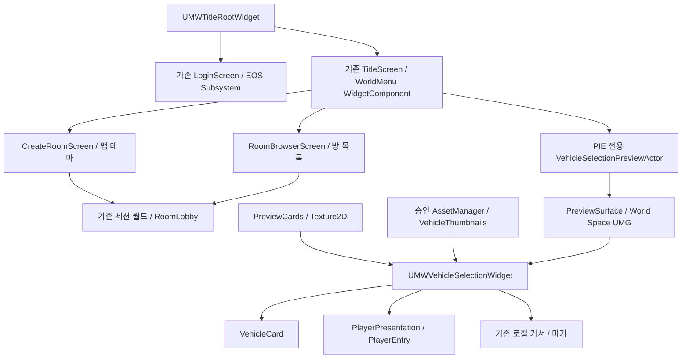

# ProjectMW UI 연동 진입점·소유권

버전 **UI-UCM-1.0**, 기준 2026-11-03T13:58:19+09:00. [입력 계약](PROJECTMW_UI_UCM_INTEGRATION_CONTRACT.md)과 [요구 CSV](PROJECTMW_UI_REQUIRED_ASSETS.csv)를 함께 읽는다. 아래는 현재 소스 함수이며 UCM이 직접 수정하라는 목록이 아니다.

## 1. 실제 연결도

현재 Preview는 기존 메뉴에서 열리는 개발 표시 경로다. UCM Visual BP→SceneCapture→RenderTarget→차량 이미지의 동작은 위 그래프에 없으며 구현돼 있다고 가정하지 않는다. 내부 WidgetComponent RT는 Surface의 UMG 렌더링용이다.

## 2. 함수별 입력/수명 진입점

| 기능 | 실제 소스 링크 | 책임과 주의 |
|---|---|---|
| 타이틀 생성·메뉴 | [NativeConstruct](C:/workspace/UE/ProjectMW/Source/MW/UI/MWTitleRootWidget.cpp:17) | 기존 로그인/메뉴 WBP·Subsystem Delegate·화면 생성 소유권 |
| 화면 전환 | [RefreshEntryScreen](C:/workspace/UE/ProjectMW/Source/MW/UI/MWTitleRootWidget.cpp:91) | 로그인/세션 상태·메뉴/방생성/방검색/PIE Preview 전환 |
| 월드 메뉴 연결 | [InitializeWorldMenu](C:/workspace/UE/ProjectMW/Source/MW/UI/MWTitleRootWidget.cpp:147) | WorldMenuActorClass의 단일 WidgetComponent에 기존 TitleScreen 연결 |
| 개발 Preview 진입 | [HandleVehiclePreviewRequested](C:/workspace/UE/ProjectMW/Source/MW/UI/MWTitleRootWidget.cpp:210) | PIE+로그인+세션 None; 현재 레벨의 유일 Preview Actor.OpenPreview |
| Preview 수명 시작 | [OpenPreview](C:/workspace/UE/ProjectMW/Source/MW/UI/MWVehicleSelectionPreviewActor.cpp:24) | PreviewWidgetClass 생성·PreviewSurface 연결·기존 ViewTarget/커서/입력 보관 |
| Preview 정리 | [ClosePreview](C:/workspace/UE/ProjectMW/Source/MW/UI/MWVehicleSelectionPreviewActor.cpp:50) | Widget 제거·Delegate 해제·충돌 끔·카메라/커서 복원; EndPlay에서도 호출 |
| 차량 목록 입력 | [RefreshVehicles](C:/workspace/UE/ProjectMW/Source/MW/UI/MWVehicleSelectionWidget.cpp:293) | PreviewCards 또는 AssetManager Definition + VehicleThumbnails 분기 |
| 기존 카드 해제 | [ClearCards](C:/workspace/UE/ProjectMW/Source/MW/UI/MWVehicleSelectionWidget.cpp:257) | 카드 Delegate·선택·배열·Panel 자식 해제. 모델 Actor 정리는 없음 |
| 카드 Preview 입력 | [SetPreview](C:/workspace/UE/ProjectMW/Source/MW/UI/MWVehicleCardWidget.cpp:78) | FText+Texture2D+가용성; 서버 GameplayTag는 EmptyTag |
| 카드 운영 입력 | [SetVehicle](C:/workspace/UE/ProjectMW/Source/MW/UI/MWVehicleCardWidget.cpp:69) | 승인 FGameplayTag+Definition+Thumbnail; Pawn을 생성하지 않음 |
| Hover 하단 그림 | [HandleCardHover](C:/workspace/UE/ProjectMW/Source/MW/UI/MWVehicleSelectionWidget.cpp:703) | Preview에서 같은 Thumbnail을 로컬 명패 SetPresentation으로 전달 |
| 클릭 임시/개발 선택 | [HandleCardChosen](C:/workspace/UE/ProjectMW/Source/MW/UI/MWVehicleSelectionWidget.cpp:677) | Preview는 즉시 로컬 완료·고정; 실제 서버 요청과 구분 |
| 운영 선택 의도 | [HandleConfirm](C:/workspace/UE/ProjectMW/Source/MW/UI/MWVehicleSelectionWidget.cpp:720) | OnSelectionRequested(FGameplayTag); 현재 Preview에서는 버튼 숨김 |
| 실패/요청 정리 | [FinishSelectionRequest](C:/workspace/UE/ProjectMW/Source/MW/UI/MWVehicleSelectionWidget.cpp:740) | pending 해제·오류·UI 갱신. 서버 승인/확정 API가 아님 |
| 선택 취소 | [CancelLocalSelection](C:/workspace/UE/ProjectMW/Source/MW/UI/MWVehicleSelectionWidget.cpp:748) | 개발 전원 완료 전 로컬 취소; 서버 확정 취소로 연결 금지 |
| 참가자 수신 | [RefreshPlayers](C:/workspace/UE/ProjectMW/Source/MW/UI/MWVehicleSelectionWidget.cpp:521) | 현 로컬 AMWGameState.OnLobbyChanged 초기 조회/구독·기존 구독 해제 |
| 참가자 표시 | [BuildLobbyParticipants](C:/workspace/UE/ProjectMW/Source/MW/UI/MWVehicleSelectionWidget.cpp:557) | 현 실제 경로는 이름/슬롯/로컬 여부만; 차량 서버 결과 수신 미구현 |
| 명패 입력 | [SetPresentation](C:/workspace/UE/ProjectMW/Source/MW/UI/MWVehiclePlayerEntryWidget.cpp:6) | Thumbnail/Name/State/PlayerTint 소비; 하단 상태판은 기존 Image_IdentityBadge 바인딩 |
| 카탈로그 조회 | [GetAssetIdsUnderRoot](C:/workspace/UE/ProjectMW/Source/MW/System/MWAssetManager.cpp:170) | 기존 ID/SoftPath 조회와 태그 문자열 정렬. 트랙 전용 UI API 아님 |
| 테마 목록 | [GetAvailableMapThemeIds](C:/workspace/UE/ProjectMW/Source/MW/System/MultiplayerSubSystem/MWMultiplayerSubsystem.cpp:418) | Asset.MapTheme 하위 중 유효 UWorld만 제공 |
| 테마 대상 검증 | [ResolveMapPackageName](C:/workspace/UE/ProjectMW/Source/MW/System/MultiplayerSubSystem/MWMultiplayerSubsystem.cpp:375) | BP 조각을 레벨 카탈로그로 받지 않음 |

NativeConstruct/NativeDestruct의 기존 구독·입력·커서 보관/복원과 AddUniqueDynamic/RemoveDynamic 짝을 유지한다. 데이터를 공급하려고 Widget 생성·Delegate·UI 상태를 별도로 복제하지 않는다.

## 3. 에디터에서 연결할 실제 데이터 위치

| 위치 | 현재 저장 값 / 허용되는 후속 입력 |
|---|---|
| /Game/UI/Lobby/WBP_TitleRoot_WorldDev | WorldMenuActorClass=BP_TitleWorldMenu_Dev, VehiclePreviewActorClass=BP_VehicleSelectionPreview_Dev, CreateRoomWidgetClass/RoomBrowserWidgetClass=각 WorldDev WBP |
| 위 Root의 LoginScreen/TitleScreen | WBP_Login_WorldDev / WBP_Title_WorldDev의 기존 인스턴스. UCM Root로 교체하지 않음 |
| /Game/UI/Lobby/VehicleSelection/BP_VehicleSelectionPreview_Dev | PreviewWidgetClass=WBP_VehicleSelection_Preview_C, PreviewSurface=World/1920×1080/hardware input. PreviewViewTarget은 기존 레벨 설정 |
| /Game/UI/Lobby/VehicleSelection/WBP_VehicleSelection_Preview | bPreviewOnly=true. PreviewCards5종 순서/Thumbnail·PreviewScenarios 유지. 새로운 운영 DataAsset을 만들지 않음 |
| /Game/UI/Lobby/VehicleSelection/WBP_VehicleSelection_Dev | bPreviewOnly=false, VehicleAssetRoot=Asset.Vehicle, VehicleThumbnails 현재 빈 Map. 서버 승인 Tag→Texture2D가 후속 운영 입력 |
| CardWidgetClass / PlayerEntryWidgetClass | 기존 WBP_VehicleCard_Dev_C / WBP_VehiclePlayerEntry_Dev_C 유지 |
| 하단 WBP_VehiclePlayerEntry_Dev | Image_Vehicle은 VehicleAspect ScaleToFit에 연결, 안전 영역228×188. Image_IdentityBadge는 색상 상태판이며 옛 이름 옆 점이 아님 |
| 마커 WBP_VehiclePlayerMarker_Dev | 원본 PointerBadge/Arrow와 기존 PlayerTint·소프트웨어 커서 연결 유지 |
| /Game/Data/DA_AssetData | 현재 입력3종+Asset.MapTheme.DevDefault→L_Dev_Default. 차량/트랙 정의0. StartupAssetData 경로 이동 금지 |

운영 썸네일 Map은 Definition의 내부 FName VehicleId가 아니라 카탈로그 FGameplayTag로 키를 잡는다. 새 데이터 필드가 있는 것처럼 `VisualClass`, `VehiclePreviewActorClass`를 **차량별** 수신 필드로 문서화하지 않는다. Root의 VehiclePreviewActorClass는 위젯 호스트 클래스다.

## 4. 변경/정리 시 지켜야 하는 기존 동작

- Hover는 Preview의 하단 그림만 바꾸며 카드의 Thumbnail을 재사용한다. 클릭은 Preview의 실제 참가자 항목·로컬 고정 표시를 갱신한다. UI 그림 교체는 서버 요청이 아니다.
- PreviewCards 순서를 보존해 기존 PreviewCardIndex 시나리오를 유지한다. RefreshVehicles는 운영 유효 Tag 선택을 복원하고 Preview는 기존 ActivePreview 인덱스를 재반영한다. 카드가 없어졌거나 unavailable이면 유효한 다른 차로 임의 확정하지 않는다.
- ClearCards/NativeDestruct/ClosePreview/EndPlay의 기존 정리 경로를 재사용한다. 현재3D 모델 인스턴스는 없으므로 모델 Destroy가 이미 구현돼 있다고 기록하지 않는다.
- 향후3D 도입 시 이전 actor/미완료 load/캡처 참조 정리의 소유자를 먼저 정한다. 가능한 기존 Preview 소유자 확장을 검토하되, 지금 필드·API·새 Actor/Manager를 추가하지 않는다.
- 실제 서버 확정은 PlayerState VehicleAssetID와 서버 Phase다. Preview bConfirmed, Ready, 카드 수, 색상 상태판만으로 운영 승인/전원 완료를 생성하지 않는다.

## 5. 트랙용 실제 진입점의 부재

현재 Source의 MWVehicleSelection*를 트랙 선택기로 확장하지 않는다. UI/Construction은 자리만 있고 실제 선택 WBP가 없으며, 로컬 Source에 TrackDefinition·TrackCatalog UI 소비 API가 없다. Input.SelectConstruction 태그는 입력 계약일 뿐 트랙 카탈로그 입력 함수가 아니다. 현재 Data/Catalogs/DA_TrackConstructionTestAssets 파일도 이 workspace에서는 존재하지 않았다. 과거 타인 잠금 기록을 로컬 구현으로 추정하지 않는다.

트랙 관련 후속 진입점은 **기존 UMWAssetManager의 generic 조회 아래 서버/건설/TA가 승인할 정의/Root와 실제 선택 UI**다. 지금 이름만 정해 새 Track DataAsset이나 화면을 만들지 않는다. MapTheme의 UWorld 검증을 우회해133개 Piece를 방 테마 옵션에 등록하지 않는다. 공급자133+1 source metadata는 기존 CSV를 참조하고 UI 노출·잠금·변형·진단 제외는 소유자가 정한다.

## 6. 다른 작업과의 충돌/수정 금지 경로

| 경로·범위 | 정본 소유자 / 이번 계약의 경계 |
|---|---|
| Source/MW/UI/MWTitleRootWidget.*, MWVehicleSelectionWidget.*, MWVehicleCardWidget.*, MWVehiclePlayerEntryWidget.*, MWVehiclePlayerMarkerWidget.*, MWVehicleSelectionPreviewActor.*, MWVehicleUITypes.h | 이 UI 채팅. 공급자는 경로/매핑만 반환하고 임의 리팩터링 금지 |
| Content/UI/Lobby/*WorldDev*, Content/UI/Lobby/VehicleSelection/WBP_* 및 BP_VehicleSelectionPreview_Dev | UI 담당자. BP 변수명/Widget Tree/순서/커서/디자인 유지 |
| Content/UI/Common, 공유 Material/Texture | UI·아트 소유권 조율. 같은 이름/SHA로 자동 덮어쓰지 않음 |
| Content/Levels/L_Title.umap, WBP_RoomLobby 및 기존 공용 로비 | 공식/팀 공유 파일. 기존 연결 보존 |
| L_Title_WorldUI_Dev, L_VehicleSelection_UI_Dev의 카메라·배경·충돌 설정 | UI/별도 타이틀 담당 범위. UCM 장면 전체 덮어쓰기 금지 |
| Source/MW/System·Player의 GameMode/GameState/PlayerState/Controller, MultiplayerSubSystem 및 서버 브랜치의 MWConnection/HUD | 서버/EOS 담당자. 로컬 구 클래스와 서버 Lobby/Gameplay 분리를 혼동하지 않음 |
| MWVehicleDefinitionData/DriveData, Gameplay/Vehicle의 Character/Movement, 차량 Pawn/BP | 차량 데이터/주행 담당자. UCM Visual을 Pawn으로 등록하지 않음 |
| C:/Users/user/Documents/Codex/UCM_MasterLibrary | UCM 담당자. 이 UI 작업은 읽기 전용; Master/검증 에셋 수정 금지 |

Git의 기존 미커밋 목록은 TitleRoot·방생성/검색/로비·uproject/Editor target과 untracked 차량 UI/Editor 소스를 포함한다. 이것을 새 공급자 변경으로 흡수하거나 stage/reset하지 않는다. 본 작업은 문서3개와 Master 링크만 갱신한다.

## 7. 소비자가 기다리는 항목

1. UCM 담당자가 요구 CSV의 키에 기존139행 매핑을 조인하고, 차량5종의 정확한 SourceRef/Blueprint·deps·권리/검증 범위를 회신한다. 미매핑3개는 미확정 유지.
2. 새 Texture2D가 필요한지 현재 썸네일 유지로 충분한지 UI 담당자가 결정한다. 기존 아이콘은 이미 표시되므로 BP 이식을 선행 조건으로 만들지 않는다.
3. 운영 통합은 최신 서버 API와 Definition/DriveData/Pawn 생성 책임이 정리된 후 한다. 서버를 UI 계약에 맞추는 변경은 요구하지 않는다.
4. 3D/트랙의 새 필드·소유권은 별도 승인된 구현 단계에서 정한다. 이번 명세를 구현 완료나 상호 승인 완료로 확대하지 않는다.

## 8. 이번에 실제로 확인한 것

소스·로컬 branch blob, CDO5종,12개 WBP의 저장 리소스 참조, 실제 PreviewSurface와 내부 RT, AssetRegistry0/0, 기존 카탈로그4항목, UCM BP5개 파일/해시 및 공급 CSV를 읽었다. 숨긴 legacy Widget의 참조도 목록에 포함될 수 있어 CSV에서 template reference로 구분했다. 새 PIE 실행/입력·빌드·Cook·UCM load/compile/spawn·에셋 마이그레이션은 하지 않았다. 기존 실행 중 UI와 미저장 상태는 보존했다.

근거 JSON: `C:/Users/user/Documents/Codex/2026-10-27/make-way-ue-0-make-way-2/work/ui-ucm-contract/current-ui-audit.json`, `data-render-audit.json`, `before-sha256.json`. 공급자 기존 문서와 비교 가능한 스냅샷이며 미래 변경 후에는 다시 확인한다.
