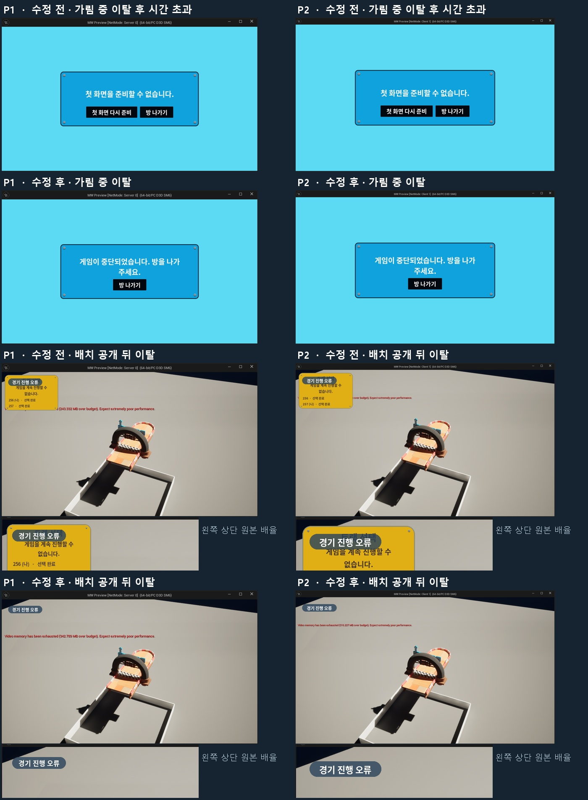

# 트랙 건설 중 참가자 이탈 시 중단 안내 검증

2026-11-19 · UE 5.8 Win64 Development · 리슨 서버 P1, 클라이언트 P2·P3. 같은 배치 세션에서 P3의 접속을 끊고 남은 두 창을 비교했다.

| 이탈 시점 | 수정 전 P1·P2 | 수정 후 P1·P2 |
|---|---|---|
| 목적지의 첫 화면이 아직 가려져 있을 때 | 로딩이 계속되다 서버 중단 후 각각 약 27~28초 뒤 일반 오류와 재시도 버튼이 나타났다. | ‘게임이 중단되었습니다. 방을 나가 주세요.’와 방 나가기 버튼 하나가 나타났다. |
| 트랙 배치 화면이 이미 보일 때 | 노란 트랙판과 어두운 ‘경기 진행 오류’ 배지가 왼쪽 상단에서 겹쳤다. | 두 창에 ‘경기 진행 오류’ 배지가 하나씩 남았다. 종료된 트랙판과 참가자 배치 목록은 사라졌다. |

## 원인과 수정 위치

| 위치 | 변경 내용 |
|---|---|
| `Source/MW/Player/MWGameplayPlayerController.cpp` · `ApplyGameplayInputMode` | 기존 로직은 배치에서 실패 단계로 바뀌면 트랙판을 제거한 직후 실패 단계용으로 다시 만들었다. 트랙판의 수명을 트랙 선택과 배치 단계로 한정했다. 이미 공개된 화면에서는 게임·UI 입력과 마우스 커서를 유지한다. 로딩 중에는 복구창이 입력 포커스를 관리한다. |
| `Source/MW/UI/Gameplay/MWArrivalScreen.cpp` · `Tick` | 목적지 월드·컨트롤러와 방 설정이 확인된 뒤 복제된 단계가 `Failed`이면 해당 틱에서 중단 메시지를 표시한다. 기존 로딩 시간 제한은 복구 가능한 첫 화면 준비 실패에 계속 적용된다. |
| `Source/MW/UI/Gameplay/MWArrivalScreen.{h,cpp}` · `ShowFailure` | 기존 복구 패널에 메시지와 재시도 가능 여부를 전달한다. 서버가 끝낸 경기는 기존 방 나가기 동작만 제공한다. |
| `Source/MW/UI/Gameplay/MWRaceHUDWidget.cpp` · `UpdatePhase`, `WBP_RaceHUD` | 공개된 경기의 실패 단계 표시는 기존 HUD의 `PhaseLabels`와 `Panel_Phase`가 소유한다. 이번 수정은 이 경로를 그대로 사용한다. 글꼴·배지 스타일·버튼 배치를 C++에 추가하지 않았다. |

## 재현과 판정 근거

1. Cua Driver로 PIE를 시작하고 세 게임 뷰포트를 960×540, 1280×722, 1600×902로 맞췄다. 세 크기에 대응하는 UMG DPI는 각각 0.499500, 0.667856, 0.834856이다. Windows 모니터 배율은 그대로였다.
2. 이탈 시점을 재현하기 위해 시험 스크립트로 로비 준비·차량 확정·트랙 선택을 진행하고 P3에 `disconnect`를 보냈다. 공개 뒤 이탈 시험은 세 월드에서 트랙 선택 첫 화면 공개 로그가 나온 다음 배치판이 실제로 보일 때까지 기다렸다. 선택·설치 조작 자체의 검증은 별도 실행에서 세 명 모두 Cua Driver로 직접 진행했다.
3. 화면을 가린 채 이탈한 수정 전 실행(PID 1788)에서 서버 중단 시각은 로그 기준 05:12:32.027이었다. 일반 오류는 05:12:59.499, 05:13:00.347에 기록됐다. 가림 경로를 수정한 실행(PID 35708)은 서버 중단 05:17:56.692 뒤 70·71ms에 두 복구창을 표시했다. 이 수치는 서버 로그와 각 창의 복구 처리 로그 사이의 경과 시간이다.
4. 배치 공개 뒤 이탈한 수정 전 실행(PID 35948)에서는 05:20:03.094에 서버가 경기를 중단한 뒤에도 남은 두 창에 트랙 위젯이 있었다. 최종 실행(PID 13108)에서는 서버 중단 05:25:17.151 이후 남은 두 월드 모두 `Failed`, 배치 세션 `bIsOpen=False`였다. 각 로컬 컨트롤러가 소유한 뷰포트의 트랙 위젯 수는 0이었다. Cua Driver 캡처 두 장에서 기존 경기 HUD의 오류 배지 하나씩을 확인했다.
5. 최종 빌드에서 가림 중 이탈도 다시 실행했다(PID 5332). 서버 중단 05:26:45.365 뒤 68·69ms에 두 복구 처리 로그가 남았고, Cua Driver로 남은 두 창 모두 중단 문구와 ‘방 나가기’ 하나만 표시하는 것을 확인했다.
6. 최종 소스로 `MWEditor Win64 Development`와 `MW Win64 Development` 빌드가 모두 성공했다. 에디터 일부 화면에 보이는 빨간 줄은 비디오 메모리 경고다. 원본 캡처에도 그대로 남겼다.

일반 조작에서 설치 확정 전 스냅을 풀면 끝점 접근 안내로 돌아온다. 우클릭에 트랙 설치 취소 명령은 바인딩되어 있지 않다. 위 중단 시험은 경기 시작 참가자가 떠났을 때 서버가 건설을 종료하는 경로를 다뤘다.

선택·커서 검증 커밋은 `f3b0fad`, 배치·설치 검증 커밋은 `f8f663c`다. [선택 검증](TRACK_SELECTION_MIXED_DPI.md) · [배치 검증](TRACK_PLACEMENT_CURSOR_VERIFICATION.md)
