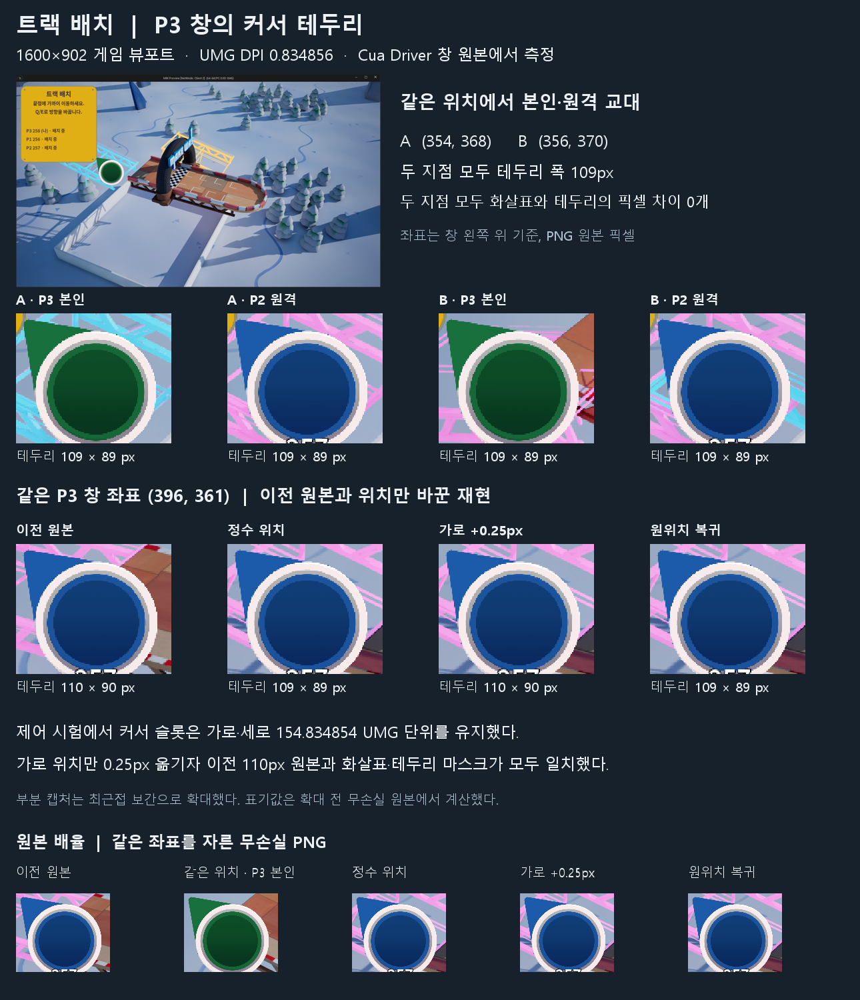

# P3 배치 화면에서 P2 커서가 110px로 보인 이유

2026-11-19 · UE 5.8 Win64 Development · 검증 대상 `ac44e93` · Cua Driver 3인 PIE

P3 창에서 P2의 파란 커서와 P3의 초록 커서를 같은 위치에 번갈아 놓았다. 정지 위치 두 곳에서 두 커서의 테두리 폭은 모두 **109px**였다. 기존 스냅 캡처의 **110px**도 실제로 그려진 폭이었다. 같은 마커를 가로로 0.25px 옮기는 시험에서 이전 원본의 화살표와 테두리를 픽셀 단위로 그대로 재현했다. 이 결과에 따라 게임의 커서 크기와 위치 보간은 유지했다.

## 실행 환경과 측정 기준

- 리슨 서버 P1과 클라이언트 P2·P3을 한 프로세스의 독립 PIE 창으로 실행했다. 게임 뷰포트와 UMG DPI는 각각 960×540 / 0.499500, 1280×722 / 0.667856, 1600×902 / 0.834856이었다. Windows 모니터 배율은 유지했다.
- 첫 실행(PID 11916)에서는 로비 준비와 차량·트랙 확정으로 배치 단계에 진입한 뒤 Cua Driver로 P2와 P3 창을 번갈아 활성화해 커서를 옮겼다. 캡처는 모두 P3 창의 원본 해상도 PNG를 사용했다. 좌표는 제목 표시줄을 포함한 그 PNG의 왼쪽 위를 원점으로 한다.
- 같은 위치의 판정 기준은 화살표 단색 영역의 왼쪽·위쪽 경계 좌표다. P2 화살표 RGB는 (28, 91, 170), P3은 (24, 113, 61)이다. 이전 측정값과 비교할 수 있도록 배지의 밝은 테두리에서 RGB (247, 235, 236)인 픽셀들의 가로 범위를 쟀다. 109·110px는 이 테두리의 폭이다.
- ‘픽셀 차이 0’은 두 PNG에서 화살표의 단색 영역을 같은 마스크 값으로 만들고 테두리 마스크도 따로 만들어 대조한 결과다. 닉네임, 번호, 배경은 측정에서 제외했다.

## 실제 커서를 교대한 결과

| P3 창에서 관측한 위치 | P3 본인 테두리 | P2 원격 테두리 | 같은 좌표에서의 대조 |
|---|---:|---:|---|
| A (354, 368) | 109×89px | 109×89px | 화살표·테두리 마스크 차이 각각 0픽셀 |
| B (356, 370) | 109×89px | 109×89px | 화살표·테두리 마스크 차이 각각 0픽셀 |
| 이전 스냅 캡처의 위치 (396, 361) | 109×89px | 이번 일반 입력 직후 109×90px, 기존 캡처 110×90px | 정수 좌표가 같아도 가장자리에 채워진 픽셀은 달라질 수 있었다. |

## 위치만 바꿔 이전 원본 재현

두 번째 실행(PID 32860)에서 P2가 조작하는 실제 원격 마커를 사용했다. 시험 스크립트는 P3의 마커를 그리는 `ScaleBox`에 일시적으로 렌더 위치 이동만 적용했다. P2 입력, DPI, 캔버스 슬롯 크기와 정렬은 고정했다. 원본과 같은 세로 위치에 맞추기 위한 −1px를 세 표본에 공통으로 적용했다. Cua Driver로 세 상태를 각각 캡처한 뒤 시험값을 제거했다.

| 같은 화살표 좌표 (396, 361) | 가로 이동 | 슬롯 크기(UMG 단위) | 테두리 폭×높이 | 테두리 픽셀 수 |
|---|---:|---:|---:|---:|
| 기준 | 0px | 154.834854 × 154.834854 | 109×89px | 1,255 |
| 가로 위치만 변경 | +0.25px | 154.834854 × 154.834854 | 110×90px | 1,280 |
| 원위치 복귀 | 0px | 154.834854 × 154.834854 | 109×89px | 1,255 |
| 이전 `snap2_0_p3.png` | 당시 소수 위치 미기록 | 당시 슬롯 실측 없음 | 110×90px | 1,280 |

+0.25px 표본과 이전 원본의 파란 화살표·밝은 테두리 마스크는 **같은 화면 좌표에서 차이 0픽셀**이었다. 기준 표본과 원위치 표본도 두 마스크가 일치했다. 이전 프레임의 정확한 소수 좌표는 기록되지 않았으므로 +0.25px는 같은 결과를 재현한 값이다.

그림 맨 아래에는 다섯 원본의 동일 영역을 원본 배율로 실었다. 원본의 자른 영역은 (389, 355)부터 (530, 473) 직전까지다. 비교 PNG에서 각 영역의 시작점은 (24, 1340), (276, 1340), (528, 1340), (780, 1340), (1032, 1340)이다. 첫 번째와 네 번째의 단색 마스크를 직접 대조할 수 있다.

## 실제 코드 경로

| 소유 위치 | 확인한 동작 |
|---|---|
| `Source/MW/UI/Cursor/MWRemoteCursorOverlay.h` · `PointerDisplaySize` | 공용 크기 설정은 154.834854 UMG 단위다. P3의 DPI를 곱한 한 변은 129.264738px다. 배지 테두리는 이 사각형 안쪽에 그려진다. |
| `Plugins/MWUCMFrontend/Source/MWUCMFrontend/Private/MWUCMTitleFlow.cpp` · `InstallFrontendCursor`, `Source/MW/UI/Cursor/MWPointerCursor.h` | 본인 소프트웨어 커서는 공용 크기에 해당 뷰포트의 DPI를 곱한 크기로 같은 마커 WBP를 그린다. |
| `Source/MW/UI/MWTrackSelectionWidget.cpp` · `NativeTick` | P2의 월드 지점을 P3 뷰포트의 위젯 좌표로 투영한다. 기존 마커 WBP와 공용 표시 크기를 원격 오버레이에 넘긴다. |
| `Source/MW/UI/Cursor/MWRemoteCursorOverlay.cpp` · `PresentCursor` | `SetSize(Layout.DisplaySize)`로 크기를 적용하고 `FMath::Vector2DInterpTo`로 위치를 보간한 뒤 `SetPosition`을 호출한다. 일반 입력으로 P2를 움직인 대조 시험에서 P3의 슬롯 위치는 (705.7161, 482.0565), (817.6836, 537.2110) 등 픽셀 사이를 지났다. 68개 기록에서 가로·세로 슬롯 크기는 모두 같았다. |

위치가 픽셀 사이에 걸치면 테두리색과 정확히 같은 픽셀이 한 열 더 생길 수 있다. 본인·원격의 표시 크기 계산을 바꾸거나 배치 단계에 별도 크기 보정을 추가할 근거는 발견되지 않았다. 이번 커밋의 변경 범위는 검증 문서와 캡처다.

[앞선 트랙 배치 검증](TRACK_PLACEMENT_CURSOR_VERIFICATION.md)
