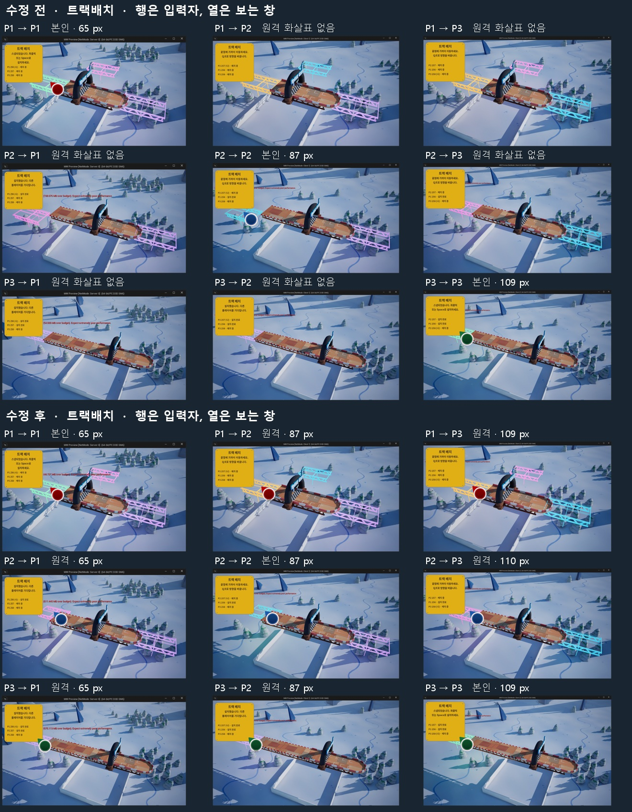
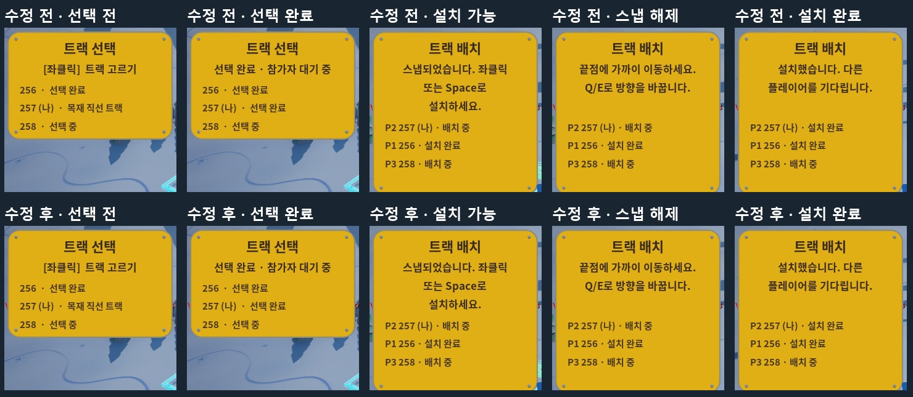

# 트랙 배치의 원격 커서와 설치 안내

2026-11-19 · UE 5.8 Win64 · Cua Driver · 수정 전 PIE PID 11824, 수정 후 PID 7716. 크기가 다른 리슨 서버 및 두 클라이언트에서 같은 목재 직선을 선택하고 한 명씩 스냅, 스냅 해제, 재스냅, 좌클릭 설치를 진행했다.

## 원격 커서

수정 전에는 입력 창에만 참가자 화살표가 있었다. 수신 창에는 트랙 고스트가 보였지만 화살표가 없었다. `ShowPlacementStatus`가 원격 커서의 부모 캔버스를 접고, 선택 종료 뒤에는 배치 포인터를 전송할 경로도 없었다.

| 보는 창 | 본인 테두리 | P1을 볼 때 | P2를 볼 때 | P3를 볼 때 |
|---|---:|---:|---:|---:|
| P1 · 960×540 · UMG DPI 0.499500 | 65 px | 65 | 65 | 65 |
| P2 · 1280×722 · UMG DPI 0.667856 | 87 px | 87 | 87 | 87 |
| P3 · 1600×902 · UMG DPI 0.834856 | 109 px | 109 | 110 | 109 |

화살표 단색 RGB는 각각 (185, 0, 0), (28, 91, 170), (24, 113, 61)로 세 창에서 동일했다. 테두리 색과 정확히 일치한 픽셀을 측정했다. P3가 P2를 본 스냅 표본에서는 110px, 같은 송수신 창의 스냅 해제 표본에서는 109px였다. 표시 논리 크기는 같은 154.834854이고 관측된 최대 차이는 한 픽셀이다. 작은 창에서 이전 차량 문서와 폭 수치를 비교할 때는 색 마스크의 판정법도 함께 봐야 한다.

동일 위치에서 다시 측정한 결과, P3의 본인 커서와 P2 원격 커서는 정지 상태에서 모두 109px였다. 가로 위치만 0.25px 이동한 시험에서 같은 슬롯 크기로 이전 110px 원본의 테두리와 화살표 픽셀을 재현했다. [동일 위치 비교와 원인 검증](TRACK_PLACEMENT_CURSOR_RASTER.md)

## 고친 곳

| 파일 | 동작과 소유자 |
|---|---|
| `Source/MW/UI/MWTrackSelectionWidget.cpp` | 배치 시작 시 후보 이름표만 숨긴다. 배치 포인터를 송신하고, 수신한 참가자별 월드 지점을 각 창의 화면 좌표로 투영해 기존 원격 오버레이에 표시한다. |
| `Source/MW/UI/Cursor/MWCursorProjection.{h,cpp}`, `Gameplay/Construction/MWTrackSelectionBoard.cpp` | 선택판의 실제 포인터 광선과 평면 교차 계산을 공용 함수로 옮겼다. 배치에서는 현재 세션의 BuildOrigin 높이를 쓴다. 포커스와 커서 가시성, 화면 범위, 역투영 결과를 확인한다. 스냅에 의해 바뀌는 고스트 중심과 포인터 끝은 별개다. |
| `Source/MW/Player/Cursor/MWSharedCursorTypes.h`, `Gameplay/Construction/MWTrackConstructionPlacement.cpp` | 서버가 실제 배치 참가자에게 TrackPlacement 월드 좌표 스트림을 열고 설치 완료·이탈·배치 취소 때 닫는다. 기존 소유자 검사·전송 빈도 제한·숨김 만료를 재사용한다. 확정된 참가자의 원격 배치 화살표는 그 참가자의 고스트와 함께 사라진다. |
| `Source/MW/Gameplay/Construction/MWTrackPlacementViewComponent.cpp` | 스냅된 위치에서 설치를 요청하면 기존 안내를 유지하다가 승인 결과로 교체한다. 요청 잠금, 코스 변경·거절 문구, 확정 직전 광선 재검사와 서버 설치 판정은 기존 처리 경로에서 수행한다. |

본인과 원격의 화살표 모양·핫스폿은 기존 마커 WBP, 크기는 기존 오버레이 설정, 색은 방 멤버 팔레트가 소유한다. 이번 작업은 C++ 소스와 검증 문서·캡처를 변경했다.

## 설치와 안내

수정 후 서버에 P1→조각 2(접속 1/0), P2→조각 3(2/1), P3→조각 4(3/0)가 각각 기록됐다. 세 명 모두 동일 시험에서 직접 설치했다. 앞선 참가자들은 설치 완료·대기 안내를 받았고 마지막 설치로 세션이 닫혔다. 스냅 지점에서 벗어나면 ‘끝점에 가까이 이동하세요’로 돌아왔고, 다시 들어가면 설치 안내가 나타났다. 기존 입력은 좌클릭 또는 Space로 설치, Q/E로 방향 전환이다. 우클릭은 설치한 조각을 되돌리는 명령에 바인딩되어 있지 않다.

각 실행에서 입력 직후 캡처 중 제목·상태·참가자 글씨 영역을 식별할 수 있었던 14장을 측정했다. 세 문구 영역의 정확한 글자색을 원본 PNG에서 찾아 비교한 결과 제목과 상태 사이에는 최소 13px, 상태와 참가자 사이에는 최소 12px가 비어 있었다. 선택·설치·스냅 해제 캡처에서 이전 획과 다음 획의 겹침은 보이지 않았다. 연속하는 모든 게임 프레임을 캡처한 결과는 아니다. 일부 창에는 에디터의 비디오 메모리 경고가 출력됐다. 그림과 측정에는 게임 안내판 내부를 사용했다.

원본 ZIP에는 입력 직후와 세 창 PNG, 글자 영역 간격, 복제된 선택·설치 상태, 서버 설치 로그가 있다. 스냅 해제는 설치 확정 전 검증이며, 참가자 이탈에 따른 서버 건설 취소와 구분한다.
