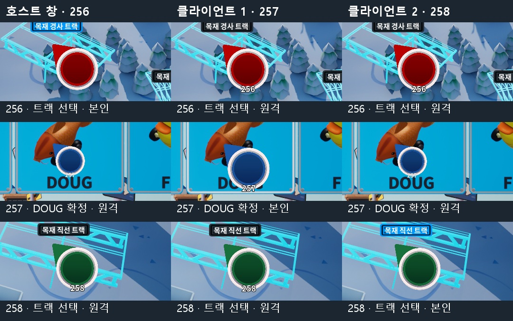

# 트랙 선택의 원격 참가자 커서

## 원인과 편집 위치

트랙 선택 화면의 `UMWTrackSelectionWidget::NativeTick`가 매 참가자마다 텍스트 위젯을 만들어 `+ P번호 닉네임`을 표시했다. 기존 차량·로비의 포인터 클래스와 핫스폿을 사용하지 않아 트랙 선택에서만 모양이 달랐다.

| 파일 | 바뀐 내용 |
|---|---|
| `Config/DefaultGame.ini`, `Source/MW/UI/Cursor/MWRemoteCursorOverlay.h` | 공용 포인터 클래스 설정을 `[/Script/MW.MWRemoteCursorOverlay]`로 옮겼다. 프로젝트의 `WBP_VehiclePlayerMarker_Dev`와 표시 크기를 프런트엔드 및 트랙 선택이 함께 읽는다. 포인터 끝은 해당 WBP의 핫스폿 속성에서 편집한다. |
| `Plugins/MWUCMFrontend/Source/MWUCMFrontend/{Public/MWUCMTitleFlow.h,Private/MWUCMTitleFlow.cpp}` | 프런트엔드 커서 설치 시 공용 설정의 클래스·표시 크기를 읽는다. |
| `Source/MW/UI/MWTrackSelectionWidget.{h,cpp}` | 원격 플레이어의 복제된 월드 위치를 수신자 뷰포트의 위젯 좌표로 투영한다. 공용 오버레이가 마커를 참가자별로 재사용하며 화살표 끝을 해당 위치에 맞춘다. 마커에 멤버 팔레트 색·번호·닉네임·확정 상태를 전달한다. 자기 자신, 비활성 참가자, 다른 세션·리비전, 비가시 커서는 그리지 않는다. 배치 단계에 들어가면 해당 레이어를 숨긴다. |
| `Content/UI/Lobby/VehicleSelection/WBP_VehiclePlayerMarker_Dev.uasset` | 기존 화살표·원형 배지·닉네임 위젯을 그대로 불러온다. 트랙 전용 커서 에셋을 추가할 필요가 없다. |

## 3인 PIE 관찰

- PID 8600, Client 1에서 Cua Driver로 우측 직선 후보에 포인터를 옮겼을 때 해당 후보가 강조됐다. Client 2의 복제 상태에 Member 2가 표시됐고, 수신 창의 소유 Controller에 연결된 `WBP_VehiclePlayerMarker_Dev_C`가 생성됐다.
- PID 12364의 별도 3인 PIE에서 Client 1을 Cua Driver로 캡처했다. 왼쪽 후보 위에 다른 참가자 258의 녹색 화살표·원형 배지와 닉네임이 보였다. Client 1의 명단에서 257이 ‘나’이며 258은 다른 참가자다. 배치로 넘어간 PID 8600의 같은 경로에서는 선택 커서가 숨고 설치 고스트가 표시됐다.

## 2026-11-19 본인 창과 수신 창 색 일치

이전 실행에서 Member 3의 포인터가 본인 트랙 선택 창에서는 빨간색, 다른 창에서는 초록색이었다. 원격 마커는 `GetColorForMember(MemberId)`를 읽었지만, 차량 선택이 끝나고 복원된 프런트엔드 소프트웨어 커서는 설치 시 지정한 고정 빨간색을 계속 사용했다.

- `Plugins/MWUCMFrontend/Source/MWUCMFrontend/Private/MWUCMTitleFlow.cpp`의 `InstallFrontendCursor`와 `RefreshFrontendCursorColor`가 해당 게임 인스턴스의 로컬 Controller·PlayerState에서 방 MemberId를 읽는다. 입장 전 기본 메뉴 커서 색을 유지하고 유효한 ID가 생기면 공용 팔레트 색을 적용한다. 기존 게임 인스턴스 틱에서 ID 변경을 확인해 첫 복제·맵 이동·재입장에서도 갱신한다.
- `Plugins/MWUCMFrontend/Source/MWUCMFrontend/Public/MWUCMTitleFlow.h`의 `CursorMemberId`가 마지막 적용 값을 보관한다. 같은 ID로 매 프레임 위젯 색을 다시 설정하지 않는다.
- 실제 참가자 색의 편집 위치는 `Config/DefaultGame.ini`의 `[/Script/MW.MWParticipantPalette]`이다. 차량 선택의 로컬·원격 마커, 트랙 선택의 로컬·원격 마커가 모두 같은 멤버 ID 기준을 사용한다.

### 3인 PIE 결과

PID 13364의 같은 세 창에서 플레이어마다 차례로 Cua Driver로 카드를 가리키고 좌클릭했다. 차량을 모두 확정한 뒤 트랙 선택에서도 같은 세 플레이어가 차례로 후보를 가리켰다. 입력 창 한 개와 수신 창 두 개의 위젯에서 배지의 선형 RGBA를 읽어 비교했다. 아래 수치는 소수 여섯 자리로 표시했으며 원본 값으로도 일치했다.

| 방 멤버 · 닉네임 | 팔레트 선형 RGBA | 차량 선택 본인·수신 2창 | 트랙 선택 본인·수신 2창 |
|---|---|---|---|
| 1 · 256 | (0.485150, 0, 0, 1) | 모두 빨강 | 모두 빨강 |
| 2 · 257 | (0.011612, 0.104616, 0.401978, 1) | 모두 파랑 | 모두 파랑 |
| 3 · 258 | (0.009134, 0.165132, 0.046665, 1) | 모두 초록 | 모두 초록 |

아래 각 행은 같은 참가자의 포인터를 호스트, Client 1, Client 2가 각각 본 실제 캡처다. 가운데 행은 차량 선택 원격 배율이 0.70이었던 시점의 캡처다. [크기 수정 후 세 창 비교](VEHICLE_SELECTION_AUTHORING.md#차량-선택-커서-크기와-화살표-끝--3인-pie)에서 후속 측정값을 확인할 수 있다. 색 실측은 크기·명암이 있는 그림을 화면에서 추정하는 대신 실제 마커의 색 속성을 비교했다. UE 5.8 Win64 Development의 `MWEditor` 및 `MW` 빌드가 모두 통과했다.

