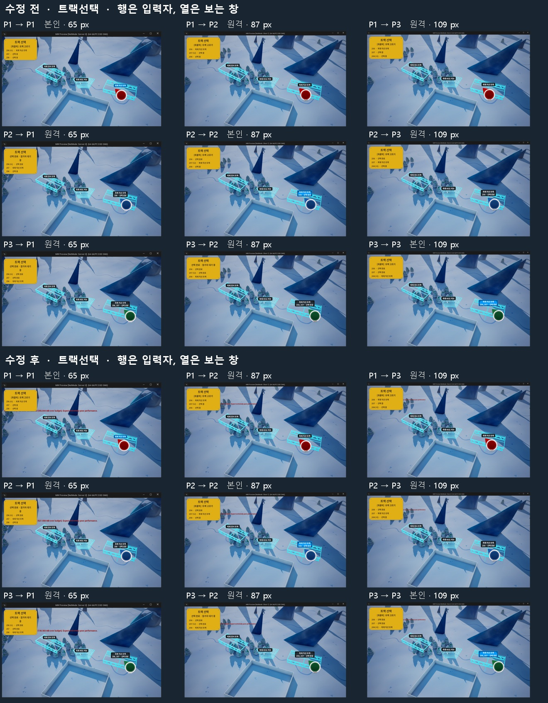

# 트랙 선택 커서와 확정 안내 검증

2026-11-19 · UE 5.8 Win64 Development · 리슨 서버 한 명과 클라이언트 두 명, 독립 PIE 창 세 개. 수정 전 PID 11824, 수정 후 PID 7716. 차량 확정과 로비 준비는 시험 스크립트로 마쳤고, 트랙에서는 Cua Driver로 각 창을 전면에 놓고 실제 월드 후보를 가리킨 후 좌클릭했다.

| 보는 창 | 게임 뷰포트 | UMG DPI | P1 빨강 | P2 파랑 | P3 초록 |
|---|---:|---:|---:|---:|---:|
| P1 호스트 | 960×540 | 0.499500 | 65 px | 65 px | 65 px |
| P2 클라이언트 1 | 1280×722 | 0.667856 | 87 px | 87 px | 87 px |
| P3 클라이언트 2 | 1600×902 | 0.834856 | 109 px | 109 px | 109 px |

창마다 대각선 항목이 본인 기준이다. 수정 전후의 아홉 측정값이 같았다. 원본 PNG에서 배지의 밝은 테두리 색과 정확히 같은 RGB 픽셀의 가로 폭을 쟀다. 화살표 단색 면은 입력자와 두 수신자 모두 P1 (185, 0, 0), P2 (28, 91, 170), P3 (24, 113, 61)이었다. 모니터의 Windows 배율은 유지하고 게임 창의 실제 뷰포트와 UMG DPI를 달리했다.

### 선택과 문구 교체

세 명이 차례로 오른쪽 ‘목재 직선 트랙’을 가리키고 좌클릭했다. 호스트와 두 클라이언트 모두 선택 ID 1을 확정한 뒤 배치로 이동했다. 앞선 두 사람에게 ‘선택 완료 · 참가자 대기 중’이 표시됐고 마지막 참가자가 선택하면 다음 단계로 넘어갔다. 우클릭은 이 화면의 선택 취소 입력에 연결되어 있지 않다.

`Source/MW/UI/MWTrackSelectionWidget.cpp`의 `Refresh`에서 응답 대기 중 상태판을 ‘선택 확인 중…’으로 다시 쓰던 한 줄을 제거했다. 기존 `bRequestPending`이 중복 요청을 막고, 승인이나 거절 응답은 기존 `HandleSelectionReply`에서 표시한다. 같은 위치의 `Text_SessionStatus`가 새 문구를 받는다. 수집한 캡처에서 이전 글자와 새 글자가 겹치는 잔상은 재현되지 않았다. 전환 PNG는 모든 렌더 프레임을 기록한 동영상이 아니다.

### 실제 편집 위치

- 운영 본인 커서는 `MWUCMTitleFlow.cpp`의 `InstallFrontendCursor`와 `RefreshFrontendCursorColor`가 관리한다. 원격은 `MWTrackSelectionWidget.cpp`의 `NativeTick`에서 같은 마커 클래스·논리 크기·핫스폿을 사용하고 방 멤버 팔레트를 적용한다.
- 마커 외형은 `WBP_VehiclePlayerMarker_Dev`, 클래스와 표시 크기는 `MWRemoteCursorOverlay` 설정, 상태판의 글꼴과 슬롯은 `WBP_TrackSelectionTest`에서 편집한다. 선택 서버 판정과 후보 히트 처리는 기존 경로를 사용했다.
- 이번 선택 작업에서 고친 곳은 상태판의 C++ 문구 선택이다. 프로젝트 WBP, 팔레트, 커서 배율 및 기존 출발 보고에 대한 변경은 없다. 비교 JPG와 별도로 원본 ZIP에 세 창 PNG, 멤버별 서버 선택 상태, 측정 코드와 좌표를 보관했다.
