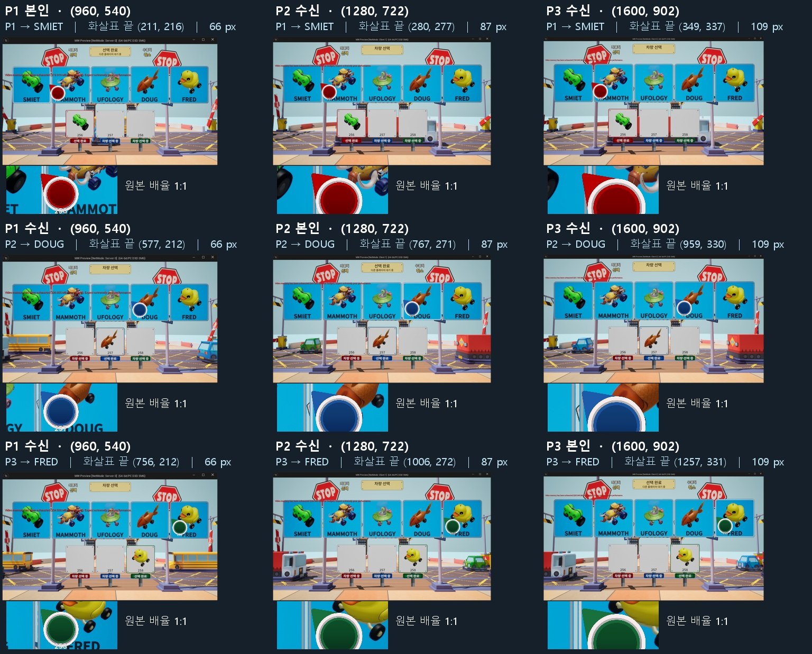

# 차량 선택 커서의 혼합 DPI 검증

2026-11-19 · `fix/post-merge-gameplay` · 실행 코드 `7507a2e` · UE 5.8 Win64, D3D12, 단일 프로세스 3인 리슨 서버 PIE (PID 28776). 이전 동일 크기 시험을 확장해 참가자 세 명이 각각 다른 카드 경계를 클릭했다.

| 보는 창 | 실제 게임 뷰포트 | 런타임 UMG DPI | 본인 테두리 | 다른 두 명의 테두리 |
|---|---:|---:|---:|---:|
| P1 호스트 | 960×540 | 0.499500 | 66 px | 66 / 66 px |
| P2 클라이언트 1 | 1280×722 | 0.667856 | 87 px | 87 / 87 px |
| P3 클라이언트 2 | 1600×902 | 0.834856 | 109 px | 109 / 109 px |

### 카드 경계와 서버 선택

| 입력 | 누른 경계 | P1에서 보인 끝점 | P2에서 보인 끝점 | P3에서 보인 끝점 | 서버 확정 ID |
|---|---|---:|---:|---:|---|
| P1 빨강 | SMIET 오른쪽 안쪽 | (211, 216) | (280, 277) | (349, 337) | Asset.Vehicle.SMIET |
| P2 파랑 | DOUG 왼쪽 안쪽 | (577, 212) | (767, 271) | (959, 330) | Asset.Vehicle.DOUG |
| P3 초록 | FRED 왼쪽 안쪽 | (756, 212) | (1006, 272) | (1257, 331) | Asset.Vehicle.FRED |

좌표 원점은 제목 표시줄을 포함한 각 창 PNG의 좌상단이다. Cua Driver로 창 프레임을 조절한 뒤 게임에서 `GetViewportSize`와 `GetViewportScale`을 읽었다. 같은 모니터의 Windows 배율을 유지했고 세 게임 뷰포트의 DPI가 서로 달랐다. 각 행에서 한 명만 카드를 확정하고 세 월드의 참가자 목록에서 같은 차량 ID를 확인했다. 같은 카드에서 우클릭한 뒤 세 목록에서 해당 ID가 지워진 것도 확인했다.

### 측정과 재현

Cua Driver로 해당 창에서 실제 클릭한 뒤 그 창을 전면으로 유지했다. 게임은 포커스가 없는 창의 본인 커서 전송을 숨긴다. 수신 창으로 포커스를 옮기지 않고 세 창을 캡처했다. 아래 비교의 행은 입력자, 열은 수신 창이다. 전체 화면 아래 확대 영역은 PNG의 원본 픽셀 배율이다.

원본 PNG의 화살표 단색 연결 영역에서 가장 왼쪽 위 끝을 찾고, 같은 마커의 밝은 배지 테두리 양 끝 사이를 쟀다. 닉네임과 위젯의 투명 여백은 측정에서 제외했다. 세 창 모두 끝점이 해당 파란 카드 안에 있었다. 원본 ZIP에는 세 세트의 창 PNG, 클릭 직후 입력 창, 측정 코드와 결과, 서버 확정 로그, 취소 전후 세 월드의 상태가 들어 있다.

### 편집 위치와 변경 범위

- `WBP_VehicleSelection_Preview`의 `LocalPlayerCursor` 슬롯과 마커 WBP가 크기와 핫스폿을 소유한다. 차량 위젯의 원격 배율은 세 창에서 1.0이었다.
- `Source/MW/UI/VehicleSelection/MWVehicleSelectionWidget.cpp`에서 본인 커서에는 뷰포트 DPI를 적용하고 원격 오버레이에는 Designer 논리 크기를 전달한다. `MWCursorProjection.cpp`는 게시판 정규화 좌표를 수신 창에 재투영한다.
- 이번 커서 작업은 재검증으로 완료했다. 이 커밋의 수정 위치는 이 문서와 `Images/VehicleCursorMixedDPI.jpg`다. 선택·취소는 운영 로비 경로로 수행했다.
