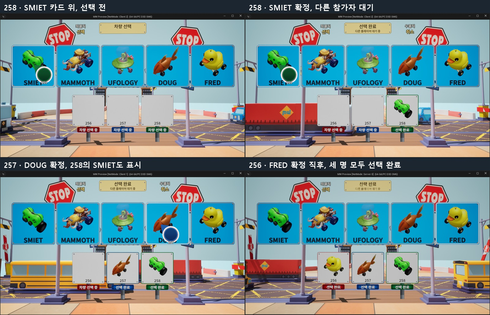

# 차량 선택 화면 편집과 프리뷰 문구 제거

운영 로비가 생성하는 `WBP_VehicleSelection_Preview`는 `WBP_VehicleSelection_Dev`의 Designer 트리를 상속한다. 에셋 이름의 Preview는 클래스 식별자다. 변경 전 부모 트리에는 `PreviewControls/PreviewNotice` 텍스트 블록과 `디자인 Preview · 서버 상태 아님` 문구가 저장돼 있었다. 런타임의 `RefreshControls()`는 이를 숨겼지만 `NativeConstruct()`는 해당 위젯이 없으면 버튼 연결을 중단했다. 카드 이름·참가자 상태도 별도 Slate 툴팁으로 등록돼 마우스 정지 시 사각창을 생성했다.

| 파일 또는 에셋 | 수정 위치와 결과 |
|---|---|
| `Content/UI/Lobby/VehicleSelection/WBP_VehicleSelection_Dev.uasset` | `PreviewNotice` 노드를 제거하고 이름/GUID를 정리했다. `PreviewControls` 기본값은 Collapsed다. 같은 Canvas 아래의 숨긴 `WorldCardBounds` 슬롯이 월드 카드 행의 앵커·크기·정렬을 소유한다. 부모에 저장한 변경이 파생 WBP에 적용된다. |
| `Source/MW/UI/VehicleSelection/MWVehicleSelectionWidget.{h,cpp}` | 필수 바인딩·초기화 검사에서 삭제한 문구를 제거했다. 월드 진입 시 `AlignmentCardGroup`에 `WorldCardBounds`의 슬롯을 복사하고 모드 종료 시 기존 슬롯·자동 크기·커서 변환을 복원한다. 옛 WBP는 기존 월드 설정을 읽는다. |
| `MWVehicleCardWidget.cpp` · `MWVehiclePlayerEntryWidget.cpp` · `MWVehiclePlayerMarkerWidget.cpp` | 중복 사각 툴팁을 만드는 텍스트 등록을 제거했다. 차량명·닉네임·확정 표시는 기존 카드와 참가자 행에 남는다. |
| `MWVehiclePlayerMarkerWidget.h` · `Source/MW/UI/Cursor/MWPointerCursor.h` · `WBP_VehiclePlayerMarker_Dev.uasset` | 마커 단위의 정규화 핫스폿을 지원한다. 원본 화살표의 렌더 변환을 반영해 현재 WBP의 끝점 (0, 0)을 지정했다. 같은 마커 경로가 입력·표시에 쓰인다. |
| `Config/DefaultGame.ini` · `Source/MW/UI/Lobby/MWLobbyHUD.cpp` | HUD가 일반 차량 다섯 개의 썸네일 경로를 덮어쓰던 코드를 지웠다. WBP의 차량별 지정이 우선하고 미지정 ID는 `DefaultVehicleThumbnails`에서 찾는다. 비밀 차량 항목도 유지한다. |

## 검증

UE 5.8에서 부모와 파생 WBP를 컴파일했다. 로컬 3인 PIE의 운영 로비에서 세 참가자의 차량 선택 인스턴스마다 하위 위젯 80개를 조사했고 `PreviewNotice`가 없었다. Cua Driver로 세 번째 창에서 SMIET를 좌클릭해 서버 차량 ID와 초록색 확정 카드가 일치하는지 확인했다. 같은 카드에서 우클릭해 차량 ID가 비고 화면이 ‘차량 선택 중’으로 돌아오는 것도 확인했다. 삭제한 안내문을 참조하던 초기화 조건이 남았다면 이 입력이 동작하지 않는다. 수신 측에서 같은 부모 WBP와 마커 해시를 적용해야 한다.

## 2026-11-19 차량 카드 호버·확정 재검증

UE 5.8 Win64 Development Editor, PID 13364. 로컬 리슨 서버와 두 원격 클라이언트를 독립 PIE 창으로 실행했다. 테스트 준비 스크립트는 로비 준비와 경기 시작까지 담당했다. 차량 선택은 세 창에서 Cua Driver로 직접 입력했다.

| 입력한 창 | 카드 위에 포인터를 둔 상태 | 좌클릭 후 확인 |
|---|---|---|
| Client 2 · Member 3 · 258 | SMIET를 가리켰을 때 참가자 칸은 ‘차량 선택 중’이었다. | SMIET 썸네일·‘선택 완료’·우클릭 취소 안내가 나타났고 서버가 `Asset.Vehicle.SMIET`를 기록했다. |
| Client 1 · Member 2 · 257 | DOUG를 가리켰을 때 파란 마커가 카드 위에 나타났다. | 빈 참가자 칸에 DOUG가 들어왔고 먼저 선택한 258의 SMIET도 보였다. 서버 확정 ID는 `Asset.Vehicle.DOUG`였다. |
| 호스트 · Member 1 · 256 | FRED를 가리킨 동안 본인 참가자 칸은 비어 있었다. | FRED 확정 직후 세 참가자 칸이 모두 채워졌다. 서버가 `Asset.Vehicle.FRED`를 기록한 뒤 출발했다. |

세 창의 카드 호버와 확정 후 대기 화면에서 ‘프리뷰’ 글씨나 그 사각 툴팁이 나타나지 않았다. 현재 운영 인스턴스의 자식 텍스트와 툴팁에서도 ‘프리뷰’·‘미리보기’ 검색 결과는 0건이었다. 비어 있던 하단 사각 칸은 참가자별 차량 선택 슬롯이며, 확정하면 해당 차량 썸네일을 표시했다. 기존 제거 커밋 `8bd1999`이 이 실행에서도 적용되어 차량 위젯을 추가 수정할 필요가 없었다.

