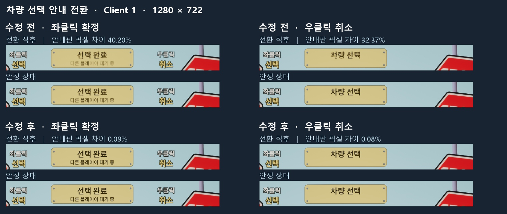

# 차량 선택 완료와 우클릭 취소의 글자 겹침 수정

2026-11-19 · UE 5.8 Win64 Development · 실제 타이틀에서 진입한 로컬 리슨 서버 3인 PIE · D3D12. 변경 전 PID 28776, 수정 후 새 프로세스 PID 15224.

## 관찰한 증상

Client 1에서 DOUG의 왼쪽 경계를 좌클릭하고 같은 위치에서 우클릭했다. 수정 전 상태 표본에는 ‘차량 선택’ → ‘차량 선택 요청의 서버 응답을 기다리고 있습니다.’ → ‘선택 완료’가 기록됐다. 한 확정에서 중간 문구와 완료 문구의 관측 시각 차이는 34ms였다. 차량 선택 루트 WBP의 애니메이션 재생 여부는 이 표본 모두 거짓이었다. 실제 창에서는 새 글자 위에 이전 획이 남았고 우측 ‘우클릭 취소’도 옅게 나타났다. 당시 세 창의 차량 게시판은 모두 엔진 기본 단면 마스크 재질을 사용했다.

## 수정한 위치와 실제 편집값

| 위치 | 바뀐 내용과 편집 책임 |
|---|---|
| `Source/MW/UI/VehicleSelection/MWVehicleSelectionWidget.cpp`의 `RefreshControls` | 운영 방의 제목·대기 상세는 소유 PlayerState의 서버 확정 차량 ID를 읽는다. 선택 요청과 취소 요청 중에는 직전 확정 상태에 해당하는 안내를 유지한다. 우클릭 안내는 취소 가능한 확정 ID가 있을 때 표시하고, 요청 중 비활성 색이 입혀지는 중간 단계를 없앴다. 입력 잠금·오류 표시·서버 요청은 기존 경로를 쓴다. |
| 같은 이름의 `.h` | 즉시 확정 방식에서 더 이상 표시하지 않는 `ConfirmVehicleText`, `RequestPendingText` 편집 속성을 정리했다. ‘차량 선택’, ‘선택 완료’, ‘다른 플레이어 대기 중’의 문구 원본은 기존 WBP 기본값에 있다. |
| `/Game/UI/Lobby/VehicleSelection/M_VehicleSelectionBoard` | 엔진의 unlit `Widget3DPassThrough` 그래프와 SlateUI 파라미터를 재사용해 만든 차량 게시판 전용 단면 투명 재질. `Translucency Pass = After Motion Blur`에서 현재 위젯 텍스처를 그린다. 글자를 바꿀 때 이전 월드 프레임이 같은 획에 누적되는 경로를 피했다. |
| 같은 폴더의 `BP_VehicleSelectionPreview_Dev` → `PreviewSurface` | WidgetComponent의 Blend Mode를 Transparent로 설정하고 재질 슬롯 0에 위 재질을 지정했다. 운영 타이틀 레벨의 배치 인스턴스가 이 기본값을 사용한다. 재질 할당은 BP 한 곳에 저장했다. |
| `WBP_VehicleSelection_Dev`와 실행 위젯 `WBP_VehicleSelection_Preview` | 폰트·카드 슬롯·안내판 배치·입력 범례 디자인은 기존 WBP가 소유한다. 카드·참가자 안내도 같은 수정된 게시판에 그려진다. 커서의 크기와 핫스폿은 기존 마커·슬롯을 사용한다. |
| `Docs/Reviews/FrontendIntegration/PR_ASSET_HANDOFF.csv` | Git 제외 바이너리 두 개의 경로·크기·SHA-256·로컬 전달 상태를 기록했다. |

## 실제 전환 캡처

두 실행에서 같은 Client 1 뷰포트(1280×722), 같은 카드, 같은 클릭 좌표로 Cua Driver 창 PNG를 연속 수집했다. ‘전환 직후’는 문구 교체가 처음 보인 **수집 표본**이다. ‘안정 상태’는 반대 동작을 하기 직전의 같은 창이다. Cua 캡처 사이의 게임 프레임은 계수하지 않았다.

| 처음 바뀐 표본과 안정 화면의 픽셀 차이 | 수정 전 | 수정 후 |
|---|---:|---:|
| 확정 때 가운데 안내 | 40.20% | 0.09% |
| 확정 때 우클릭 취소 안내 | 21.63% | 0.14% |
| 취소 때 가운데 안내 | 32.37% | 0.08% |
| 취소 때 우클릭 취소 안내 | 0.23% | 0.21% |

같은 실행의 전후 안정 화면에서 밝기가 48/255 이상 달라진 픽셀만 골랐다. 표본과 목표 화면의 절대 밝기 차이 합을 두 안정 상태 사이의 차이 합으로 나눴다. **목표와 같으면 0%**, 이전 상태와 같으면 약 100%다. 이 값은 페이드 시간이나 전체 화면의 불량률을 뜻하지 않는다. 원본 ZIP에 영역 좌표, 측정 코드, 모든 표본과 상태 기록을 보관했다.

## 회귀 검증과 작업 방식 대조

| 요청 | 확인 결과 |
|---|---|
| 지침 재독·편집 책임 점검 | 작업 전 로컬 `UI_AUTHORING_GUIDELINES_V2.md`를 다시 읽고 이전 소유자 조사(`212ef7f`)와 운영 로비 호출부를 대조했다. 외형은 에셋, 표시 시점은 기존 차량 선택 C++ 위젯에서 편집했다. |
| GUI 조작과 캡처 | Cua Driver로 에디터 Play, 세 창의 크기·포커스, 실제 좌·우클릭, PNG 캡처를 수행했다. 로비 준비·게임 시작과 상태 판독은 PIE 시험 스크립트가 담당했다. |
| 서로 다른 DPI에서 세 사람 교대 | `47e2620`에서 기록한 세 크기로 수정 후 다시 시험했다. P1→SMIET, P2→DOUG, P3→FRED가 서버 및 세 복제 목록에 일치했다. 각 입력자의 취소 뒤 선택 ID도 지워졌다. 보는 창별 테두리 폭은 수정 후 아홉 표본에서도 각각 66·87·109px였다. |
| 제목·상세·우클릭 범례 | 수정 후 세 플레이어의 선택과 취소에서 제목은 ‘차량 선택’ ↔ ‘선택 완료’ 두 상태만 기록됐다. ‘다른 플레이어 대기 중’과 우클릭 범례는 확정 때 나타나고 취소 때 함께 사라졌다. 카드 호버와 확정 뒤 사각창의 ‘프리뷰’ 제거는 기존 한글 커밋 `65de4e9`에 별도 비교 캡처가 있다. |
| 화면비 변경 | 실행 중 호스트를 1024×768(4:3), Client 2를 1680×720(21:9)으로 바꾸어 SMIET와 FRED 경계에서 각각 확정·취소했다. 타이틀 카메라의 상하·좌우 여백이 생긴 상태에서도 선택이 맞았다. 일부 원본 창에 에디터의 비디오 메모리 경고가 표시됐다. 위 전환 수치는 경고가 측정 영역 밖인 1280×722 창에서 산출했다. |
| 빌드·에셋 재열기 | `MWEditor`와 `MW` Win64 Development 빌드 성공. 별도 새 에디터에서 BP를 다시 열어 컴파일 전후 같은 재질 참조를 확인했고 타이틀 레벨에 배치된 실물의 참조도 확인했다. 세 PIE 월드의 실제 재질 패스는 모두 After Motion Blur였다. |
| 기존 로딩·트랙 요구 | 이전 로딩 시험은 `f4e42a9`, `16ea3b4`와 `UI_AUTHORING_VERIFICATION_20261119.md`에, 호스트·별도 클라이언트의 첫 진입과 출발 보고 횟수는 해당 실행 기록에 있다. 트랙 설치는 `0f2b0f3`에서 Member 3의 확정 직전 고스트와 서버 설치 위치 차이 약 5.7×10⁻¹³ cm를 기록했다. 트랙 커서는 `59424d2`, 대기판·단계 안내·아이템 슬롯은 `ee9855f`가 대응 작업이다. 이번 변경은 차량 선택 위젯과 그 게시판 재질에 한정해 PIE에서 재시험했다. |
| 문서·에셋 전달 | 작업별 한글 커밋, 비교 이미지, 원본 PNG와 JSON, 바이너리 인계 ZIP을 구분했다. 수신 측 설치와 UVCS 업로드는 미확인이다. |

에셋 ZIP은 프로젝트 루트 기준 `Content/UI/Lobby/VehicleSelection/` 경로를 담고 있다. BP는 25,170바이트(`63d4fc9928cb7c49d654e0b0505ed62d89b4b62ff3523a7f586dfb13dfc642f0`), 재질은 12,092바이트(`cebc5b123e7144f1c97077f159cc1c70790774ae0e6ae5ca292776cb66af8668`)다.
