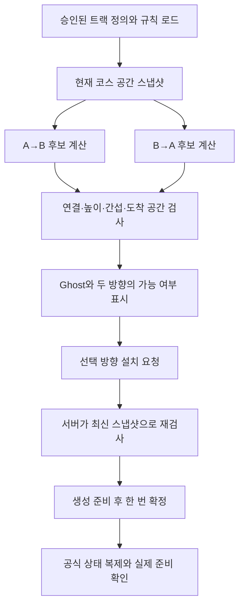

# ProjectMW 트랙 배치 알고리즘 구현 가이드 v0.1

작성일: 2026-10-28 · 적용 분야: Client + Server + Art/TA

기준 설계: [트랙 배치 알고리즘 설계 v0.1](트랙_배치_알고리즘_설계_v0.1.md)

이 문서는 설계안을 UE C++·DataAsset·에셋 제작·멀티플레이 흐름으로 옮기는 방법을 설명한다. 실제 Runtime 코드를 추가한 결과가 아니다. 코드 조각은 핵심 계산과 책임을 설명하는 예제이며 UHT 선언·include·복제 등록·프로젝트 연결을 갖춘 완성 소스가 아니다. 원작의 비공개 구현을 재현했다고 주장하지 않는다.

## 0. 현재 출발점과 문서의 적용 범위

### 0.1 이번 작성에서 확인한 상태

- 저장소 확인 시점의 HEAD는 `d3e27a5`, 브랜치는 `main`이었다. 원격 확인 후에도 기존 변경은 없었다.
- 저장소에 `Docs/Engineering/Client/트랙_배치_알고리즘_설계_v0.1.md`가 추가돼 있고, 앞서 전달한 설계안과 내용이 같다.
- 현재 main의 `Source/MW`에는 공용 DataAsset·AssetManager·온라인 로그인·Frontend 코드가 있다. TrackManager·TrackPiece·서버 배치 검사 코드는 확인되지 않았다.
- 이전 대화에서 조사한 차량 기능 브랜치의 소스 존재를 현재 main의 구현 상태로 간주하지 않는다.
- 설치된 `UE_5.8/Engine/Build/Build.version`은 **UE 5.8.4 / CL 58902052**다. 과거 명세의 5.8.3 기록과 구분한다.
- 문서 전용 브랜치 생성이 승인되지 않아 이 파일은 저장소 밖의 산출물 폴더에 작성했다. main·코드·에셋·원본 명세는 수정하지 않았다.

### 0.2 유지하는 게임 규칙

1. 단일 경로의 현재 끝에만 트랙을 추가한다.
2. 한 조각의 양 끝 A/B는 모두 입구·출구가 된다. 설치 방향은 A→B / B→A 두 가지다.
3. 높이는 조각 형상과 소켓 연결로 결정한다. 자유 높이 이동·자유 회전·미러링을 추가하지 않는다.
4. 정상 건설에서는 참가자당 한 조각을 추가한다. 자동 도착 도로는 이 수량에 포함하지 않는다.
5. 서버가 순차 확정한다. 오래된 리비전은 거절하고 사용자의 선택은 보존한다.
6. 제한시간 18초, 제한된 대체 후보 실패 시 `ConstructionBlocked`, 실제 준비 확인 후 출발이라는 기존 계약을 유지한다.
7. 출발 방향의 반대, U턴, 누적 회전각 자체를 거절 조건으로 삼지 않는다.

### 0.3 첫 구현에서 구체화할 제작 제약

첫 버전은 **양 끝 연결면이 수평이고, 포트 주변에 수평 연결 구간이 있는 조각**으로 제한한다. 조각 내부에는 고저차와 검증된 경사가 있어도 된다. 상승 조각의 A와 B 높이가 다르면서 양 끝은 수평인 형태가 가능하다.

이 제약은 원작의 규칙이라는 뜻이 아니다. 현재 계획된 ACharacter의 수직 캡슐과, 로컬 좌표로 제작한 차량 여유 공간을 안전하게 연결하기 위한 구현 선택이다. 이 조건에서는 조각 Actor가 월드에서 Yaw와 위치만 바뀌므로 로컬 Z와 월드 Z가 일치한다.

기울어진 연결면까지 지원하는 확장은 후속으로 둔다. 그 경우 Actor의 Pitch/Roll이 생기며, 도로와 함께 기울인 박스가 실제 수직 차량 캡슐을 포함하는지 별도 검증해야 한다. 아래 일반 강체 변환식은 그 확장에도 쓸 수 있지만, 초기 에셋 검증은 수평 포트를 요구한다.

## 1. 전체 구현을 세 층으로 나누기

| 층 | 입력 | 출력 | 실행 주체 |
|---|---|---|---|
| 데이터 준비 | 트랙 DataAsset·규칙·설치 목록 | 검증된 값 데이터와 공간 스냅샷 | 서버와 각 클라이언트 |
| 후보 계산·검사 | 스냅샷·조각·방향 | 배치 Transform·새 끝점·도착 예약·이슈 | 서버/클라이언트 공용 순수 계산 |
| 설치 확정 | 서버 요청·성공 후보 | Actor 생성·공식 목록·리비전·복제 | 서버만 |

후보를 검사하려고 매번 임시 Actor를 스폰하지 않는다. 로컬 Ghost의 메시 충돌로 공식 배치 가능 여부를 판정하지도 않는다. 두 곳이 같은 값 데이터 계산기를 사용해야 Ghost와 서버 결과가 일치하기 쉽다.



### 필요한 용어

- **포트(Port)**: 조각 양 끝의 연결 위치·자세·규격.
- **프레임(Frame)**: 위치와 X/Y/Z 방향축을 갖는 좌표계.
- **AABB**: 월드 축과 나란한 외곽 상자. 빠르게 근처 후보를 찾는 데 쓴다.
- **OBB**: 도로 방향에 맞춰 돌아갈 수 있는 상자. 실제 겹침 검사에 쓴다.
- **리비전(Revision)**: 검사에 영향을 주는 코스 상태가 바뀔 때 증가하는 번호.
- **예약(Reservation)**: 아직 Actor로 만들지 않은 도착 구간의 배치 계획·공간 데이터.

## 2. 파일과 클래스의 책임

아래 경로는 새 구현의 제안이다. 기존 소스를 이동하거나 같은 책임의 클래스를 중복 생성하라는 뜻이 아니다. 실제 제작 때 최신 소스를 다시 조사한다.

```text
Source/MW/Construction/
  MWTrackPlacementTypes.h       방향·포트·형상·요청·결과 등의 공용 타입
  MWTrackPieceDefinition.h/cpp  트랙 제작 데이터와 정적 데이터 검사
  MWPlacementRules.h/cpp        월드 경계·오차·도착 정의 등 규칙
  MWTrackPlacementMath.h/cpp    프레임·OBB·AABB·SAT 계산
  MWTrackPlacementEvaluator.h/cpp  부작용 없는 후보 평가
  MWTrackPiece.h/cpp            확정 조각의 메시·충돌·상태 적용
  MWTrackManager.h/cpp          서버 목록·요청 처리·예약·리비전
  MWTrackGhost.h/cpp            로컬 미리보기와 문제 구간 표시
```

| 대상 | 맡길 책임 | 넣지 않을 책임 |
|---|---|---|
| PieceDefinition | 메시·포트·검사 공간·양방향 메타데이터 | 현재 설치 상태·플레이어·타이머 |
| PlacementMath | 좌표와 형상 계산 | World 검색·RPC·Actor 스폰 |
| Evaluator | 스냅샷에 대한 판정·사유 | 점수·수량 소모·상태 변경 |
| TrackManager | 공식 코스와 한 번의 설치 확정 | Widget 생성·차량 이동 내부 |
| TrackPiece | 공식 배치 데이터로 정적 Actor 구성 | 아무 클라이언트의 설치 요청 수신 |
| Ghost | 현재 평가 결과 표현 | 서버 승인 대신 결정 |
| 소유 PlayerController | 설치 의도를 서버에 전달 | 클라이언트 임의 Transform 확정 |

처음부터 별도 Subsystem·범용 큐·공간 트리·플러그인 프레임워크를 만들지 않는다. 서버의 게임 스레드에서 동기 평가·확정이 가능하면 TrackManager의 작은 함수들로 연결한다.

## 3. 데이터 구조를 먼저 고정하기

### 3.1 조각 정의와 설치 인스턴스는 다른 데이터다

같은 커브 DataAsset을 여러 번 설치할 수 있다. 따라서 조각 종류의 ID와 설치된 개체의 ID를 구분한다.

```cpp
// 구조를 설명하는 핵심 필드 예제. UENUM/USTRUCT/UPROPERTY 등은 실제 구현에서 추가한다.
enum class EMWTrackDirection : uint8 { AtoB, BtoA };
enum class EMWTrackEnd : uint8 { A, B };
enum class EMWShapeRole : uint8 { Solid, Clearance, Protected };
enum class EMWShapeRegion : uint8 { Body, EndA, EndB };

struct FMWLocalPlacementBox
{
    int32 ShapeId;                  // 정의 안에서 유일하고 안정적인 ID
    FVector CenterLocalCm;
    FQuat RotationLocal;
    FVector HalfExtentCm;           // 전체 크기가 아니라 반길이
    EMWShapeRole Role;
    EMWShapeRegion Region;
};

struct FMWTrackPort
{
    FTransform LocalFrame;          // 정의의 기준 좌표 안에 있음
    FName ConnectionProfileId;      // 호환 폭·단면·규격을 식별
    double DriveWidthCm;
};

struct FMWPlacedPieceRecord
{
    int32 InstanceId;               // 현재 코스에서 유일, 삭제 후 임의 재사용 안 함
    FName PieceId;
    int32 DefinitionVersion;
    EMWTrackDirection Direction;
    FTransform WorldTransform;
    int32 Sequence;
    bool bSystemPiece;              // 자동 도착 도로인지 구분
};
```

외부 입력의 Direction을 enum으로 받더라도 유효한 두 값인지 서버에서 검사한다. 배열 인덱스로 바로 쓰지 않는다.

### 3.2 Definition에 필요한 필드

| 필드 | 제작·검증 기준 |
|---|---|
| PieceId / DefinitionVersion | 서버 카탈로그에 유일하게 등록 |
| Mesh | 건설 진입 전에 서버/클라이언트에서 로드·Cook 확인 |
| PortA / PortB | A→B 기준 주행축 +X, 위쪽 +Z, Scale=1 |
| PlacementBoxes[] | Solid·Clearance·Protected와 Body/End 구분 |
| HeightBoxes[] | 도로 높이 검사 전용의 촘촘한 작은 영역 |
| Centerline[] | A→B 순서의 Position/Tangent/Up/Distance/폭 |
| ForwardMetadata / ReverseMetadata | 각 방향의 체크포인트·복귀·방향성 슬롯 |
| JoinRegionA/B | 해당 끝에서만 접촉을 허용할 작은 연결 영역 |
| Approved | 양방향 스냅·주행·검증을 마친 정식 후보 여부 |

서버는 승인된 카탈로그에서만 PieceId를 해석한다. 클라이언트가 전송한 ActorClass나 패키지 경로로 스폰하지 않는다. 카탈로그가 준비되지 않으면 건설을 시작하지 않는다.

### 3.3 포트 데이터의 원본은 하나로 유지한다

StaticMesh 소켓과 DataAsset의 포트 Transform을 둘 다 수동 편집 가능한 원본으로 운영하지 않는다.

권장 제작 흐름:

1. 메시의 `Snap_In`/`Snap_Out` 소켓을 기준으로 A/B를 만든다.
2. Editor 제작 단계에서 메시 로컬 소켓을 읽어 Definition의 검증된 데이터로 굽는다.
3. 메시·소켓 변경 시 재생성하고 DefinitionVersion을 갱신한다.
4. Runtime은 준비된 Definition의 값을 사용한다.

소켓은 `DoesSocketExist` 등으로 먼저 존재를 확인한다. `GetSocketTransform` 호출이 Transform을 반환했다고 소켓이 존재한다고 판단하지 않는다. 설치 헤더에는 소켓이 없을 때 컴포넌트 Transform을 돌려주는 관련 API 설명도 있으므로 누락을 명시적으로 검사해야 한다.

메시 컴포넌트와 Actor 루트의 상대 Transform은 첫 구현에서 Identity로 고정하는 편이 단순하다. 상대 Transform이 필요하면 소켓·검사 공간·중심선도 같은 기준으로 변환해야 한다.

### 3.4 규칙 데이터

`PlacementRules`에는 월드 높이 범위·수평 건설 영역·연결 규격·접합 오차·수치 오차·도착 정의·대체 후보 목록과 RulesVersion을 둔다.

오차를 하나의 큰 값으로 합치지 않는다.

| 값 | 단위와 목적 |
|---|---|
| PositionToleranceCm | 정렬 뒤 포트 위치 오차 |
| AngleToleranceDeg | 포트 축·수평 자세 검증 |
| NumericalEpsilonCm | 부동소수점 연산 경계의 작은 오차 |
| MaxJoinPenetrationCm | 연결된 두 끝에서만 허용할 작은 관통 |
| NonAdjacentGapCm | 비인접 도로끼리 필요한 여유, 실제 제작/주행으로 결정 |
| AxisParallelEpsilon | SAT 교차축의 수치적 퇴화 판정. 길이 단위가 아님 |

높이·차량 크기·게임 밸런스 수치는 실측 전 미정으로 둔다. 아래 좌표 예제의 1,000cm 같은 숫자는 수학 설명용이다.

## 4. 트랙 에셋을 구현 가능한 형태로 준비하기

### 4.1 첫 세 조각

직선, 비대칭 커브, 높이가 바뀌는 완만한 경사를 만든다. 비대칭 커브는 한쪽에 직선 구간이 있는 형태가 좋다. 입출구 교환이 제대로 됐는지 육안으로 쉽게 확인할 수 있다.

각 조각에서 다음을 완료한다.

1. cm 단위·피벗·Scale=1을 확인한다.
2. A/B 포트를 도로 연결 단면 중심에 둔다.
3. 두 포트의 +X를 모두 A→B 주행 방향으로 놓는다.
4. 포트의 +Z가 위를 향하고 양 끝 연결 구간이 수평인지 확인한다.
5. 실제 주행 충돌과 배치 검사 공간을 따로 만든다.
6. A→B와 B→A 양방향으로 주행·체크포인트·복귀를 확인한다.

한 방향이 미검증인 조각을 정식 양방향 후보로 승인하지 않는다. 처음에는 검증된 세 조각으로 알고리즘을 완성하고 수량을 늘린다.

### 4.2 커브에 박스를 배치하는 방법

커브 전체를 큰 박스 하나로 감싸면 안쪽 빈 공간이 막힌다. 중심선을 따라 작은 구간으로 나누고 각 구간의 진행 방향에 맞춰 Solid OBB를 둔다.

자동 생성 초안은 인접 중심선 샘플 두 점의 중간을 박스 중심으로, 두 점의 차이를 길이 방향으로 사용한다. 박스 반길이는 구간 길이/2, 반폭과 두께는 해당 구간의 도로 규격으로 정한다.

하지만 두 샘플 사이의 실제 곡선이 직선 현 밖으로 볼록하게 나갈 수 있다. **두 끝점만 덮었다고 전체 곡선이 덮인 것은 아니다.** 더 촘촘한 샘플·보수적인 폭 여유·실제 메시 대조를 통해 도로의 모든 막히는 부분이 검사 공간에 포함되게 한다. 자동 생성은 제작 초안이고 승인 과정은 별도다.

각 박스에는 ShapeId를 고정한다. 배열 재정렬 때문에 오류 표시 대상이 바뀌지 않게 한다.

### 4.3 차량 통행 공간

Clearance는 차량의 중심이 아니라 차량 충돌체 전체가 지나갈 공간이다. 실제 차량 캡슐 반지름·반높이, 도로에서 허용하는 좌우 위치, 경사와 뱅킹을 반영한다.

초기 수평 포트 제약에서는 Actor가 Yaw만 회전하므로 로컬 +Z로 만든 수직 여유 공간이 월드에서도 수직이다. 다만 조각 내부 경사에서는 차량 캡슐의 접지 위치가 평지와 다를 수 있으므로 단순히 도로 표면에서 고정 차고만 위로 늘리고 끝내지 않는다. 실제 CMC 주행 경로를 따라 캡슐을 배치해 덮이는지 검증하고 작은 OBB들을 조정한다.

- 도로를 받치는 자기 조각 Solid와 자기 Clearance는 월드 배치 비교에서 제외한다.
- 다른 조각의 Solid가 이 Clearance 안으로 들어오면 새 도로를 달릴 공간이 부족한 것이다.
- Clearance끼리 겹친다는 이유만으로 거절하지 않는다.
- 경사에서 지나치게 큰 박스를 쓰면 빈 공간까지 막는 오탐이 생긴다. 문제 구간만 더 작게 나눈다.

### 4.4 보호 공간

체크포인트 Trigger의 판정 영역과 안전 복귀용 보호 공간은 다르다. Trigger는 통과 감지용이고, 보호 공간은 도로·장애물이 침범하지 않아야 하는 실제 공간이다.

보호 공간은 자신을 지지하는 도로 표면을 제외하고 검사한다. 자신의 바닥을 포함해 일반 Solid와 무조건 비교하면 모든 복귀 위치가 실패한다. 지지 소유자와 허용 바닥 접촉을 명시하고, 그 소유자의 난간·천장·다른 부분까지 통째로 제외하지 않는다.

## 5. 양방향 연결 Transform 구현

### 5.1 기준 프레임

현재 코스의 `TailWorld`는 코스가 다음으로 진행할 방향을 +X로 가진다. A/B 포트는 제작 기준 A→B 방향이다.

| 방향 | 입구 프레임 | 출구 프레임 |
|---|---|---|
| A→B | A | B |
| B→A | B의 X/Y 반전 | A의 X/Y 반전 |

역방향에서 Z를 반전하면 도로를 뒤집는 결과가 되므로 금지한다.

```cpp
FTransform ReverseTravelFrame(const FTransform& Frame)
{
    // 원래 프레임의 로컬 Z를 기준으로 방향을 뒤집는다.
    const FQuat HalfTurn(FVector::UpVector, PI);
    FQuat Rotation = Frame.GetRotation() * HalfTurn;
    Rotation.Normalize();
    return FTransform(Rotation, Frame.GetTranslation(), FVector::OneVector);
}
```

위 함수는 위치를 보존한다. 월드 원점이나 Actor 중심을 기준으로 포트 위치까지 회전시키는 함수가 아니다.

### 5.2 Actor Transform을 성분으로 계산하기

단위 Scale의 강체 변환에서 입구의 로컬 위치를 E, 로컬 회전을 QE, 목표 Tail 위치를 T, 회전을 QT라고 하자.

```text
ActorRotation = QT × inverse(QE)
ActorPosition = T - ActorRotation(E)
```

ActorRotation은 입구 자세를 목표 자세로 맞춘다. ActorPosition은 회전된 입구가 정확히 Tail에 오도록 위치를 보정한다.

```cpp
FTransform SolvePieceWorld(
    const FTransform& EntryLocal,
    const FTransform& TailWorld)
{
    // 호출 전에 유한 값, 정규화 quaternion, Scale=1을 검증한다.
    FQuat WorldRotation =
        TailWorld.GetRotation() * EntryLocal.GetRotation().Inverse();
    WorldRotation.Normalize();

    const FVector WorldPosition = TailWorld.GetTranslation()
        - WorldRotation.RotateVector(EntryLocal.GetTranslation());

    return FTransform(WorldRotation, WorldPosition, FVector::OneVector);
}
```

### 5.3 UE FTransform의 합성 순서

설치된 `TransformNonVectorized.h`는 `A * B`가 **A를 먼저 적용하고 B를 다음에 적용**한다고 설명한다. Quaternion 곱의 적용 순서와 혼동하면 안 된다.

따라서 UE FTransform 표기로는 다음과 같다.

```cpp
const FTransform PieceWorld = EntryLocal.Inverse() * TailWorld;
const FTransform ActualEntryWorld = EntryLocal * PieceWorld;
const FTransform NextTailWorld = ExitLocal * PieceWorld;
```

이는 원래 설계안의 열벡터 행렬식 `Tail × inverse(Entry)`와 같은 의미지만 표기 순서가 다르다. 비균일 Scale이 끼면 단순 강체 계산의 전제가 깨지므로 Scale=1을 검사하고, 잘못된 데이터를 조용히 보정해 수용하지 않는다.

### 5.4 계산 뒤 반드시 확인할 값

1. `ActualEntryWorld.Position`과 Tail 위치 차이.
2. 두 프레임의 정규화 X축 내적과 허용 각도.
3. 정규화 Z축 내적과 허용 각도.
4. 결과 Actor의 수평 포트 제약과 유효 Scale.

전방 비교는 `dot >= cos(AngleTolerance)`로 쓸 수 있다. 내적을 각도로 변환해 표시한다면 [-1,1]로 clamp한 뒤 acos를 사용한다.

스냅한 뒤 방향이 어긋나면 임의의 추가 회전으로 숨기지 않는다. 포트 규약·역방향 프레임·곱 순서를 검사한다.

### 5.5 숫자 예제

설명용 직선은 A=(0,0,0), B=(1000,0,0), 두 포트 Yaw=0이다. 목표 Tail=(1000,2000,500), Yaw=90°로 둔다.

| 선택 | 계산된 Actor 위치 | Actor Yaw | 새 출구 위치 |
|---|---|---|---|
| A→B | (1000,2000,500) | 90° | (1000,3000,500) |
| B→A | (1000,3000,500) | -90° | (1000,3000,500) |

대칭 직선은 두 방향의 최종 도로 형상이 같다. 비대칭 커브에서는 같은 입구 위치를 유지하면서 새 출구 위치·방향이 달라진다. 양방향을 시험할 때 직선 하나만 쓰면 오류를 놓치기 쉽다.

## 6. 역방향 중심선·체크포인트·슬롯

### 6.1 중심선 뒤집기

A→B 샘플을 P[0]…P[n-1], 누적거리 D[i], 총길이 L이라고 한다.

```text
역방향 샘플 i:
    원본 인덱스 j = n - 1 - i
    Position = P[j]
    Tangent = -OriginalTangent[j]
    Up = OriginalUp[j]
    Distance = L - D[j]
```

이 로컬 결과를 PieceWorld로 변환한다. 위치에는 TransformPosition, 방향에는 회전 또는 TransformVectorNoScale을 사용하고 정규화한다.

### 6.2 체크포인트와 복귀

체크포인트는 포트·조각·Sequence와 연결된 안정 ID를 가진다. 역방향 설치에서는 통과 방향도 반대다. 서버는 다음 체크포인트인지, 해당 라운드에 이미 지급했는지, 참가자 상태가 유효한지를 검사한다.

복귀 위치는 기존 점을 180도 돌리는 것만으로 항상 안전해지지 않는다. 조각 안의 위험 요소·커브 바깥쪽·출구 여유가 달라질 수 있으므로 Forward/Reverse 메타데이터를 별도로 검수한다.

자동 도착 도로가 추가될 때 마지막 조각의 체크포인트 ID를 그 도로 기준면에 대응시킨다. 물리 도로 Actor가 하나 늘었다고 점수용 체크포인트를 하나 더 만들지 않는다. 이전 라운드 결승의 ID와 위치는 확장 뒤에도 유지한다.

### 6.3 방향성 슬롯

- 장식·양방향 범퍼: 메시와 함께 월드 변환.
- 진행 방향 가속 패드: 선택 방향의 Tangent 또는 방향별 SlotFrame 사용.
- 한쪽만 바라보는 팬: 도로 진행을 따르는지, 메시 고정 방향을 따르는지 제작 데이터에 명시.

역방향 배치와 런타임 미러링은 다른 기능이다. 메시 Scale을 음수로 바꿔 방향을 구현하지 않는다.

## 7. 로컬 박스를 월드 OBB와 AABB로 바꾸기

```cpp
struct FMWWorldOBB
{
    FVector Center;
    FVector Axis[3];   // 정규직교 단위 축
    FVector Extent;    // 양수 반길이, cm
};

FMWWorldOBB ToWorldOBB(
    const FMWLocalPlacementBox& Local, const FTransform& PieceWorld)
{
    FMWWorldOBB Out;
    Out.Center = PieceWorld.TransformPosition(Local.CenterLocalCm);
    FQuat Rotation = PieceWorld.GetRotation() * Local.RotationLocal;
    Rotation.Normalize();
    Out.Axis[0] = Rotation.GetAxisX();
    Out.Axis[1] = Rotation.GetAxisY();
    Out.Axis[2] = Rotation.GetAxisZ();
    Out.Extent = Local.HalfExtentCm; // Scale=1이라는 전제
    return Out;
}
```

월드 AABB 반길이 R은 각 축의 절댓값을 이용해 구한다.

```text
R = abs(AxisX) * ExtentX
  + abs(AxisY) * ExtentY
  + abs(AxisZ) * ExtentZ

AABB.Min = Center - R
AABB.Max = Center + R
```

각 조각의 Solid·Clearance·Protected를 모두 포함하는 AABB를 캐시한다. Solid만 감싼 AABB로 후보를 추리면 도로는 멀지만 차량 공간끼리 관련되는 Solid↔Clearance 검사를 놓칠 수 있다.

최소 간격이나 접촉 오차를 사용하는 검사에서는 broad phase AABB에도 그 검사 여유를 반영한다. broad phase가 narrow phase보다 작아서는 안 된다.

## 8. 고도와 건설 경계 검사

### 8.1 OBB의 정확한 Z 범위

박스 O의 Z방향 반길이는 다음과 같다.

```text
RadiusZ = abs(AxisX.Z)*ExtentX
        + abs(AxisY.Z)*ExtentY
        + abs(AxisZ.Z)*ExtentZ

MinZ = Center.Z - RadiusZ
MaxZ = Center.Z + RadiusZ
```

HeightBoxes 전체의 최소·최대 Z를 허용 범위와 비교한다. 입구와 출구 높이만 검사하지 않으므로 중간이 높은 경사·커브도 검출한다.

거절 결과에는 초과한 ShapeId, 실제 MinZ/MaxZ, 허용 하한/상한을 넣는다. UI는 초과한 부분과 높이 제한면을 보여준다.

HeightBoxes는 도로 높이를 나타내야 한다. 높은 장식이나 아래로 긴 비충돌 지지대가 게임의 도로 고도 제한을 바꾸지 않게 한다. 차량 머리 공간 부족은 높이 상한이 아니라 Clearance의 별도 사유다.

### 8.2 수평 경계

첫 버전의 건설 영역을 월드 축에 정렬된 직사각형으로 정하면 각 높이/도로 검사 박스의 AABB Min/Max X/Y를 비교할 수 있다. 이 검사는 해당 직사각형 경계와 OBB에 대해 보수적인 추측이 아니라 OBB의 실제 축별 극값 검사다.

회전한 건설 영역이 필요하면 영역의 로컬 좌표로 OBB를 변환한 뒤 같은 방식으로 비교한다. 카메라 화면 밖으로 나갔다는 이유로 설치를 거절하지 않는다.

## 9. OBB 간섭을 SAT로 검사하기

### 9.1 왜 AABB만 쓰지 않는가

AABB는 빠르지만 회전한 커브 박스를 넓게 감싼다. AABB가 겹친다는 것은 정밀 검사가 필요하다는 뜻이며 충돌 확정이 아니다.

SAT(분리축 정리)는 두 볼록 상자의 투영 구간이 어느 축에서든 분리되면 실제로 떨어져 있다고 판단한다.

두 OBB A/B에서 검사할 축은 다음 15개다.

- A의 세 축.
- B의 세 축.
- A의 각 축과 B의 각 축을 외적한 아홉 축.

마지막 아홉 축을 생략하면 모서리끼리 비껴 있는 상자를 충돌로 오판할 수 있다. 거의 평행해서 길이가 0에 가까운 외적 축만 수치 규칙에 따라 건너뛴다.

### 9.2 한 축에서의 계산

정규화된 검사축 N에서 상자 A의 투영 반길이:

```text
Radius(A,N) = Σ ExtentA[i] * abs(dot(AxisA[i], N))
CenterDistance = abs(dot(CenterB - CenterA, N))
Overlap = Radius(A,N) + Radius(B,N) - CenterDistance
```

Overlap이 음수면 그 축에서 간격이 있다. 모든 유효 축에서 양수면 관통한다. 0 근처는 접촉으로 분리해 정책 계층에서 처리한다.

### 9.3 핵심 계산 예제

```cpp
enum class EMWBoxRelation : uint8 { Separated, Touching, Penetrating };

struct FMWSATResult
{
    EMWBoxRelation Relation;
    double MinDepthCm;     // 정규화된 축의 최소 분리 이동 깊이
    FVector Axis;          // 문제 방향 표시용. 정확한 접촉점은 아님
};

double ProjectRadius(const FMWWorldOBB& Box, const FVector& N)
{
    return Box.Extent.X * FMath::Abs(FVector::DotProduct(Box.Axis[0], N))
         + Box.Extent.Y * FMath::Abs(FVector::DotProduct(Box.Axis[1], N))
         + Box.Extent.Z * FMath::Abs(FVector::DotProduct(Box.Axis[2], N));
}

// 의사 구현: 축 배열 생성과 데이터 유효성 검사는 호출 전제다.
FMWSATResult CompareBoxes(const FMWWorldOBB& A, const FMWWorldOBB& B,
    double NumericalEpsilonCm, double AxisParallelEpsilon)
{
    TArray<FVector, TInlineAllocator<15>> Axes;
    for (int32 I = 0; I < 3; ++I) Axes.Add(A.Axis[I]);
    for (int32 I = 0; I < 3; ++I) Axes.Add(B.Axis[I]);
    for (int32 I = 0; I < 3; ++I)
        for (int32 J = 0; J < 3; ++J)
            Axes.Add(FVector::CrossProduct(A.Axis[I], B.Axis[J]));

    const FVector Delta = B.Center - A.Center;
    double MinDepth = TNumericLimits<double>::Max();
    FVector MinAxis = FVector::ForwardVector;

    for (FVector N : Axes)
    {
        const double LengthSquared = N.SizeSquared();
        if (LengthSquared <= AxisParallelEpsilon * AxisParallelEpsilon)
            continue;
        N /= FMath::Sqrt(LengthSquared);
        const double Depth = ProjectRadius(A, N) + ProjectRadius(B, N)
            - FMath::Abs(FVector::DotProduct(Delta, N));
        if (Depth < -NumericalEpsilonCm)
            return { EMWBoxRelation::Separated, Depth, N };
        if (Depth < MinDepth) { MinDepth = Depth; MinAxis = N; }
    }
    return { MinDepth > NumericalEpsilonCm
        ? EMWBoxRelation::Penetrating : EMWBoxRelation::Touching,
        MinDepth, MinAxis };
}
```

전제는 세 축이 정규직교하고 Extent가 양수인 유효 OBB다. NaN이나 빈 축 배열이 들어왔을 때 성공으로 끝내지 않도록 별도 입력 검사를 둔다. 거리 계산을 double/FVector의 현재 정밀도로 유지하고 불필요하게 float로 줄이지 않는다.

### 9.4 접촉·관통·최소 간격의 정책

SAT 함수는 기하 관계만 반환하고 게임의 허용 여부는 별도로 판단한다.

| 관계 | 기본 처리 |
|---|---|
| 비인접 Solid↔Solid 관통 | TrackOverlap |
| 비인접 Solid↔Solid 접촉 또는 최소 여유 부족 | 검사 공간의 여유 정책에 따라 거절 |
| Solid↔Clearance 양의 관통 | InsufficientClearance |
| Clearance가 지지 바닥과 수치적으로 접촉 | 지정된 지지/접합 규칙 안에서 허용 |
| Clearance↔Clearance | 그 자체로 거절하지 않음 |
| Solid↔Protected 침범 | ProtectedAreaBlocked |

`Depth > 큰 오차`일 때만 거절하는 식으로 전역 관통을 허용하지 않는다. 필요한 최소 간격은 규칙에 맞게 Solid 검사 상자에 보수적인 여유를 더하고 broad phase에도 동일하게 반영한다. 이는 정확한 메시 간 최단거리 계산과는 다르며 그 차이를 제작 규격에 기록한다.

SAT의 MinAxis와 MinDepth는 문제 방향을 보여주는 자료다. 정확한 충돌 접촉점을 구했다고 표시하지 않는다. 첫 UI는 문제 Shape 두 개를 강조하면 충분하다.

## 10. 접합부만 예외로 처리하기

### 10.1 전체 Actor Ignore가 잘못되는 이유

새 U자 커브가 기존 끝에 정상적으로 붙은 뒤 되돌아와 직전 조각 중간을 뚫을 수 있다. 직전 Actor를 전부 Ignore하면 이 관통을 놓친다.

처음부터 Body와 EndA/EndB Shape를 분리한다. 예외 대상은 실제 연결된 끝끼리의 Shape 쌍뿐이다.

### 10.2 허용 조건을 코드에서 좁히기

아래 조건을 모두 만족할 때만 접합 예외를 적용한다.

1. A와 B가 이번 후보에서 실제로 연결된 인스턴스다.
2. 두 Shape가 실제 연결된 포트의 End 영역에 속한다.
3. 각 Shape 전체가 동일한 작은 월드 JoinRegion 안에 들어 있다.
4. 연결 위치·방향·폭 규격이 이미 통과했다.
5. Solid끼리의 관통 깊이는 MaxJoinPenetrationCm 이하이다.

Shape 전체가 JoinRegion 안에 드는지 여부는 Shape의 여덟 꼭짓점을 JoinRegion 로컬 좌표로 변환해 각 축 절댓값이 반길이 이하인지 검사한다. 이것은 교집합 전체의 영역 포함을 보장하는 보수적인 충분조건이다. 불필요한 거절이 생기면 End Shape를 더 작게 분해한다. 태그만 보고 무조건 허용하지 않는다.

Clearance의 접합부 겹침도 실제 연결된 End 영역 안에서만 예외로 처리한다. 반대쪽 끝이나 Body와의 침범은 일반 검사로 보낸다.

```text
if 연결된 End 쌍이고 두 형상이 작은 공통 JoinRegion에 포함됨:
    Solid/Solid는 작은 접합 관통 한도 검사
    의도된 접합부 Clearance 관계는 별도 허용 규칙 적용
else:
    일반 Solid/Clearance/Protected 검사
```

### 10.3 반드시 실패시킬 에셋

- End 태그를 붙인 상자가 조각 몸통까지 덮는다.
- JointTolerance가 도로 두께·연결 구간에 비해 지나치게 크다.
- Body 검사 공간 사이에 의도하지 않은 빈틈이 있다.
- 수평 포트 주변 Clearance가 도로와 크게 관통한다.

정적 검사와 실제 양방향 연결 테스트가 이 문제를 먼저 잡아야 한다.

## 11. 공간 스냅샷과 판정 순서

### 11.1 World에서 매번 검색하지 않기

TrackManager는 확정 인스턴스의 월드 OBB와 AABB를 저장한다. 트랙 생성·삭제·도착 시설 교체·검사 대상 장애물 변경 때 갱신한다.

스냅샷에는 최소한 다음이 들어간다.

```text
RoundEpoch, CourseRevision, RulesVersion, CatalogVersion
TailFrame, TailInstanceId, TailEnd
정렬된 확정 인스턴스의 PlacementBoxes와 전체 AABB
검사 대상 월드 장애물·보호 공간
현재 도착 예약 또는 이미 생성된 도착 구간 상태
```

Ghost Actor, 임시 준비 Actor, 비충돌 장식은 공식 공간 목록에 등록하지 않는다. Inspector용 형상과 실제 판정 형상이 같은 배열을 읽게 한다.

월드 지형·건물 중 실제 차량을 막는 것은 승인된 배치 장애물로 등록한다. 임의 장식 전체를 WorldStatic 조회로 가져오면 시각적으로 비켜 있는 공간까지 막힐 수 있다. 별도 등록 데이터나 정한 배치 쿼리 채널을 사용하며, 채널 설정 변경은 생산자·소비자와 함께 검증한다.

### 11.2 검사 행렬

| 후보 역할 | 기존 역할 | 의미 |
|---|---|---|
| Solid | Solid | 구조물 관통 |
| Solid | Clearance | 기존 길을 막음 |
| Clearance | Solid | 새 길의 차량 공간 부족 |
| Solid | Protected | 기존 복귀·체크포인트 보호 침범 |
| Protected | Solid | 새 보호 공간 미확보 |
| Clearance | Clearance | 기본 검사 제외 |

슬롯 점유·위험 요소 설치 가능 여부는 해당 설치 시스템의 별도 정책이다. 트랙 배치 검사에서 위험 요소의 모든 게임플레이 규칙까지 중복 구현하지 않는다.

### 11.3 EvaluatePlacement의 의사코드

```text
EvaluatePlacement(snapshot, definition, direction, rules):
    result = 빈 결과(snapshot의 버전 정보 포함)
    데이터·정의 버전·direction이 유효하지 않으면 해당 오류로 종료

    entry, exit = 방향에 맞는 포트 프레임 선택
    candidate = SolvePieceWorld(entry, snapshot.Tail)
    result.CandidateTransform = candidate
    result.NextTail = exit를 candidate로 월드 변환

    연결 규격·정렬 후 축·수평 포트 제약 검사
    계산을 계속할 수 없으면 종료

    candidate의 OBB·AABB·높이 영역·방향별 보호 공간 생성
    높이와 월드 경계 이슈 수집
    기존 인스턴스와 공간 행렬에 따라 검사
    연결된 두 End에만 국소 접합 예외 적용

    finishRoad = candidate.NextTail에 도착 도로를 가상 연결
    finishCap = finishRoad.Exit에 마감 시설을 가상 연결
    두 형상의 높이·월드 경계·공간을 검사

    finishRoad/finishCap을 기존 코스뿐 아니라 candidate와도 비교
    finishCap과 finishRoad도 비교하되 실제 접합부만 허용
    해당 도착 모듈 내부의 사전 승인된 자기 관계는 명시 구분
    실패는 FinishAreaBlocked와 상세 원인으로 반환

    이슈를 안정된 순서로 정렬
    Blocking 이슈가 없으면 result.Valid = true
    성공 시 result.FinishReservation = 도착 형상과 배치 계획
    return result
```

이전 예약은 실제 도로가 아니며 새 후보가 대체한다. 반면 실제로 존재하는 이전 도착 도로는 검사 대상이다. 교체할 이전 마감 시설만 명시 ID로 대체 대상에 넣고 그 Actor가 속한 다른 도로까지 제외하지 않는다.

대부분의 검사는 이슈를 함께 수집하되 잘못된 Transform·미로드 정의처럼 다음 계산을 할 수 없는 경우는 즉시 종료한다. 단순 높이 실패를 이유로 다른 관련 오류를 숨길 필요는 없다.

## 12. 도착 예약과 라운드 확장을 구현하기

### 12.1 예약 구조

```text
FinishReservation
  BaseCourseRevision
  FinishDefinitionVersion
  RoadTransform, CapTransform
  Road의 출구와 체크포인트 기준면
  검사된 도로·마감·복귀 공간
```

각 후보에서 도착 공간을 함께 검사하면 조각 설치가 성공했는데 마지막에 결승 도로를 만들지 못하는 상황을 예방한다.

예약이 보장하는 것은 **현재까지의 코스를 여기서 끝낼 공간**이다. 다음 조각, 남은 참가자의 조각, 무한 확장의 가능성은 보장하지 않는다.

### 12.2 도착 상태를 명시적으로 구분

| 상태 | 코스 끝 | 처리 |
|---|---|---|
| BuildingReserved | 마지막 플레이어 조각 출구 | 도착 구간은 데이터로 예약 |
| Closed | 생성된 도착 도로와 마감 시설 | 종료 가능성이 실제 배치로 확보됨 |
| ExtendingFromClosed | 이전 도착 도로 출구 | 이전 마감 시설을 보존한 채 확장 후보 평가 |

이 구분이 없으면 도착 도로 뒤에 도착 도로를 계속 붙여 검사하는 재귀가 생기거나, 기존 마감 시설이 새 조각을 막는 오판이 생긴다.

### 12.3 처음 코스 생성

시작 도로를 만든 뒤 도착 모듈을 붙일 수 있는 기본 상태인지 검사한다. 시작 도로·도착 정의가 잘못됐다면 플레이어 건설을 열지 말고 명시 실패로 끝낸다. 초기 예약은 첫 배치와 같은 판정 규칙을 사용한다.

### 12.4 마지막 플레이어 조각

1. 새 조각과 도착 도로·마감 시설의 전체 계획을 평가한다.
2. 세 Actor와 필요한 체크포인트 데이터를 준비한다.
3. 어느 하나 실패하면 이번 요청의 준비 객체만 정리한다.
4. 전부 준비되면 공식 목록·Tail·체크포인트 연결·플레이어 완료·Revision을 확정한다.
5. 도착 Actor를 공식 상태로 공개하고 코스를 Closed로 둔다.

### 12.5 다음 라운드

이전 결승의 통과 도로는 남긴다. 이전 결승 체크포인트도 같은 ID로 남는다. 첫 새 조각을 이전 도착 도로의 출구에 붙인다.

건설 진입 즉시 마감 시설을 파괴하지 않는다. ExtendingFromClosed 스냅샷에서 그 마감 시설만 교체 대상으로 지정하고 첫 후보를 평가한다. 첫 새 조각의 준비·확정이 성공한 뒤 이전 마감을 제거한다. 실패하면 이전 코스를 그대로 유지한다.

새 조각들이 추가된 후에는 새 끝에서 도착 구간을 다시 만든다. 자동 도착 도로가 주행거리에 포함되는 것과 점수 대상이 늘어나는 것은 별개다.

## 13. 서버 설치 요청과 중복 방지

### 13.1 요청 필드

```cpp
struct FMWPlaceTrackRequest
{
    FName OfferedPieceId;
    EMWTrackDirection Direction;
    int32 RoundEpoch;
    int32 SeenCourseRevision;
    uint32 ClientRequestId;
};
```

PlayerId는 요청을 받은 owning Controller로 식별한다. 클라이언트가 보낸 임의 플레이어 ID로 다른 사람의 배치 권한을 소모하지 않는다. RequestId의 범위는 플레이어+RoundEpoch다.

### 13.2 중복 결과는 권한 소모 검사보다 먼저 찾는다

같은 성공 요청이 다시 도착하면 플레이어는 이미 배치 완료 상태다. 완료 여부부터 검사하면 재수신을 성공 재전달 대신 거절하게 된다.

권장 순서:

1. 호출 소유자·요청 형식·허용된 Epoch 범위를 검사한다.
2. 동일 키의 처리 결과가 있으면 요청 내용의 fingerprint도 비교한다.
3. 내용까지 같으면 이전 Accepted/Rejected 결과를 돌려준다. 재생성하지 않는다.
4. 같은 ID로 PieceId/Direction 등 내용이 바뀌면 DuplicateRequestConflict로 거절한다.
5. 새 요청이면 Phase·기한·후보·방향·남은 권한·Revision을 검사한다.
6. 공간 평가와 준비·확정을 진행하고 최종 결과를 저장한다.

성공 결과는 Phase가 바뀐 직후의 정상 재수신에도 재전달할 수 있게 짧은 완료 보관 구간을 둔다. 오래된 Epoch 전체를 무제한 저장하거나 새 배치에 적용하지 않는다. 악의적인 무한 ID 전송은 빈도 제한과 보관량 제한으로 통제한다.

Reliable RPC를 사용해도 요청의 의미상 중복 방지는 별도로 필요하다. stale 리비전이나 이미 끝난 배치처럼 정상적으로 생길 수 있는 거절을 연결 종료로 처리하지 않는다.

### 13.3 동시 요청 예제

```text
현재 Revision = 10
플레이어 A: Revision 10 요청 → 성공, Revision 11
플레이어 B: Revision 10 요청 → StaleRevision
B의 선택은 유지, Revision 11의 Ghost 표시
B가 다시 확인한 새 요청 → Revision 11 기준 재검사
```

서버가 B의 요청을 몰래 새 끝점으로 옮겨 설치하지 않는다. B가 보지 못한 위치에 조각이 설치되는 문제를 막기 위해서다.

## 14. Actor 생성은 데이터 확정과 분리해서 준비하기

### 14.1 Deferred Spawn은 자동 트랜잭션이 아니다

설치 엔진에는 `UWorld::SpawnActorDeferred`와 `AActor::FinishSpawning`이 있고, Finish 단계에서 Construction Script가 실행된다. 이것만으로 여러 Actor의 생성·복제가 원자적으로 묶이는 것은 아니다.

준비 단계 Actor는 다음 조건을 갖게 한다.

- 초기에는 공식 코스 목록에 등록하지 않는다.
- Tick·충돌·체크포인트 이벤트·게임플레이 부작용을 비활성화한다.
- 준비 중에는 복제하지 않는다. 클래스 기본값과 생성 경로를 함께 통제한다.
- Construction Script/BeginPlay가 점수·등록·다른 Actor 파괴를 실행하지 않게 한다.
- 실제 생성 결과의 메시·소켓·충돌 구성이 검사한 Definition과 일치하는지 확인한다.

Blueprint Construction Script가 검사 공간과 다른 형상으로 메시를 바꾸면 사전 판정이 무의미해진다. 정식 TrackPiece BP는 승인 데이터의 표현만 담당하게 한다.

### 14.2 Prepare → Commit → Publish

```text
Prepare
  준비 Actor와 이전 상태/예약을 보관하는 요청별 Journal 생성
  필요한 모든 Actor 생성·FinishSpawning·참조 준비
  준비 결과와 최신 Epoch/Revision/규칙 재확인

Commit
  공식 목록·Tail·예약·완료 플래그·결과 캐시를 한 경로에서 갱신
  이 시점까지 실패할 수 있는 필수 검사와 자원 준비를 끝냄
  Revision은 성공 요청당 한 번 증가

Publish
  공식 Actor 상태 적용, 충돌·복제 활성화
  교체된 이전 마감 시설 제거
  호스트 표시 갱신과 원격 복제
```

Journal은 이번 요청에서 만든 Actor만 파괴한다. 실패한 요청 때문에 기존 확정 조각을 삭제하거나 다른 플레이어의 완료 상태를 되돌리지 않는다.

Commit 뒤에도 필수 실패가 가능한 구조라면 해당 작업을 Prepare로 옮기거나 명시 복구 상태를 설계해야 한다. 단순히 `Revision++` 다음 줄에서 스폰하고 null이면 return하는 방식은 금지한다.

동기 게임 스레드에서도 Construction Script·Delegate를 통한 재진입이 생길 수 있다. 처리 중 가드와 부작용 차단을 두고, 외부 콜백이 중간 코스 상태를 관찰하지 않게 한다. 비동기 로드가 필요하면 건설 전에 준비하거나 별도 InFlight 요청 수명을 명시한다.

### 14.3 실패 후 보존할 것

| 실패 위치 | 보존되는 공식 상태 |
|---|---|
| 후보 평가 실패 | 이전 목록·Tail·예약·완료·Revision 전부 |
| 새 조각 생성 실패 | 이전 공식 상태 전부, 요청 준비 객체만 정리 |
| 도착 Actor 하나 실패 | 새 조각까지 함께 취소, 이전 공식 상태 보존 |
| 준비 중 Epoch/Revision 변경 | 준비 요청 무효화, 최신 공식 상태 보존 |
| 첫 확장 실패 | 이전 Closed 코스와 마감 시설 보존 |

## 15. 복제 상태와 클라이언트 실제 준비

### 15.1 정적인 도로의 복제

TrackPiece는 서버가 생성한 Replicated Actor로 둔다. 움직이지 않는 도로에 매 프레임 이동 RPC를 보내지 않는다.

`SetReplicateMovement(false)`를 쓴다면 최종 위치 전달을 그것에 맡기지 않는다. `PieceId/DefinitionVersion/Direction/WorldTransform/InstanceId/Sequence`를 포함한 배치 상태 구조체를 명시적으로 복제하고, 초기 수신·OnRep에서 Actor Transform과 메시를 적용하는 경로를 둔다.

서버는 같은 상태 적용 함수를 직접 호출하고 원격은 OnRep에서 호출한다. C++ 서버 대입만으로 호스트의 OnRep가 실행된다고 가정하지 않는다.

TrackManager는 공식 Manifest와 CourseRevision을 관리한다. 초기 규모에서는 평범한 복제 배열로 시작할 수 있다. Manifest와 개별 Actor를 중복 권한 원본으로 운영하지 말고 Manifest는 기대하는 ID/정의/버전 목록, Actor는 해당 항목의 실제 표현으로 해석한다.

### 15.2 리비전만 받았다고 준비 완료가 아니다

다른 Actor의 복제 순서는 보장하지 않는다. 클라이언트는 다음 조건을 합쳐 준비 여부를 계산한다.

```text
수신 Manifest가 목표 Revision에 해당
기대하는 모든 InstanceId가 정확히 존재
각 Actor의 DefinitionVersion·방향·배치 상태가 일치
메시·필수 에셋이 실제로 로드됨
주행 충돌이 등록되고 활성화됨
도착 도로가 필요하면 그 Actor도 준비됨
제거 대상 이전 마감 시설이 더 이상 통행을 막지 않음
```

개수만 맞아도 다른 조각이 들어 있을 수 있으므로 ID와 버전도 비교한다. 등록·제거·OnRep·에셋 로드 완료 때 같은 준비 함수를 다시 평가한다. 임의 Delay로 동기화를 추정하지 않는다.

서버는 현재 유효 참가자의 목표 Revision 준비 응답을 확인한 뒤 Countdown을 시작한다. 준비 응답은 시작 동기화를 위한 것이며 점수나 배치 판정을 클라이언트에 맡기는 증명이 아니다. 제한시간을 넘으면 명시 취소·예외 종료한다.

## 16. Ghost와 이유 표시 구현

### 16.1 로컬 상태

별도 서버 Phase를 늘리지 않고 로컬 배치 UI 상태를 둔다.

| 상태 | 표시와 입력 |
|---|---|
| Selecting | 후보 선택 |
| WaitingForData | 회색 Ghost 또는 로딩, 설치 잠금 |
| Previewing | 선택 방향 Ghost·사유·반대 방향 가능 여부 |
| RequestPending | 보낸 후보를 표시하고 중복 요청 잠금 |
| Placed | 내 조각 완료 표시 |

거절은 독립적인 영구 상태가 아니라 사유를 가진 Previewing으로 돌아간다. 선택한 PieceId와 방향을 유지한다. 취소 액션을 새로 요구하지 않는다.

### 16.2 두 방향 계산과 캐시

```text
Key = PieceId + DefinitionVersion + Direction
    + CourseRevision + RulesVersion + CatalogVersion
```

검사에 영향을 주는 월드 장애물·보호 영역이 바뀌면 CourseRevision도 갱신한다. 이를 코스 수량 변화에만 묶으면 같은 리비전의 낡은 검사 결과가 남는다. 별도 공간 리비전을 도입하는 대안도 있지만 첫 구현은 하나의 의미를 일관되게 유지한다.

현재 방향과 반대 방향을 모두 평가해 캐시한다. 마우스가 조금 움직여도 스냅된 후보의 Transform이 같다면 재검사를 반복할 필요가 없다. 매 Tick World 전체를 검색하지 않는다.

기존 휠의 한 단계는 A→B와 B→A를 토글한다. Axis1D 값을 매 프레임 그대로 누적해 여러 번 뒤집지 않도록 실제 휠 단계 이벤트를 한 번만 소비한다. 방향이 둘이므로 +1/-1 모두 한 단계 토글 결과는 같다.

### 16.3 거절 결과 구조

```text
PlacementResult
  SnapshotVersions
  CandidateTransform, NextTail
  FinishReservation
  bValid
  Issues[]

PlacementIssue
  Code, Severity, Context(CurrentPiece/FinishRoad/FinishCap)
  CandidateShapeId, OtherInstanceId, OtherShapeId
  ProblemBox/ProblemRegion
  ActualValue, AllowedValue, DetailCode
```

표시 문자열은 UI에서 로컬라이즈한다. Geometry 코드가 매번 FText를 만들거나 내부 ID를 사용자에게 보여주지 않는다.

| 코드 | 사용자 문구 예시 | 강조할 것 |
|---|---|---|
| AboveHeightLimit / BelowHeightLimit | 높이 제한을 넘습니다 | 초과 구간과 제한면 |
| TrackOverlap | 기존 트랙과 겹칩니다 | 충돌한 두 구간 |
| InsufficientClearance | 차량이 통과할 공간이 부족합니다 | 부족한 통행 공간 |
| FinishAreaBlocked | 도착 구간을 만들 공간이 부족합니다 | 자동 도착 Ghost |
| StaleRevision | 코스가 변경되었습니다. 다시 확인해 주세요 | 최신 끝점의 미리보기 |

반대 방향만 유효하면 그 사실을 알려주되 자동 전환·자동 설치하지 않는다. 두 방향 모두 불가하면 각각의 원인을 보여준다. 모양이 대칭인 직선은 두 방향이 같아 보일 수 있다.

### 16.4 이슈를 안정적으로 정렬

데이터 준비 오류→연결/지원 자세→높이/경계→Solid 관통→차량 공간→보호 공간→도착 구간 순으로 대표 원인을 정한다. 동률에서는 InstanceId·ShapeId 순으로 선택한다.

정확히 같은 후보에서 월드 검색 순서가 달라졌다는 이유만으로 사유 문구가 흔들리면 안 된다. 최대 표시 개수를 제한하더라도 대표 원인과 전체 이슈 개수는 일관되게 유지한다.

### 16.5 RPC 응답과 복제 순서

Accepted 응답과 실제 조각 Actor 도착은 어느 쪽이 먼저일지 가정하지 않는다. Accepted는 요청 처리 완료이며 실제 코스 준비 완료는 별도다. 오래된 RequestId/Epoch의 응답이 새 선택의 대기 표시를 해제하지 않게 한다.

Stale 거절 시 선택을 보존하고 최신 Revision의 실제 데이터가 준비된 뒤 새 Ghost를 표시한다. 자동 재요청은 하지 않는다.

## 17. 제한시간과 배치 불가 처리

서버의 승인된 작은 대체 카탈로그를 고정 순서로 검사한다. 각 조각의 A→B와 B→A를 모두 검사하되 동일한 안전 규칙과 도착 예약을 적용한다.

```text
for 아직 조각을 설치하지 못한 유효 참가자:
    for 제한된 대체 정의:
        for 두 방향:
            최신 코스로 평가
            유효하면 일반 서버 설치 경로로 확정
            생성 실패라면 결과를 처리하고 제한된 정책에 따라 다음 후보
    유효 대체가 없으면 ConstructionBlocked로 종료
```

한 대체가 성공하면 Revision이 바뀌므로 다음 참가자는 새 스냅샷으로 검사한다. 동시에 계산한 예전 후보들을 연달아 확정하지 않는다.

무한 랜덤 재시도, 공간 검사 생략, 기본 직선 강제 스폰을 하지 않는다. 실패하면 정상 N개 배치 완료로 기록하지 않는다. 현재 종료 가능한 코스·예약은 보존하고, 기존 문서의 명시 예외 종료를 따른다. 이 문서가 기존 코스로 경주를 강행하는 새 정책을 추가하지 않는다.

## 18. 전체 경로와 진행거리 연결

단일 연결 목록에서는 새 조각이 기존 Tail에 붙었다는 사실로 연결성이 유지된다. 전체 코스를 다시 탐색해 길을 찾을 필요는 없다. 새 조각의 공간 간섭만 관련 기존 조각 전체와 비교한다.

코스 진행거리 소비 기능을 채택하면 각 구간에 누적길이를 캐시한다. 자동 도착 도로도 실제 주행거리에는 포함하지만 점수 ID와는 분리한다.

```text
진행거리 = 구간 시작 누적거리 + 선택 방향 기준 구간 내 거리
```

차량을 전체 중심선의 가장 가까운 점에만 붙이면 입체 교차나 U턴의 가까운 다른 도로로 진행도가 튄다. 현재 구간·허용 인접 구간·다음 체크포인트 순서를 함께 사용해 탐색 범위를 제한한다.

거리 차 탈락에 이 지표를 사용할지는 기존 경기 계약의 미정 항목이다. 이 구현 문서가 임계값과 점수 규칙을 자동 확정하지 않는다.

## 19. 단계별 구현과 완료 기준

| 단계 | 구현할 것 | 다음 단계로 갈 증거 |
|---|---|---|
| 1 | 데이터 정의·포트·방향 프레임 | 비대칭 조각의 두 방향 입구가 같은 Tail에 정확히 정렬 |
| 2 | 월드 OBB/AABB·고도·경계 | 중간 최고점 초과와 정상 경사 사례를 구분 |
| 3 | SAT·역할 행렬·접합 예외 | 정상 접합 허용, 직전 몸통 관통 거절 |
| 4 | 도착 모듈 가상 배치·예약 | 조각은 가능하지만 도착만 막히는 후보 거절 |
| 5 | 한 PC Ghost·원인·반대 방향 표시 | 동일 결과에서 위치·색·사유가 일치 |
| 6 | 서버 요청·생성 Journal·중복·stale | 중복 스폰 0, 실패 시 공식 상태 보존 |
| 7 | 복제 Manifest·실제 준비 확인 | 호스트+원격 2명이 같은 코스 준비 후 출발 |
| 8 | 타임아웃·대체·확장 | 제한된 시간 안에 정상 완료 또는 이유 있는 예외 종료 |

각 단계는 게임이 돌아가는 작은 단위로 연결한다. C++ 파일 수를 늘리거나 DataAsset만 만들고 완료로 표시하지 않는다. 제작 에셋은 공용 Content 기준에 따라 Tracks/Data·Tracks/Art에 두고 Editor 검사 코드는 필요 시 MWEditor에 분리한다.

정식 저장소 구현에 착수할 때에는 기존 명세 4.1·4.2·4.5, TA 포트/방향 데이터, 체크포인트·도착 수명 계약을 함께 갱신한다. 이 문서만 추가해 기존 고정 In/Out 계약이 자동 변경됐다고 취급하지 않는다.

## 20. 검증 방법과 기대 결과

작성 과정에서는 독립적인 수치 계산으로 5.5절의 두 방향 예제, 서로 다른 입구·목표 자세 50개의 연결 위치·방향 일치, 회전 상자 20개의 꼭짓점 범위와 AABB·높이 투영식 일치를 확인했다. UTF-8 인코딩·코드 블록 짝·문서 링크 6개도 확인했다. 이는 설명에 사용한 수식과 문서의 점검이며, 아래 C++·에셋·서버 수용 검사를 실행한 결과가 아니다.

### 20.1 순수 계산 자동화 후보

다른 시스템 없이 값만 넣어 확인할 수 있는 계산부터 검증한다.

| ID | 입력 | 기대 결과 |
|---|---|---|
| M-01 | 임의 위치·Yaw의 Tail, 직선 A→B | 입구 정렬, 길이만큼 전진한 출구 |
| M-02 | 같은 직선 B→A | 최종 도로 형상과 출구 동일 |
| M-03 | 비대칭 커브 두 방향 | 연결에 쓰는 끝 교환, 각 출구 정확 |
| M-04 | 역방향 중심선 | 거리 0부터 L까지 증가, Tangent 반전·Up 유지 |
| M-05 | 회전 OBB | AABB와 Z 극값이 여덟 꼭짓점 검사와 일치 |
| M-06 | 분리·접촉·관통 박스 | 관계 분류와 깊이 부호 일치 |
| M-07 | 모서리 축에서만 분리되는 회전 박스 | 아홉 외적 축을 포함했을 때 분리 |
| M-08 | NaN·0 extents·비정규화 축·비단위 Scale | 잘못된 입력으로 명시 실패 |

### 20.2 에셋·월드 검사

| ID | 재현 | 기대 결과 |
|---|---|---|
| W-01 | 도로 입출구는 범위 안, 중간만 고도 초과 | 높이 오류와 해당 구간 표시 |
| W-02 | 고도 범위 경계 직전/일치/초과 | 합의한 경계 정책대로 안정 판정 |
| W-03 | 충분히 높은 입체 교차 | Solid·차량 공간 침범 없으면 허용 |
| W-04 | 도로는 안 닿지만 천장 낮음 | InsufficientClearance |
| W-05 | 정상 접합 / U턴으로 직전 몸통 관통 | 전자만 허용 |
| W-06 | End 태그를 몸통까지 잘못 확장 | 에셋 검사 실패, Ignore 우회 불가 |
| W-07 | U자 안쪽 빈 공간의 도로 | 작은 실제 검사 공간으로 판정 |
| W-08 | 장식 기둥 / 실제 충돌 기둥 | 실제 통행을 막는 구성만 해당 규칙으로 검사 |
| W-09 | 현재 조각은 가능, 도착 도로만 충돌 | FinishAreaBlocked, 설치 전 상태 유지 |
| W-10 | 이전 도착 예약 자리에 다음 조각 설치 | 이전 예약만 대체, 새 도착 공간 확보 |
| W-11 | 다음 라운드 확장 | 이전 통과 도로·CheckpointId 유지 |
| W-12 | 경사·역방향 실제 CMC 주행 | 충돌·접지·캡슐 공간·복귀 데이터 확인 |

### 20.3 서버·복제·실패 주입

| ID | 재현 | 기대 결과 |
|---|---|---|
| N-01 | 성공 요청 동일 ID 재수신 | 기존 Accepted 재전달, 스폰 1회 |
| N-02 | 같은 ID로 다른 Piece/Direction | DuplicateRequestConflict |
| N-03 | 원격 둘이 같은 Revision에 요청 | 하나 확정 후 나머지는 stale·선택 보존 |
| N-04 | Prepare의 두 번째 Actor 생성 실패 | 준비 객체만 정리, 목록·Revision·완료 변화 없음 |
| N-05 | 첫 확장 준비 실패 | 이전 Closed 코스와 마감 시설 유지 |
| N-06 | 준비 중 Phase/Epoch 변경 | 이전 요청의 늦은 확정 없음 |
| N-07 | Revision 먼저, Actor·충돌 나중 도착 | 실제 준비 전 Countdown 없음 |
| N-08 | Accepted와 Actor의 도착 순서 교차 | 중복 요청·가짜 완료·영구 대기 없음 |
| N-09 | 같은 개수의 잘못된 InstanceId | 준비 완료로 인정하지 않음 |
| N-10 | 타임아웃 대체 둘 다 실패 | 유한 시간 내 ConstructionBlocked |
| N-11 | 호스트 표시와 원격 OnRep | 같은 위치·사유·완료 상태 |
| N-12 | 지연·손실·참가자 이탈 | 수명 정리·준비 기한·중복 방지 유지 |

이 표는 실행할 수용 기준이다. 작성 시 게임 빌드·PIE·3PC·Cook 테스트를 통과했다는 기록이 아니다. 실제 구현에서는 UE Automation, 의도적 실패 샘플, 실제 3PC 패키지를 적절히 조합한다.

## 21. 성능과 디버깅

- 조각당 Shape 수 K, 기존 조각 N에 대해 후보당 최악 비교는 대략 O(NK²)다. 두 방향은 상수배다.
- 정적 인스턴스의 월드 형상과 AABB는 설치 때 캐시한다.
- Piece/Direction/Revision/규칙이 바뀔 때만 두 후보를 재평가한다.
- 같은 이슈의 중복 Shape 쌍은 합쳐 UI가 긴 오류 목록으로 도배되지 않게 한다.
- 먼저 단순 순회+AABB 제거로 측정한다. 실제 병목이 확인될 때 공간 해시/BVH 등을 검토한다.
- 일시적 진단에는 Candidate Solid, Clearance, JoinRegion, FinishReservation을 다른 색으로 그린다.
- 판정 시간·AABB 통과 개수·SAT 비교 수·Shape 수를 같은 장면에서 측정한다. 근거 없이 FPS나 대역폭을 보장하지 않는다.

로그에는 Epoch/Revision/RequestId/플레이어 식별/조각 ID/방향/대표 사유와 문제 Shape를 남긴다. 사용자 UI에는 필요한 이유와 문제 구간만 보여준다. 매 Tick의 같은 실패 로그는 제한한다.

## 22. 자주 발생할 구현 실수

1. 행렬식의 곱 순서를 UE FTransform에 그대로 복사한다.
2. B→A에서 포트 위치까지 원점 기준으로 180도 돌린다.
3. 메시만 회전하고 중심선·체크포인트·복귀 방향은 그대로 둔다.
4. 커브 전체 Bounds 하나로 빈 공간까지 막는다.
5. 도로 표면만 검사하고 차량 머리 공간을 생략한다.
6. 직전 조각 전체를 Ignore하거나 End 태그만 믿고 예외 처리한다.
7. 도착 도로를 기존 코스와만 비교하고 방금 설치할 후보와 비교하지 않는다.
8. 예약 공간과 실제로 유지해야 할 이전 도착 도로를 함께 제외한다.
9. 스폰을 먼저 공개하고 실패 뒤 목록만 되돌린다.
10. 중복 결과 조회 전에 이미 배치 완료라며 거절한다.
11. 리비전·Actor 개수만 보고 실제 충돌 준비를 생략한다.
12. 자동 도착 Actor 수만큼 체크포인트 점수도 추가한다.

## 23. 근거와 확인 범위

### 23.1 프로젝트 문서

아래 문서는 이 대화에서 본문을 확인한 공용·분야 지침이며 본 가이드는 그 계약을 구현하는 신규 제안이다.

- [기획최종안](<C:/Users/user/Documents/Unreal Projects/ProjectMW/Docs/Shared/MakeWay_기획최종안.md>)
- [개발명세](<C:/Users/user/Documents/Unreal Projects/ProjectMW/Docs/Shared/Client,Server/MakeWay_클라이언트_개발명세서_v1.0.md>)
- [TA 개발명세](<C:/Users/user/Documents/Unreal Projects/ProjectMW/Docs/Shared/TA/MakeWay_TA_개발명세서_v1.0.md>)
- [개발 공통 가이드](<C:/Users/user/Documents/Unreal Projects/ProjectMW/Docs/Engineering/DEVELOPMENT_GUIDE.md>)
- [저장소의 설계안](<C:/Users/user/Documents/Unreal Projects/ProjectMW/Docs/Engineering/Client/트랙_배치_알고리즘_설계_v0.1.md>)

### 23.2 이번에 대조한 설치 엔진 헤더

- `Engine/Source/Runtime/Core/Public/Math/TransformNonVectorized.h`: Transform 합성 순서, Quaternion 순서와의 차이, TransformPosition/TransformVectorNoScale.
- `Engine/Source/Runtime/Engine/Classes/Engine/World.h`: SpawnActorDeferred, OverlapMultiByObjectType.
- `Engine/Source/Runtime/Engine/Classes/GameFramework/Actor.h`: FinishSpawning, SetReplicateMovement.
- `Engine/Source/Runtime/Engine/Classes/Kismet/GameplayStatics.h`: FinishSpawningActor와 Construction Script 실행 설명.
- `Engine/Source/Runtime/Engine/Classes/Components/SceneComponent.h`: 소켓 Transform·로컬에서 월드 합성 경로.

설치 루트는 `C:/Program Files/Epic Games/UE_5.8`이다. 헤더와 계약을 읽은 사실은 위 C++ 예제를 UHT·컴파일·네트워크에서 검증한 결과와 다르다.

양방향 Transform, OBB 계산·접합 정책·도착 예약·Prepare/Commit/Publish는 이 프로젝트를 위한 설계 선택이다. 원작 후기나 영상이 이러한 내부 구현을 증명하는 것은 아니다.
