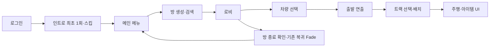

# ProjectMW — 이번 통합으로 무엇이 달라지는가

작성일: 2026-11-13. 개발자·기획자·테스터가 함께 보는 설명서다. **현재 코드와 기존 검증 기록을 설명하는 문서이며, 모든 기능의 최종 테스트가 끝났다는 뜻은 아니다.**

**현재 제출 방침:** `fix/item-ui-polish@bf69dc3` 전체를 단일 PR로 준비한다. Kevin 수정2는 이미 포함된 상태를 유지하고 수정3은 포함하지 않는다. 이전에 검토한 기능별 PR 분리와 구버전 코드 재구성은 진행하지 않는다.

이 문서는 단일 통합 PR의 변경 설명서다. 실행 코드 기준은 `bf69dc3`이며, 이후 추가하는 설명서 커밋은 게임 코드·설정·에셋을 변경하지 않는다. 실제 PR HEAD는 PR 본문에 별도로 기재한다.

## 0. 코드 리뷰어가 먼저 볼 것

비개발자는 2절의 화면 변화부터, 코드 리뷰어는 아래 순서로 읽으면 된다. `main → bf69dc3` 전체가 대상이며, 한글 주석 정리 커밋만 리뷰하는 PR이 아니다.

| 순서 | 시작 위치 | 확인할 핵심 |
|---|---|---|
| 1. 로비 요청/이동 | [MWLobbyGameMode · RequestCancelVehicle](https://github.com/kevin6091/ProjectMW/blob/bf69dc349168aa798afe6f7b985a0062fb4ee6a3/Source/MW/System/GameMode/MWLobbyGameMode.cpp#L293) / [TryCompleteVehicleSelection](https://github.com/kevin6091/ProjectMW/blob/bf69dc349168aa798afe6f7b985a0062fb4ee6a3/Source/MW/System/GameMode/MWLobbyGameMode.cpp#L309) | 소유자·단계·선택 ID를 검사하는가. 전원 연출 완료 후에만 이동하고 완료 누락은 실패로 복구하는가. Controller·PlayerState·HUD 소비자까지 함께 본다. |
| 2. 부스터/기믹 | [MWVehicleMovementComponent · UpdateDriveVelocity](https://github.com/kevin6091/ProjectMW/blob/bf69dc349168aa798afe6f7b985a0062fb4ee6a3/Source/MW/Gameplay/Vehicle/MWVehicleMovementComponent.cpp#L569) / [SetTrackLiftBase](https://github.com/kevin6091/ProjectMW/blob/bf69dc349168aa798afe6f7b985a0062fb4ee6a3/Source/MW/Gameplay/Vehicle/MWVehicleMovementComponent.cpp#L300) | 부스터 종료 시 초과 속도만 회수하는가. 발판 수명·Tick 선행을 정리하는가. 이 부분은 실제 이동에 영향을 주는 우리 변경이다. |
| 3. 커서/선택 | [MWVehicleSelectionWidget · ConfigureSharedCursorVisual](https://github.com/kevin6091/ProjectMW/blob/bf69dc349168aa798afe6f7b985a0062fb4ee6a3/Source/MW/UI/VehicleSelection/MWVehicleSelectionWidget.cpp#L55) / [CancelLocalSelection](https://github.com/kevin6091/ProjectMW/blob/bf69dc349168aa798afe6f7b985a0062fb4ee6a3/Source/MW/UI/VehicleSelection/MWVehicleSelectionWidget.cpp#L1002) | 플레이어 ID 기준 색·DPI/월드 배율·화살표 끝점이 맞는가. UI만 취소하고 서버 선택이 남는 경로가 없는가. |
| 4. 음악 수명 | [MWUCMContinuousMusic · RequestTrack](https://github.com/kevin6091/ProjectMW/blob/bf69dc349168aa798afe6f7b985a0062fb4ee6a3/Plugins/MWUCMFrontend/Source/MWUCMFrontend/Private/MWUCMContinuousMusic.cpp#L21) / [Deinitialize](https://github.com/kevin6091/ProjectMW/blob/bf69dc349168aa798afe6f7b985a0062fb4ee6a3/Plugins/MWUCMFrontend/Source/MWUCMFrontend/Private/MWUCMContinuousMusic.cpp#L92) | 같은 곡을 다시 시작하지 않는가. 오래된 비동기 완료를 무시하고 다음 곡 생성 성공 후 이전 곡을 줄이는가. 게임 인스턴스 종료에 맞춰 정리하는가. |
| 5. 아이템 판정/HUD | [MWItemComponent · ServerUseItem](https://github.com/kevin6091/ProjectMW/blob/bf69dc349168aa798afe6f7b985a0062fb4ee6a3/Source/MW/Gameplay/Items/MWItemComponent.cpp#L121) / [MWGameplayHUDSubsystem · Tick](https://github.com/kevin6091/ProjectMW/blob/bf69dc349168aa798afe6f7b985a0062fb4ee6a3/Source/MW/UI/Gameplay/MWGameplayHUDSubsystem.cpp#L617) | 서버 지급 ID/단계 검사와 HUD 구독 수명을 구분한다. 룰렛은 실제 지급 결과를 꾸며 보여 줄 뿐 결과를 정하지 않는다. |
| 6. 환경/의존성 | [MWAssetManager · StartInitialLoading](https://github.com/kevin6091/ProjectMW/blob/bf69dc349168aa798afe6f7b985a0062fb4ee6a3/Source/MW/System/MWAssetManager.cpp#L21) / [MWEnvironmentGameplay · OnWorldBeginPlay](https://github.com/kevin6091/ProjectMW/blob/bf69dc349168aa798afe6f7b985a0062fb4ee6a3/Plugins/MWEnvironmentGameplay/Source/MWEnvironmentGameplay/Private/MWEnvironmentGameplay.cpp#L28) | 통합 카탈로그 실패 시 기본 목록으로 복구하는가. 테마·생성기·숨긴 배경·조명을 종료 때 정리하는가. 표시 숨김과 충돌 해제를 혼동하지 않는다. |

**서버 경계:** Kevin 수정2와 같은 것은 `MWVehiclePawnNetwork.cpp`, `MWVehicleNetworkTypes.h`, `MWVehicleSpringArmComponent.cpp/.h` 4파일이다. 이 말이 로비 서버 코드와 Movement까지 main과 같다는 뜻은 아니다. 위 1·2번은 우리 연동 변경으로 별도 검토해야 한다.

**아이템 범위:** 현재 `EMWItemId`는 `None/Booster`뿐이다. 룰렛 후보의 다른 그림 4개가 사용 가능한 아이템 4종을 추가한 것은 아니다. 벡터화한 것도 슬롯 프레임·유리 반사이며 아이템 그림 전체가 아니다.

**문서와 증거:** 이 설명서는 PR 브랜치의 Docs에 포함하며, 코드 링크는 실제 빌드한 확정 커밋 `bf69dc3`을 가리킨다. 빌드 로그는 로컬에 보관돼 있어 별도 전달이 필요하다. Kevin3 비교·분리 계획은 미채택 참고 기록이며 이번 제출 파일에 포함하지 않는다.

## 1. 먼저 알아야 할 범위

| 질문 | 답 |
|---|---|
| 어느 코드를 합치려는가? | `fix/item-ui-polish`의 `bf69dc349168aa798afe6f7b985a0062fb4ee6a3` |
| 무엇과 비교했는가? | 2026-11-13 fetch 후 `main`의 `770f9f69bd4af0b2a7bd41cf9fe246888abcf8e1` |
| 지난 PR은 어떻게 됐는가? | [#10](https://github.com/kevin6091/ProjectMW/pull/10)은 닫혔지만 **병합되지 않았다**. 그때 변경과 이후 수정이 모두 이번 범위다. |
| 더 옛날 UI PR도 다시 넣는가? | [#2](https://github.com/kevin6091/ProjectMW/pull/2)는 이미 병합됐다. main에 있는 기본 UI를 이번 신규 제작으로 세지 않는다. |
| 변경량은? | 기능 버전 `bf69dc3`은 main보다 58커밋 앞서 있고 Git 표시상 126개 항목(추가 61·수정 39·이동 14·삭제 표시 12)이다. 이 설명서 1파일·1커밋을 추가한 제출본은 59커밋·127개 항목이다. |
| 최신 Kevin 코드는? | 이번 브랜치는 **예측보정 수정2 `bab3245`까지**다. 원격 `fix/Network-Prediction`의 수정3 `772d2e0`은 포함하지 않는다. |
| 코드만 받으면 같은 화면이 나오는가? | 아니다. 화면 배치·모델·음원 등이 들어 있는 Unreal 에셋의 버전도 맞아야 한다. |

파일 수가 이전 설명의 114개에서 126개로 늘어난 이유는 **주석·서식 변경 후 UI 이동 12쌍을 Git이 ‘이전 파일 삭제 + 새 파일 추가’로 판정하기 때문**이다. 기능 12개가 새로 생기거나 없어진 것이 아니다. 부록에 실제 대응 경로를 적었다. 이 수는 기능 버전 `bf69dc3`의 비교 값이다. PR에 함께 추가하는 이 설명서 1파일은 별도로 계산한다.

## 2. 플레이하는 사람에게 무엇이 달라지는가

아래는 **구현된 동작**이다. 최종 커밋에서 다시 실행해 확인했는지는 8절에 따로 적었다.

| 어디서 | 플레이어에게 보이는 변화 | 왜 필요한가 |
|---|---|---|
| 로그인·인트로 | 기존 로그인 UI의 반응형 배치 에셋을 사용하고, 인트로는 Space·마우스로 넘긴다. | 작은 창에서 잘림을 줄이고 재생을 기다리지 않을 수 있다. 로그인 화면 배치는 코드만으로 전달되지 않는다. |
| 메인·로비 | 기존 방 생성·검색·종료 흐름을 사용한다. 호스트의 방 종료에는 확인 창을 띄운다. 테마는 내부 ID 대신 ‘설원/장난감 상자/열대’로 보인다. | 방을 잘못 닫는 일을 줄이고 설정을 읽기 쉽게 한다. |
| 차량 선택 | 커서에 이름을 붙이고 플레이어 ID 기준으로 색을 맞춘다. 움직이는 커서와 선택 확정 표시를 분리하고 우클릭 취소를 서버에 요청한다. | 누구의 커서인지, 누가 선택을 끝냈는지 구분한다. |
| 전원 선택 완료 | 즉시 맵을 바꾸던 경로 앞에 UCM 출발 카메라 연출·완료 보고를 연결한다. | 원래 출발 장면을 보여 주고 참가자의 준비를 확인한다. |
| 맵 이동 | 같은 BGM이면 재생 위치를 유지하고, 곡이 바뀔 때 다음 곡이 준비된 뒤 전환한다. | 메뉴·로비 이동 때 음악이 불필요하게 끊기거나 처음부터 나오지 않게 한다. |
| 게임 화면 | 로딩·대기 표지판과 차량 위 닉네임을 표시한다. | 현재 기다리는 상태와 차량 주인을 알려 준다. |
| 아이템 획득·사용 | 슬롯의 아이콘이 빠르게 바뀌다가 실제 받은 아이템에 멈춘다. Space 사용 후 작아지며 사라지고, 빈 슬롯에는 마이너스를 그리지 않는다. | 획득과 사용 결과를 알아보기 쉽게 한다. 룰렛이 실제 지급 결과를 바꾸지는 않는다. |
| 아이템 슬롯 외형 | 테두리·유리 반사는 벡터 SVG로 그리고 아이콘의 중심을 보정한다. | 슬롯을 키웠을 때 외곽이 거칠어지는 문제를 줄인다. **아이템 그림 자체는 기존 래스터 텍스처**다. |
| 주행·드리프트 | 바퀴 회전·조향 보간, 로컬 차량의 드리프트 자국, 속도·부스터 바람 효과를 연결한다. | 주행 상태를 눈으로 전달한다. 투명차는 보이지 않는 바퀴의 위치·반지름을 BP에서 정한다. |
| 부스터 | 장착·분사·분리 연출과 차량별 위치 설정을 사용한다. 효과 종료 뒤 제한을 넘는 속도를 서서히 줄인다. | 부스터가 멀리 붙는 문제와 가속키를 계속 눌렀을 때 초과 속도가 남는 문제를 다룬다. |
| 배경·트랙 기믹 | Snow/Toybox/Tropic을 기존 환경 생성기에 연결하고 트랙의 승강기·롤러 등의 런타임 연결을 포함한다. | 선택한 테마와 트랙 데이터가 실제 게임 월드에 연결되게 한다. 모든 특수 기믹의 멀티플레이 완료를 뜻하지 않는다. |

전체 화면 흐름은 다음과 같다. 로그인·세션 연결·복귀 가림막 등 main에 이미 있는 부분을 사용하며, 이 흐름 전체를 새로 만든 것은 아니다.



## 3. 이전 PR 이후 추가로 정리한 것

기준은 닫힌 PR #10의 HEAD `23ea60c`다. 이전 PR에 이미 있던 아이템 슬롯·Environment를 ‘후속 버그 수정에서 처음 만든 기능’으로 중복 계산하지 않는다.

| 후속 변경 | 핵심 커밋 | 실제 달라진 처리 |
|---|---|---|
| 음악 지속 재생 | `66104f9` | 음악 재생 참조를 GameInstance 수명에서 유지하고 월드 종료에 맞춰 끊지 않는다. |
| 타이틀 배경 교통 | `7ae7149` | 복구 경로·시간에 맞춰 표시 차량을 재생하고 중단 때 재생 객체·숨김 상태를 정리한다. |
| 표시명·이벤트 수명 | `03de036`, `861e995` | 테마 표시명과 실제 ID를 분리하고 이전 GameState 이벤트 구독을 종료 때 해제한다. |
| 검증용 모듈 | `0796ed6` | Environment 자동 시험 플러그인을 기본 비활성화해 일반 실행에서 시험 장면이 끼어들지 않게 한다. |
| 부스터 종료 | `a920314` | 기존 감속값으로 제한 초과 속도만 줄인다. 실제 이동 계산 변경이므로 차량 담당자 검토 대상이다. |
| 승강기 | `91328a6` | 초기화·복제 활성화·탑승 참조 정리를 보완했다. 원격 차량 추종의 최종 해결로 확정하지 않았다. |
| Kevin 기준 통합 | `5871b38`, `07b8d7d` | Kevin의 박스 충돌·예측보정 경로에 우리 표시·아이템·트랙 연결을 맞췄다. |
| 투명차 | `415c1af`, `b201e1a` | 가상 바퀴 설정 API, 부스터 장착 Transform과 시퀀스 바인딩 판별을 추가·수정했다. 실제 값은 로컬 BP에도 들어 있다. |
| 한글 주석·읽기 정리 | `a63bc38`, `629acab`, `3bd7d33`, `bf69dc3` | 역할·권한·수명·좌표·실패 처리의 설명과 줄바꿈을 정리했다. 마지막 2개 커밋은 아래 토큰 비교로 실행 코드 불변을 확인했다. |

`47fed23`에는 예전 승강기 상대 스냅샷 작업이 보존돼 있지만, **현재 핵심 네트워크 파일은 Kevin 수정2와 같다.** 커밋 목록에 있다는 이유로 예전 스냅샷 방식을 현재 동작으로 설명하면 안 된다.

## 4. 개발자는 어느 파일을 보면 되는가

링크의 줄 번호는 `bf69dc3` 기준으로 실제 함수 위치를 찾아 붙였다. 이후 코드가 바뀌면 해당 커밋 또는 함수 이름으로 다시 찾는다.

| 기능 | 확인할 코드 | 바뀐 연결·판단 |
|---|---|---|
| 인트로 스킵 | [MWUCMTitleFlow.cpp · SkipIntro](https://github.com/kevin6091/ProjectMW/blob/bf69dc349168aa798afe6f7b985a0062fb4ee6a3/Plugins/MWUCMFrontend/Source/MWUCMFrontend/Private/MWUCMTitleFlow.cpp#L842) | 기존 Preview 스킵 API를 호출하고 입력을 정리한다. UCM 카메라 경로를 다시 제작하지 않는다. |
| 방 종료 확인 | [SMWHostLeaveConfirmation](https://github.com/kevin6091/ProjectMW/blob/bf69dc349168aa798afe6f7b985a0062fb4ee6a3/Plugins/MWUCMFrontend/Source/MWUCMFrontend/Private/MWUCMTitleFlow.cpp#L51) | 960×432 디자인 창을 화면에 맞춰 표시하고 Space 확인·Esc 취소·마우스를 받는다. 기존 방 종료 요청 앞에 확인 단계를 연결한다. |
| 차량 색·크기 | [GetParticipantTintForMember](https://github.com/kevin6091/ProjectMW/blob/bf69dc349168aa798afe6f7b985a0062fb4ee6a3/Source/MW/UI/VehicleSelection/MWVehicleSelectionWidget.cpp#L541) / [ConfigureSharedCursorVisual](https://github.com/kevin6091/ProjectMW/blob/bf69dc349168aa798afe6f7b985a0062fb4ee6a3/Source/MW/UI/VehicleSelection/MWVehicleSelectionWidget.cpp#L55) | 임시 UI 자리 순서 대신 공유 MemberId로 팔레트를 선택한다. 원격 커서 스케일은 Config의 0.70을 사용한다. |
| 선택 취소 | [CancelLocalSelection](https://github.com/kevin6091/ProjectMW/blob/bf69dc349168aa798afe6f7b985a0062fb4ee6a3/Source/MW/UI/VehicleSelection/MWVehicleSelectionWidget.cpp#L1002) | UI만 지우지 않고 현재 선택 ID를 함께 보내 서버 승인 결과로 갱신한다. |
| 취소 서버 처리 | [MWLobbyGameMode.cpp · RequestCancelVehicle](https://github.com/kevin6091/ProjectMW/blob/bf69dc349168aa798afe6f7b985a0062fb4ee6a3/Source/MW/System/GameMode/MWLobbyGameMode.cpp#L293) | 요청자·단계·예상 ID를 검사한 뒤 PlayerState의 차량 ID를 해제한다. |
| 출발 대기 | [TryCompleteVehicleSelection](https://github.com/kevin6091/ProjectMW/blob/bf69dc349168aa798afe6f7b985a0062fb4ee6a3/Source/MW/System/GameMode/MWLobbyGameMode.cpp#L309) / [HandleVehicleDepartureTimeout](https://github.com/kevin6091/ProjectMW/blob/bf69dc349168aa798afe6f7b985a0062fb4ee6a3/Source/MW/System/GameMode/MWLobbyGameMode.cpp#L381) | 전원 선택 즉시 이동하던 흐름을 연출 완료 통지 대기로 바꾼다. 12초 실패 감지는 강제 이동이 아니라 시작 실패 복구다. |
| 지속 음악 | [MWUCMContinuousMusic.cpp · RequestTrack](https://github.com/kevin6091/ProjectMW/blob/bf69dc349168aa798afe6f7b985a0062fb4ee6a3/Plugins/MWUCMFrontend/Source/MWUCMFrontend/Private/MWUCMContinuousMusic.cpp#L21) | 동일 곡을 유지하고 비동기 로드 후 새 재생 객체 생성이 성공해야 이전 곡을 줄인다. GameInstance 종료 때 최종 정리한다. |
| 게임 HUD | [MWGameplayHUDSubsystem.cpp · Tick](https://github.com/kevin6091/ProjectMW/blob/bf69dc349168aa798afe6f7b985a0062fb4ee6a3/Source/MW/UI/Gameplay/MWGameplayHUDSubsystem.cpp#L617) / [MWGameplaySign.cpp · FitDesignCanvas](https://github.com/kevin6091/ProjectMW/blob/bf69dc349168aa798afe6f7b985a0062fb4ee6a3/Source/MW/UI/Gameplay/MWGameplaySign.cpp#L20) | 기존 경기 단계·참가자 상태를 읽어 표지판과 닉네임을 표시한다. UI가 경기 단계를 확정하지 않는다. |
| 아이템 판정 | [MWItemComponent.cpp · ServerUseItem](https://github.com/kevin6091/ProjectMW/blob/bf69dc349168aa798afe6f7b985a0062fb4ee6a3/Source/MW/Gameplay/Items/MWItemComponent.cpp#L121) | 서버에서 지급 ID·보유 상태·게임 단계·중복 활성 상태를 확인한 후 부스터를 적용한다. main 대비 아이템 기능 추가이지 표시만 바꾼 파일이 아니다. |
| 부스터 부착 | [SpawnBoosterVisual](https://github.com/kevin6091/ProjectMW/blob/bf69dc349168aa798afe6f7b985a0062fb4ee6a3/Source/MW/Gameplay/Items/MWItemComponentVisual.cpp#L146) / [PlayBoosterAnimation](https://github.com/kevin6091/ProjectMW/blob/bf69dc349168aa798afe6f7b985a0062fb4ee6a3/Source/MW/Gameplay/Items/MWItemComponentVisual.cpp#L201) | BP 장착 override를 적용하고 MovieScene의 Spawnable 여부로 루트 Actor와 움직이는 부품의 바인딩을 구분한다. |
| 초과 속도 복구 | [UpdateDriveVelocity](https://github.com/kevin6091/ProjectMW/blob/bf69dc349168aa798afe6f7b985a0062fb4ee6a3/Source/MW/Gameplay/Vehicle/MWVehicleMovementComponent.cpp#L569) | 제한 초과분만 `CoastDeceleration × DeltaTime`으로 감소시킨다. |
| 휠 표시 | [InitializeWheelVisuals](https://github.com/kevin6091/ProjectMW/blob/bf69dc349168aa798afe6f7b985a0062fb4ee6a3/Source/MW/Gameplay/Vehicle/MWVehiclePawn.cpp#L79) / [UpdateWheelVisuals](https://github.com/kevin6091/ProjectMW/blob/bf69dc349168aa798afe6f7b985a0062fb4ee6a3/Source/MW/Gameplay/Vehicle/MWVehiclePawn.cpp#L169) | BP의 컴포넌트·반지름·축·초기 Transform을 캐시하고 Tick에서는 캐시만 갱신한다. 조향은 보간하며 순간이동 때 표시 기준을 초기화한다. |
| 자국·가상 바퀴 | [UpdateSkidMarks](https://github.com/kevin6091/ProjectMW/blob/bf69dc349168aa798afe6f7b985a0062fb4ee6a3/Source/MW/Gameplay/Vehicle/MWVehiclePawn.cpp#L227) / [SampleWheel](https://github.com/kevin6091/ProjectMW/blob/bf69dc349168aa798afe6f7b985a0062fb4ee6a3/Source/MW/Gameplay/Vehicle/Visual/MWVehicleSkidMarkComponent.cpp#L39) | 시각 바퀴 또는 BP 가상 바퀴로 바닥을 추적한다. 현재 로컬 조종 차량 표시이며 원격 자국 복제를 추가하지 않았다. |
| 트랙·승강기 | [MWTrackRuntimeComponent.cpp · BeginPlay](https://github.com/kevin6091/ProjectMW/blob/bf69dc349168aa798afe6f7b985a0062fb4ee6a3/Source/MW/Gameplay/Track/MWTrackRuntimeComponent.cpp#L47) / [SetTrackLiftBase](https://github.com/kevin6091/ProjectMW/blob/bf69dc349168aa798afe6f7b985a0062fb4ee6a3/Source/MW/Gameplay/Vehicle/MWVehicleMovementComponent.cpp#L300) | 트리거·충돌 데이터를 읽어 기믹을 연결하고 발판 이동을 차량 이동보다 먼저 처리한다. 종료 때 탑승 참조·Tick 의존을 정리한다. |
| 배경 연결 | [MWEnvironmentGameplay.cpp · OnWorldBeginPlay](https://github.com/kevin6091/ProjectMW/blob/bf69dc349168aa798afe6f7b985a0062fb4ee6a3/Plugins/MWEnvironmentGameplay/Source/MWEnvironmentGameplay/Private/MWEnvironmentGameplay.cpp#L28) | 단계·테마에 맞춰 기존 Environment 생성기를 만들고 정리한다. Theme·Seed를 지정한 뒤 BeginPlay한다. |
| 타이틀 교통 | [UCMMenuTraffic.cpp · StartTraffic](https://github.com/kevin6091/ProjectMW/blob/bf69dc349168aa798afe6f7b985a0062fb4ee6a3/Plugins/UCMTitlePreview/Source/UCMTitlePreview/Private/UCMMenuTraffic.cpp#L42) | 복구 이벤트·경로·시간의 표시용 차량 재생이다. 실제 경기 AI 주행·서버 차량을 추가한 것이 아니다. |

### 실제 계산 변경 두 가지

**부스터 종료 후 속도 복구** — 이전에는 제한보다 빠르면 추가 가속을 안 할 뿐, 이미 남아 있는 초과 속도를 회수하지 못할 수 있었다. 현재는 진행 방향의 초과분만 기존 감속값으로 줄인다.

```cpp
const float ExcessSpeed = FMath::Max(SpeedInRequestedDirection - SpeedLimit, 0.f);
const float SpeedReduction = FMath::Min(ExcessSpeed, DriveConfig.CoastDeceleration * DeltaTime);
GroundVelocity -= Forward * TravelSign * SpeedReduction;
```

**부스터가 엉뚱한 위치에 붙는 문제** — 루트 시퀀스에도 트랙이 있으므로 ‘트랙이 없으면 루트’라는 기존 판단이 틀렸다. 현재는 실제 Spawnable 식별자로 구분한다. 비교 커밋은 `415c1af → b201e1a`다.

```cpp
// 이전 판단
Binding.GetTracks().IsEmpty()

// 현재 판단
MovieScene->FindSpawnable(Binding.GetObjectGuid())
```

원본 시퀀스의 키 값을 새로 제작한 변경이 아니다. 현재 기존 5종 기본 장착표도 코드에 남아 있으며, 모든 장착 설정을 DataAsset으로 옮겼다고 설명하지 않는다.

## 5. 서버 담당자가 꼭 확인할 부분

**‘Kevin 네트워크 파일을 보존했다’와 ‘서버 변경이 전혀 없다’는 다른 말이다.**

| 영역 | 이번 통합의 정확한 상태 |
|---|---|
| 예측·보정·스냅샷·SpringArm | `MWVehiclePawnNetwork.cpp`, `MWVehicleNetworkTypes.h`, `MWVehicleSpringArmComponent.cpp/.h` 4파일은 현재 HEAD와 Kevin `bab3245`의 Git 내용이 동일하다. |
| main 대비 이동·충돌 | Kevin의 접촉 샘플·충격 회전·박스 예측 충돌이 들어 있어 main과는 다르다. `SimulateDriveStep`, `CaptureDriveSnapshot`, `ApplyDriveSnapshot`, `UpdateSteering`, `MoveVehicle`, `TryResolveVehicleContact`가 검토 대상이다. |
| 우리 연결 | ItemComponent의 부스터 적용, 트랙 가속·표면 속도·승강기 연결, Pawn의 휠·스키드·아이템 초기화를 보존한다. 이동의 초과 속도 감소도 포함한다. |
| 로비 서버 | Controller의 선택 취소 RPC·출발 완료 보고, GameMode의 요청자 검사·완료 대기, PlayerState의 승인 선택 해제가 추가됐다. 실제 네트워크 계약 변경이므로 함께 검토한다. |
| EOS 세션 | `MWMultiplayerSubsystem.h`, `MWMultiplayerTypes.h`, `MWGameInstance.h`의 main 대비 변경은 메뉴 공통 타입의 include 경로 변경이다. 이번 PR에서 EOS 생성·종료 알고리즘을 재작성한 것으로 설명하지 않는다. |
| 승강기 상대 보정 | 이전 별도 상대 스냅샷 실험을 Kevin 수정2 위에 다시 덮어쓰지 않았다. 원격 차량이 발판을 제대로 따라가는지는 남은 실행 확인이다. |
| 충돌 모양 | 현재는 Kevin의 **박스 충돌 경로**다. 과거 볼록 콜리전용 에셋은 보존 대상일 뿐, 이번 실행에서 볼록 충돌을 사용한다는 뜻이 아니다. |

우리 코드에 Kevin 수정3을 다시 합칠 필요가 생기면 이 설명서의 기준과 테스트 결과도 갱신해야 한다. 이번 문서 작업에서 추가 병합은 하지 않았다.

## 6. 설정·플러그인·폴더는 무엇이 달라졌나

| 항목 | 변경과 역할 |
|---|---|
| `Config/DefaultEngine.ini` | 기본 모션 블러를 끈다. 기존 인증 설정의 값은 문서에 복사하지 않는다. |
| `Config/DefaultGame.ini` | 3테마·음원·글꼴·아이콘·원격 커서 배율·표시명을 연결한다. SVG 폴더를 패키지 수집 대상에 등록한다. 등록과 실제 Cook 성공은 별개다. |
| `Config/DefaultGameplayTags.ini` | 환경 테마·데이터 ID를 등록한다. 태그가 있다고 해당 테마·아이템이 전부 구현된 것은 아니다. |
| `MWAssetManager.cpp/.h` | 통합 카탈로그를 검사해 사용하고, 없거나 실패하면 기존 카탈로그로 돌아간다. 기존 `DA_AssetData`를 무조건 폐기하지 않는다. |
| `MWEnvironmentRestore` | 복구 데이터로 환경을 만드는 기존 완료본. 같은 바닥을 인스턴스로 묶고 보이는 타일을 미리 준비하는 변경을 포함한다. 생성기를 처음부터 다시 만든 것은 아니며 최종 성능 향상 수치를 측정했다고 주장하지 않는다. |
| `MWEnvironmentGameplay` | 현재 경기 단계·테마와 위 생성기를 연결한다. 두 Runtime 환경 플러그인은 `.uproject`에서 활성화돼 있다. |
| `MWEnvironmentAcceptance` | 선택적 로컬 검증 도구다. **기본 비활성**, Shipping/Test 제외다. 일반 실행에 필수인 것처럼 설명하지 않는다. |
| `MWUCMFrontend`·`UCMTitlePreview` | main에도 있던 플러그인이다. 메뉴 연결·음악·표시 교통 등 이번 수정이 추가됐으며 두 플러그인 자체를 이번에 처음 켠 것은 아니다. |
| `MW.Build.cs` | 부스터 시퀀스용 `LevelSequence`·`MovieScene` 의존성을 추가한다. |
| UI C++ 폴더 | `Common / Cursor / Title / Lobby / VehicleSelection / Gameplay`로 나눴다. 클래스 이름·`/Script/MW` 모듈을 바꾼 이사가 아니다. include를 새 경로로 연결한다. |
| 한글 주석·서식 | `07b8d7d → bf69dc3`의 72개 C++·C# 파일에서 주석·공백을 제외한 토큰이 같다. Python 도구 1개는 실행 AST 동일 검사 기록이 있다. ‘줄이 많아졌다’를 기능 추가량으로 세지 않는다. |
| 문서·개인 설정 | 이식 리소스 분류·환경 인계·작업 산출물 정리 규칙을 보완하고 개인 Rider 설정은 공유 대상에서 제외한다. |

일부 문서에는 더 오래된 구현 계획·테스트 상태가 남아 있다. 예를 들어 ‘팀원 코드 수정 요청’ 문서는 당시 인계 기록이며, 현재 취소·출발 구현이 없다는 증거가 아니다. 현재 소스와 확정 SHA를 함께 본다.

## 7. Git 외에 에디터에서 맞춰야 할 것

**현재 Git diff에는 `.uasset`·`.umap`이 하나도 없다.** 아래는 기존 로컬 작업·인계 기록에 있는 필수 연결이다. 이번에 해당 에셋을 다시 편집·저장하거나 UVCS 반영 여부를 확인한 목록은 아니다.

| 대상 | 로컬 에디터에서 들어간 내용·필요한 확인 |
|---|---|
| `/Game/UI/Lobby/WBP_Login_WorldDev`와 로비·타이틀·생성·검색 WBP | 반응형 배치·글꼴·클릭 영역·하단 버튼 배치. C++만 받아서는 Designer 수정이 전달되지 않는다. |
| 차량 선택 WBP·마커 WBP | 이름·플레이어 색·선택 테두리·비밀 선택 영역의 바인딩. 차량 선택 제목과 UFOLOGY 사이 빈 공간의 숨은 선택은 실제 WBP 설정도 필요하다. |
| `BP_MWVehiclePawn_DOUG/FRED/MAMMOTH/Smiet/UFOLOGY` | 직접 메시 계층·휠 참조·반지름·축·Transform. 이전 컴파일 기록의 시각 휠 수는 각각 4/4/4/2/3이다. |
| `BP_MWVehiclePawn_InvisiblePilot` | 시각 휠 0·가상 바퀴 2. 중심 `(-40,-23,-37)`, `(-40,23,-37)`cm와 반지름 15cm는 프로젝트 조정값이다. 원본 복구 수치로 주장하지 않는다. |
| 같은 투명차 ItemComponent | 장착 override, 위치 `(-42,0,4)`cm, Yaw −90°, 스케일 0.1·배기 길이 6.2의 저장 기록이 있다. 최종 주행 외형 확인은 별도다. |
| 차량 6종 CameraBoom | `MWVehicleSpringArmComponent`, 길이 750의 이전 컴파일/CDO 확인 기록이 있다. 이번 문서 작성에서는 저장하지 않았다. |
| Doug Timeline | 꼬리·지느러미는 BP Timeline을 유지한다. 휠 C++ 이관과 함께 사라지거나 C++로 옮겨졌다고 설명하지 않는다. |
| UFOLOGY 파일럿 | 복구 파일럿과 `/Game/Gameplay/Vehicles/Animation/UfologyPilotRecovered/ABP_UfologyPilot` 연결. 이전에 컴파일을 확인했지만 최종 HEAD의 팔·핸들 동작은 새로 실행하지 않았다. |
| `/Game/Developers/user/L_Dev_Drive_ItemPickup` | 배치된 Doug의 AutoPossess를 Disabled로 바꾼 기록이 있다. GameMode 기본 Pawn 대신 Doug를 자동 조종하던 설정을 해제한 것이다. |
| 아이템·스키드 | 아이콘 5개, 아이콘 표시 Material, `M_MW_TireSkid`, 부스터 외형·부착/분사/분리 시퀀스·음원이 필요하다. 아이콘 5개가 모두 사용 가능한 아이템 5종을 뜻하지 않는다. |
| 3테마 환경 | `DA_Environment_Snow/Toybox/Tropic`, 각 메시·재질·음원, `/Game/EnvironmentRestore/Integration/DA_EnvironmentGameplayCatalog`가 필요하다. 전체 의존 경로는 저장소의 `Docs/EnvironmentRestore/Asset_Dependencies.csv`에 있다. |
| 숨긴 개발 배경 | Config의 `HiddenBackdropActorPaths`는 기존 배경 표시를 숨긴다. **충돌까지 자동 제거하지 않는다.** 차량 접지에 미치는 영향은 별도 확인 대상이다. |

권한 미확인 상용 추출물을 공개 Git에 넣는 방법으로 누락을 해결하지 않는다. 지정 담당자가 내부 에셋의 버전·전달 경로·예약 상태를 확인해야 한다. 이번에는 UVCS 명령을 실행하지 않았다.

구형 BP의 과거 정리 기록은 최종 Git 파일 삭제 목록과 구분해야 한다. 이번 확정 커밋 비교에서 삭제로 잡힌 12개는 모두 UI 소스 이동이다. 로컬의 오래된 BP를 이번 문서 작업에서 추가 삭제했다고 보고하지 않는다.

## 8. 무엇을 검증했고 무엇이 남았는가

| 검사 | 확인한 버전과 결과 | 이 결과로 말할 수 없는 것 |
|---|---|---|
| Editor Development | 최종 `bf69dc3`로 이어진 동일 소스, UE 5.8.4 Win64 빌드 성공. 최초 PCH 메모리 부족 뒤 병렬 작업 1개로 제한해 재시도 성공. | PIE·전체 에셋 정상 동작 |
| Game Development | 같은 최종 소스 빌드 성공, 158.28초. | Cook·패키지 실행 성공 |
| 주석·서식 동일성 | `07b8d7d`와 현재 C++·C# 실행 토큰 동일을 이번에 다시 확인했다. | 그 이전의 모든 기능 변경에 버그가 없다는 보증 |
| BP 13개 | `07b8d7d` 시점 차량 6·파일럿 AnimBP 1·UI 6 메모리 컴파일 통과. 검사 중 저장하지 않았다. | 최종 HEAD에서 전체 BP를 다시 검사했다는 주장 |
| 이전 PIE | PR #10의 이전 소스에서 아이템 획득·룰렛·Space 사용, 일부 트랙 배치·부스터 표시 기록이 있다. | 현재 최종 통합본·실제 3대 PC 회귀 성공 |
| 최종 HEAD PIE·EOS 왕복·3인 배치/주행 | **이번 버전에서 새로 실행하지 않았다.** | 통과 표시 금지 |
| Cook·패키징·전체 Missing Asset | **최종 버전 미검증.** 이번 문서 작성 중 패키징도 하지 않았다. | Git 코드와 로컬 에셋의 완전한 전달 보장 |
| 전체 main diff 공백 검사 | `MWUCMTitleFlow.h`의 사용자 편집 내용에 줄 끝 공백 경고 160곳. 마지막 정리 커밋 자체의 diff 검사는 통과했다. 기존 사용자 줄은 보존했다. | 전체 PR diff의 공백 검사가 통과했다는 주장 |

### 실제로 남아 있는 확인 사항

1. **부스터 소리가 깨지는 느낌:** 위치·바인딩 수정과 별개다. 실제 출력 믹싱·음원을 확인해야 하며 해결 완료로 적지 않는다.
2. **승강기 위 원격 차량 추종:** 발판 초기화·종료 보완만으로 네트워크 탑승까지 해결됐다고 볼 수 없다. Kevin 코드와 같은 최종 조건에서 호스트·클라이언트를 비교해야 한다.
3. **개발 배경 충돌 영향:** 숨겨진 큰 배경에 Collision이 남아 있으면 차량 바닥 추적에 영향을 줄 수 있다. 화면에 안 보인다고 영향이 없는 것은 아니다.
4. **에셋 인계와 최종 입력 회귀:** 다른 PC에서 같은 BP·카탈로그로 로그인·Space 스킵·차량 취소·커서·방 종료·아이템을 확인해야 한다.
5. **형식 경고:** 위 160곳은 기존 헤더 편집 줄을 보존하면서 남은 공백 경고다. 기능 회귀와 구분해 별도 서식 정리 여부를 검토한다.

이전 PR #10의 GitHub 댓글·리뷰 타임라인 조회에는 항목이 없었다. 부스터 음향 등 팀원이 전달한 증상과 로컬에서 원인을 확인한 항목을 구분했다.

검증 원본은 로컬 작업 폴더의 `outputs/PREDICTION2_INTEGRATION_20261112/BLUEPRINTS.json`, `KOREAN_STYLE/EDITOR_BUILD_RETRY.log`, `GAME_BUILD.log`, `VERIFICATION.json` 및 이번 `outputs/PR_PREPARATION_20261113/EVIDENCE.json`에 있다. 이 설명서에 파일을 언급했다고 GitHub에 첨부됐다는 뜻은 아니다.

## 9. 팀원이 확인하는 순서

1. **기획·아트:** 2절의 화면 변화를 보고 의도한 화면·차량·3테마가 맞는지 확인한다. ‘새 기능’과 기존 화면 재사용을 구분한다.
2. **클라이언트:** 4절의 커서 → 취소 → 출발 → HUD → 음악 순서로 연결과 해제를 확인한다.
3. **차량·서버:** 5절의 Kevin 기준을 먼저 맞추고 아이템·부스터·승강기 연결만 따로 확인한다. 수정3이 들어 있다고 가정하지 않는다.
4. **에셋 담당:** 7절의 BP·카탈로그·음원 버전을 맞춘다. Git 빌드 성공만으로 에셋 최신화를 생략하지 않는다.
5. **테스트:** 최종 HEAD에서 로그인 → 스킵 → 방 생성/검색 → 로비 → 차량 선택·우클릭 취소 → 출발 → 3인 트랙 배치 → 주행·아이템 → 방 종료·음악 지속을 확인한다. 부스터 전후 속도와 승강기 탑승은 별도 기록한다.
6. **병합 담당:** 결과와 두 팀원 리뷰를 받은 뒤 최신 main을 다시 확인한다. 실패하면 대응 코드·에셋 범위를 함께 검토해 별도 복구 PR을 준비한다. 다른 팀원의 작업이나 공유 이력을 초기화하지 않는다.

### 팀원 PC에서 실행 확인을 시작하는 방법

아래는 **아직 수행해야 할 확인 절차**다. 성공 기록으로 읽지 않는다.

1. 소스를 위 HEAD에 맞추고, 7절의 UI·차량 BP/카탈로그·음원·아이콘을 내부 인계 버전과 맞춘다. 클래스 누락·참조 오류가 나면 에셋 버전부터 확인한다.
2. 에디터와 게임을 닫은 상태에서 아래 Editor/Game Development 빌드를 실행한다. Live Coding 실행 중에는 일반 빌드가 차단될 수 있다. Cook/패키징 명령이 아니다.

```powershell
& 'C:/Program Files/Epic Games/UE_5.8/Engine/Build/BatchFiles/Build.bat' MWEditor Win64 Development '-Project=C:/workspace/UE/ProjectMW/MW.uproject' -WaitMutex -NoHotReloadFromIDE -NoXGE -NoUBA -MaxParallelActions=1
& 'C:/Program Files/Epic Games/UE_5.8/Engine/Build/BatchFiles/Build.bat' MW Win64 Development '-Project=C:/workspace/UE/ProjectMW/MW.uproject' -WaitMutex -NoHotReloadFromIDE -NoXGE -NoUBA -MaxParallelActions=1
```

3. 새 에디터에서 필수 차량·파일럿 ABP·UI BP를 컴파일하고 누락 참조를 확인한다. 과거 13개 컴파일 결과를 이 검사 대신 쓰지 않는다. 이 문서 작성에서는 BP를 새로 저장하지 않았다.
4. 설정상 기본 맵은 `/Game/Levels/L_Title`이다. 해당 버전의 타이틀/로비 에셋을 맞춘 뒤 실제 마우스와 W/S·Space로 로그인·스킵·방 생성/검색·차량 선택/취소·출발·복귀를 확인한다. 이번 조사에서 새 에디터 실행으로 맵 내부 연결을 다시 검증한 것은 아니다.
5. 아이템 단독 확인은 `/Game/Developers/user/L_Dev_Drive_ItemPickup`에서 수행한다. 실제 픽업 → 룰렛이 받은 부스터에 멈춤 → Space 사용 → 빈 슬롯 순서와 부스터 전후 속도를 기록한다. 맵·입력·게임 단계 조건이 맞는지 함께 확인한다.
6. 호스트+클라이언트 둘을 추가한 3인 조건에서 커서 색/이름·동시 취소/확정·출발 완료 누락·방 종료·원격 승강기를 확인한다. 단일 PC 3창과 실제 3PC 결과를 구분한다. 부스터 음향과 숨긴 배경 충돌도 따로 판정한다.

같은 PC에서 로그를 보는 경우 기존 근거 폴더는 `C:/Users/user/Documents/Codex/2026-11-03/projectmw-ucm-ui-unreal-engine-5/outputs/PREDICTION2_INTEGRATION_20261112/`다. 최종 빌드 로그는 그 아래 `KOREAN_STYLE/EDITOR_BUILD_RETRY.log`, `KOREAN_STYLE/GAME_BUILD.log`이고 이전 BP 기록은 `BLUEPRINTS.json`이다. 팀원에게 이미 전달된 경로가 아니므로 실제 리뷰에서는 필요한 로그를 별도로 인계해야 한다. 이전 PR의 아이템/트랙 입력 기록은 엔진 테스트 키 주입 조건이며, 실제 하드웨어 입력 검증과 구분한다.

현재 main 대비 충돌 없음은 `770f9f6` 기준이다. 다른 팀원이 Kevin 수정3을 먼저 main에 병합하면 기존에 조사한 충돌 5파일을 다시 확인해야 한다. 그 통합은 이번 단일 PR 준비에서 실행하지 않았다.

이번 제출 준비에서는 실행 코드를 바꾸지 않고 이 설명서만 추가했다. 새 PIE·BP 컴파일·Cook/패키징은 수행하지 않았다. 위 미검증 항목은 병합 전에 별도로 확인해야 한다.

## 부록 — main 대비 변경 항목 전체

다음 목록은 코드 기준 `770f9f6 → bf69dc3`의 실제 Git 결과다. `A` 추가, `M` 수정, `R` 이동, `D` 삭제 표시다. UI 이동은 해당 경로의 설명을 함께 읽는다. 기존 위치가 사라졌다는 뜻과 기능이 삭제됐다는 뜻은 다르다. 이 부록은 기능 버전의 126개 항목이며, 그 이후 추가하는 이 설명서 1파일은 목록에 포함하지 않는다.

### 설정·프로젝트·작업 규칙

| Git 표시 | 파일 | 실제 변경 의미 |
|---|---|---|
| M | [.gitignore](https://github.com/kevin6091/ProjectMW/blob/bf69dc349168aa798afe6f7b985a0062fb4ee6a3/.gitignore#L1) | 개인 Rider 설정·불필요한 로컬 파일 추적 제외 규칙 정리. |
| M | [AGENTS.md](https://github.com/kevin6091/ProjectMW/blob/bf69dc349168aa798afe6f7b985a0062fb4ee6a3/AGENTS.md#L1) | 분야별 선행 문서·작업 방식 및 생성 문서 정리 규칙. |
| M | [Config/DefaultEngine.ini](https://github.com/kevin6091/ProjectMW/blob/bf69dc349168aa798afe6f7b985a0062fb4ee6a3/Config/DefaultEngine.ini#L1) | 기본 MotionBlur 비활성화. |
| M | [Config/DefaultGame.ini](https://github.com/kevin6091/ProjectMW/blob/bf69dc349168aa798afe6f7b985a0062fb4ee6a3/Config/DefaultGame.ini#L1) | 카탈로그·3테마·음악·커서·아이템 HUD 설정과 SVG Stage 등록. |
| M | [Config/DefaultGameplayTags.ini](https://github.com/kevin6091/ProjectMW/blob/bf69dc349168aa798afe6f7b985a0062fb4ee6a3/Config/DefaultGameplayTags.ini#L1) | Environment 테마 등 데이터 식별 태그 등록. |
| M | [MW.uproject](https://github.com/kevin6091/ProjectMW/blob/bf69dc349168aa798afe6f7b985a0062fb4ee6a3/MW.uproject#L1) | Environment Restore/Gameplay 플러그인 활성화. |
| M | [Source/MW/MW.Build.cs](https://github.com/kevin6091/ProjectMW/blob/bf69dc349168aa798afe6f7b985a0062fb4ee6a3/Source/MW/MW.Build.cs#L1) | LevelSequence/MovieScene 런타임 의존성 추가. |

### 문서·직접 제작한 SVG

| Git 표시 | 파일 | 실제 변경 의미 |
|---|---|---|
| A | [Content/UI/Common/Slate/ItemSlotGlass.svg](https://github.com/kevin6091/ProjectMW/blob/bf69dc349168aa798afe6f7b985a0062fb4ee6a3/Content/UI/Common/Slate/ItemSlotGlass.svg#L1) | 아이템 슬롯 외곽·유리 반사의 벡터 원본. |
| A | [Docs/Engineering/Client/FRONTEND_TEAM_CHANGE_REQUESTS.md](https://github.com/kevin6091/ProjectMW/blob/bf69dc349168aa798afe6f7b985a0062fb4ee6a3/Docs/Engineering/Client/FRONTEND_TEAM_CHANGE_REQUESTS.md#L1) | 계약·진입점·작업/검증 이력 문서 갱신. 과거 완료 기록과 이번 HEAD 결과 구분. |
| M | [Docs/Engineering/Client/FRONTEND_UI_MASTER.md](https://github.com/kevin6091/ProjectMW/blob/bf69dc349168aa798afe6f7b985a0062fb4ee6a3/Docs/Engineering/Client/FRONTEND_UI_MASTER.md#L1) | 계약·진입점·작업/검증 이력 문서 갱신. 과거 완료 기록과 이번 HEAD 결과 구분. |
| M | [Docs/Engineering/Client/PROJECTMW_UI_INTEGRATION_ENTRYPOINTS.md](https://github.com/kevin6091/ProjectMW/blob/bf69dc349168aa798afe6f7b985a0062fb4ee6a3/Docs/Engineering/Client/PROJECTMW_UI_INTEGRATION_ENTRYPOINTS.md#L1) | 계약·진입점·작업/검증 이력 문서 갱신. 과거 완료 기록과 이번 HEAD 결과 구분. |
| M | [Docs/Engineering/Client/VEHICLE_PAWN_LOCAL_MOVEMENT.md](https://github.com/kevin6091/ProjectMW/blob/bf69dc349168aa798afe6f7b985a0062fb4ee6a3/Docs/Engineering/Client/VEHICLE_PAWN_LOCAL_MOVEMENT.md#L1) | 계약·진입점·작업/검증 이력 문서 갱신. 과거 완료 기록과 이번 HEAD 결과 구분. |
| A | [Docs/EnvironmentRestore/Asset_Dependencies.csv](https://github.com/kevin6091/ProjectMW/blob/bf69dc349168aa798afe6f7b985a0062fb4ee6a3/Docs/EnvironmentRestore/Asset_Dependencies.csv#L1) | 로컬 에셋 의존성 목록. |
| A | [Docs/EnvironmentRestore/README.md](https://github.com/kevin6091/ProjectMW/blob/bf69dc349168aa798afe6f7b985a0062fb4ee6a3/Docs/EnvironmentRestore/README.md#L1) | 3테마 연결/자원 인계 안내. |
| A | [Docs/EnvironmentRestore/SetupLocalCatalog.py](https://github.com/kevin6091/ProjectMW/blob/bf69dc349168aa798afe6f7b985a0062fb4ee6a3/Docs/EnvironmentRestore/SetupLocalCatalog.py#L1) | 검증된 로컬 테마/레벨 경로로 카탈로그 생성하는 수동 도구. 한글 주석·줄바꿈 정리 포함. |
| A | [Docs/EnvironmentRestore/VALIDATION.md](https://github.com/kevin6091/ProjectMW/blob/bf69dc349168aa798afe6f7b985a0062fb4ee6a3/Docs/EnvironmentRestore/VALIDATION.md#L1) | Environment 기존 검증 범위 기록. |
| A | [Docs/EnvironmentRestore/Validation_Summary.json](https://github.com/kevin6091/ProjectMW/blob/bf69dc349168aa798afe6f7b985a0062fb4ee6a3/Docs/EnvironmentRestore/Validation_Summary.json#L1) | Environment 기존 검증 데이터. 이번 HEAD 재실행 아님. |
| M | [Docs/Shared/Client,Server/16_로비_게임플레이_분리와_차량선택_전환_계약.md](https://github.com/kevin6091/ProjectMW/blob/bf69dc349168aa798afe6f7b985a0062fb4ee6a3/Docs/Shared/Client%2CServer/16_%EB%A1%9C%EB%B9%84_%EA%B2%8C%EC%9E%84%ED%94%8C%EB%A0%88%EC%9D%B4_%EB%B6%84%EB%A6%AC%EC%99%80_%EC%B0%A8%EB%9F%89%EC%84%A0%ED%83%9D_%EC%A0%84%ED%99%98_%EA%B3%84%EC%95%BD.md#L1) | 계약·진입점·작업/검증 이력 문서 갱신. 과거 완료 기록과 이번 HEAD 결과 구분. |
| M | [Docs/Shared/폴더·에셋 배치 기준 및 규칙.md](https://github.com/kevin6091/ProjectMW/blob/bf69dc349168aa798afe6f7b985a0062fb4ee6a3/Docs/Shared/%ED%8F%B4%EB%8D%94%C2%B7%EC%97%90%EC%85%8B%20%EB%B0%B0%EC%B9%98%20%EA%B8%B0%EC%A4%80%20%EB%B0%8F%20%EA%B7%9C%EC%B9%99.md#L1) | Items·Hazards·Utilities의 대량 이식 리소스 하위 분류 예외와 시각 조립 BP의 보관 위치를 문서화. |

### Environment 플러그인

| Git 표시 | 파일 | 실제 변경 의미 |
|---|---|---|
| A | [Plugins/MWEnvironmentAcceptance/MWEnvironmentAcceptance.uplugin](https://github.com/kevin6091/ProjectMW/blob/bf69dc349168aa798afe6f7b985a0062fb4ee6a3/Plugins/MWEnvironmentAcceptance/MWEnvironmentAcceptance.uplugin#L1) | 선택적 Environment 검증 플러그인/계측 코드. 일반 게임 자동 실행 용도 아님. |
| A | [Plugins/MWEnvironmentAcceptance/Source/MWEnvironmentAcceptance/MWEnvironmentAcceptance.Build.cs](https://github.com/kevin6091/ProjectMW/blob/bf69dc349168aa798afe6f7b985a0062fb4ee6a3/Plugins/MWEnvironmentAcceptance/Source/MWEnvironmentAcceptance/MWEnvironmentAcceptance.Build.cs#L1) | 선택적 Environment 검증 플러그인/계측 코드. 일반 게임 자동 실행 용도 아님. 한글 주석·줄바꿈 정리 포함. |
| A | [Plugins/MWEnvironmentAcceptance/Source/MWEnvironmentAcceptance/Private/MWEnvFlowProbe.cpp](https://github.com/kevin6091/ProjectMW/blob/bf69dc349168aa798afe6f7b985a0062fb4ee6a3/Plugins/MWEnvironmentAcceptance/Source/MWEnvironmentAcceptance/Private/MWEnvFlowProbe.cpp#L1) | 선택적 Environment 검증 플러그인/계측 코드. 일반 게임 자동 실행 용도 아님. 한글 주석·줄바꿈 정리 포함. |
| A | [Plugins/MWEnvironmentAcceptance/Source/MWEnvironmentAcceptance/Private/MWEnvFlowProbe.h](https://github.com/kevin6091/ProjectMW/blob/bf69dc349168aa798afe6f7b985a0062fb4ee6a3/Plugins/MWEnvironmentAcceptance/Source/MWEnvironmentAcceptance/Private/MWEnvFlowProbe.h#L1) | 선택적 Environment 검증 플러그인/계측 코드. 일반 게임 자동 실행 용도 아님. |
| A | [Plugins/MWEnvironmentAcceptance/Source/MWEnvironmentAcceptance/Private/MWEnvironmentAcceptance.cpp](https://github.com/kevin6091/ProjectMW/blob/bf69dc349168aa798afe6f7b985a0062fb4ee6a3/Plugins/MWEnvironmentAcceptance/Source/MWEnvironmentAcceptance/Private/MWEnvironmentAcceptance.cpp#L1) | 선택적 Environment 검증 플러그인/계측 코드. 일반 게임 자동 실행 용도 아님. 한글 주석·줄바꿈 정리 포함. |
| A | [Plugins/MWEnvironmentGameplay/MWEnvironmentGameplay.uplugin](https://github.com/kevin6091/ProjectMW/blob/bf69dc349168aa798afe6f7b985a0062fb4ee6a3/Plugins/MWEnvironmentGameplay/MWEnvironmentGameplay.uplugin#L1) | 현재 테마/게임 단계에 따른 기존 Environment 생성기 연결과 종료 정리. |
| A | [Plugins/MWEnvironmentGameplay/Source/MWEnvironmentGameplay/MWEnvironmentGameplay.Build.cs](https://github.com/kevin6091/ProjectMW/blob/bf69dc349168aa798afe6f7b985a0062fb4ee6a3/Plugins/MWEnvironmentGameplay/Source/MWEnvironmentGameplay/MWEnvironmentGameplay.Build.cs#L1) | 현재 테마/게임 단계에 따른 기존 Environment 생성기 연결과 종료 정리. 한글 주석·줄바꿈 정리 포함. |
| A | [Plugins/MWEnvironmentGameplay/Source/MWEnvironmentGameplay/Private/MWEnvironmentGameplay.cpp](https://github.com/kevin6091/ProjectMW/blob/bf69dc349168aa798afe6f7b985a0062fb4ee6a3/Plugins/MWEnvironmentGameplay/Source/MWEnvironmentGameplay/Private/MWEnvironmentGameplay.cpp#L1) | 현재 테마/게임 단계에 따른 기존 Environment 생성기 연결과 종료 정리. 한글 주석·줄바꿈 정리 포함. |
| A | [Plugins/MWEnvironmentGameplay/Source/MWEnvironmentGameplay/Public/MWEnvironmentGameplay.h](https://github.com/kevin6091/ProjectMW/blob/bf69dc349168aa798afe6f7b985a0062fb4ee6a3/Plugins/MWEnvironmentGameplay/Source/MWEnvironmentGameplay/Public/MWEnvironmentGameplay.h#L1) | 현재 테마/게임 단계에 따른 기존 Environment 생성기 연결과 종료 정리. 한글 주석·줄바꿈 정리 포함. |
| A | [Plugins/MWEnvironmentRestore/MWEnvironmentRestore.uplugin](https://github.com/kevin6091/ProjectMW/blob/bf69dc349168aa798afe6f7b985a0062fb4ee6a3/Plugins/MWEnvironmentRestore/MWEnvironmentRestore.uplugin#L1) | 완료본에서 가져온 테마 DataAsset·타일/ISM 배경 생성·범위/수명 관리. |
| A | [Plugins/MWEnvironmentRestore/Source/MWEnvironmentRestore/MWEnvironmentRestore.Build.cs](https://github.com/kevin6091/ProjectMW/blob/bf69dc349168aa798afe6f7b985a0062fb4ee6a3/Plugins/MWEnvironmentRestore/Source/MWEnvironmentRestore/MWEnvironmentRestore.Build.cs#L1) | 완료본에서 가져온 테마 DataAsset·타일/ISM 배경 생성·범위/수명 관리. 한글 주석·줄바꿈 정리 포함. |
| A | [Plugins/MWEnvironmentRestore/Source/MWEnvironmentRestore/Private/MWEnvironmentRestore.cpp](https://github.com/kevin6091/ProjectMW/blob/bf69dc349168aa798afe6f7b985a0062fb4ee6a3/Plugins/MWEnvironmentRestore/Source/MWEnvironmentRestore/Private/MWEnvironmentRestore.cpp#L1) | 완료본에서 가져온 테마 DataAsset·타일/ISM 배경 생성·범위/수명 관리. 한글 주석·줄바꿈 정리 포함. |
| A | [Plugins/MWEnvironmentRestore/Source/MWEnvironmentRestore/Private/MWEnvironmentRestoreModule.cpp](https://github.com/kevin6091/ProjectMW/blob/bf69dc349168aa798afe6f7b985a0062fb4ee6a3/Plugins/MWEnvironmentRestore/Source/MWEnvironmentRestore/Private/MWEnvironmentRestoreModule.cpp#L1) | 완료본에서 가져온 테마 DataAsset·타일/ISM 배경 생성·범위/수명 관리. 한글 주석·줄바꿈 정리 포함. |
| A | [Plugins/MWEnvironmentRestore/Source/MWEnvironmentRestore/Public/MWEnvironmentRestore.h](https://github.com/kevin6091/ProjectMW/blob/bf69dc349168aa798afe6f7b985a0062fb4ee6a3/Plugins/MWEnvironmentRestore/Source/MWEnvironmentRestore/Public/MWEnvironmentRestore.h#L1) | 완료본에서 가져온 테마 DataAsset·타일/ISM 배경 생성·범위/수명 관리. 한글 주석·줄바꿈 정리 포함. |

### 타이틀·음악·표시 교통 플러그인

| Git 표시 | 파일 | 실제 변경 의미 |
|---|---|---|
| M | [Plugins/MWUCMFrontend/Source/MWUCMFrontend/MWUCMFrontend.Build.cs](https://github.com/kevin6091/ProjectMW/blob/bf69dc349168aa798afe6f7b985a0062fb4ee6a3/Plugins/MWUCMFrontend/Source/MWUCMFrontend/MWUCMFrontend.Build.cs#L1) | 소비 코드에 필요한 모듈 의존성 선언. 한글 주석·줄바꿈 정리 포함. |
| A | [Plugins/MWUCMFrontend/Source/MWUCMFrontend/Private/MWUCMContinuousMusic.cpp](https://github.com/kevin6091/ProjectMW/blob/bf69dc349168aa798afe6f7b985a0062fb4ee6a3/Plugins/MWUCMFrontend/Source/MWUCMFrontend/Private/MWUCMContinuousMusic.cpp#L1) | GameInstance 수명의 지속 음악·비동기 교체·종료 정리. 한글 주석·줄바꿈 정리 포함. |
| A | [Plugins/MWUCMFrontend/Source/MWUCMFrontend/Private/MWUCMContinuousMusic.h](https://github.com/kevin6091/ProjectMW/blob/bf69dc349168aa798afe6f7b985a0062fb4ee6a3/Plugins/MWUCMFrontend/Source/MWUCMFrontend/Private/MWUCMContinuousMusic.h#L1) | 연속 음악 Subsystem과 로드/재생 참조 선언. 한글 주석·줄바꿈 정리 포함. |
| M | [Plugins/MWUCMFrontend/Source/MWUCMFrontend/Private/MWUCMTitleFlow.cpp](https://github.com/kevin6091/ProjectMW/blob/bf69dc349168aa798afe6f7b985a0062fb4ee6a3/Plugins/MWUCMFrontend/Source/MWUCMFrontend/Private/MWUCMTitleFlow.cpp#L1) | 인트로 스킵·확인 창·음악 연결·출발 연출·수명 정리. 기존 복귀 FSM 재사용. 한글 주석·줄바꿈 정리 포함. |
| A | [Plugins/MWUCMFrontend/Source/MWUCMFrontend/Private/MWUCMWorldMusic.cpp](https://github.com/kevin6091/ProjectMW/blob/bf69dc349168aa798afe6f7b985a0062fb4ee6a3/Plugins/MWUCMFrontend/Source/MWUCMFrontend/Private/MWUCMWorldMusic.cpp#L1) | 월드/게임 단계의 음악 선택·메뉴 효과음 연결. 한글 주석·줄바꿈 정리 포함. |
| A | [Plugins/MWUCMFrontend/Source/MWUCMFrontend/Private/MWUCMWorldMusic.h](https://github.com/kevin6091/ProjectMW/blob/bf69dc349168aa798afe6f7b985a0062fb4ee6a3/Plugins/MWUCMFrontend/Source/MWUCMFrontend/Private/MWUCMWorldMusic.h#L1) | 음원 설정·테마 매핑·상태 구독 선언. 한글 주석·줄바꿈 정리 포함. |
| M | [Plugins/MWUCMFrontend/Source/MWUCMFrontend/Public/MWUCMTitleFlow.h](https://github.com/kevin6091/ProjectMW/blob/bf69dc349168aa798afe6f7b985a0062fb4ee6a3/Plugins/MWUCMFrontend/Source/MWUCMFrontend/Public/MWUCMTitleFlow.h#L1) | 스킵/음악/확인/출발 연출 상태와 인터페이스 선언. 한글 주석·줄바꿈 정리 포함. |
| A | [Plugins/UCMTitlePreview/Source/UCMTitlePreview/Private/UCMMenuTraffic.cpp](https://github.com/kevin6091/ProjectMW/blob/bf69dc349168aa798afe6f7b985a0062fb4ee6a3/Plugins/UCMTitlePreview/Source/UCMTitlePreview/Private/UCMMenuTraffic.cpp#L1) | 원본 이벤트/경로 기반 메뉴 교통 재생과 중단 복구. 한글 주석·줄바꿈 정리 포함. |
| M | [Plugins/UCMTitlePreview/Source/UCMTitlePreview/Private/UCMTitleFidelityDirector.cpp](https://github.com/kevin6091/ProjectMW/blob/bf69dc349168aa798afe6f7b985a0062fb4ee6a3/Plugins/UCMTitlePreview/Source/UCMTitlePreview/Private/UCMTitleFidelityDirector.cpp#L1) | 원본 움직임 재생과 교통 시작·정리 수명 결합. 한글 주석·줄바꿈 정리 포함. |
| M | [Plugins/UCMTitlePreview/Source/UCMTitlePreview/Private/UCMTitlePreview.cpp](https://github.com/kevin6091/ProjectMW/blob/bf69dc349168aa798afe6f7b985a0062fb4ee6a3/Plugins/UCMTitlePreview/Source/UCMTitlePreview/Private/UCMTitlePreview.cpp#L1) | 인트로 스킵 및 메뉴 선택/포인터 연결. 한글 주석·줄바꿈 정리 포함. |
| A | [Plugins/UCMTitlePreview/Source/UCMTitlePreview/Public/UCMMenuTraffic.h](https://github.com/kevin6091/ProjectMW/blob/bf69dc349168aa798afe6f7b985a0062fb4ee6a3/Plugins/UCMTitlePreview/Source/UCMTitlePreview/Public/UCMMenuTraffic.h#L1) | 교통 재생 데이터/Actor/정리 API. 한글 주석·줄바꿈 정리 포함. |
| M | [Plugins/UCMTitlePreview/Source/UCMTitlePreview/Public/UCMTitleFidelityDirector.h](https://github.com/kevin6091/ProjectMW/blob/bf69dc349168aa798afe6f7b985a0062fb4ee6a3/Plugins/UCMTitlePreview/Source/UCMTitlePreview/Public/UCMTitleFidelityDirector.h#L1) | 교통 데이터·재생 상태 참조 추가. 한글 주석·줄바꿈 정리 포함. |
| M | [Plugins/UCMTitlePreview/Source/UCMTitlePreview/Public/UCMTitlePreview.h](https://github.com/kevin6091/ProjectMW/blob/bf69dc349168aa798afe6f7b985a0062fb4ee6a3/Plugins/UCMTitlePreview/Source/UCMTitlePreview/Public/UCMTitlePreview.h#L1) | 인트로 스킵·메뉴 이벤트 API. 한글 주석·줄바꿈 정리 포함. |

### 아이템·부스터

| Git 표시 | 파일 | 실제 변경 의미 |
|---|---|---|
| A | [Source/MW/Gameplay/Items/MWItemComponent.cpp](https://github.com/kevin6091/ProjectMW/blob/bf69dc349168aa798afe6f7b985a0062fb4ee6a3/Source/MW/Gameplay/Items/MWItemComponent.cpp#L1) | 서버 지급·사용 검증, 아이템/부스터 복제와 게임 단계 수명. 한글 주석·줄바꿈 정리 포함. |
| A | [Source/MW/Gameplay/Items/MWItemComponent.h](https://github.com/kevin6091/ProjectMW/blob/bf69dc349168aa798afe6f7b985a0062fb4ee6a3/Source/MW/Gameplay/Items/MWItemComponent.h#L1) | 아이템 ID/상태·복제·BP 장착 override·표시 자원 선언. 한글 주석·줄바꿈 정리 포함. |
| A | [Source/MW/Gameplay/Items/MWItemComponentVisual.cpp](https://github.com/kevin6091/ProjectMW/blob/bf69dc349168aa798afe6f7b985a0062fb4ee6a3/Source/MW/Gameplay/Items/MWItemComponentVisual.cpp#L1) | 복구 부스터 외형/시퀀스/Jet/Audio 수명, 장착 override·Spawnable 바인딩. 한글 주석·줄바꿈 정리 포함. |
| A | [Source/MW/Gameplay/Items/MWPickupBox.cpp](https://github.com/kevin6091/ProjectMW/blob/bf69dc349168aa798afe6f7b985a0062fb4ee6a3/Source/MW/Gameplay/Items/MWPickupBox.cpp#L1) | 서버 중첩 획득·획득 가능 상태·재등장 관리. 한글 주석·줄바꿈 정리 포함. |
| A | [Source/MW/Gameplay/Items/MWPickupBox.h](https://github.com/kevin6091/ProjectMW/blob/bf69dc349168aa798afe6f7b985a0062fb4ee6a3/Source/MW/Gameplay/Items/MWPickupBox.h#L1) | 아이템 상자 충돌·재등장·복제 인터페이스. 한글 주석·줄바꿈 정리 포함. |
| A | [Source/MW/Tests/MWItemPickupTests.cpp](https://github.com/kevin6091/ProjectMW/blob/bf69dc349168aa798afe6f7b985a0062fb4ee6a3/Source/MW/Tests/MWItemPickupTests.cpp#L1) | 지급·사용 및 거절 경로 자동화 테스트 추가. 최신 재실행 결과 아님. 한글 주석·줄바꿈 정리 포함. |

### 트랙 런타임

| Git 표시 | 파일 | 실제 변경 의미 |
|---|---|---|
| A | [Source/MW/Gameplay/Track/MWTrackRuntimeComponent.cpp](https://github.com/kevin6091/ProjectMW/blob/bf69dc349168aa798afe6f7b985a0062fb4ee6a3/Source/MW/Gameplay/Track/MWTrackRuntimeComponent.cpp#L1) | 복구 트랙의 충돌·승강기·롤러·트리거·교통 런타임. 한글 주석·줄바꿈 정리 포함. |
| A | [Source/MW/Gameplay/Track/MWTrackRuntimeComponent.h](https://github.com/kevin6091/ProjectMW/blob/bf69dc349168aa798afe6f7b985a0062fb4ee6a3/Source/MW/Gameplay/Track/MWTrackRuntimeComponent.h#L1) | 트랙 동작 상태·탑승 차량·수명 API. 한글 주석·줄바꿈 정리 포함. |
| A | [Source/MW/Gameplay/Track/MWTrackRuntimeData.h](https://github.com/kevin6091/ProjectMW/blob/bf69dc349168aa798afe6f7b985a0062fb4ee6a3/Source/MW/Gameplay/Track/MWTrackRuntimeData.h#L1) | 충돌·트리거·움직임·교통 데이터 형식. 한글 주석·줄바꿈 정리 포함. |
| A | [Source/MW/Gameplay/Track/MWTrackRuntimeSubsystem.cpp](https://github.com/kevin6091/ProjectMW/blob/bf69dc349168aa798afe6f7b985a0062fb4ee6a3/Source/MW/Gameplay/Track/MWTrackRuntimeSubsystem.cpp#L1) | 트랙 카탈로그 조회·스폰 연결·미리보기·레이스 트리거. 한글 주석·줄바꿈 정리 포함. |
| A | [Source/MW/Gameplay/Track/MWTrackRuntimeSubsystem.h](https://github.com/kevin6091/ProjectMW/blob/bf69dc349168aa798afe6f7b985a0062fb4ee6a3/Source/MW/Gameplay/Track/MWTrackRuntimeSubsystem.h#L1) | 월드 트랙 연결/카탈로그·약한 참조 선언. 한글 주석·줄바꿈 정리 포함. |
| A | [Source/MW/Gameplay/Track/MWTrackVisualLibrary.cpp](https://github.com/kevin6091/ProjectMW/blob/bf69dc349168aa798afe6f7b985a0062fb4ee6a3/Source/MW/Gameplay/Track/MWTrackVisualLibrary.cpp#L1) | 복구 트랙의 표시 데이터·Transform 조회 도우미. 한글 주석·줄바꿈 정리 포함. |
| A | [Source/MW/Gameplay/Track/MWTrackVisualLibrary.h](https://github.com/kevin6091/ProjectMW/blob/bf69dc349168aa798afe6f7b985a0062fb4ee6a3/Source/MW/Gameplay/Track/MWTrackVisualLibrary.h#L1) | 트랙 표시 도우미 선언. 한글 주석·줄바꿈 정리 포함. |

### 차량·주행·시각 효과

| Git 표시 | 파일 | 실제 변경 의미 |
|---|---|---|
| M | [Source/MW/Gameplay/Vehicle/MWVehicleMovementComponent.cpp](https://github.com/kevin6091/ProjectMW/blob/bf69dc349168aa798afe6f7b985a0062fb4ee6a3/Source/MW/Gameplay/Vehicle/MWVehicleMovementComponent.cpp#L1) | Kevin 접촉/박스 예측 통합 + 아이템 초과 속도 회수·트랙 부스트/발판 연결. 한글 주석·줄바꿈 정리 포함. |
| M | [Source/MW/Gameplay/Vehicle/MWVehicleMovementComponent.h](https://github.com/kevin6091/ProjectMW/blob/bf69dc349168aa798afe6f7b985a0062fb4ee6a3/Source/MW/Gameplay/Vehicle/MWVehicleMovementComponent.h#L1) | 읽기용 조향 입력, 접촉/트랙/부스터 API와 약한 발판 참조. 한글 주석·줄바꿈 정리 포함. |
| M | [Source/MW/Gameplay/Vehicle/MWVehicleNetworkTypes.h](https://github.com/kevin6091/ProjectMW/blob/bf69dc349168aa798afe6f7b985a0062fb4ee6a3/Source/MW/Gameplay/Vehicle/MWVehicleNetworkTypes.h#L1) | Kevin 입력/스냅샷·접촉 데이터 형식 그대로. |
| M | [Source/MW/Gameplay/Vehicle/MWVehiclePawn.cpp](https://github.com/kevin6091/ProjectMW/blob/bf69dc349168aa798afe6f7b985a0062fb4ee6a3/Source/MW/Gameplay/Vehicle/MWVehiclePawn.cpp#L1) | 기존 Pawn에 아이템·캐시 휠·가상 스키드·표시 카메라 연결. 마지막 병합은 Kevin 초기화와 결합. 한글 주석·줄바꿈 정리 포함. |
| M | [Source/MW/Gameplay/Vehicle/MWVehiclePawn.h](https://github.com/kevin6091/ProjectMW/blob/bf69dc349168aa798afe6f7b985a0062fb4ee6a3/Source/MW/Gameplay/Vehicle/MWVehiclePawn.h#L1) | 시각 휠·가상 바퀴·아이템·부스터 카메라·Kevin 표시 상태 선언. 한글 주석·줄바꿈 정리 포함. |
| M | [Source/MW/Gameplay/Vehicle/MWVehiclePawnNetwork.cpp](https://github.com/kevin6091/ProjectMW/blob/bf69dc349168aa798afe6f7b985a0062fb4ee6a3/Source/MW/Gameplay/Vehicle/MWVehiclePawnNetwork.cpp#L1) | Kevin 예측보정 수정2 그대로. main 대비 보정·서버 재현·원격 보간 변경. |
| A | [Source/MW/Gameplay/Vehicle/MWVehicleSpringArmComponent.cpp](https://github.com/kevin6091/ProjectMW/blob/bf69dc349168aa798afe6f7b985a0062fb4ee6a3/Source/MW/Gameplay/Vehicle/MWVehicleSpringArmComponent.cpp#L1) | Kevin 표시 대상 추종·카메라 래그 처리 그대로. |
| A | [Source/MW/Gameplay/Vehicle/MWVehicleSpringArmComponent.h](https://github.com/kevin6091/ProjectMW/blob/bf69dc349168aa798afe6f7b985a0062fb4ee6a3/Source/MW/Gameplay/Vehicle/MWVehicleSpringArmComponent.h#L1) | Kevin 전용 SpringArm 선언 그대로. |
| A | [Source/MW/Gameplay/Vehicle/Visual/MWVehicleSkidMarkComponent.cpp](https://github.com/kevin6091/ProjectMW/blob/bf69dc349168aa798afe6f7b985a0062fb4ee6a3/Source/MW/Gameplay/Vehicle/Visual/MWVehicleSkidMarkComponent.cpp#L1) | 바닥 추적과 제한 개수 ISM 스키드 자국. 이동 물리/복제 판정 아님. 한글 주석·줄바꿈 정리 포함. |
| A | [Source/MW/Gameplay/Vehicle/Visual/MWVehicleSkidMarkComponent.h](https://github.com/kevin6091/ProjectMW/blob/bf69dc349168aa798afe6f7b985a0062fb4ee6a3/Source/MW/Gameplay/Vehicle/Visual/MWVehicleSkidMarkComponent.h#L1) | 바퀴 접촉 캐시와 자국 추가/리셋 API. 한글 주석·줄바꿈 정리 포함. |
| M | [Source/MW/Tests/MWVehicleMovementTests.cpp](https://github.com/kevin6091/ProjectMW/blob/bf69dc349168aa798afe6f7b985a0062fb4ee6a3/Source/MW/Tests/MWVehicleMovementTests.cpp#L1) | 부스터 종료 후 초과 속도 감소 검사 등 이동 테스트 추가. 한글 주석·줄바꿈 정리 포함. |

### 플레이어·로비·공유 연결

| Git 표시 | 파일 | 실제 변경 의미 |
|---|---|---|
| M | [Source/MW/Player/MWGameplayPlayerController.cpp](https://github.com/kevin6091/ProjectMW/blob/bf69dc349168aa798afe6f7b985a0062fb4ee6a3/Source/MW/Player/MWGameplayPlayerController.cpp#L1) | 기존 주행 입력에 아이템 사용 액션 연결. 한글 주석·줄바꿈 정리 포함. |
| M | [Source/MW/Player/MWGameplayPlayerController.h](https://github.com/kevin6091/ProjectMW/blob/bf69dc349168aa798afe6f7b985a0062fb4ee6a3/Source/MW/Player/MWGameplayPlayerController.h#L1) | HandleUseItem 선언. 한글 주석·줄바꿈 정리 포함. |
| M | [Source/MW/Player/MWLobbyPlayerController.cpp](https://github.com/kevin6091/ProjectMW/blob/bf69dc349168aa798afe6f7b985a0062fb4ee6a3/Source/MW/Player/MWLobbyPlayerController.cpp#L1) | 차량 취소 요청·출발 완료 보고 RPC 연결. 한글 주석·줄바꿈 정리 포함. |
| M | [Source/MW/Player/MWLobbyPlayerController.h](https://github.com/kevin6091/ProjectMW/blob/bf69dc349168aa798afe6f7b985a0062fb4ee6a3/Source/MW/Player/MWLobbyPlayerController.h#L1) | 위 소유자 RPC/API 선언. 한글 주석·줄바꿈 정리 포함. |
| M | [Source/MW/System/GameMode/MWLobbyGameMode.cpp](https://github.com/kevin6091/ProjectMW/blob/bf69dc349168aa798afe6f7b985a0062fb4ee6a3/Source/MW/System/GameMode/MWLobbyGameMode.cpp#L1) | 차량 취소 요청자 검증·전원 출발 연출 완료 대기·실패 복구. 한글 주석·줄바꿈 정리 포함. |
| M | [Source/MW/System/GameMode/MWLobbyGameMode.h](https://github.com/kevin6091/ProjectMW/blob/bf69dc349168aa798afe6f7b985a0062fb4ee6a3/Source/MW/System/GameMode/MWLobbyGameMode.h#L1) | 취소·출발 완료 API, 대기 참가자/목적지/타이머 선언. 한글 주석·줄바꿈 정리 포함. |
| M | [Source/MW/System/MWAssetManager.cpp](https://github.com/kevin6091/ProjectMW/blob/bf69dc349168aa798afe6f7b985a0062fb4ee6a3/Source/MW/System/MWAssetManager.cpp#L1) | 선택 카탈로그 검증/fallback 및 override 전용 숨김 ID 처리. |
| M | [Source/MW/System/MWAssetManager.h](https://github.com/kevin6091/ProjectMW/blob/bf69dc349168aa798afe6f7b985a0062fb4ee6a3/Source/MW/System/MWAssetManager.h#L1) | 선택 카탈로그·숨김 ID 설정 선언. 한글 주석·줄바꿈 정리 포함. |
| M | [Source/MW/System/MWGameInstance.h](https://github.com/kevin6091/ProjectMW/blob/bf69dc349168aa798afe6f7b985a0062fb4ee6a3/Source/MW/System/MWGameInstance.h#L1) | 메뉴 공통 타입의 include 경로만 변경. |
| M | [Source/MW/System/MWPlayerState.cpp](https://github.com/kevin6091/ProjectMW/blob/bf69dc349168aa798afe6f7b985a0062fb4ee6a3/Source/MW/System/MWPlayerState.cpp#L1) | 서버 승인 차량 선택 해제 API 추가, 초기화 순서 정리. 한글 주석·줄바꿈 정리 포함. |
| M | [Source/MW/System/MWPlayerState.h](https://github.com/kevin6091/ProjectMW/blob/bf69dc349168aa798afe6f7b985a0062fb4ee6a3/Source/MW/System/MWPlayerState.h#L1) | 차량 ID 해제 API와 변경된 메뉴 include. 한글 주석·줄바꿈 정리 포함. |
| M | [Source/MW/System/MultiplayerSubSystem/MWMultiplayerSubsystem.h](https://github.com/kevin6091/ProjectMW/blob/bf69dc349168aa798afe6f7b985a0062fb4ee6a3/Source/MW/System/MultiplayerSubSystem/MWMultiplayerSubsystem.h#L1) | 메뉴 공통 타입 include 경로만 변경. EOS 처리 변경 아님. |
| M | [Source/MW/System/MultiplayerSubSystem/MWMultiplayerTypes.h](https://github.com/kevin6091/ProjectMW/blob/bf69dc349168aa798afe6f7b985a0062fb4ee6a3/Source/MW/System/MultiplayerSubSystem/MWMultiplayerTypes.h#L1) | 메뉴 공통 타입 include 경로만 변경. |

### UI 폴더·화면·HUD

| Git 표시 | 파일 | 실제 변경 의미 |
|---|---|---|
| A | [Source/MW/UI/Common/MWMenuTypes.cpp](https://github.com/kevin6091/ProjectMW/blob/bf69dc349168aa798afe6f7b985a0062fb4ee6a3/Source/MW/UI/Common/MWMenuTypes.cpp#L1) | 설정 기반 테마 표시명 조회와 fallback. 한글 주석·줄바꿈 정리 포함. |
| R087 | [Source/MW/UI/Common/MWMenuTypes.h](https://github.com/kevin6091/ProjectMW/blob/bf69dc349168aa798afe6f7b985a0062fb4ee6a3/Source/MW/UI/Common/MWMenuTypes.h#L1) | 공통 폴더 이동 + 테마 표시명 함수 선언. 한글 주석·줄바꿈 정리 포함. 이전 경로: `Source/MW/UI/MWMenuTypes.h`. |
| A | [Source/MW/UI/Cursor/MWPointerCursor.h](https://github.com/kevin6091/ProjectMW/blob/bf69dc349168aa798afe6f7b985a0062fb4ee6a3/Source/MW/UI/Cursor/MWPointerCursor.h#L1) | 기존 UI 클래스의 폴더 이동. 이후 한글 주석·서식 정리 포함; 이동 자체를 신규 기능으로 세지 않음. 이전 `Source/MW/UI/MWPointerCursor.h`의 이동 후 파일. |
| A | [Source/MW/UI/Gameplay/MWGameplayHUDSubsystem.cpp](https://github.com/kevin6091/ProjectMW/blob/bf69dc349168aa798afe6f7b985a0062fb4ee6a3/Source/MW/UI/Gameplay/MWGameplayHUDSubsystem.cpp#L1) | GameState 표지판/닉네임, 아이템 이벤트·슬롯·룰렛·사용 연출. 한글 주석·줄바꿈 정리 포함. |
| A | [Source/MW/UI/Gameplay/MWGameplayHUDSubsystem.h](https://github.com/kevin6091/ProjectMW/blob/bf69dc349168aa798afe6f7b985a0062fb4ee6a3/Source/MW/UI/Gameplay/MWGameplayHUDSubsystem.h#L1) | HUD 설정과 소유 Pawn/ItemComponent 수명 선언. 한글 주석·줄바꿈 정리 포함. |
| A | [Source/MW/UI/Gameplay/MWGameplaySign.cpp](https://github.com/kevin6091/ProjectMW/blob/bf69dc349168aa798afe6f7b985a0062fb4ee6a3/Source/MW/UI/Gameplay/MWGameplaySign.cpp#L1) | 공통 폰트·로고·볼트·반응형 게시판 Slate 표시. 한글 주석·줄바꿈 정리 포함. |
| A | [Source/MW/UI/Gameplay/MWGameplaySign.h](https://github.com/kevin6091/ProjectMW/blob/bf69dc349168aa798afe6f7b985a0062fb4ee6a3/Source/MW/UI/Gameplay/MWGameplaySign.h#L1) | 공통 게시판/사인 위젯과 표시 자원 선언. 한글 주석·줄바꿈 정리 포함. |
| R092 | [Source/MW/UI/Lobby/MWCreateRoomWidget.cpp](https://github.com/kevin6091/ProjectMW/blob/bf69dc349168aa798afe6f7b985a0062fb4ee6a3/Source/MW/UI/Lobby/MWCreateRoomWidget.cpp#L1) | 폴더 이동 + 사용자 표시명과 원래 테마 ID의 인덱스 대응. 이전 경로: `Source/MW/UI/MWCreateRoomWidget.cpp`. |
| R098 | [Source/MW/UI/Lobby/MWCreateRoomWidget.h](https://github.com/kevin6091/ProjectMW/blob/bf69dc349168aa798afe6f7b985a0062fb4ee6a3/Source/MW/UI/Lobby/MWCreateRoomWidget.h#L1) | 기능별 UI 폴더로 이동하고 관련 include 경로 정리. 이전 경로: `Source/MW/UI/MWCreateRoomWidget.h`. |
| R083 | [Source/MW/UI/Lobby/MWLobbyHUD.cpp](https://github.com/kevin6091/ProjectMW/blob/bf69dc349168aa798afe6f7b985a0062fb4ee6a3/Source/MW/UI/Lobby/MWLobbyHUD.cpp#L1) | 폴더 이동 + 취소·출발 연출 콜백·커서 표면 캐시 연결. 한글 주석·줄바꿈 정리 포함. 이전 경로: `Source/MW/UI/MWLobbyHUD.cpp`. |
| R085 | [Source/MW/UI/Lobby/MWLobbyHUD.h](https://github.com/kevin6091/ProjectMW/blob/bf69dc349168aa798afe6f7b985a0062fb4ee6a3/Source/MW/UI/Lobby/MWLobbyHUD.h#L1) | 출발 연출 상태/콜백·표면 캐시 선언. 한글 주석·줄바꿈 정리 포함. 이전 경로: `Source/MW/UI/MWLobbyHUD.h`. |
| R082 | [Source/MW/UI/Lobby/MWLobbyPresentation.h](https://github.com/kevin6091/ProjectMW/blob/bf69dc349168aa798afe6f7b985a0062fb4ee6a3/Source/MW/UI/Lobby/MWLobbyPresentation.h#L1) | 기존 표시 인터페이스에 출발 연출 완료 연결. 이전 경로: `Source/MW/UI/MWLobbyPresentation.h`. |
| R098 | [Source/MW/UI/Lobby/MWRoomBrowserWidget.cpp](https://github.com/kevin6091/ProjectMW/blob/bf69dc349168aa798afe6f7b985a0062fb4ee6a3/Source/MW/UI/Lobby/MWRoomBrowserWidget.cpp#L1) | 기능별 UI 폴더로 이동하고 관련 include 경로 정리. 이전 경로: `Source/MW/UI/MWRoomBrowserWidget.cpp`. |
| R098 | [Source/MW/UI/Lobby/MWRoomBrowserWidget.h](https://github.com/kevin6091/ProjectMW/blob/bf69dc349168aa798afe6f7b985a0062fb4ee6a3/Source/MW/UI/Lobby/MWRoomBrowserWidget.h#L1) | 기능별 UI 폴더로 이동하고 관련 include 경로 정리. 이전 경로: `Source/MW/UI/MWRoomBrowserWidget.h`. |
| R089 | [Source/MW/UI/Lobby/MWRoomListEntryWidget.cpp](https://github.com/kevin6091/ProjectMW/blob/bf69dc349168aa798afe6f7b985a0062fb4ee6a3/Source/MW/UI/Lobby/MWRoomListEntryWidget.cpp#L1) | 폴더 이동 + 테마 사용자 표시명 적용. 이전 경로: `Source/MW/UI/MWRoomListEntryWidget.cpp`. |
| R100 | [Source/MW/UI/Lobby/MWRoomListEntryWidget.h](https://github.com/kevin6091/ProjectMW/blob/bf69dc349168aa798afe6f7b985a0062fb4ee6a3/Source/MW/UI/Lobby/MWRoomListEntryWidget.h#L1) | 내용 동일한 폴더 이동. 기능 구현 변경 없음. 이전 경로: `Source/MW/UI/MWRoomListEntryWidget.h`. |
| R098 | [Source/MW/UI/Lobby/MWRoomLobbyWidget.cpp](https://github.com/kevin6091/ProjectMW/blob/bf69dc349168aa798afe6f7b985a0062fb4ee6a3/Source/MW/UI/Lobby/MWRoomLobbyWidget.cpp#L1) | 폴더 이동 + 테마 사용자 표시명 적용. 이전 경로: `Source/MW/UI/MWRoomLobbyWidget.cpp`. |
| R097 | [Source/MW/UI/Lobby/MWRoomLobbyWidget.h](https://github.com/kevin6091/ProjectMW/blob/bf69dc349168aa798afe6f7b985a0062fb4ee6a3/Source/MW/UI/Lobby/MWRoomLobbyWidget.h#L1) | 기능별 UI 폴더로 이동하고 관련 include 경로 정리. 이전 경로: `Source/MW/UI/MWRoomLobbyWidget.h`. |
| D | [Source/MW/UI/MWPointerCursor.h](https://github.com/kevin6091/ProjectMW/blob/770f9f69bd4af0b2a7bd41cf9fe246888abcf8e1/Source/MW/UI/MWPointerCursor.h) | 아래 현재 파일로 이동한 이전 경로. 기능 삭제 아님: `Source/MW/UI/Cursor/MWPointerCursor.h`. |
| D | [Source/MW/UI/MWVehicleCardWidget.cpp](https://github.com/kevin6091/ProjectMW/blob/770f9f69bd4af0b2a7bd41cf9fe246888abcf8e1/Source/MW/UI/MWVehicleCardWidget.cpp) | 아래 현재 파일로 이동한 이전 경로. 기능 삭제 아님: `Source/MW/UI/VehicleSelection/MWVehicleCardWidget.cpp`. |
| D | [Source/MW/UI/MWVehicleCardWidget.h](https://github.com/kevin6091/ProjectMW/blob/770f9f69bd4af0b2a7bd41cf9fe246888abcf8e1/Source/MW/UI/MWVehicleCardWidget.h) | 아래 현재 파일로 이동한 이전 경로. 기능 삭제 아님: `Source/MW/UI/VehicleSelection/MWVehicleCardWidget.h`. |
| D | [Source/MW/UI/MWVehiclePlayerEntryWidget.cpp](https://github.com/kevin6091/ProjectMW/blob/770f9f69bd4af0b2a7bd41cf9fe246888abcf8e1/Source/MW/UI/MWVehiclePlayerEntryWidget.cpp) | 아래 현재 파일로 이동한 이전 경로. 기능 삭제 아님: `Source/MW/UI/VehicleSelection/MWVehiclePlayerEntryWidget.cpp`. |
| D | [Source/MW/UI/MWVehiclePlayerEntryWidget.h](https://github.com/kevin6091/ProjectMW/blob/770f9f69bd4af0b2a7bd41cf9fe246888abcf8e1/Source/MW/UI/MWVehiclePlayerEntryWidget.h) | 아래 현재 파일로 이동한 이전 경로. 기능 삭제 아님: `Source/MW/UI/VehicleSelection/MWVehiclePlayerEntryWidget.h`. |
| D | [Source/MW/UI/MWVehiclePlayerMarkerWidget.cpp](https://github.com/kevin6091/ProjectMW/blob/770f9f69bd4af0b2a7bd41cf9fe246888abcf8e1/Source/MW/UI/MWVehiclePlayerMarkerWidget.cpp) | 아래 현재 파일로 이동한 이전 경로. 기능 삭제 아님: `Source/MW/UI/VehicleSelection/MWVehiclePlayerMarkerWidget.cpp`. |
| D | [Source/MW/UI/MWVehiclePlayerMarkerWidget.h](https://github.com/kevin6091/ProjectMW/blob/770f9f69bd4af0b2a7bd41cf9fe246888abcf8e1/Source/MW/UI/MWVehiclePlayerMarkerWidget.h) | 아래 현재 파일로 이동한 이전 경로. 기능 삭제 아님: `Source/MW/UI/VehicleSelection/MWVehiclePlayerMarkerWidget.h`. |
| D | [Source/MW/UI/MWVehicleSelectionPreviewActor.cpp](https://github.com/kevin6091/ProjectMW/blob/770f9f69bd4af0b2a7bd41cf9fe246888abcf8e1/Source/MW/UI/MWVehicleSelectionPreviewActor.cpp) | 아래 현재 파일로 이동한 이전 경로. 기능 삭제 아님: `Source/MW/UI/VehicleSelection/MWVehicleSelectionPreviewActor.cpp`. |
| D | [Source/MW/UI/MWVehicleSelectionPreviewActor.h](https://github.com/kevin6091/ProjectMW/blob/770f9f69bd4af0b2a7bd41cf9fe246888abcf8e1/Source/MW/UI/MWVehicleSelectionPreviewActor.h) | 아래 현재 파일로 이동한 이전 경로. 기능 삭제 아님: `Source/MW/UI/VehicleSelection/MWVehicleSelectionPreviewActor.h`. |
| D | [Source/MW/UI/MWVehicleSelectionWidget.cpp](https://github.com/kevin6091/ProjectMW/blob/770f9f69bd4af0b2a7bd41cf9fe246888abcf8e1/Source/MW/UI/MWVehicleSelectionWidget.cpp) | 아래 현재 파일로 이동한 이전 경로. 기능 삭제 아님: `Source/MW/UI/VehicleSelection/MWVehicleSelectionWidget.cpp`. |
| D | [Source/MW/UI/MWVehicleSelectionWidget.h](https://github.com/kevin6091/ProjectMW/blob/770f9f69bd4af0b2a7bd41cf9fe246888abcf8e1/Source/MW/UI/MWVehicleSelectionWidget.h) | 아래 현재 파일로 이동한 이전 경로. 기능 삭제 아님: `Source/MW/UI/VehicleSelection/MWVehicleSelectionWidget.h`. |
| D | [Source/MW/UI/MWVehicleUITypes.h](https://github.com/kevin6091/ProjectMW/blob/770f9f69bd4af0b2a7bd41cf9fe246888abcf8e1/Source/MW/UI/MWVehicleUITypes.h) | 아래 현재 파일로 이동한 이전 경로. 기능 삭제 아님: `Source/MW/UI/VehicleSelection/MWVehicleUITypes.h`. |
| R098 | [Source/MW/UI/Title/MWTitleRootWidget.cpp](https://github.com/kevin6091/ProjectMW/blob/bf69dc349168aa798afe6f7b985a0062fb4ee6a3/Source/MW/UI/Title/MWTitleRootWidget.cpp#L1) | 기능별 UI 폴더로 이동하고 관련 include 경로 정리. 이전 경로: `Source/MW/UI/MWTitleRootWidget.cpp`. |
| R098 | [Source/MW/UI/Title/MWTitleRootWidget.h](https://github.com/kevin6091/ProjectMW/blob/bf69dc349168aa798afe6f7b985a0062fb4ee6a3/Source/MW/UI/Title/MWTitleRootWidget.h#L1) | 기능별 UI 폴더로 이동하고 관련 include 경로 정리. 이전 경로: `Source/MW/UI/MWTitleRootWidget.h`. |
| A | [Source/MW/UI/VehicleSelection/MWVehicleCardWidget.cpp](https://github.com/kevin6091/ProjectMW/blob/bf69dc349168aa798afe6f7b985a0062fb4ee6a3/Source/MW/UI/VehicleSelection/MWVehicleCardWidget.cpp#L1) | 폴더 이동 + 공통 폰트/차량 선택 헤더 include 정리. 한글 주석·줄바꿈 정리 포함. 이전 `Source/MW/UI/MWVehicleCardWidget.cpp`의 이동 후 파일. |
| A | [Source/MW/UI/VehicleSelection/MWVehicleCardWidget.h](https://github.com/kevin6091/ProjectMW/blob/bf69dc349168aa798afe6f7b985a0062fb4ee6a3/Source/MW/UI/VehicleSelection/MWVehicleCardWidget.h#L1) | 기능별 UI 폴더로 이동하고 관련 include 경로 정리. 한글 주석·줄바꿈 정리 포함. 이전 `Source/MW/UI/MWVehicleCardWidget.h`의 이동 후 파일. |
| A | [Source/MW/UI/VehicleSelection/MWVehiclePlayerEntryWidget.cpp](https://github.com/kevin6091/ProjectMW/blob/bf69dc349168aa798afe6f7b985a0062fb4ee6a3/Source/MW/UI/VehicleSelection/MWVehiclePlayerEntryWidget.cpp#L1) | 하단 확정 슬롯에 플레이어 색 테두리 적용. 한글 주석·줄바꿈 정리 포함. 이전 `Source/MW/UI/MWVehiclePlayerEntryWidget.cpp`의 이동 후 파일. |
| A | [Source/MW/UI/VehicleSelection/MWVehiclePlayerEntryWidget.h](https://github.com/kevin6091/ProjectMW/blob/bf69dc349168aa798afe6f7b985a0062fb4ee6a3/Source/MW/UI/VehicleSelection/MWVehiclePlayerEntryWidget.h#L1) | 하단 슬롯 표시 변경에 필요한 바인딩/선언. 한글 주석·줄바꿈 정리 포함. 이전 `Source/MW/UI/MWVehiclePlayerEntryWidget.h`의 이동 후 파일. |
| A | [Source/MW/UI/VehicleSelection/MWVehiclePlayerMarkerWidget.cpp](https://github.com/kevin6091/ProjectMW/blob/bf69dc349168aa798afe6f7b985a0062fb4ee6a3/Source/MW/UI/VehicleSelection/MWVehiclePlayerMarkerWidget.cpp#L1) | 이동 커서 닉네임·플레이어 색 표시. 한글 주석·줄바꿈 정리 포함. 이전 `Source/MW/UI/MWVehiclePlayerMarkerWidget.cpp`의 이동 후 파일. |
| A | [Source/MW/UI/VehicleSelection/MWVehiclePlayerMarkerWidget.h](https://github.com/kevin6091/ProjectMW/blob/bf69dc349168aa798afe6f7b985a0062fb4ee6a3/Source/MW/UI/VehicleSelection/MWVehiclePlayerMarkerWidget.h#L1) | 커서 이름 표시 옵션/바인딩. 한글 주석·줄바꿈 정리 포함. 이전 `Source/MW/UI/MWVehiclePlayerMarkerWidget.h`의 이동 후 파일. |
| A | [Source/MW/UI/VehicleSelection/MWVehicleSelectionPreviewActor.cpp](https://github.com/kevin6091/ProjectMW/blob/bf69dc349168aa798afe6f7b985a0062fb4ee6a3/Source/MW/UI/VehicleSelection/MWVehicleSelectionPreviewActor.cpp#L1) | 기능별 UI 폴더로 이동하고 관련 include 경로 정리. 한글 주석·줄바꿈 정리 포함. 이전 `Source/MW/UI/MWVehicleSelectionPreviewActor.cpp`의 이동 후 파일. |
| A | [Source/MW/UI/VehicleSelection/MWVehicleSelectionPreviewActor.h](https://github.com/kevin6091/ProjectMW/blob/bf69dc349168aa798afe6f7b985a0062fb4ee6a3/Source/MW/UI/VehicleSelection/MWVehicleSelectionPreviewActor.h#L1) | 기존 UI 클래스의 폴더 이동. 이후 한글 주석·서식 정리 포함; 이동 자체를 신규 기능으로 세지 않음. 이전 `Source/MW/UI/MWVehicleSelectionPreviewActor.h`의 이동 후 파일. |
| A | [Source/MW/UI/VehicleSelection/MWVehicleSelectionWidget.cpp](https://github.com/kevin6091/ProjectMW/blob/bf69dc349168aa798afe6f7b985a0062fb4ee6a3/Source/MW/UI/VehicleSelection/MWVehicleSelectionWidget.cpp#L1) | 커서 크기·MemberId 색, 고정 마커 제거·실제 취소·비밀 선택·Preview 안내 숨김. 한글 주석·줄바꿈 정리 포함. 이전 `Source/MW/UI/MWVehicleSelectionWidget.cpp`의 이동 후 파일. |
| A | [Source/MW/UI/VehicleSelection/MWVehicleSelectionWidget.h](https://github.com/kevin6091/ProjectMW/blob/bf69dc349168aa798afe6f7b985a0062fb4ee6a3/Source/MW/UI/VehicleSelection/MWVehicleSelectionWidget.h#L1) | 선택/취소 요청 상태·비밀 카드·안정 색 조회 API. 한글 주석·줄바꿈 정리 포함. 이전 `Source/MW/UI/MWVehicleSelectionWidget.h`의 이동 후 파일. |
| A | [Source/MW/UI/VehicleSelection/MWVehicleUITypes.h](https://github.com/kevin6091/ProjectMW/blob/bf69dc349168aa798afe6f7b985a0062fb4ee6a3/Source/MW/UI/VehicleSelection/MWVehicleUITypes.h#L1) | 기존 UI 클래스의 폴더 이동. 이후 한글 주석·서식 정리 포함; 이동 자체를 신규 기능으로 세지 않음. 이전 `Source/MW/UI/MWVehicleUITypes.h`의 이동 후 파일. |
