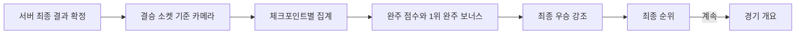

# 경기 종료 점수 집계와 최종 우승

현재 결과 화면은 [결승 순위에서 끝난다](#점수판-구도와-결승-카드-공개-순서). 앞선 절의 경기 개요 전환은 해당 버전의 검증 기록이다.

## 영상과 화면 흐름

Switch 플레이 영상 1:29–1:38과 4:13–4:25에서 체크포인트 번호별 점수, 완주 점수, 선착 보너스, 순위 순서와 숫자·막대의 움직임을 확인했다. 10월 30일 멀티플레이 영상 11:02–11:11의 결승 카메라, 순위 공개, 계속 입력 후 경기 개요 전환도 참고했다. 화면 외형에는 ProjectMW의 기존 결과 위젯과 서체를 사용했다.

## 변경 위치

| 위치 | 역할 |
| --- | --- |
| `MWGameplayGameMode.h/.cpp` | 서버가 지급한 체크포인트 점수를 통과 순서대로 기록한다. GameMode BP에서 체크포인트·완주 순서별 점수와 1위 완주 보너스를 편집할 수 있다. 기본 총액은 체크포인트 100점, 완주 순서대로 300·150·50점이다. 1위 완주는 기본 150점과 보너스 150점으로 표시한다. |
| `MWRoomTypes.h/.cpp` | 지급 내역을 라운드 결과와 함께 전송한다. 점수 없이 통과한 번호도 기록한다. 표시 기록의 전송 한도를 넘긴 점수는 전체 점수에서 확인해 하나의 집계 줄로 표시한다. 동일 경기에서는 서버·클라이언트가 같은 Git 빌드를 사용한다. |
| `MWMatchResultsWidget.h/.cpp` | 서버 누적 점수에서 마지막 라운드 지급액을 뺀 값으로 시작해 실제 지급 순서대로 올린다. 순위는 서버 최종 결과를 표시하며 1위 완주 보너스와 최종 우승을 별개의 값으로 처리한다. |
| `WBP_MatchResults`·`WBP_MatchResultRow` | 문구, 시간, 막대·배경·서체, 카메라 위치와 결승 소켓 기준 Niagara를 편집한다. |
| `MWGameplayHUDSubsystem`·`MWGameplayPlayerController` | 최종 결과가 준비된 로컬 창에 한 번만 화면을 열고 가림막의 포커스 우선권을 지킨다. 계속 버튼으로 같은 창의 경기 개요를 연다. |
| `Config/DefaultGame.ini` | 실행 시 사용할 결과 WBP 클래스와 쿠킹 대상 경로를 등록한다. |

서든데스처럼 새로 지급된 점수가 없는 경기는 집계를 건너뛴다. 결승 포트 기준 카메라가 준비되지 않으면 집계 또는 우승 화면부터 표시한다. 경기 개요에서 로비 복귀는 보류했다.

## 빌드·자동화

- 기준은 `origin/main 5a4006d`다. UE 5.8 `MWEditor Win64 Development` 빌드와 결과 WBP 두 개의 컴파일을 통과했다.
- `MW.Gameplay.PlayerRound` 3개, `MW.Gameplay.RoundLoop` 3개가 통과했다. 결과 스냅샷의 순서·점수·선착 보너스 직렬화, 기존 정상 집계, 전원 재선택, 서든데스 전환을 확인했다.
- 체크포인트 안내 커밋 `3aa5884`와 공통으로 변경한 `DefaultGame.ini`, `MWGameplayHUDSubsystem.h/.cpp`는 같은 main 기준으로 3방향 병합 모의 검사에서 줄 충돌이 없었다.

## 3인 PIE 검증과 시각 검토

- 기본 목표 4,000점으로 7라운드까지 진행했다. Cua Driver로 트랙을 설치했고 테스트 보조 스크립트는 차량을 실제 체크포인트와 결승 트리거에 옮겼다. 6·7라운드의 호스트 배치에서 차를 따라가던 카메라가 끝점을 화면 밖에 뒀으므로 시험 중 기존 배치 카메라를 다시 지정했다. 설치와 채점은 서버 경로를 사용했다.
- 세 창에서 결승 카메라, 체크포인트 6개, 완주, 1위 완주 보너스, 우승 강조, 최종 순위를 확인했다. 서버 최종 점수는 4,300·3,250·2,550점이다. 이번 실행에서 경기 개요 전환은 결과 로그로 확인되지 않았다. [호스트 캡처](Evidence/MatchResultsTally/local-standings-preview.png), [빌드·서버 결과·세 창 연출 로그](Evidence/MatchResultsTally/pie-evidence.txt)
- 현재 위젯은 기존 가로 행 표를 사용한다. Switch 영상의 참가자별 세로 집계와 10월 30일 영상의 결승선 위 순위 카드와 외형이 다르다. 검증은 집계와 순위 데이터의 동작까지다.
- 기존 결과 WBP 두 개는 UVCS `cs:76`에서 들어왔다. 현재 검토본은 별도 셸브 `sh:15@ProjectMW/ProjectMW@sms1599@unity`에 두 파일만 올렸다. Git 커밋과 푸시는 시각 검토를 위해 보류했다.

## 원본 자료 목록

기존 로컬 추출 폴더 `C:/workspace/Unpack/AssetStudio`에서 `Road Sign Scores.png`와 `Road Sign Results.png`를 확인했다. 둘 다 비어 있는 판 프레임이다. `t_iconScore.png`와 `t_iconCheckpoints.png`는 각각 GO와 STOP 표지 아이콘이며 주행 중 점수 및 통과 안내 완성 화면으로 볼 수 없다. 같은 폴더에 `Victory Canvas`·`Victory Camera` FBX와 `Scorebar Loop` 음원도 있다. 현재 `Content/UI/Results`에는 UE에서 만든 WBP 두 개가 있다. 이 WBP 제작 기록은 공용 `T_MW_MenuSign`과 Noto Sans KR 사용을 보여 준다.

## 검토 후 레이아웃 수정

Switch 영상 4:01~4:13의 체크포인트 구간과 10월 30일 영상 9:30~10:30의 통과 장면에서 주행 중 별도 체크포인트 점수 토스트나 고정 누적 점수는 확인되지 않았다. Switch 4:12 전후 결승 근처 상단 중앙의 시계는 감소하는 시간이었다. 우상단에 스친 `Push 8 other players to their deaths`는 미션 진행 안내였다. 체크포인트 번호별 점수는 이후 집계판에서 확인됐다.

- `WBP_MatchResults`가 세 표면의 위치와 전환 시간을 편집한다. `WBP_MatchScoreColumn`은 아래에서 위로 채워지는 참가자별 막대, `WBP_MatchPodiumCard`는 결승선 한쪽에서 순서대로 열리는 순위 카드, `WBP_MatchResultRow`는 버튼을 누른 뒤 보는 경기 개요다.
- 막대와 순위의 참가자 색은 공용 팔레트에서 읽는다. 카드의 차량 이미지는 차량 선택에서 사용하던 공용 썸네일 설정을 조회한다. 닉네임·점수·순위는 서버에서 확정된 참가자 데이터다.
- 정상 라운드는 기존 서버 결과 대기 시간 안에서 집계와 라운드 순위를 표시한다. 최종 결과는 결승 카메라에서 집계를 시작하고 마지막에 순위 카드를 공개한다. 같은 라운드에서 정상 결과가 최종 결과로 바뀌면 별도의 표시로 처리한다.
- 주행 중 상시 우상단 점수 슬롯을 제거했다. 이 브랜치에서는 체크포인트 토스트 클래스를 등록하지 않는다. 기존 경기에는 첫 완주 이후 별도 제한시간이 없어, 영상의 카운트다운에 해당하는 추가 경기 규칙을 도입하지 않았다. 체크포인트 판정·점수 지급은 기존 서버 경로를 사용한다.

### 3인 PIE 레이아웃 비교

- 변경 전 주행 [P2](Evidence/MatchResultsTally/before-checkpoint-p2.png), 변경 후 실제 체크포인트 통과 [P1](Evidence/MatchResultsTally/after-checkpoint-p1.png) · [P2](Evidence/MatchResultsTally/after-checkpoint-p2.png) · [P3](Evidence/MatchResultsTally/after-checkpoint-p3.png)
- 변경 전 [가로 결과표](Evidence/MatchResultsTally/local-standings-preview.png), 변경 후 [체크포인트 세로 집계](Evidence/MatchResultsTally/after-round-tally-p1.png)
- 설원 리슨 서버와 두 클라이언트에서 두 라운드를 진행했다. Cua Driver로 조각 설치와 `계속` 클릭을 수행했다. 검증은 PIE 서버 인스턴스의 목표만 550으로 낮추고 로비 요청과 차량 위치를 보조했다. 두 번째 라운드에서 호스트 배치 카메라를 기존 선택판 카메라로 한 번 다시 지정했다. 실제 체크포인트·결승 트리거가 점수를 지급했다.
- 호스트 1280×722, 원격 창 800×482에서 토스트·상시 누적 점수 없이 세 명이 각각 100점을 받았다. 세 창이 서버 최종 점수 700·400·200과 같은 순위를 표시했고, 세 창에서 각각 `계속`을 눌러 경기 개요를 열었다. [레이아웃 검증 로그](Evidence/MatchResultsTally/layout-pie-evidence.txt)

### 최종 순위 재검증

- 카드 사이 여백과 순위 글자 대비를 보완했다. 이미 해당 라운드 집계를 본 창은 같은 라운드의 최종 결과에서 합산을 건너뛰고 결승 카메라 뒤 순위 카드를 공개한다. 최종 결과로 처음 진입한 창은 스냅샷으로 집계부터 표시할 수 있다.
- 목표 250점의 별도 3인 PIE에서 세 창 모두 완주와 선착 보너스를 한 번씩만 집계했다. 정상 결과에서 최종 결과로 전환된 후 재집계 없이 1위부터 공개했고, 300·150·50점 순위 카드와 세 창의 `계속 → 경기 개요`를 확인했다. [1위 등장](Evidence/MatchResultsTally/after-first-position-entry.png) · [P1](Evidence/MatchResultsTally/after-podium-p1.png) · [P2](Evidence/MatchResultsTally/after-podium-p2.png) · [P3](Evidence/MatchResultsTally/after-podium-p3.png) · [P2 경기 개요](Evidence/MatchResultsTally/after-overview-p2.png) · [최종 검증 로그](Evidence/MatchResultsTally/layout-final-evidence.txt)
- PIE 전용 목표 변경 명령을 제거한 소스로 Editor 재빌드 및 `MW.Gameplay.PlayerRound`·`MW.Gameplay.RoundLoop` 자동화 6개 재실행까지 통과했다.

### `4501245` 검증 시점의 로컬 에셋 버전

| 파일 | SHA-256 |
| --- | --- |
| `WBP_MatchResults.uasset` | `D1330A5ADA722A0A72563EDB85F10BB6F74DE923723DB388992759696BAAFDB0` |
| `WBP_MatchScoreColumn.uasset` | `76C33A3069033AC1D18C036AF4CFF9D23EC55C9A7C7C94063EEAE8F0AD779AB5` |
| `WBP_MatchPodiumCard.uasset` | `A5E31F72BE8F5F7B457B1EB54C12377D9DA3CC6D921239095BBBE7C8EFADDD97` |
| `WBP_MatchResultRow.uasset` | `2996885BA79083614602C56B70E97EB62934B3264463B8823E0798688D8EC67C` · cs:76 원본 |

앞서 만든 `sh:15`는 변경 전 가로 결과표 검토본이다. 위 해시는 `4501245`의 검증 당시 기록이다.

최신 수정본으로 다시 모의 병합했을 때 기존 `feature/checkpoint-feedback@3aa5884`와 `MWGameplayHUDSubsystem.cpp` 오버레이 슬롯에서 줄 충돌 한 곳이 발생했다. 기존 브랜치가 파란 토스트 슬롯을 추가한 바로 아래에 있던 우상단 점수 슬롯을 이번 브랜치가 제거했기 때문이다. 위의 충돌 없음 결과는 레이아웃 수정 전 검토본에 해당한다.

## 점수 막대와 결승 순위 표지판 연결

10월 30일 멀티플레이 영상 10:38에서 이름은 막대의 채움 경계 위에, 점수는 경계 바로 아래에 함께 움직인다. 11:04에서는 결승선 위 중앙의 1위 카드가 아래 순위 카드보다 크게 보인다. 두 장면을 기준으로 표지판과 이름·점수의 배치를 비교했다.

| 수정 위치 | 편집·실행 동작 |
| --- | --- |
| `Content/UI/Results/WBP_MatchScoreColumn.uasset` | `ScoreBar.WidgetStyle.FillImage`에 `T_Road_Sign_Scores_5b1bec523c37`을 연결했다. `MeterSurface`에서 막대와 글자 캔버스를 같은 영역에 채운다. 닉네임과 점수의 간격·가로 정렬·글꼴은 WBP에서 편집한다. |
| `Source/MW/UI/Gameplay/MWMatchResultsWidget.cpp`의 `SetTallyScore` | 현재 점수와 집계 기준 점수로 채움 비율을 계산한다. 두 글자 슬롯의 세로 앵커에 `1 - 채움 비율`을 적용해 점수 집계 중 같은 높이로 움직이게 했다. 낮은 점수에서도 글자 전체를 읽을 수 있도록 막대 경계에서 자르지 않는다. |
| `Content/UI/Results/WBP_MatchPodiumCard.uasset` | `CardBackground`에 `T_Road_Sign_Results_a96ddda0cc90`을 연결했다. 이름과 점수를 표지판 안의 같은 줄에 배치했다. 카드 색은 공용 참가자 팔레트에서 읽는다. |
| `Content/UI/Results/WBP_MatchResults.uasset` 및 `MWMatchResultsWidget.h/.cpp`의 `Present`, `UpdatePodium` | WBP가 중앙의 `WinnerCardHost`, 아래 순위 카드의 크기와 간격, 코스 중앙선을 보는 결승 카메라 구도를 소유한다. `PodiumFit`의 좌우 여백을 대칭으로 지정했다. C++은 서버의 최종 순위 1을 해당 슬롯에 넣고 서버 순서대로 카드를 공개한다. 이전 WBP에 전용 슬롯이 없으면 그 버전의 일반 카드 목록으로 표시한다. |

### Cua Driver 3인 PIE 비교

| 장면 | 수정 전 | 수정 후 |
| --- | --- | --- |
| 세로 집계 | [완주 점수 집계](Evidence/MatchResultsTally/score-sign-before-tally-p1.png) | [선착 보너스로 상승 중](Evidence/MatchResultsTally/score-sign-tally-rising-p1.png) · [집계 완료](Evidence/MatchResultsTally/score-sign-tally-final-p1.png) |
| 결승 순위 | [기존 호스트 순위](Evidence/MatchResultsTally/after-podium-p1.png) | [1위 첫 공개](Evidence/MatchResultsTally/score-sign-winner-entry-p2.png) · [호스트](Evidence/MatchResultsTally/score-sign-podium-p1.png) · [클라이언트 1](Evidence/MatchResultsTally/score-sign-podium-p2.png) · [클라이언트 2](Evidence/MatchResultsTally/score-sign-podium-p3.png) |

- 설원에서 실제 코스에 참가자 세 명의 조각이 설치됐다. 호스트 뷰포트 1280×722와 클라이언트 두 창 800×482에서 점수 집계, 결승 카메라, 1위 선공개, 최종 순위, `계속 → 경기 개요`를 확인했다. 설치 입력과 최종 화면 캡처는 Cua Driver로 수행했다.
- 각 창에서 막대와 두 글자의 세로 위치를 39번씩 읽었다. 세 창 총 117개 표본에서 두 앵커 모두 `1 - 채움 비율`과 일치했다. 부동소수점 비교 허용 오차는 `0.000002`다. 최종 점수는 세 창 모두 300·150·50점이었다. 정지 화면의 1위 카드는 2·3위 카드의 약 1.5배 너비로 보였다. [빌드·서버·화면·앵커 로그](Evidence/MatchResultsTally/score-sign-pie-evidence.txt)
- 좌우 여백 수정 전 1위 카드의 중심은 캡처 중앙보다 호스트 15px, 두 클라이언트 13.5px 오른쪽에 있었다. 수정 뒤에는 정지 프레임에서 세 창 모두 가로 오차 0px였다. 이 실행에서는 라운드 집계가 끝나기 전에 최종 결과로 전환되어, 결승 카메라 뒤에서 기존 흐름대로 집계를 다시 표시했다.
- 결과 장면을 반복해서 보기 위해 PIE 서버 목표만 250점으로 설정했다. 보조 스크립트가 로비·선택 요청을 보내고 차량을 실제 결승 트리거로 이동했다. 완주와 점수는 서버가 판정했다. 검증 뒤 PIE 전용 명령을 제거하고 Editor 재빌드 및 `MW.Gameplay.PlayerRound`·`MW.Gameplay.RoundLoop` 자동화 6개를 통과했다.

### 검토용 로컬 WBP 해시

| 파일 | SHA-256 |
| --- | --- |
| `WBP_MatchScoreColumn.uasset` | `5021011559E17E6A594459488D57B052C44036C5FDAA4C54E87F5562D2A5A299` |
| `WBP_MatchPodiumCard.uasset` | `3A01441ED91DD7A948CB70D2E68BB271EA96CCC365258D0900E5D9AC1C86FDEF` |
| `WBP_MatchResults.uasset` | `55BB0A27F619A4FF839A413E95A59BC2B93DE3E7DAECCA0A0CC1970E5DD9F937` |

세 WBP를 컴파일하고 두 브러시 리소스가 지정한 텍스처를 참조하는지 확인했다. 두 텍스처와 `WBP_MatchResultRow`의 해시는 작업 전과 동일하다. 세 WBP는 검토용 로컬본으로 보관한다. Git 푸시와 UVCS 체크인은 사용자 확인 대기다.

## 파란 집계판·차량 배지·결승 메달

10월 30일 멀티플레이 영상 10:38에서 파란 판면과 네 모서리 볼트, 상단 로고, 세로 막대 안의 차량 배지를 대조했다. 11:04의 결승 순위에서는 이름판 앞에 붙은 금·은·동 메달을 확인했다. ProjectMW의 Noto Sans KR, 참가자 팔레트, 결승 카드 배치를 적용했다.

| 수정 위치 | 편집·실행 동작 |
| --- | --- |
| `Content/UI/Results/WBP_MatchResults.uasset` | `TallySignArt` 아래 `TallySignFace`에 파란 `T_Road_Sign_Background_852f137d0c4e`을 사용한다. `TallyBolt*` 네 개는 `T_Road_Sign_Bolts_442797e33bc2`를 각 모서리에 앵커로 배치한다. 상단 `TallySignLogo`와 뒤쪽 `TallySignPole`도 기존 텍스처를 사용한다. |
| `Content/UI/Results/WBP_MatchScoreColumn.uasset` | `TallyScoreMarker` 아래에 배지와 점수 글자를 한 줄로 배치했다. `TallyBadgeBackground`에서 `T_Vehicle_Badge_Background_7d063220e79b`를 사용한다. 채움이 짧을 때도 배지와 점수를 읽을 수 있게 하단 여백을 둔다. |
| `Content/UI/Results/WBP_MatchPodiumCard.uasset` | 모든 결승 이름판이 같은 WBP를 사용한다. `RankMedals` 스위처가 금·은·동 `Ribbon` 브러시를 1·2·3위 순으로 보관한다. |
| `Source/MW/UI/Gameplay/MWMatchResultsWidget.h/.cpp` | `SetResult`가 서버 확정 순위로 메달을 선택하고 차량 선택과 같은 썸네일을 집계와 결승 목록에 표시한다. 메달 이미지가 없는 순위는 순위 번호와 참가자 색을 표시한다. `SetTallyScore`는 이름과 배지·점수 슬롯의 세로 앵커에 같은 `1 - 채움 비율`을 적용한다. |

### Cua Driver 3인 PIE

| 장면 | 변경 전 `e683996` | 변경 후 |
| --- | --- | --- |
| 중간 점수판 | [기존 집계판](Evidence/MatchResultsTally/score-sign-tally-rising-p1.png) | [203점](Evidence/MatchResultsTally/score-panel-tally-p1.png) · [258점](Evidence/MatchResultsTally/score-panel-tally-rise-p1.png) |
| 결승 순위 | [기존 순위판](Evidence/MatchResultsTally/score-sign-podium-p1.png) | [호스트](Evidence/MatchResultsTally/score-panel-podium-p1.png) · [클라이언트 1](Evidence/MatchResultsTally/score-panel-podium-p2.png) · [클라이언트 2](Evidence/MatchResultsTally/score-panel-podium-p3.png) |

- 호스트 1280×722, 클라이언트 두 창 800×482에서 세 사람 모두 트랙을 설치하고 같은 결승 순위와 `계속 → 경기 개요`를 확인했다. PIE 목표 250점과 차량 위치 보조를 사용했다. 완주·점수·순위는 실제 결승 트리거에서 서버가 확정했다.
- 각 창에서 이름·배지·점수 높이와 차량 썸네일을 132번씩 읽어 396개 표본이 모두 일치했다. 서버 순위와 스위처가 실제로 표시한 금·은·동 브러시도 9개 모두 일치했다. [PIE·브러시·앵커 로그](Evidence/MatchResultsTally/score-panel-pie-evidence.txt)
- 판면의 긁힘이 실행에 따라 약하게 보이는 프레임이 있었다. 로고·볼트·차량 배지·순위 메달은 캡처에서 확인했다.
- 임시 PIE 명령을 제거한 뒤 UE 5.8 `MWEditor Win64 Development` 빌드와 `MW.Gameplay.PlayerRound`·`MW.Gameplay.RoundLoop` 자동화 6개가 통과했다.

### 검토용 로컬 WBP 해시

| 파일 | SHA-256 |
| --- | --- |
| `WBP_MatchResults.uasset` | `E66424EDE1359B8A3F5137CEE6AA230D0D852D8F3705E67264C1D579687AC492` |
| `WBP_MatchScoreColumn.uasset` | `326ADD1987AF37D106CB306C06BB34CE7F5738703548D7BCE0EBB72B78782669` |
| `WBP_MatchPodiumCard.uasset` | `06B6A7771C74A184A03E23C3F9E01E935A77AE24096AB03173D232EC2D0D430D` |

세 WBP의 컴파일과 실제 위젯의 브러시 연결을 확인했다. 원본 텍스처는 기존 에셋을 참조한다. 세 WBP는 로컬에서 검토할 수 있다. Git 푸시와 UVCS 체크인은 사용자 확인 대기다.

## 점수판 구도와 결승 카드 공개 순서

10월 30일 플레이 영상의 10:38 프레임에서 판면이 화면 너비의 약 80%를 차지했다. 11:03대는 영상을 초당 20장으로 샘플링했다. 이름판이 화면 안에 처음 들어온 시각을 기준으로 1위 약 11:03.25, 2위 약 11:03.45, 3위 약 11:03.65에 등장했다. 메달은 이름판보다 먼저 보이는 구간이 있어 비교 시각은 이름판으로 통일했다.

| 편집 위치 | 변경 |
| --- | --- |
| `Content/UI/Results/WBP_MatchResults.uasset` | 점수판을 안전 영역 중앙에 놓고 디자인 폭을 1,130에서 1,480으로 넓혔다. 좌우 여백으로 참가자 열을 중앙에 묶었다. 결승 순위는 1위 슬롯 폭 1,230, 아래 순위 폭 820을 사용한다. 숫자는 WBP 디자인 단위다. 개요 패널과 `계속` 버튼을 위젯 트리에서 제거했다. |
| `Content/UI/Results/WBP_MatchScoreColumn.uasset` | 막대 높이를 334에서 482 디자인 단위로 늘렸다. 낮은 점수에서 배지와 숫자가 읽히도록 하단 여백을 뒀다. |
| `Source/MW/UI/Gameplay/MWMatchResultsWidget.h/.cpp` | `UpdatePodium`은 WBP에 저장된 진입 시간과 1위 단독 표시 시간을 적용한다. 1위가 자리를 잡은 뒤 하위 순위를 서버 확정 순서대로 공개한다. `Standings`가 이 위젯의 마지막 상태다. 이전 WBP에서 로드되는 개요와 버튼은 선택 바인딩으로 접는다. |

세 사람일 때 WBP의 진입 시간 0.66초를 카드당 0.22초로 나눈다. 1위 카드는 진입을 마친 뒤 0.30초간 단독으로 보인다. 그 뒤 2위와 3위를 각각 0.22초 간격으로 공개한다. 로비 복귀 흐름은 앞서 보류한 범위다.

### Cua Driver 3인 PIE 전후 비교

| 장면 | 변경 전 `a325a54` | 변경 후 |
| --- | --- | --- |
| 중간 점수판 | [호스트 58.8% 너비](Evidence/MatchResultsTally/score-panel-tally-p1.png) | [같은 크기의 호스트 창 76.9% 너비](Evidence/MatchResultsTally/podium-layout-tally-p1.png) |
| 결승 순위 | [이전 카드 크기와 계속 버튼](Evidence/MatchResultsTally/score-panel-podium-p1.png) | [1위 단독](Evidence/MatchResultsTally/podium-layout-first-only-p1.png) · [2위가 열린 뒤 3위 진입](Evidence/MatchResultsTally/podium-layout-lower-entry-p1.png) · [최종 호스트](Evidence/MatchResultsTally/podium-layout-final-p1.png) · [4:3](Evidence/MatchResultsTally/podium-layout-final-p2.png) · [21:9](Evidence/MatchResultsTally/podium-layout-final-p3.png) |

| 첫 이름판이 보인 뒤 | 영상 | 호스트 1280×722 | 클라이언트 924×693 | 클라이언트 1120×480 |
| --- | ---: | ---: | ---: | ---: |
| 2위 첫 공개 | 약 0.20초 | 0.609초 | 0.563초 | 0.515초 |
| 3위 첫 공개 | 약 0.40초 | 0.843초 | 0.797초 | 0.750초 |

- PIE는 카드 불투명도가 0.01을 넘은 첫 표본을 쟀다. 세 창에서 1위만 완전히 보이는 프레임이 있었고, 2위에서 3위까지는 약 0.23초였다. 1위 단독 구간을 둬 영상보다 2위가 늦게 시작한다. 결승 카드에는 ProjectMW의 수평 배치와 서체를 적용했다.
- 4:3에서는 판면이 창 너비의 95.9%, 21:9에서는 높이에 맞춰 58.5%로 표시됐다. 각 창에서 판면과 배지, 숫자, 카드가 잘리지 않았다. 21:9의 결승 카메라에는 기존 좌우 검은 여백이 보인다. 첫 21:9 순위 캡처에선 녹색 포인터 모양 표시가 메달 일부를 잠깐 가렸고, 멈춘 뒤 재확인한 캡처에서는 사라졌다.
- Cua Driver로 세 사람의 트랙 조각을 배치했다. PIE 목표를 250점으로 설정하고 보조 스크립트로 차량을 실제 완주 트리거까지 이동했다. 세 창에 서버 결과인 300·150·50점이 표시됐다. 각 창에서 Enter와 Space를 눌렀고 세 창 모두 `Standings`에 머물렀다. 실행 중 위젯 트리와 저장된 WBP 양쪽에서 개요와 계속 버튼의 부재를 확인했다. [빌드·PIE·타이밍 로그](Evidence/MatchResultsTally/podium-layout-pie-evidence.txt)

| 검토용 로컬 WBP | SHA-256 |
| --- | --- |
| `WBP_MatchResults.uasset` | `B2CCFDA065D103347CCC40D33E29D5A6BD4B383B10823B34DA9AF76D1DD06C8A` |
| `WBP_MatchScoreColumn.uasset` | `DA5AB9AE4ECBA05B9BEF33353506593118B7B396D68BDDB9ECA3898F21BCCA07` |

이전 개요 트리의 GUID 정리 후 새 프로세스에서 두 WBP를 로드해 컴파일 오류 0건을 확인했다. 저장 없는 검증 전후 해시는 동일하다. 두 WBP는 로컬 검토본이며 Git 푸시와 UVCS 체크인은 확인 대기다.

임시 PIE 명령을 제거하고 UE 5.8 `MWEditor Win64 Development`를 재빌드했다. `MW.Gameplay.PlayerRound`와 `MW.Gameplay.RoundLoop` 자동화 6개가 통과했다.

## 결승 시점과 순위 카드 속도 조정

`8697e6d`의 캡처와 영상 11:03–11:04를 대조했다. 직전 구현에서는 영상의 약 0.20초보다 2위가 0.32~0.41초 늦게 나왔고, 카메라는 결승판 정면에 가까웠다. 영상에서는 결승선 바닥과 차량이 먼저 보이고, 배너에선 이름과 차량이 가장 큰 요소다.

- `WBP_MatchResults`의 `CameraOffset`과 `LookAtOffset`을 결승 소켓에 상대 배치해 시선의 하향 각도를 약 28°로 설정했다. `PodiumHeadingPlate`를 접고, `PodiumFit`과 `WinnerCardExtent`에서 이름판의 위치와 높이를 편집했다. 세 명일 때 각 카드의 명목 진입 시간은 0.17초, 1위 단독 정지는 0.04초다.
- `WBP_MatchPodiumCard`의 이름 크기는 35에서 52 디자인 단위로 늘렸다. 카드 높이와 메달·차량의 공간을 키우고 점수 크기를 줄였다. 결과에는 ProjectMW의 수평 카드, 참가자 색, 기존 차량 썸네일을 사용한다. 영상의 기울어진 배너와 3D 차량·파티클 구도는 이 캡처와 다르다. 새 시야에서는 결승선이 드러나고 상단 `FINISH` 모형 일부는 화면 경계에 걸린다.

| 첫 이름판이 보인 뒤 | 영상 | 직전 3인 PIE | 이번 3인 PIE |
| --- | ---: | ---: | ---: |
| 2위 첫 공개 | 약 0.20초 | 0.515~0.609초 | 0.250~0.328초 |
| 3위 첫 공개 | 약 0.40초 | 0.750~0.843초 | 0.407~0.500초 |

같은 1280×722 호스트와 924×693·1120×480 클라이언트에서 1위 → 2위 → 3위와 최종 순위 유지를 확인했다. Cua Driver로 코스 조각을 배치했다. 결과 장면을 반복 검토하기 위해 PIE 목표를 250점으로 설정하고 차량을 실제 결승 트리거에 옮겼다. 1위 단독 구간은 위젯 불투명도 표본으로, 카메라·2위 진입·최종 배치는 캡처로 확인했다. [직전 호스트](Evidence/MatchResultsTally/podium-layout-final-p1.png) · [결승 카메라](Evidence/MatchResultsTally/finish-framing-camera-p1.png) · [2위 진입](Evidence/MatchResultsTally/finish-framing-lower-p1.png) · [수정 후 호스트](Evidence/MatchResultsTally/finish-framing-final-p1.png) · [4:3](Evidence/MatchResultsTally/finish-framing-final-p2.png) · [21:9](Evidence/MatchResultsTally/finish-framing-final-p3.png) · [PIE 로그](Evidence/MatchResultsTally/finish-framing-pie-evidence.txt)

| 로컬 WBP | SHA-256 |
| --- | --- |
| `WBP_MatchResults.uasset` | `7A5600696DBABFE12B644562FD4F3354218AD04827DE1F5917DE3138E5457E3A` |
| `WBP_MatchPodiumCard.uasset` | `A75D67E086A94DB55C5C19DAFEFCBF70165FBC5B20EF128F48C9641650E264EE` |

두 WBP는 컴파일 후 3인 PIE에서 사용한 로컬본이다. 임시 PIE 명령을 제거한 뒤 Editor 재빌드도 확인했다. Git 푸시와 UVCS 체크인은 확인 대기다.
