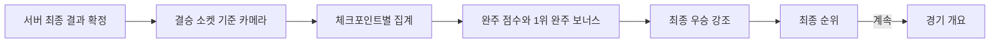

# 경기 종료 점수 집계와 최종 우승

## 영상과 화면 흐름

Switch 플레이 영상 1:29–1:38과 4:13–4:25에서 체크포인트 번호별 점수, 완주 점수, 선착 보너스, 순위 순서와 숫자·막대의 움직임을 확인했다. 10월 30일 멀티플레이 영상 11:02–11:11의 결승 카메라, 순위 공개, 계속 입력 후 경기 개요 전환도 참고했다. 화면 외형에는 ProjectMW의 기존 결과 위젯과 서체를 사용했다.

## 변경 위치

| 위치 | 역할 |
| --- | --- |
| `MWGameplayGameMode.h/.cpp` | 서버가 지급한 체크포인트 점수를 통과 순서대로 기록한다. GameMode BP에서 체크포인트·완주 순서별 점수와 1위 완주 보너스를 편집할 수 있다. 기본 총액은 체크포인트 100점, 완주 순서대로 300·150·50점이다. 1위 완주는 기본 150점과 보너스 150점으로 표시한다. |
| `MWRoomTypes.h/.cpp` | 지급 내역을 라운드 결과와 함께 전송한다. 점수 없이 통과한 번호도 기록한다. 표시 기록의 전송 한도를 넘긴 점수는 전체 점수에서 확인해 하나의 집계 줄로 표시한다. 동일 경기에서는 서버·클라이언트가 같은 Git 빌드를 사용한다. |
| `MWMatchResultsWidget.h/.cpp` | 서버 누적 점수에서 마지막 라운드 지급액을 뺀 값으로 시작해 실제 지급 순서대로 올린다. 순위는 서버 최종 결과를 표시하며 1위 완주 보너스와 최종 우승을 별개의 값으로 처리한다. |
| `WBP_MatchResults`·`WBP_MatchResultRow` | 문구, 시간, 막대·배경·서체, 카메라 위치와 결승 소켓 기준 Niagara를 편집한다. |
| `MWGameplayHUDSubsystem`·`MWGameplayPlayerController` | 최종 결과가 준비된 로컬 창에 한 번만 화면을 열고 가림막의 포커스 우선권을 지킨다. 계속 버튼으로 같은 창의 경기 개요를 연다. |
| `Config/DefaultGame.ini` | 실행 시 사용할 결과 WBP 클래스와 쿠킹 대상 경로를 등록한다. |

서든데스처럼 새로 지급된 점수가 없는 경기는 집계를 건너뛴다. 결승 포트 기준 카메라가 준비되지 않으면 집계 또는 우승 화면부터 표시한다. 경기 개요에서 로비 복귀는 보류했다.

## 빌드·자동화

- 기준은 `origin/main 5a4006d`다. UE 5.8 `MWEditor Win64 Development` 빌드와 결과 WBP 두 개의 컴파일을 통과했다.
- `MW.Gameplay.PlayerRound` 3개, `MW.Gameplay.RoundLoop` 3개가 통과했다. 결과 스냅샷의 순서·점수·선착 보너스 직렬화, 기존 정상 집계, 전원 재선택, 서든데스 전환을 확인했다.
- 체크포인트 안내 커밋 `3aa5884`와 공통으로 변경한 `DefaultGame.ini`, `MWGameplayHUDSubsystem.h/.cpp`는 같은 main 기준으로 3방향 병합 모의 검사에서 줄 충돌이 없었다.

## 3인 PIE 검증과 시각 검토

- 기본 목표 4,000점으로 7라운드까지 진행했다. Cua Driver로 트랙을 설치했고 테스트 보조 스크립트는 차량을 실제 체크포인트와 결승 트리거에 옮겼다. 6·7라운드의 호스트 배치에서 차를 따라가던 카메라가 끝점을 화면 밖에 뒀으므로 시험 중 기존 배치 카메라를 다시 지정했다. 설치와 채점은 서버 경로를 사용했다.
- 세 창에서 결승 카메라, 체크포인트 6개, 완주, 1위 완주 보너스, 우승 강조, 최종 순위를 확인했다. 서버 최종 점수는 4,300·3,250·2,550점이다. 이번 실행에서 경기 개요 전환은 결과 로그로 확인되지 않았다. [호스트 캡처](Evidence/MatchResultsTally/local-standings-preview.png), [빌드·서버 결과·세 창 연출 로그](Evidence/MatchResultsTally/pie-evidence.txt)
- 현재 위젯은 기존 가로 행 표를 사용한다. Switch 영상의 참가자별 세로 집계와 10월 30일 영상의 결승선 위 순위 카드와 외형이 다르다. 검증은 집계와 순위 데이터의 동작까지다.
- 기존 결과 WBP 두 개는 UVCS `cs:76`에서 들어왔다. 현재 검토본은 별도 셸브 `sh:15@ProjectMW/ProjectMW@sms1599@unity`에 두 파일만 올렸다. Git 커밋과 푸시는 시각 검토를 위해 보류했다.

## 원본 자료 목록

기존 로컬 추출 폴더 `C:/workspace/Unpack/AssetStudio`에서 `Road Sign Scores.png`와 `Road Sign Results.png`를 확인했다. 둘 다 비어 있는 판 프레임이다. `t_iconScore.png`와 `t_iconCheckpoints.png`는 각각 GO와 STOP 표지 아이콘이며 주행 중 점수 및 통과 안내 완성 화면으로 볼 수 없다. 같은 폴더에 `Victory Canvas`·`Victory Camera` FBX와 `Scorebar Loop` 음원도 있다. 현재 `Content/UI/Results`에는 UE에서 만든 WBP 두 개가 있다. 이 WBP 제작 기록은 공용 `T_MW_MenuSign`과 Noto Sans KR 사용을 보여 준다.

## 검토 후 레이아웃 수정

Switch 영상 4:01~4:13의 체크포인트 구간과 10월 30일 영상 9:30~10:30의 통과 장면에서 주행 중 별도 체크포인트 점수 토스트나 고정 누적 점수는 확인되지 않았다. Switch 4:12 전후 결승 근처 상단 중앙의 시계는 감소하는 시간이었다. 우상단에 스친 `Push 8 other players to their deaths`는 미션 진행 안내였다. 체크포인트 번호별 점수는 이후 집계판에서 확인됐다.

- `WBP_MatchResults`가 세 표면의 위치와 전환 시간을 편집한다. `WBP_MatchScoreColumn`은 아래에서 위로 채워지는 참가자별 막대, `WBP_MatchPodiumCard`는 결승선 한쪽에서 순서대로 열리는 순위 카드, `WBP_MatchResultRow`는 버튼을 누른 뒤 보는 경기 개요다.
- 막대와 순위의 참가자 색은 공용 팔레트에서 읽는다. 카드의 차량 이미지는 차량 선택에서 사용하던 공용 썸네일 설정을 조회한다. 닉네임·점수·순위는 서버에서 확정된 참가자 데이터다.
- 정상 라운드는 기존 서버 결과 대기 시간 안에서 집계와 라운드 순위를 표시한다. 최종 결과는 결승 카메라에서 집계를 시작하고 마지막에 순위 카드를 공개한다. 같은 라운드에서 정상 결과가 최종 결과로 바뀌면 별도의 표시로 처리한다.
- 주행 중 상시 우상단 점수 슬롯을 제거했다. 이 브랜치에서는 체크포인트 토스트 클래스를 등록하지 않는다. 기존 경기에는 첫 완주 이후 별도 제한시간이 없어, 영상의 카운트다운에 해당하는 추가 경기 규칙을 도입하지 않았다. 체크포인트 판정·점수 지급은 기존 서버 경로를 사용한다.

### 3인 PIE 레이아웃 비교

- 변경 전 주행 [P2](Evidence/MatchResultsTally/before-checkpoint-p2.png), 변경 후 실제 체크포인트 통과 [P1](Evidence/MatchResultsTally/after-checkpoint-p1.png) · [P2](Evidence/MatchResultsTally/after-checkpoint-p2.png) · [P3](Evidence/MatchResultsTally/after-checkpoint-p3.png)
- 변경 전 [가로 결과표](Evidence/MatchResultsTally/local-standings-preview.png), 변경 후 [체크포인트 세로 집계](Evidence/MatchResultsTally/after-round-tally-p1.png)
- 설원 리슨 서버와 두 클라이언트에서 두 라운드를 진행했다. Cua Driver로 조각 설치와 `계속` 클릭을 수행했다. 검증은 PIE 서버 인스턴스의 목표만 550으로 낮추고 로비 요청과 차량 위치를 보조했다. 두 번째 라운드에서 호스트 배치 카메라를 기존 선택판 카메라로 한 번 다시 지정했다. 실제 체크포인트·결승 트리거가 점수를 지급했다.
- 호스트 1280×722, 원격 창 800×482에서 토스트·상시 누적 점수 없이 세 명이 각각 100점을 받았다. 세 창이 서버 최종 점수 700·400·200과 같은 순위를 표시했고, 세 창에서 각각 `계속`을 눌러 경기 개요를 열었다. [레이아웃 검증 로그](Evidence/MatchResultsTally/layout-pie-evidence.txt)

### 최종 순위 재검증

- 카드 사이 여백과 순위 글자 대비를 보완했다. 이미 해당 라운드 집계를 본 창은 같은 라운드의 최종 결과에서 합산을 건너뛰고 결승 카메라 뒤 순위 카드를 공개한다. 최종 결과로 처음 진입한 창은 스냅샷으로 집계부터 표시할 수 있다.
- 목표 250점의 별도 3인 PIE에서 세 창 모두 완주와 선착 보너스를 한 번씩만 집계했다. 정상 결과에서 최종 결과로 전환된 후 재집계 없이 1위부터 공개했고, 300·150·50점 순위 카드와 세 창의 `계속 → 경기 개요`를 확인했다. [1위 등장](Evidence/MatchResultsTally/after-first-position-entry.png) · [P1](Evidence/MatchResultsTally/after-podium-p1.png) · [P2](Evidence/MatchResultsTally/after-podium-p2.png) · [P3](Evidence/MatchResultsTally/after-podium-p3.png) · [P2 경기 개요](Evidence/MatchResultsTally/after-overview-p2.png) · [최종 검증 로그](Evidence/MatchResultsTally/layout-final-evidence.txt)
- PIE 전용 목표 변경 명령을 제거한 소스로 Editor 재빌드 및 `MW.Gameplay.PlayerRound`·`MW.Gameplay.RoundLoop` 자동화 6개 재실행까지 통과했다.

### 로컬 에셋 버전

| 파일 | SHA-256 |
| --- | --- |
| `WBP_MatchResults.uasset` | `D1330A5ADA722A0A72563EDB85F10BB6F74DE923723DB388992759696BAAFDB0` |
| `WBP_MatchScoreColumn.uasset` | `76C33A3069033AC1D18C036AF4CFF9D23EC55C9A7C7C94063EEAE8F0AD779AB5` |
| `WBP_MatchPodiumCard.uasset` | `A5E31F72BE8F5F7B457B1EB54C12377D9DA3CC6D921239095BBBE7C8EFADDD97` |
| `WBP_MatchResultRow.uasset` | `2996885BA79083614602C56B70E97EB62934B3264463B8823E0798688D8EC67C` · cs:76 원본 |

앞서 만든 `sh:15`는 변경 전 가로 결과표 검토본이다. 위 세 변경 에셋은 현재 작업 공간에서 검증했으며 새 UVCS 인계와 Git 푸시는 확인 대기 상태다.

최신 수정본으로 다시 모의 병합했을 때 기존 `feature/checkpoint-feedback@3aa5884`와 `MWGameplayHUDSubsystem.cpp` 오버레이 슬롯에서 줄 충돌 한 곳이 발생했다. 기존 브랜치가 파란 토스트 슬롯을 추가한 바로 아래에 있던 우상단 점수 슬롯을 이번 브랜치가 제거했기 때문이다. 위의 충돌 없음 결과는 레이아웃 수정 전 검토본에 해당한다.
