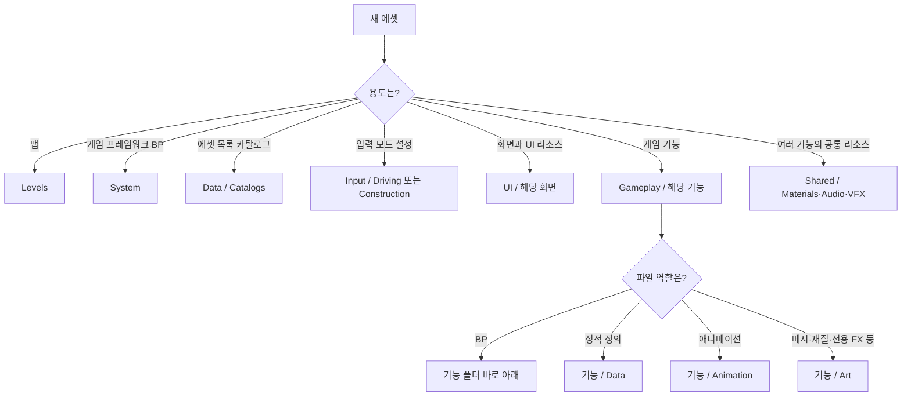
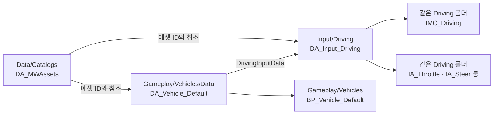

# Content Browser 폴더·에셋 배치 기준

**문서 번호:** MW-SHARED-CONTENT-001 / v1.0\
**적용:** ProjectMW의 Art·Client·Server·TA 공용 / UE 5.8.3 / 2026-10-22.\
**상태:** 공용 폴더·명명 기준. 기본 폴더 생성과 실제 에셋 제작/검증 상태는 구분한다.\
**원칙:** 기능으로 찾고, 파일 종류는 접두사로 구분한다. 이 문서는 Content 배치의 단일 기준이다. 기존 명세의 과거 폴더 예시보다 우선한다.

공용 작업 시에는 [공용 작업 규칙](WORK_RULES.md)과 함께 읽는다. 시스템 책임은 [개발명세](Client,Server/MakeWay_클라이언트_개발명세서_v1.0.md), AssetData/InputData 연결은 [공용 데이터 이식](Client,Server/06_공용_데이터_이식.md), 차량 입력·이동 구조는 [차량 상세 설계](Client,Server/07_차량_입력_이동_효과_설계.md)를 따른다. 이 문서는 해당 에셋을 **어디에 저장하고 어떤 이름으로 찾을지** 정한다.

## 1. 실제 만든 폴더 구조

```text
Content/                           # Content Browser의 /Game
├─ Levels/                         # 기존 맵 유지
├─ System/                         # GameMode·GameState·Controller 등의 BP
├─ Data/
│  └─ Catalogs/                    # 프로젝트 에셋 목록 MWAssetData
├─ Input/
│  ├─ Driving/                     # 주행 DA_Input + IMC + IA를 함께 보관
│  └─ Construction/                # 건설 DA_Input + IMC + IA를 함께 보관
├─ Gameplay/
│  ├─ Vehicles/                    # 차량 BP는 이 폴더 바로 아래
│  │  ├─ Data/                     # 차량 Definition·필요 시 공용 주행 데이터
│  │  ├─ Animation/                # ABP·BlendSpace 등
│  │  │  ├─ Sequences/             # AnimSequence
│  │  │  └─ Montages/              # AnimMontage
│  │  └─ Art/                     # 차량 메시·Skeleton·물리·재질·텍스처
│  ├─ Tracks/                      # 트랙·건설·체크포인트 BP
│  │  ├─ Data/                     # 트랙 정의·설치/스냅 관련 제작 데이터
│  │  └─ Art/                      # 도로·트랙 전용 시각 리소스
│  ├─ Items/                       # 사용하는 아이템·투사체 BP
│  │  ├─ Data/                     # 아이템 정의
│  │  └─ Art/                      # 아이템 전용 시각·소리 리소스
│  ├─ Hazards/                     # 범퍼·바리게이트 등 위험 요소 BP
│  │  ├─ Data/
│  │  └─ Art/
│  └─ Utilities/                   # 가속 패드·아이템 박스 등 보조 요소 BP
│     ├─ Data/
│     └─ Art/
├─ UI/
│  ├─ Common/                      # 공통 버튼·폰트·아이콘·UI 재질
│  ├─ Lobby/
│  ├─ Construction/
│  ├─ Race/
│  └─ Results/
├─ Shared/                         # 여러 기능에서 실제로 함께 쓰는 리소스
│  ├─ Materials/                   # 공통 Master Material 등
│  ├─ Audio/
│  └─ VFX/
├─ Developers/                     # 기존 개인 실험 영역 유지
└─ Collections/                    # 기존 에디터 컬렉션 유지
```

새 기본 폴더와 빈 폴더 보존용 `.gitkeep`를 만들었다. 위 구조의 생성이 BP·DataAsset·애니메이션 에셋 제작을 뜻하지는 않는다. 기존 `L_Dev_Default.umap`, `L_Dev_Drive.umap`, 엔진/게임 설정과 C++ 소스는 이 정리에서 이동하거나 수정하지 않았다.

폴더는 필요한 기능까지만 나눈다. 각 기능의 BP는 기능 폴더 바로 아래에 두며, 모든 기능에 `Blueprints`, `ABP`, `Mesh`, `Material`, `Texture` 폴더를 반복해서 만들지 않는다. 현재는 접두사와 Content Browser 타입 필터로 구분한다.

## 2. 어디에 저장할지 결정하는 순서



| 질문 | 적용 기준 |
|---|---|
| BP는 모두 System인가? | System은 경기 프레임워크 BP만 담당한다. 차량 BP는 Vehicles, 범퍼 BP는 Hazards에 둔다. |
| DataAsset은 모두 최상위 Data인가? | 최상위 Data는 프로젝트 공통 카탈로그용이다. 기능 정의는 해당 기능의 Data, InputData는 해당 입력 모드에 둔다. |
| 여러 에셋이 같은 차량 재질을 쓰면 Shared인가? | 차량 안에서만 재사용하면 Vehicles/Art에 둔다. 차량·트랙 등 서로 다른 기능이 함께 쓰는 리소스를 Shared로 분류한다. |
| 에셋을 여러 곳에 복사하는가? | 원본 한 곳을 다른 에셋에서 참조한다. 카탈로그 등록 때문에 실제 파일을 Data로 복사하지 않는다. |
| 부스터와 가속 패드는 같은 폴더인가? | 사용하는 아이템은 Items, 트랙 보조 요소는 Utilities다. 공통 차량 효과 API를 사용하더라도 소속 기능은 구분한다. |
| 모든 차량에 ABP/몽타주가 필요한가? | 선택한 차량 이동·리그가 요구할 때 제작한다. 폴더가 있다는 이유로 사용하지 않는 에셋을 만들지 않는다. |

## 3. 자주 만들 에셋의 저장 예시

아래 파일 이름은 **제작할 때의 예시**다. 이번 폴더 생성에서 실제 `.uasset`을 만든 것은 아니다. 경로는 Content Browser의 `/Game` 기준이다.

| 에셋 | 저장 예시 |
|---|---|
| GameMode / PlayerController BP | `/Game/System/BP_MWGameMode`, `/Game/System/BP_MWPlayerController` |
| 공용 에셋 목록 | `/Game/Data/Catalogs/DA_MWAssets` |
| 주행 입력 데이터 | `/Game/Input/Driving/DA_Input_Driving` |
| 주행 액션 / Context | `/Game/Input/Driving/IA_Throttle`, `/Game/Input/Driving/IMC_Driving` |
| 건설 입력 데이터 / 액션 | `/Game/Input/Construction/DA_Input_Construction`, `/Game/Input/Construction/IA_ConfirmPlacement` |
| 차량 BP | `/Game/Gameplay/Vehicles/BP_Vehicle_Default` |
| 차량 DefinitionData | `/Game/Gameplay/Vehicles/Data/DA_Vehicle_Default` |
| 차량 Animation Blueprint | `/Game/Gameplay/Vehicles/Animation/ABP_Vehicle_Default` |
| 차량 AnimSequence / Montage | `/Game/Gameplay/Vehicles/Animation/Sequences/AS_Vehicle_Example`, `/Game/Gameplay/Vehicles/Animation/Montages/AM_Vehicle_Example` |
| 차량 메시 / Skeleton / Physics Asset | `/Game/Gameplay/Vehicles/Art/SK_Vehicle_Default`, `SKEL_Vehicle_Default`, `PHYS_Vehicle_Default` |
| 트랙 BP / DataAsset / 메시 | `/Game/Gameplay/Tracks/BP_TrackPiece`, `Data/DA_Track_Straight`, `Art/SM_Track_Straight` |
| 부스터 아이템 / 데이터 | `/Game/Gameplay/Items/BP_Item_Boost`, `Data/DA_Item_Boost` |
| 범퍼 / 가속 패드 | `/Game/Gameplay/Hazards/BP_Hazard_Bumper`, `/Game/Gameplay/Utilities/BP_Utility_BoostPad` |
| 레이스 HUD | `/Game/UI/Race/WBP_RaceHUD` |
| 공통 머티리얼 | `/Game/Shared/Materials/M_Master_Surface` |

예시 중 같은 행의 짧은 이름/상대 경로는 첫 전체 경로의 에셋이 위치한 폴더를 기준으로 한다. 차량 외형이 추가되어 실제로 찾기 어려워질 때 `Vehicles/<VehicleName>` 등으로 확장한다. 출시 차량 1종 단계에서 외형별 폴더와 빈 하위 유형을 미리 늘리지 않는다.

## 4. 타입 접두사

`접두사_대상_역할`을 기본으로 하고 경로·파일 이름은 영문으로 작성한다. 이름에는 기능을 포함해 폴더 밖 검색 결과에서도 식별할 수 있게 한다.

| 파일 종류 | 접두사 | 예시 |
|---|---|---|
| Blueprint | `BP_` | `BP_Vehicle_Default` |
| Blueprint ActorComponent / Interface | `AC_` / `BI_` | `AC_Example`, `BI_Example` |
| Animation Blueprint | `ABP_` | `ABP_Vehicle_Default` |
| AnimSequence | `AS_` | `AS_Vehicle_Example` |
| AnimMontage | `AM_` | `AM_Vehicle_Example` |
| BlendSpace | `BS_` | `BS_Vehicle_Example` |
| DataAsset / DataTable | `DA_` / `DT_` | `DA_Vehicle_Default`, `DT_Example` |
| InputAction / InputMappingContext | `IA_` / `IMC_` | `IA_Steer`, `IMC_Driving` |
| Widget Blueprint | `WBP_` | `WBP_RaceHUD` |
| StaticMesh / SkeletalMesh | `SM_` / `SK_` | `SM_Track_Straight`, `SK_Vehicle_Default` |
| Skeleton / Physics Asset | `SKEL_` / `PHYS_` | `SKEL_Vehicle_Default`, `PHYS_Vehicle_Default` |
| Material / Material Instance | `M_` / `MI_` | `M_Master_Surface`, `MI_Vehicle_Default` |
| Texture | `T_` | `T_Vehicle_Default_BaseColor` |
| Niagara System | `FXS_` | `FXS_Item_Boost` |
| Level | `L_` | `L_Dev_Drive` |

접두사는 프로젝트 전체에서 같은 의미로 사용한다. BP/AS/AM 등은 [Epic 공식 명명 권장안](https://dev.epicgames.com/documentation/en-us/unreal-engine/recommended-asset-naming-conventions-in-unreal-engine-projects)을 참고했다. 폴더 구성과 Data/Input/Level 접두사 등은 MW의 배치 기준이다. 표의 예시가 해당 기능·클래스 추가를 요구하지는 않는다.

## 5. 데이터와 입력의 연결



파일의 저장 위치와 에셋 간 참조는 별개다. AssetData에 등록하는 것은 ID와 참조이며, InputData나 차량 정의를 카탈로그 폴더로 옮길 필요가 없다.

- 현재 `DefaultGame.ini`의 `MWAssetData` 스캔 루트 `/Game/Data`는 유지한다. `Data/Catalogs`는 그 하위다.
- 실제 카탈로그를 제작한 뒤 `StartupAssetData`에 해당 에셋 경로를 지정한다. 이번 작업에서는 빈 설정을 유지하며 예시 경로를 활성화하지 않는다.
- 다른 기능 폴더의 참조 에셋까지 Cook/패키지에 포함되는지는 실제 패키지로 검증한다. 폴더 생성과 카탈로그 스캔 설정만으로 완료 처리하지 않는다.
- 운전 모드에는 WASD/LShift/SpaceBar, 건설 모드에는 선택/배치/취소/줌 관련 액션과 IMC를 함께 둔다. 상세 입력 의미는 [차량 설계](Client,Server/07_차량_입력_이동_효과_설계.md)를 따른다.

## 6. C++·에디터·개인 실험의 경계

| 영역 | 위치/용도 |
|---|---|
| Runtime C++ 클래스 | 기존 `Source/MW`의 기능별 폴더. 이번 작업에서 재배치하지 않음 |
| 공용 데이터 C++ 클래스 | 기존 `Source/MW/Data`. 그 클래스로 제작하는 `.uasset` 위치와 구분 |
| C++ AssetManager | 기존 `Source/MW/System`. Content/System에 같은 관리자를 새로 만들 필요 없음 |
| 필요 시 Editor C++ 도구 | `Source/MWEditor`. 생성/구현은 별도 작업 |
| 개인 실험·의도적 실패 에셋 | 기존 `Content/Developers/<사용자>`의 필요한 하위 폴더. 정식 게임 에셋이 개인 경로를 참조하지 않게 함 |
| 에디터 컬렉션 | 기존 `Content/Collections`. 실제 에셋 저장 위치를 대신하지 않음 |

개인 폴더나 이름만으로 모든 패키징 제외가 보장되지는 않는다. 실패 샘플은 승인 카탈로그/릴리스 맵의 참조에서 분리하고 실제 Cook 포함 여부를 확인한다. FBX/원본 이미지/작업 파일과 검증 리포트는 정한 원본·문서 위치에 관리한다.

## 7. 에디터에서 사용하기

1. Content Browser에서 `/Game` 아래 기본 폴더를 확인한다. 새 빈 폴더가 보이지 않으면 **Show Empty Folders(빈 폴더 표시)**와 폴더 표시 옵션을 확인하고, 필요한 경우 Content Browser를 갱신/에디터를 재실행한다.
2. 파일 이름의 접두사와 타입 필터로 BP·ABP·DataAsset 등을 좁힌다. 같은 목적의 `BP`, `Blueprint`, `Blueprints` 최상위 폴더를 추가로 만들지 않는다.
3. 새 에셋은 처음부터 해당 기능 폴더에 생성한다. `.gitkeep`는 Git의 빈 폴더 보존용 텍스트이며 Unreal 에셋이 아니다. 첫 에셋 추가 때 제거해도 된다.
4. 기존 `.uasset`/`.umap` 이동은 별도 변경으로 취급하고 [Git 공통 규칙](GIT_COLLABORATION_GUIDE.md)의 예약·참조 검사·리뷰를 적용한다. 이동은 Unreal Editor 안에서 수행하고 참조/Redirector/Config/Cook 영향을 확인한다.

이 작업은 기본 디렉터리와 문서 배치를 검증한 것이다. 실제 에셋 제작·ABP 연결·애니메이션 재생·Editor 화면 표시·Cook/패키지 검증을 완료한 것으로 기록하지 않는다.
