# MW 차량 입력·이동·효과 상세 설계

**문서 번호:** MW-VEH-DESIGN-001 / v1.0 / 2026-10-22\
**상태:** 사용자 채택 설계. 차량 런타임·입력 에셋의 구현/주행 검증 완료를 뜻하지 않는다.\
**적용:** Client + Server, UE 5.8.3, `MW` Runtime 모듈, 3인 Listen Server 우선.\
**상위 계약:** [개발명세 5~7절](MakeWay_클라이언트_개발명세서_v1.0.md), [일별 마일스톤](02_클라이언트_마일스톤_4주.md). 이 문서는 차량 내부 책임·입력 의미·효과 수명·검증의 상세 원본이다.

## 1. 채택 결정과 현재 구현 상태

### 1.1 결정된 구조

- **GAS를 도입하지 않는다.** 기존 `GameplayTags`는 입력/에셋 식별에 계속 사용한다. GAS 전체를 흉내 내는 범용 능력·속성·효과 프레임워크도 만들지 않는다.
- **공용 기본 설정 + 작은 운전 입력 구조체 + 차량 Movement + 차량 효과 컴포넌트**를 사용한다.
- Khazan의 Config/Intent/Constraint/Policy에서 책임 분리는 참고하되, 네 개의 독립 Component/Subsystem을 만들지 않는다. 최종 제어값 계산은 VehiclePawn의 작은 함수와 필요한 값 구조체로 시작한다.
- 모든 차량 외형은 같은 주행 성능을 사용한다. 일시 효과는 Config 원본을 변경하지 않는다.
- 기본 조작은 **W 전방 추진 / S 브레이크 / A·D 바퀴 조향 / LShift 기본 드리프트 / SpaceBar 아이템 사용**이다. 기본 드리프트는 이번 채택 범위이며 드리프트 부스트는 선택 기능이다.
- 차량 이동 백엔드의 최종 선택과 수치는 D3 검증으로 결정한다. Chaos Vehicles가 첫 시험 후보이며, 별도 커스텀 이동 컴포넌트를 반드시 신설한다는 의미는 아니다.

### 1.2 실제 소스와 후속 구현을 구분

| 대상 | 현재 확인한 상태 | 이 문서의 적용 |
|---|---|---|
| `UMWAssetData`, `UMWAssetManager` | 공용 기반 소스 존재 | 준비 시점의 명시적 로드/조회 사용. 물리 Tick에서 로드하지 않음 |
| `UMWInputData` | IMC + InputTag/InputAction 목록, 정확 조회·일반 유효성 검사 존재 | 입력 데이터 계약 유지 |
| `UMWVehicleDefinitionData` | VehicleId, DisplayName, PawnClass, DrivingInputData 존재 | 차량 생성/입력 정의의 정적 데이터. DriveConfig 참조 필드는 아직 없음 |
| Throttle / Steer / UseItem 태그 | `MWGameplayTags`에 존재 | 기존 식별자 유지 |
| Brake / Drift 태그 | **아직 없음** | 후속 구현에서 `Input.Action.Brake`, `Input.Action.Drift` 추가 예정 |
| Controller, 차량 Pawn/Movement, 효과 컴포넌트, 아래 신규 구조체 | 이 계약을 실행하는 Runtime 소스는 아직 없음 | 채택한 구현 대상이며 구현 완료가 아님 |
| 실제 운전 IMC/InputAction·차량 연결 | 이 문서 작성에서 제작/연결하지 않음 | 에셋·패키지·3인 주행은 후속 검증 |

현재 소스: [InputData](../../../Source/MW/Data/MWInputData.h), [VehicleDefinitionData](../../../Source/MW/Data/MWVehicleDefinitionData.h), [네이티브 태그](../../../Source/MW/MWGameplayTags.cpp). 기반 이식과 과거 검증 기록은 [06 문서](06_공용_데이터_이식.md)를 따른다.

## 2. 시스템 전체 흐름

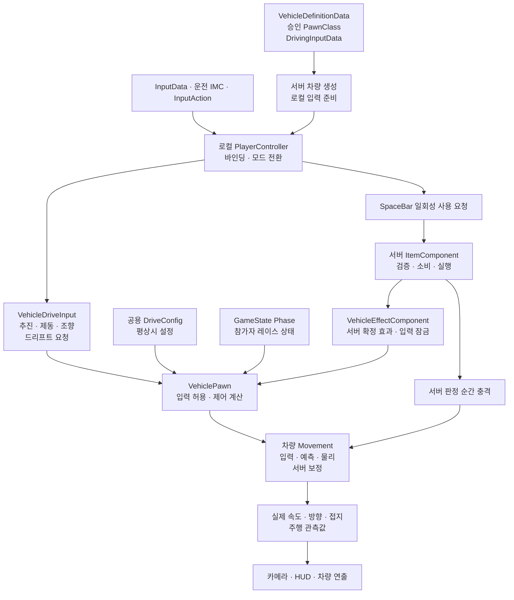

그림의 입력 경로는 논리적 책임이다. 소유 클라이언트와 서버의 차량 시뮬레이션은 채택한 Movement의 네트워크 계약으로 연결한다. 로컬 효과 계산 결과가 서버의 아이템/피격 판정을 대체하지 않는다.

## 3. 클래스 관계와 상태 소유권

### 3.1 관계도

아래 신규 타입명은 구현 시 사용할 설계 이름이다. `VehicleMovement`는 채택한 엔진 컴포넌트/구현을 뜻하며 새로운 공통 래퍼 클래스의 요구가 아니다.

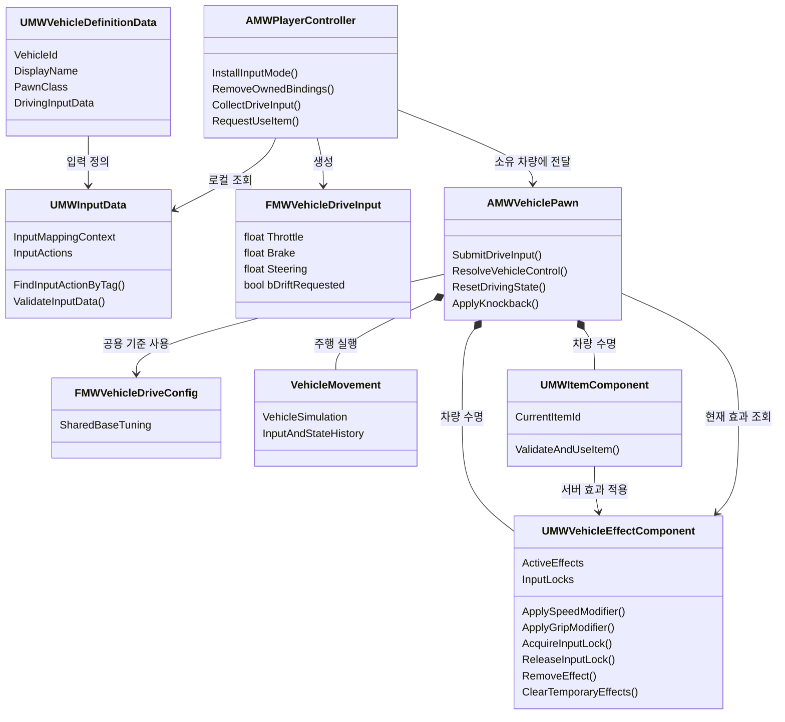

### 3.2 책임 표

| 대상 | 상태 원본·수명 | 책임 | 맡기지 않는 책임 |
|---|---|---|---|
| DefinitionData / InputData | 제작된 정적 에셋 | 스폰/입력 정의와 검증 | 현재 입력·효과·속도·서버 판정 |
| 공용 DriveConfig | 승인된 공용 주행 설정 | 평상시 기준값 | 효과 때문에 원본을 덮어쓰기 |
| Controller | 소유 플레이어의 로컬 입력 연결 | 자신이 설치한 IMC/바인딩 관리, 입력과 요청 전달 | 임의 물리 속도 변경, 아이템 성공 확정 |
| VehiclePawn | 차량 수명 | 입력 수신·허용 판정 연결·최종 제어 계산·이동 호출 | 점수나 아이템 소비의 원본 |
| VehicleEffectComponent | 차량 수명의 서버 확정 효과, 필요한 상태 동기화 | 효과 중첩·만료·해제·입력 잠금 | 투사체 생성, 인벤토리, 쿨다운 전반, 경기 Phase의 별도 FSM |
| 차량 Movement | 차량 물리·입력/상태 이력 | 추진·제동·조향·접지·물리 예측/보정 | 점수 지급, 픽업 소비, 반복 연출 |
| ItemComponent | 동일 Pawn에 부착, 서버 원본 | 1칸 아이템 보유·사용 가능 여부·소비·실행 | 내부 Movement 변수 직접 변경 |
| GameMode / GameState / PlayerState | 기존 경기 수명 | 서버 경기 규칙 / 복제 Phase / 지속 개인 기록 | 차량 내부 효과 목록과 중복되는 원본 |
| 카메라 / HUD | 로컬 표시 수명 | 실제 주행 상태와 서버 확정 게임 상태 소비 | 입력 요청값으로 실제 속도를 가장하거나 효과를 확정 |

PlayerController 입력 바인딩의 공통 연결은 A가 담당한다. C는 아이템 사용 요청의 소비·서버 실행·HUD를 담당한다. 같은 SpaceBar 액션을 양쪽에서 중복 바인딩하지 않는다.

## 4. 운전 입력 계약

### 4.1 키·액션·값

| 키 | InputAction 설계 이름 | InputTag | 값/수집 방식 | 의미 |
|---|---|---|---|---|
| W | `IA_Throttle` | `Input.Action.Throttle` | Axis1D, 0~1. Triggered 갱신 | 차량이 바라보는 전방으로 추진 요청 |
| S | `IA_Brake` | `Input.Action.Brake` **추가 예정** | Axis1D, 0~1. Triggered 갱신 | 제동 요청. 후진/음수 스로틀 입력으로 사용하지 않음 |
| A / D | `IA_Steer` | `Input.Action.Steer` | Axis1D, A=-1 / D=+1 | 차량 기준 왼쪽/오른쪽으로 조향 바퀴를 돌림 |
| LShift | `IA_Drift` | `Input.Action.Drift` **추가 예정** | Boolean. 누르는 동안 요청 | 기본 드리프트 제어 요청. 토글·드리프트 부스트가 아님 |
| SpaceBar | `IA_UseItem` | `Input.Action.UseItem` | Boolean. Pressed 트리거의 Triggered 1회 | 서버 아이템 사용 요청 1회 |

- W/S/조향의 Completed·Canceled에서는 해당 저장값을 0으로 만든다. LShift는 Started에서 요청을 켜고 Completed·Canceled에서 끈다. 유지 판정을 지연시키는 Hold 트리거를 기본값으로 넣지 않는다.
- SpaceBar를 누르고 있어도 매 프레임 사용 요청을 보내지 않는다. Started와 Triggered를 동시에 사용 경로에 연결하지 않는다. 기관총의 제한 점사는 서버 아이템 로직이 처리한다.
- A는 IMC에서 Negate, D는 양수 매핑으로 구성한다. `IA_Steer`의 `AccumulationBehavior`를 **Cumulative**로 설정하고 최종 값을 [-1, 1]로 제한해 A+D=0을 보장한다. 엔진 기본값인 최고 절댓값 선택만으로 상쇄를 기대하지 않는다.
- W와 S는 별도 액션이다. 동시 입력의 초기 제어 규칙은 **제동 우선**이다. 원래 입력은 보존하고 최종 적용 단계에서 Brake>0이면 Throttle=0으로 처리한다.
- Controller는 키/액션을 해석하고 Pawn은 차량 제어를 해석한다. 카메라 Yaw를 W의 진행 방향에 사용하지 않는다.

### 4.2 운전 입력 값 구조체

아래는 컴파일용 선언이 아닌 필드 계약이다. 실제 USTRUCT/직렬화·네트워크 이력 타입은 선택한 Movement에 맞춘다.

```cpp
struct FMWVehicleDriveInput
{
    float Throttle = 0.f;       // [0, 1]
    float Brake = 0.f;          // [0, 1]
    float Steering = 0.f;       // [-1, 1], 음수=차량 좌측, 양수=우측
    bool bDriftRequested = false;
};
```

이 구조체가 MW의 작은 Intent다. 아이템 사용, 현재 속도, 부스터 배율, 입력 잠금, 경기 Phase를 넣지 않는다. 유효하지 않은 수치(NaN/Inf)는 거부하고 유효 범위를 확인한다. 클라이언트가 보내는 정상 범위 값도 서버 사용 권한을 보장하지 않는다.

### 4.3 차량 조향과 이동 방향

**A/D는 조향 입력이며 차체 Yaw 직접 가산이나 좌우 평행이동이 아니다.** 정지한 차량에 D만 입력하면 우측 조향을 요청할 뿐, 그 입력으로 차량이 자력 우회전하거나 옆으로 이동하지 않는다. W+D는 전방 추진과 우측 조향을 결합해 우회전한다.

차량 기준 전방은 차체 진행축(기본 로컬 +X), 우측은 +Y다. 시각 메시의 축이 다르면 Pawn/Movement의 차체 기준에 맞춘다. 실제 이동 방향은 접지·슬립·관성·외력의 영향을 받으므로 차체 전방과 항상 같지는 않다.

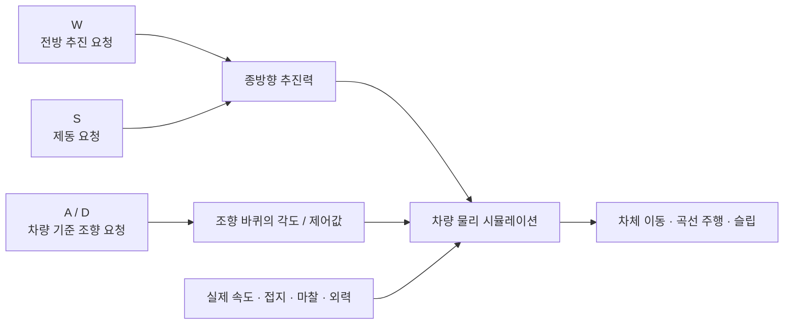

| 조건/입력 | 입력/제어 결과 | 기대 동작 |
|---|---|---|
| 정지·평지, 외력 없음 + D만 | Throttle=0, Steering=+1 | 바퀴 조향 요청. 입력만으로 차체 회전/우측 이동 없음 |
| 정지·평지, 외력 없음 + A만 | Throttle=0, Steering=-1 | 좌측도 동일 |
| W | Throttle=1, Steering=0 | 현재 차체 전방으로 가속 |
| W+A / W+D | Throttle=1, Steering=-1/+1 | 전진하며 좌회전/우회전 |
| 관성 주행 중 A/D, W 해제 | Throttle=0, Steering=-1/+1 | 남아 있는 속도와 접지에 따라 조향 가능 |
| 주행 중 S | Brake=1 | 제동. 정지 후에도 자동 후진하지 않음 |
| W+S | 원입력 둘 다 1, 최종 Throttle=0 / Brake=1 | 제동 우선 |
| A+D | Steering=0 | 서로 상쇄. 먼저/나중에 누른 키에 따라 임의 선택하지 않음 |
| W+D에서 W만 해제 | Throttle=0, Steering=+1 | 추진 중단 후 관성 조향. 즉시 차체 정지 아님 |

W+D 예시는 **정지 상태에서 추진과 조향이 함께 필요함**을 뜻한다. `W가 눌렸을 때만 Steering을 허용`하는 조건은 넣지 않는다. 경사·충돌·폭발로 이미 움직이는 차량은 W 없이도 이동할 수 있다. 별도 제자리 회전·공중 방향 전환은 이번 기본 조향에 포함하지 않는다.

### 4.4 입력 수집·전달 순서

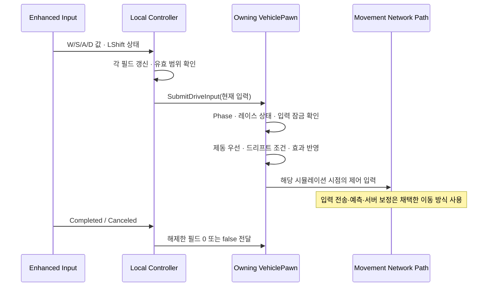

운전 IMC와 건설 IMC는 상호 배타적으로 설치한다. 전환 시 저장 입력과 Movement의 잔류 입력도 정리한다. 전체 `ClearAllMappings`로 다른 기능의 매핑을 삭제하지 않고, 자신이 설치한 Context와 바인딩 핸들만 해제한다.

## 5. LShift 기본 드리프트

기본 드리프트는 **LShift 유지 요청을 차량의 드리프트 제어에 반영하는 기능**이다. 그립/횡방향 저항/조향 응답 등 실제 적용 수단은 선택한 Movement에서 검증한다. LShift가 눌렸다는 이유만으로 실제 차량이 미끄러지는 상태라고 확정하지 않는다.

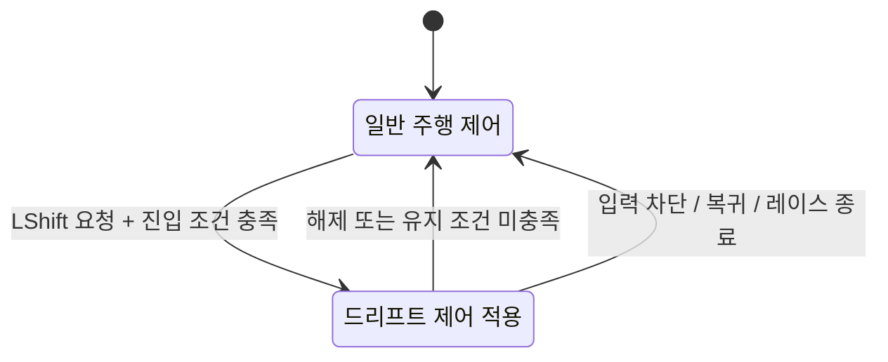

- 진입/유지 조건에는 유효 레이스 상태, 입력 허용, 접지, 실제 속도와 필요한 조향 조건을 사용한다. 구체 조건과 최소 속도·튜닝 값은 D3 실험에서 확정한다.
- 드리프트용 순간 제어값은 운전 입력에서 계산한다. 매 프레임 지속 효과를 새로 발급하는 방식으로 만들지 않는다.
- 얼음/기름 등 노면에 의한 미끄러짐은 LShift 요청과 별개의 외부 효과다. 두 작용의 최종 그립 계산은 중복 원복 없이 수행한다.
- **드리프트 부스트·게이지·콤보 보상은 선택 기능**이다. LShift 기본 드리프트 채택만으로 추가하지 않는다.
- 위 상태도는 제어 전환의 설명이며, 경기 Phase나 실제 슬립 관측과 중복되는 별도 범용 FSM을 신설하라는 뜻이 아니다.

## 6. Config와 최종 제어 계산

### 6.1 설정의 위치

| 구분 | 둘 값 | 원본/변경 규칙 |
|---|---|---|
| 엔진 Movement 기본 설정 | 휠·구동계·기본 입력 보간 등 선택한 구현이 이미 소유한 설정 | 엔진 설정을 단일 원본으로 사용. 동일 값을 별도 Config에 이중 보관하지 않음 |
| `FMWVehicleDriveConfig` | MW 고유의 공용 제어·드리프트 기준 등 실제 필요한 설정 | 모든 외형에 공통. 필드·단위·범위는 D3 선택 결과로 고정 |
| 활성 효과 | 부스터·감속·노면 효과·입력 잠금 | 차량 수명의 런타임 상태. Config 원본에 기록하지 않음 |
| 관측값 | 실제 속도, 각속도, 접지, 슬립 등 | Movement에서 읽음. 요청값이나 설정값으로 대체하지 않음 |

공용 설정은 하나의 승인된 주행 설정에서 공급한다. 데이터 에셋 편집이 필요하면 공용 DriveData 안에 Config를 담을 수 있지만, **DriveData라는 추가 클래스와 Definition별 설정 참조를 지금 필수로 만들지는 않는다.** 현재 DefinitionData에는 그 필드가 없다. 외형마다 물리 클래스 기본값이 달라져 성능 차이가 생기지 않도록 같은 주행 설정 사용을 검증한다.

모든 수치는 유한값·유효 범위를 검사하고 거리 cm, 시간 s, 속도 cm/s 등 단위를 필드 계약에 명시한다. HUD km/h 변환과 물리 단위를 구분한다. 검증되지 않은 최고속도·드리프트 배율·충격량을 확정 수치로 기록하지 않는다.

### 6.2 Policy에 대응하는 작은 계산

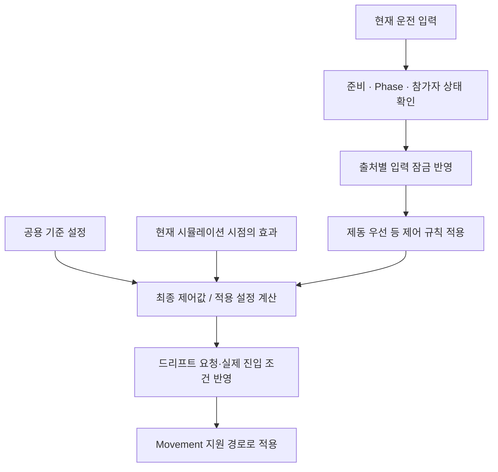

`ResolveVehicleControl` 등의 작은 함수로 시작한다. 계산 결과를 값 구조체로 묶어도 별도 Policy Component를 요구하지 않는다. 이벤트로 효과 목록/파생 설정을 갱신할 수 있지만 차량 입력과 물리 시뮬레이션은 Movement가 요구하는 Tick/서브스텝을 계속 사용한다.

입력 차단, 차체 정지, 순간 충격은 서로 다른 처리다. Countdown은 별도의 주차/제동 제어로 차체를 대기시키고, 피격의 입력 차단은 기존 관성·넉백을 자동 제거하지 않는다. 매 Tick 강제 속도 대입/차체 회전으로 물리 결과를 덮어쓰지 않는다.

## 7. 효과·잠금·순간 충격 계약

### 7.1 지속 효과와 입력 잠금

| 항목 | 의미/수명 |
|---|---|
| EffectId | 서버가 확정한 효과 인스턴스 식별자. 효과 종류/아이템 ID와 구분 |
| 종류·변경 항목·강도 | 속도 계열, 그립 계열 등 작은 실제 요구 집합. 유한값/범위 검사 |
| 출처 | 아이템/패드/노면 등 적용 원인. 출처별 해제에 사용하며 권한 증명은 아님 |
| 시작·종료 조건 | 서버 시간의 만료 시각 또는 출처 이탈 등 명시 조건. 무기한은 명시적으로 구분 |
| 입력 잠금 핸들 | 해당 적용 원인이 만든 잠금만 해제. 여러 동일 종류의 원인도 구분 |
| 세대/라운드 | 복귀·라운드 경계 전 효과/콜백이 새 상태를 변경하지 않게 유효성 확인 |

| 합성 대상 | 확정 규칙 | D3~D5에 정할 부분 |
|---|---|---|
| 입력 잠금 | 해당 조작에 유효한 잠금이 하나라도 남으면 차단. 한 원인의 종료가 다른 원인을 해제하지 않음 | 전체 운전/일부 조작 등 실제 필요한 잠금 범위 |
| 동일 EffectId의 중복 수신 | 새 효과로 중복 등록하지 않음 | 갱신 메시지의 리비전/전송 표현 |
| 서로 다른 부스터·가속 패드 | 활성 효과에서 재계산하며 원본을 덮어쓰지 않음 | 초기 권장안은 최대 배율 적용·동일 출처 시간 갱신. **중첩 정책은 아직 미확정** |
| 노면 미끄러짐과 드리프트 | 각 기여를 보존하고 최종 그립/제어값 계산 | 합성식·최솟값·각 Movement 파라미터와의 연결 |
| 효과 제거 | 지정 인스턴스만 제거한 뒤 남은 효과로 재계산 | 실제 타이머/복제 자료형 |

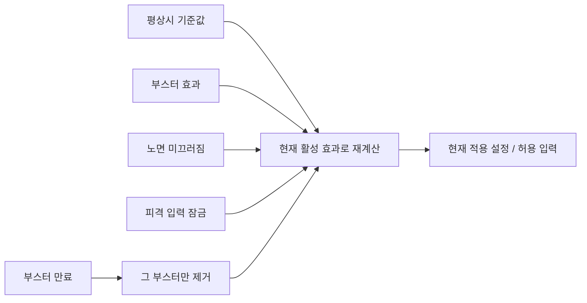

| 순서 예시 | 활성 작용 | 종료 후 반드시 유지할 것 |
|---|---|---|
| T0 | 기본 주행 | 공용 기준값 |
| T1 | 부스터 + 노면 미끄러짐 | 두 작용의 기여 |
| T2 | 위 효과 + 피격 입력 잠금 + 폭발 충격 | 입력 제한과 실제 물리 충격을 각각 처리 |
| T3 | 부스터만 만료 | 노면 효과·남은 입력 잠금·물리 관성 |
| T4 | 잠금 해제, 노면 이탈 | 기준 설정으로 계산. 차체 속도를 강제로 기본값으로 바꾸지 않음 |

T0~T4는 순서 설명이며 실제 지속시간·성능 측정 그래프가 아니다. 약한 출처 참조의 무효 감지는 보조 수단이다. 만료, 노면 이탈, 출처 종료, 복귀, 라운드 경계의 명시 해제를 마련한다.

### 7.2 순간 충격

`ApplyKnockback(Direction, Strength, Source)`는 서버가 판정한 피격을 차량에 전달하는 의미상 API다. Direction은 World 기준의 유효 방향이며 정규화/제로 벡터 처리를 정한다. Strength가 충격량인지 속도 변화량인지, 질량 반영과 수직 성분·상한은 Movement 선정 후 계약으로 고정한다.

- 폭탄/망치/범퍼 등은 자신의 적중·범위·중복 히트를 판정하고 차량 API를 호출한다. 클라이언트가 최종 힘·피해·대상을 확정하지 않는다.
- 충격 자체는 지속 부스터 목록에 넣거나 매 Tick 같은 힘을 재적용하지 않는다. 지속 바람 같은 힘은 별도 지속 작용 계약이 필요하다.
- 재시뮬레이션은 동일 물리 충격을 원래 시뮬레이션 프레임에 다시 적용할 수 있다. 전역 `이미 적용됨` 플래그로 정당한 물리 재생을 막지 않는다. 대신 점수·아이템 소비·피격 연출 등 게임 부작용의 중복을 막는다.
- 폭탄과 노면 미끄러짐은 연결 가능한 효과의 예다. 이 설계 채택이 기존 콘텐츠 일정에 폭탄/얼음 아이템 추가를 자동 확정하지는 않는다.

## 8. 서버 권한과 아이템 사용 흐름

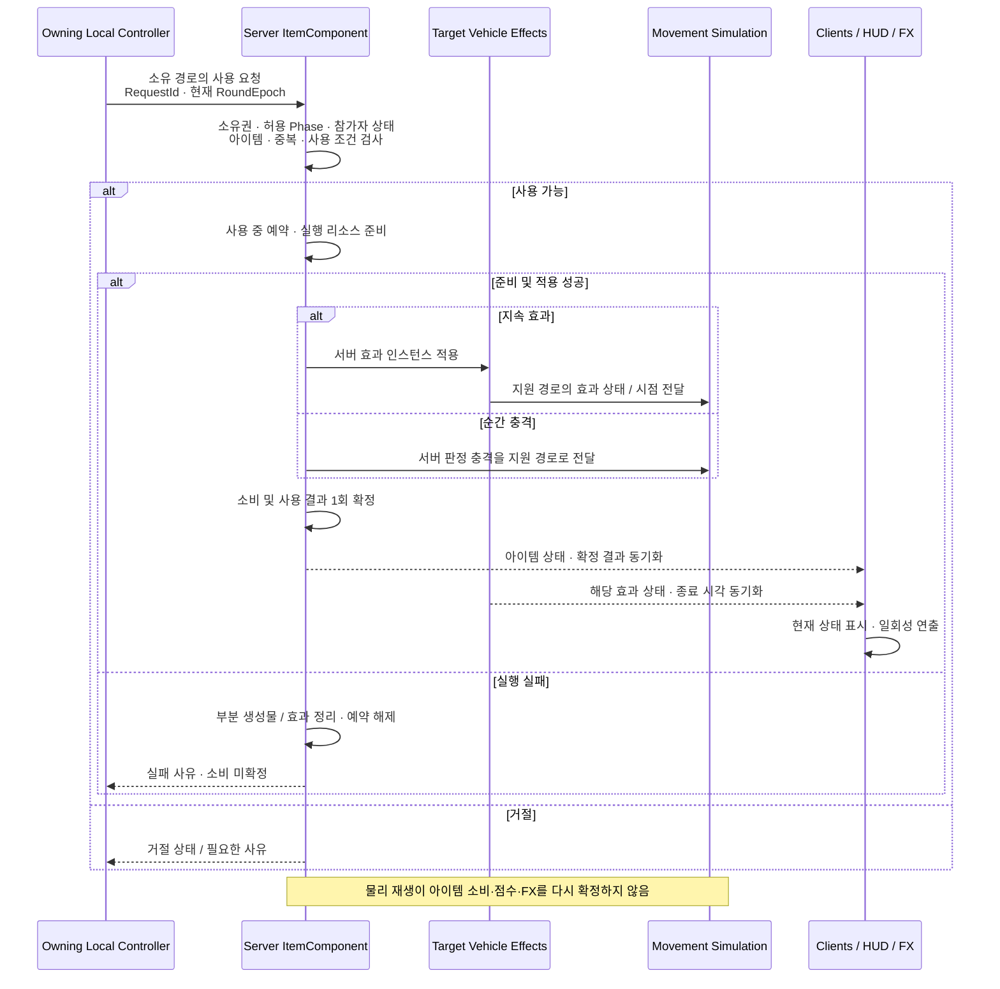

| 경로 | 규칙 |
|---|---|
| 연속 운전 입력 | 채택한 Movement의 입력 전송/예측/서버 보정 사용. 별도 매 Tick Reliable RPC 추가 금지 |
| SpaceBar 사용 | 소유 Controller 등 유효한 owning connection 경로. 요청 ID 범위·Epoch·중복 거절과 성공 1회 확정 |
| 실행 실패 | 검증→필요 리소스 준비→실행 성공→소비/결과 확정. 실패 시 부분 생성물·효과와 예약 정리, 중복 소비/부분 성공을 남기지 않음 |
| 효과 상태 | 서버가 확정. 클라이언트가 시뮬레이션/표시에 필요한 상태·시점을 동기화 |
| 재시뮬레이션 | 과거 프레임의 입력·효과·드리프트·충격을 올바르게 재구성. 현재 배율만 복제했다고 이력이 완성된 것은 아님 |
| 일시 연출 | 확정 이벤트를 소비. 지속 상태의 유일한 근거로 Multicast/로컬 타이머를 사용하지 않음 |
| Listen Host | 서버 변경 후 로컬 표시와 원격 OnRep 표시 모두 갱신. 서버 OnRep 자동 실행 가정 금지 |

GAS의 능력 예측은 차량 물리 이력을 대신하지 않는다. GAS 미도입 여부와 무관하게 접지·충돌·효과·복귀를 선택한 물리 예측 방식에서 검증해야 한다.

## 9. 초기화·전환·복귀 수명

### 9.1 입력과 차량 준비

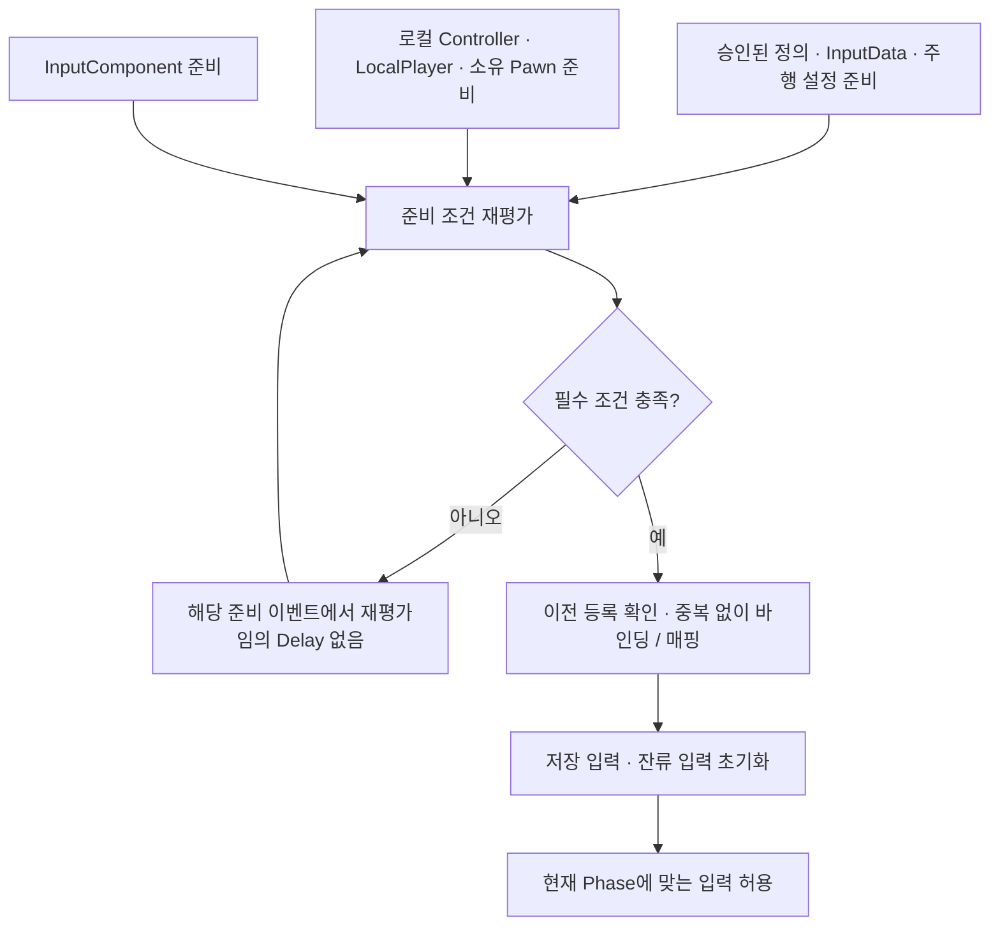

`PossessedBy()`만으로 원격 소유 클라이언트 준비를 완료하지 않는다. 소유 클라이언트의 Restart/PawnClientRestart, Controller 복제 및 에셋 준비 등 실제 생명주기 이벤트에서 동일한 준비 검사로 연결한다. 모든 콜백에서 바인딩을 중복 추가하지 않는다. 서버에서는 별도로 승인 정의·주행 설정·소유권의 유효성을 확인한다.

### 9.2 같은 Pawn 복귀

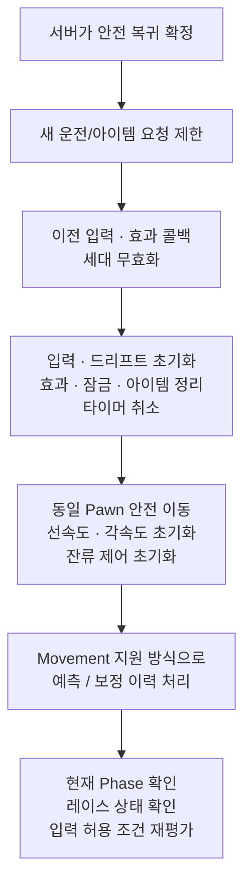

| 경계 | 반드시 정리/재평가할 것 |
|---|---|
| 운전 ↔ 건설 모드 | 해당 모드 IMC/바인딩, 저장 운전 입력, 드리프트 요청, Movement 잔류 입력 |
| UnPossess / 차량 교체 | 이전 차량 입력과 로컬 연결. 이전 출처의 늦은 콜백 무효화 |
| 피격 잠금 만료 | 해당 잠금만 해제. 다른 잠금/노면 효과 유지 |
| 동일 Pawn 복귀 | 입력, 드리프트, 아이템/임시 효과/잠금, 타이머, 물리 상태, 이동 이력 |
| 라운드 시작·종료 / 재경기 | 이전 라운드 입력·요청·효과 정리, 현재 Phase 규칙 재평가 |
| EndPlay | Delegate·Timer·바인딩·참조 해제. 이것만으로 같은 Pawn 복귀 정리를 대신하지 않음 |

이전 효과의 만료 콜백이 복귀 후 새 효과를 제거해서는 안 된다. Phase에 따른 차단은 현재 경기 상태에서 계산하며, 효과 목록 초기화가 Countdown/탈락 상태의 차단을 풀어서는 안 된다.

경계 시 이전 저장값/이력은 재사용하지 않는다. W/LShift를 계속 누른 경우 재개 시 즉시 새 입력을 받을지, 키 해제 후 재입력을 요구할지는 D3 입력 재개 계약에서 확정한다. 해당 선택과 무관하게 이전 세대의 저장값·요청을 새 상태로 재생하지 않아야 한다.

## 10. 단계별 구현과 인수

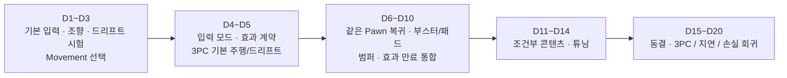

일별 시간의 단일 원본은 [02 마일스톤](02_클라이언트_마일스톤_4주.md)이다. 기본 드리프트는 기존 차량 작업 안에서 우선 구현/검증하고, 비용이 늘면 조건부 콘텐츠를 조정한다. 360인시 내 완료가 새 설계만으로 보장된다고 기록하지 않는다.

## 11. 수용 기준과 검증 행렬

아래는 **실행해야 할 기준**이다. 이 문서 작성에서 통과한 테스트 결과가 아니다. 기본 입력/물리 시험은 호스트와 원격 소유 차량을 각각 확인한다. 네트워크 시험은 무지연 기준과 관측 RTT 약 100ms를 비교하고 D8 이후 손실 조건을 추가한다.

| ID | 재현 | 기대 결과 |
|---|---|---|
| VI-01 | 정지·평지·외력 없음에서 A/D만 | 조향 요청만 발생. 자력 차체 회전/횡이동 없음 |
| VI-02 | W, W+A, W+D | 차량 전방 추진, 전진 좌/우회전. 카메라 방향 변경이 조작 기준을 바꾸지 않음 |
| VI-03 | 주행 중 W 해제 후 A/D | 관성 속도에 따른 조향. W 조건으로 조향이 잘리지 않음 |
| VI-04 | S만, 주행 중 S, W+S | 정지 시 자동 후진 없음, 정상 제동, 동시 입력은 제동 우선 |
| VI-05 | A+D 및 한 키만 해제 | 동시 0, 남은 키 방향으로 정확히 복귀. 액션 누적 설정 확인 |
| VI-06 | LShift 유지/해제·진입 조건 미충족 | 요청과 실제 제어 상태 구분, 해제/취소 후 잔류 없음. 기본 드리프트로 부스트 자동 발생하지 않음 |
| VI-07 | SpaceBar 유지·연속 재입력·중복 요청 | 한 번 누를 때 1회 요청, 서버 조건과 중복 검사, 슬롯/효과 중복 확정 없음 |
| VI-08 | W/LShift 유지 중 모드 전환·UnPossess | 이전 모드/차량의 저장 입력·매핑 잔류 없음 |
| VE-01 | 부스터+패드+미끄러짐의 시작/만료 순서를 교차 | 정한 중첩 규칙대로 계산, 한 효과 종료가 다른 효과를 초기화하지 않음 |
| VE-02 | 동일 종류의 잠금 두 개 후 하나 해제 | 나머지 잠금 유지, 모두 해제 후 현재 Phase 조건으로 복구 |
| VE-03 | 폭발/범퍼 충격 중 입력 잠금 | 충격/관성 유지, 조작 제한과 차체 정지의 구분 유지 |
| VE-04 | 효과 만료 직전 동일 Pawn 복귀 | 이전 콜백이 새 세대 효과/입력을 변경하지 않음 |
| VN-01 | 호스트 1+원격 2 충돌·가속·드리프트·넉백 | 서버 최종 상태와 소유자/관측자 결과 확인, 보정 품질 기록 |
| VN-02 | 보정/재시뮬레이션 중 아이템·충격 | 물리는 정상 재생, 소비·픽업·점수·피격 FX 중복 없음 |
| VN-03 | 같은 Pawn 텔레포트 복귀 후 재조작 | 이전 속도·조향·드리프트·효과·예측 상태 잔류 없음 |
| VD-01 | 실제 운전 InputData/IMC·패키지 | Brake/Drift 태그, 액션 타입·키·누적·트리거, Cook/로드와 로컬 연결 확인 |

## 12. 구현 전에 닫을 미정 항목

| 항목 | 확정된 범위 | 남은 결정/시점 |
|---|---|---|
| 이동 구현 | Chaos Vehicles 우선 시험, 후보 최대 2개 | 최종 백엔드·입력/효과 이력 전달·텔레포트 처리 D3 |
| 기본 조작 | W/S/A/D/LShift/SpaceBar, 차량 기준 조향, S 제동, 동시 제동 우선 | 물리 튜닝·보간 수치 D3 |
| 드리프트 | LShift 유지 요청, 기본 기능 포함, 부스트 별도 | 진입/유지 조건·그립/조향 적용·임계값 D3 |
| 효과 합성 | 출처별 기여/해제, Config 불변, 잠금이 남으면 차단 | 부스터 중첩·갱신, 노면/드리프트 합성 D3~D5 |
| 충격 | 서버 판정의 순간 작용 | Strength 단위·질량/수직 처리·상한 D3~D5 |
| 입력 재개 | 경계에서 이전 입력·효과 세대 초기화 | 계속 누른 키의 재개/재입력 규칙 D3 |
| 표현/복제 | 실제 관측값 기반 표시, 서버 효과 확정 | 최소 복제 필드·시점/리비전·거절 표현 D5 |

## 13. 근거와 적용 한계

- [Epic — Enhanced Input](https://dev.epicgames.com/documentation/unreal-engine/enhanced-input-in-unreal-engine): 액션·IMC·Modifier·Trigger와 로컬 Context 관리. 키 배치와 제동 우선은 MW의 설계 선택이다.
- [Epic — Gameplay Ability System Overview](https://dev.epicgames.com/documentation/en-us/unreal-engine/understanding-the-unreal-engine-gameplay-ability-system): GAS가 담당하는 능력·속성·효과·실행 수명. 미도입은 MW 범위에 대한 결정이다.
- [Epic — Networked Physics Overview](https://dev.epicgames.com/documentation/en-us/unreal-engine/networked-physics-overview): 물리 예측·보정·재시뮬레이션과 이력. 지원 기능 설명을 MW 주행 품질의 실증으로 간주하지 않는다.
- [Khazan Locomotion 타입](https://github.com/kevin6091/Khazan/blob/0f04ac939de21e57b80e9c774eb64308e0297aed/Khazan/Source/Khazan/Character/Locomotion/KZLocomotionType.h), [컴포넌트](https://github.com/kevin6091/Khazan/blob/0f04ac939de21e57b80e9c774eb64308e0297aed/Khazan/Source/Khazan/Character/Component/KZLocomotionComponent.cpp): 정적 설정/입력/원인별 기여/계산 결과의 책임 분리 참고. 보행·GAS·락온·Root Motion 구현은 이식하지 않는다.

2026-10-22 설치 UE 5.8.3의 `EnhancedInput/Public/InputAction.h`와 `Private/EnhancedPlayerInput.cpp`에서 `EInputActionAccumulationBehavior::Cumulative` 및 기본 최고 절댓값 선택을 확인했다. 생명주기는 `GameFramework/Pawn.h`, 차량 입력·초기화 API는 채택 시 해당 엔진 소스로 재확인한다. Mermaid 그림은 책임·관계·순서를 설명하며, 물리 성능 측정값이나 구현 완료 증거가 아니다.
