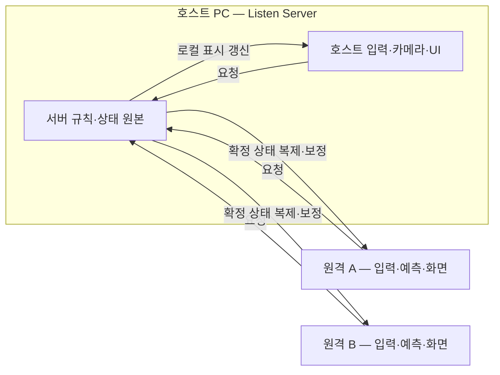
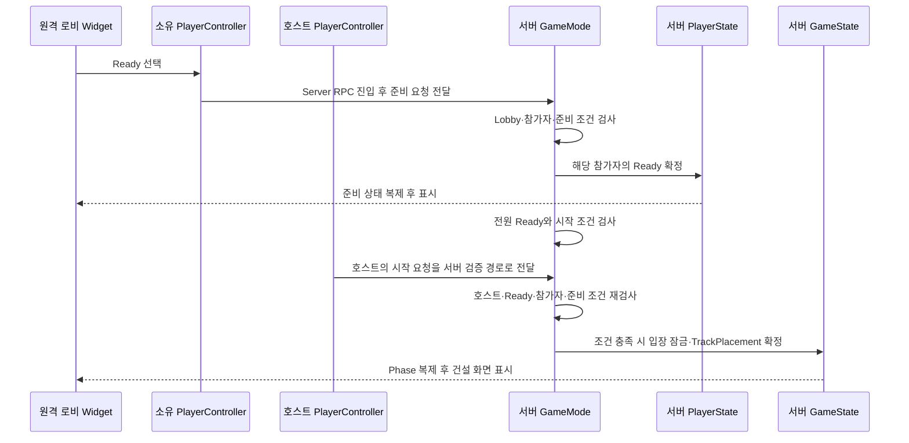

# MW 리슨 서버 설계와 Gameplay Framework 이해

**문서 번호:** MW-NET-DESIGN-001 / v1.2 / 2026-10-28\
**적용:** Client + Server, UE 5.8.3, `MW` Runtime 모듈, 호스트 1명 + 원격 2명 우선.\
**상태:** 설계·학습 문서. 차량은 사용자 지시에 따라 `ACharacter` 기반으로 계획한다. 아래 신규 클래스와 요청 이름은 구현 예정이며 컴파일·멀티플레이 검증 완료를 뜻하지 않는다.

게임 규칙과 수용 기준은 [개발명세](MakeWay_클라이언트_개발명세서_v1.0.md), 차량 내부의 입력·효과 계약은 [07 차량 설계](07_차량_입력_이동_효과_설계.md), 일정은 [02 마일스톤](02_클라이언트_마일스톤_4주.md)이 원본이다. 이 문서는 그 구조를 처음 배우는 개발자가 이해하고 구현할 수 있도록 설명한다. 과거 문서의 Chaos Vehicles 우선 검토는 이번 Character 방향으로 갱신했다.

**v1.1 타이틀/방 흐름 추가:** 방 생성·검색·선택 참가와 여러 독립 호스트를 포함한 구현 순서는 [09 타이틀부터 게임플레이까지의 마일스톤](09_타이틀부터_게임플레이까지_마일스톤.md)을 따른다. 무료 EOS를 초기 인터넷 경로로 계획하며 유료 서버 구독을 전제로 두지 않는다. 아래 경기 Framework 앞에 세션 준비 단계를 연결한다.

## 1. 리슨 서버에서 서버와 클라이언트는 무엇인가

서버는 경기의 최종 결과를 결정하는 실행 주체다. 클라이언트는 플레이어의 입력을 받고 화면을 표시하며, 서버에 행동을 요청한다. **리슨 서버는 호스트가 서버 역할과 자신의 로컬 플레이를 함께 수행하는 구성**이다.

3명이 플레이하면 호스트 PC 하나와 원격 PC 두 개가 실행된다. 호스트의 게임 월드에는 서버 권한 객체가 있고, 같은 월드의 상태로 호스트 화면도 표시한다. 호스트 안에 서버용 GameState와 클라이언트용 GameState를 따로 두 개 생성하는 설계는 아니다.



여기서 **권한(Authority)**은 게임 상태를 최종 확정할 책임을 말한다. **로컬 제어**는 이 컴퓨터의 플레이어가 입력하는 대상이라는 뜻이다. 호스트의 자기 차량은 두 조건을 함께 만족하므로, 서버 판정과 로컬 화면 처리를 상호 배타적인 분기로 만들면 한쪽 처리가 빠질 수 있다.

### 1.1 방 목록을 관리하는 서비스와 실제 경기 서버는 다르다

타이틀의 경기 생성은 방 이름·정원·테마를 받아 세션을 등록하고 생성자의 PC에서 Listen Server를 준비한다. 경기 참가는 세션 서비스에서 방 목록을 검색해 선택한 호스트로 접속한다. **무료 EOS는 방 검색·연결을 돕고, 실제 경기 규칙은 호스트 PC에서 실행한다.** 비용과 서비스 근거는 09 문서 2절을 따른다.

접속 전의 목록은 다른 방의 GameState에서 읽을 수 없다. 실제 타입인 `UMWMultiplayerSubsystem : UGameInstanceSubsystem`이 로컬 프로세스에서 생성·검색·참가·나가기와 맵 이동 사이의 작업을 관리하고, 입장 후에는 해당 방의 GameState/PlayerState를 읽는다. 이 Subsystem은 복제 객체가 아니다. 과거 제안명 `UMWSessionSubsystem`을 별도 클래스로 추가하지 않는다.

2026-10-28 맵 테마 연동은 [06 문서 6.3절](06_공용_데이터_이식.md)의 AssetData/AssetManager 경로를 정본으로 채택했다. 승인된 테마 ID를 카탈로그의 UWorld 참조로 해석하고, 생성한 Listen 월드에서 GameMode가 승인 설정을 GameState에 반영한다. 추가 코드와 연결 순서는 [10 방 생성 구현 가이드](10_AssetManager_맵테마_기반_방생성_구현가이드.md)를 따른다.

누구나 방을 생성해 호스트가 될 수 있고 서로 다른 호스트의 방이 동시에 존재한다. 각 방은 고유 SessionId와 별도 경기 월드·GameMode·GameState를 사용한다. 방 이름은 표시용이므로 같은 이름만으로 같은 방이라고 판단하지 않는다. 한 인스턴스가 한 번에 참여/호스팅하는 방은 하나로 계획한다.

## 2. GameMode·GameState·PlayerState를 먼저 이해하기

경기를 예로 들면 GameMode는 **판정하는 심판**, GameState는 **경기 전체의 공식 기록**, PlayerState는 **참가자 한 명의 공식 기록**에 가깝다. 화면의 전광판은 Widget이다. GameState 자체가 UI는 아니다.

| 질문 | 담당 객체 | MW 예시 |
|---|---|---|
| 지금 경기를 시작해도 되는가? | GameMode | 참가 인원·Ready·필수 준비 조건 검사 |
| 지금 어떤 단계인가? | GameState | 현재 `TrackPlacement`, 2라운드, 마감 시각 |
| 이 참가자는 어떤 상태인가? | PlayerState | 준비 완료, 누적 12점, 복귀 대기 |

### 2.1 GameMode — 규칙을 실행하고 판정하는 곳

프로젝트에서는 `AMWGameMode : AGameModeBase`로 시작한다. GameMode는 **서버에만 존재**하며 클라이언트로 복제되지 않는다. 레벨의 게임 플레이가 시작될 때 엔진이 설정된 클래스를 생성한다. 프레임워크 클래스는 일반 레벨 Actor처럼 수동 배치하는 대상이 아니다. [Epic AGameModeBase](https://dev.epicgames.com/documentation/en-us/unreal-engine/API/Runtime/Engine/AGameModeBase)

MW에서 맡길 일은 다음과 같다.

- 경기 중 새 참가를 거부하고, 참가·퇴장에 따른 경기 대기를 정리한다.
- 승인된 차량 정의를 사용해 차량을 생성하고 Controller가 조종하도록 연결한다.
- Ready와 준비 조건을 확인해 경기 Phase를 전환한다.
- 체크포인트 순서·중복을 검사하고 점수, 탈락·복귀, 라운드·최종 승패를 확정한다.
- 기다리는 작업에 제한시간을 두고 실패·이탈 때 종료 경로를 선택한다.

모든 세부 기능을 GameMode 한 파일에 넣는다는 뜻은 아니다. 배치의 소켓·간섭 검사는 TrackManager, 차량 이동은 Movement가 담당한다. GameMode는 경기 규칙을 조율하고 최종 전환을 책임진다.

접속 관련 엔진 진입점으로는 `PreLogin`의 입장 허용/거절, `PostLogin`의 접속 성공 처리, `Logout`의 이탈 처리가 있다. 입장 검사 후에도 Phase가 바뀔 수 있어 실제 참가 등록·시작 시점의 조건을 재확인한다. `PostLogin`이 실행됐다고 원격 클라이언트의 데이터·트랙·UI까지 준비된 것은 아니므로 실제 준비는 따로 확인한다. [Epic GameMode 생명주기](https://dev.epicgames.com/documentation/en-us/unreal-engine/game-mode-and-game-state-in-unreal-engine)

예를 들어 체크포인트 점수는 서버의 경기 규칙이 계산하고 해당 PlayerState에 반영한다. 클라이언트 HUD는 GameMode를 찾아 점수를 읽지 않는다.

### 2.2 GameState — 모두에게 알려야 하는 경기 상태

`AMWGameState : AGameStateBase`는 서버에 원본이 있고 원격 클라이언트에 복제되는 경기 상태 객체다. GameMode가 판정한 결과 중 **모두가 알아야 하는 값**을 담는다. [Epic AGameStateBase](https://dev.epicgames.com/documentation/en-us/unreal-engine/API/Runtime/Engine/AGameStateBase)

MW에서 사용할 필드의 예시는 다음과 같다. 아래 이름은 아직 구현된 프로퍼티가 아니다.

| 필드 | 의미 |
|---|---|
| `Phase` | 로비·건설·카운트다운·레이스·결과 등 현재 단계 |
| `RoundIndex` | 화면에 표시하는 라운드 번호 |
| `RoundEpoch` | 과거 라운드의 늦은 요청을 구분하는 실행 식별자 |
| `PhaseEndServerTime` | 현재 단계가 끝나는 서버 기준 시각 |
| 승인된 경기 설정 | 목표 점수·최대 인원 등 공개 설정 |
| 결과 상태 | 우승자·종료 사유 등 공용 결과 |

GameMode는 “카운트다운을 시작한다”고 결정하고 GameState에 Phase와 종료 시각을 기록한다. 클라이언트는 그 상태로 카운트다운을 표시한다. **GameState에 값이 도착했다는 이유로 클라이언트가 다음 Phase를 결정하지 않는다.**

남은 시간은 매초 숫자를 보내는 대신 아래처럼 계산한다. 서버 시간의 동기화도 네트워크 지연의 영향을 받으므로 표시용 시간과 서버의 최종 마감 판정을 구분한다.

```text
표시할 남은 시간 = max(0, PhaseEndServerTime - GetServerWorldTimeSeconds())
```

`Phase`, `RoundEpoch`, 종료 시각처럼 함께 해석할 값은 하나의 복제 구조체로 묶는다. GameState의 `PlayerArray`로 참가자 PlayerState 목록을 조회할 수 있지만, 배열 순서를 영구 플레이어 ID나 순위로 사용하지 않는다. [Epic GameState 설명](https://dev.epicgames.com/documentation/en-us/unreal-engine/game-mode-and-game-state-in-unreal-engine)

### 2.3 PlayerState — 참가자 한 명의 경기 기록

`AMWPlayerState : APlayerState`는 서버에서 참가자마다 생성되며, 다른 클라이언트에도 전달할 개인 경기 정보를 담는다. **자기 PlayerState만 클라이언트에 있는 것은 아니다.** 다른 참가자의 점수판을 만들 때도 각자의 PlayerState를 읽는다. [Epic APlayerState](https://dev.epicgames.com/documentation/en-us/unreal-engine/API/Runtime/Engine/APlayerState)

| MW의 개인 상태 | 사용 예시 |
|---|---|
| 준비 여부 | 로비의 Ready 표시 |
| 누적 점수·이번 라운드 점수 | 점수판과 결과 화면 |
| 순위·완주 상태 | 레이스 HUD와 결과 |
| 이번 라운드 배치 완료 | 건설 대기와 중복 배치 방지 |
| 레이스 상태 | `Active`, `PendingRespawn`, `Finished`, `Eliminated` 등 |

위 레이스 상태는 설계 예시다. 정상 레이스의 복귀 대기와 서든데스의 복귀 없는 탈락을 구분하고, 상태 변경은 서버의 한 경로에서 수행한다.

차량이 복귀하거나 교체되어도 남아야 할 점수·참가 기록은 PlayerState에 둔다. 차량과 함께 초기화되는 현재 입력·아이템·일시 효과는 차량에 둔다. 기본 `APlayerState::Score`와 별도 누적 점수를 둘 다 수정 가능한 원본으로 운영하지 않고, 구현 때 점수 원본 하나를 정한다.

PlayerState는 저장 파일이나 계정 데이터베이스가 아니다. 이번 단일 맵 안에서는 라운드가 바뀌어도 객체를 유지하며 값을 선택적으로 초기화한다. 앱 종료·재접속·맵 이동까지 자동 보존된다고 가정하지 않는다. 이번 범위는 경기 중 재접속을 거부한다.

### 2.4 왜 세 객체로 나누는가

“A가 체크포인트를 통과해 3점을 얻었다”는 상황을 나누어 보면 다음과 같다.

1. 서버 경기 규칙이 유효 통과인지 검사하고 3점을 계산한다. **판정 책임은 GameMode 측 규칙**이다.
2. A의 PlayerState에 점수를 기록한다. **개인 기록의 원본은 A의 PlayerState**다.
3. 그 결과 라운드 종료 조건이 충족되면 GameMode가 전환을 결정하고 GameState의 Phase를 바꾼다. **공용 진행 상태는 GameState**다.
4. 각 클라이언트 Widget이 GameState와 PlayerState를 읽어 화면을 갱신한다.

이 구분을 지키면 Widget을 다시 만들거나 차량을 복귀시켜도 현재 경기 기록으로 화면을 복원할 수 있다.

## 3. PlayerController와 Character는 어떻게 다른가

PlayerController는 플레이어의 입력·요청·로컬 화면을 연결한다. Character는 그 플레이어가 현재 조종하는 월드 안의 차량이다. Controller가 Character를 조종하도록 연결하는 것을 **Possess**라고 한다.

서버에는 각 참가자의 Controller가 있고, 원격 클라이언트에는 보통 자기 Controller만 존재한다. 다른 사람의 점수나 상태를 그 사람의 Controller에서 찾으면 안 된다. 소유권은 Server/Client RPC의 실행 경로에도 사용된다. [Epic owning connection](https://dev.epicgames.com/documentation/en-us/unreal-engine/actor-owner-and-owning-connection-in-unreal-engine)

| 객체 | 호스트 서버 월드 | 각 원격 클라이언트 |
|---|---|---|
| GameMode | 경기용 1개 | 없음 |
| GameState | 권한 원본 1개 | 복제본 1개 |
| PlayerState | 참가자별 원본 | 자신과 다른 참가자의 복제본 |
| PlayerController | 참가자별 객체 | 자기 객체 |
| VehicleCharacter | 서버가 생성한 참가자별 차량 | 관련성·준비 조건에 따라 자기 차량과 다른 차량의 복제본 |

이 표는 한 월드·로컬 플레이어 한 명·일반적인 복제 설정을 전제로 한다. 접속 직후 모든 참조가 같은 프레임에 준비되는 것은 아니다.

### 3.1 엔진에는 이 클래스들을 어떻게 연결하는가

프로젝트 설정 또는 테스트 레벨의 World Settings에서 사용할 GameMode 클래스를 지정한다. 그 GameMode의 기본 설정에 `GameStateClass`, `PlayerStateClass`, `PlayerControllerClass`를 각각 MW 파생 클래스로 연결한다. 그러면 엔진의 접속·시작 경로가 해당 클래스들을 생성한다. C++ 클래스만 추가하고 연결을 빠뜨리면 기존 기본 클래스가 계속 사용될 수 있다. [Epic GameMode 설정](https://dev.epicgames.com/documentation/en-us/unreal-engine/game-mode-and-game-state-in-unreal-engine)

기본 차량은 `DefaultPawnClass` 또는 승인된 VehicleDefinition을 해석하는 서버 스폰 경로로 정한다. 구현 때 생성 경로 하나를 선택해 기본 자동 스폰과 별도 스폰으로 차량이 중복 생성되지 않게 한다. Character도 Pawn의 자식이므로 엔진의 `PawnClass`·`DefaultPawnClass`라는 이름은 그대로 사용할 수 있다.

## 4. MW 클래스와 데이터 배치

| 설계 클래스/데이터 | 상태 원본과 책임 |
|---|---|
| `AMWGameMode` | 서버 경기 규칙·접속 정책·Phase 전환·최종 판정 |
| `AMWGameState` | 서버가 기록하고 복제하는 공용 경기 상태 |
| `AMWPlayerState` | 서버가 기록하고 복제하는 개인 경기 기록 |
| `AMWPlayerController` | 소유 플레이어의 요청 진입점과 로컬 입력·카메라·UI 연결 |
| `AMWVehicleCharacter` | 차량 수명의 상태와 컴포넌트 연결 |
| `UMWMultiplayerSubsystem` | 프로세스 수명의 로컬 세션 작업·인증 연결·방 검색/참가/정리. 방 접속 전에도 사용 |
| `UMWVehicleMovementComponent` | CharacterMovement 확장, 차량 이동 계산·예측·보정 |
| `AMWTrackManager` | 서버 배치 검증·생성·연결 순서·코스 리비전. 확정 코스 상태 복제 |
| `UMWItemComponent` | 차량의 아이템 한 칸과 서버 사용·소비 처리 |
| `UMWVehicleEffectComponent` | 서버가 확정한 지속 효과·입력 잠금·만료와 해제 |
| `UMWVehicleDefinitionData` / `UMWInputData` | 차량 클래스·입력 연결 등 제작 시 정하는 정적 정의 |
| `UMWAssetManager` | 각 프로세스에서 에셋을 준비·조회하는 로컬 서비스 |
| Widget / Ghost / 카메라 | 현재 상태 표시와 사용자 의도 전달 |

GameState에 TrackManager의 코스 상태 전체를 중복 보관하지 않는다. 코스의 `Revision/Count/ExitTransform`은 TrackManager를 원본으로 둔다. 참가자의 체크포인트 지급 이력처럼 판정에만 필요한 상세 자료는 서버 규칙에 두고, HUD에 필요한 진행도만 공개한다. 개인 후보 목록은 소유 Controller의 소유자 대상 상태로 전달할 수 있다.

2026-10-26 초기 작성 당시에는 시작 카탈로그가 연결되지 않았다. 2026-10-28 현재는 `StartupAssetData`에 기존 카탈로그가 연결되고 `Asset.MapTheme.DevDefault`의 레벨 조회·방 설정 검사까지 구현/검증되었다. EOS 로그인도 존재하지만 실제 방 생성 본문·경기 Framework·차량 Runtime 클래스는 아직 없다. 상세 현재 상태와 검증 범위는 06 문서 6.3절과 10 문서를 따른다. 과거 에셋·태그 누락 기록은 당시 스냅샷으로 읽는다.

## 5. 서버가 관리할 경기 흐름

```text
타이틀 → 경기 생성 또는 방 검색·선택 참가 → 호스트의 경기 월드에 연결
Lobby → TrackPlacement → HazardPlacement → Countdown → Racing → RoundResults
RoundResults → 계속: TrackPlacement, 기존 트랙 유지·확장
RoundResults → 단독 목표 달성: MatchResults
RoundResults → 복수 목표 달성: SuddenDeathCountdown → SuddenDeathRace → MatchResults
MatchResults → 로비 복귀 또는 재경기 초기화
```

기본 클래스는 `AGameModeBase` / `AGameStateBase` 조합을 사용하고 프로젝트 Phase를 관리한다. `AGameMode`의 내장 MatchState까지 별도로 운영하는 이중 상태 머신은 만들지 않는다.

- Phase 전환은 서버에서만 확정한다. 로컬 타이머가 0이 되어도 서버 전환 전에는 다음 단계 입력을 허용하지 않는다.
- 선택/배치/주행은 로컬 입력 모드다. 건설 후보 선택과 배치마다 서버 Phase를 추가하지 않는다.
- 라운드마다 `RoundEpoch`를 갱신한다. 재경기에서도 같은 월드에 남은 과거 요청과 구분되도록 이전 식별자를 재사용하지 않는다.
- 라운드 종료 때 목표 점수를 판정한다. 레이스 도중 목표 초과만으로 매치를 끝내지 않는다.
- 준비·복귀·건설 대기에 제한시간을 둔다. 안전한 대체도 없으면 명시적 예외 결과로 종료한다.

## 6. 요청·판정·복제의 실제 예시

RPC는 다른 실행 주체의 함수를 호출하는 통신이고, 상태 복제는 서버가 확정한 값을 클라이언트에 전달하는 통신이다. 요청과 결과 상태를 분리한다.

### 6.1 Ready 버튼을 누를 때



그림에서 RPC는 **소유 Controller에서 서버 Controller로 도착**한다. 서버 Controller에서 GameMode를 호출하는 부분은 같은 서버 안의 일반 함수 호출이다. 클라이언트가 GameMode에 직접 RPC를 보내는 구조가 아니다.

서버는 요청을 받은 Controller로 참가자를 식별한다. 클라이언트가 보낸 임의 PlayerId를 믿고 다른 사람의 Ready를 변경하지 않는다. 호스트 요청도 같은 서버 검증 함수를 거친다.

현재 기본안은 Ready를 시작 가능 조건으로 사용하고, 전원 준비 후 호스트가 시작 버튼을 누르는 방식이다. 기존 자동 전환 예시를 이 흐름으로 구체화한다. 서비스의 검색용 상태와 서버의 실제 입장 잠금을 함께 관리한다.

### 6.2 트랙을 배치할 때

```text
요청: OfferedPieceId, RoundEpoch, SeenTrackRevision, ClientRequestId
검사: 소유 참가자·Phase·기한·후보·배치 잔여 권한·중복·리비전·설치 안전성
성공: 서버 Transform 계산 → 생성·등록 성공 → 완료 플래그·리비전·끝점 확정
실패: 부분 생성물 정리 → 거절 사유와 최신 리비전 전달
```

요청 ID의 범위는 참가자 + RoundEpoch로 구분한다. 이미 처리한 요청이 다시 와도 트랙을 다시 생성하지 않는다. 오래된 리비전은 거절하고 선택은 보존한다. 최신 Ghost를 확인한 플레이어가 새 요청으로 다시 확정한다. 클라이언트가 보낸 임의 클래스나 월드 Transform으로 스폰하지 않는다.

### 6.3 체크포인트를 통과할 때

서버 Trigger가 통과 후보를 감지하면 서버 경기 규칙이 Phase·참가자 상태·통과 순서·방향·중복을 검사한다. 유효한 통과만 점수를 계산해 PlayerState에 기록한다. 마지막 체크포인트는 결승 역할도 겸하며 별도 결승 처리로 점수를 두 번 주지 않는다.

클라이언트가 “내가 1등이니 3점을 달라”고 확정 결과를 보내지 않는다. 복귀로 건너뛴 구간은 미지급하고, 기본 레이스의 거리 차 탈락·추락·파괴는 같은 복귀 대기 경로로 처리한다. 서든데스는 복귀하지 않는다.

## 7. 상태를 받은 뒤 화면을 갱신하는 방법

프로젝트의 새 필드도 복제되게 하려면 필요한 `Replicated` / `ReplicatedUsing` 선언과 복제 등록을 구현해야 한다. GameState나 PlayerState를 상속했다는 이유로 임의의 모든 멤버가 자동 복제되는 것은 아니다.

| 전달할 내용 | 기본 방법 |
|---|---|
| Phase·점수·준비·보유 아이템처럼 지속되는 값 | 프로퍼티 복제 |
| Ready·배치·아이템 사용 의도 | 소유권이 맞는 Server RPC |
| 요청 거절 사유 | 필요할 때 소유 Client RPC |
| 놓쳐도 경기 상태가 손상되지 않는 일시 효과 | 로컬 연출 또는 필요한 범위의 이벤트/RPC |
| 연속 차량 이동 | CharacterMovement의 이동 네트워크 경로 |

호스트와 원격 화면은 아래 두 진입점에서 같은 로컬 갱신 함수로 연결한다.

```text
호스트: 서버가 상태 변경 → 공통 로컬 갱신 함수 → 호스트 UI
원격:   상태 복제 수신 → OnRep → 공통 로컬 갱신 함수 → 원격 UI
```

C++ 서버 대입만으로 서버의 `OnRep`가 자동 호출된다고 가정하지 않는다. Widget 생성 때 현재 상태를 반영하고 변경 이벤트를 구독한다. 닫기·재생성·EndPlay 때 구독을 정리한다.

서로 다른 프로퍼티의 `OnRep`나 서로 다른 Actor의 RPC 도착 순서는 가정하지 않는다. Phase 구조체를 묶어도 별도 트랙 Actor와 에셋·충돌의 준비까지 보장되지는 않는다. [Epic 복제 실행 순서](https://dev.epicgames.com/documentation/en-us/unreal-engine/replicated-object-execution-order-in-unreal-engine)

그래서 코스 리비전 수신, 트랙 등록·제거, 에셋·충돌 준비 이벤트마다 해당 리비전의 준비 조건을 재평가한다. 서버는 유효한 참가자들의 리비전별 준비 확인 후 Countdown을 시작한다. 준비가 끝나지 않으면 제한시간에 시작 취소·예외 종료로 정리한다. 임의 Delay로 복제 완료를 추정하지 않는다.

## 8. ACharacter 기반 차량의 내부 설계

```text
AMWVehicleCharacter : ACharacter
├─ CapsuleComponent                      이동 충돌
├─ Mesh                                  차량 외형
├─ UMWVehicleMovementComponent            UCharacterMovementComponent 확장
├─ UMWVehicleEffectComponent              지속 효과·입력 잠금
└─ UMWItemComponent                       아이템 한 칸·사용 처리
```

`ACharacter`는 `APawn`의 자식이다. 따라서 현재 [VehicleDefinitionData](../../../Source/MW/Data/MWVehicleDefinitionData.h)의 `TSubclassOf<APawn> PawnClass`에도 Character 파생 클래스를 지정할 수 있다. 이번 문서 작업에서 소스 필드나 직렬화된 에셋 이름을 바꾸지 않는다. 실제 차량 타입이 생기면 필요에 따라 `TSubclassOf<AMWVehicleCharacter>`로 제한한다.

### 8.1 이동의 책임

이하 `UCharacterMovementComponent`는 **CMC**로 줄여 표기한다.

```text
로컬 Controller: W/S/A/D/LShift 수집
  → DriveInput: Throttle / Brake / Steering / bDriftRequested
  → VehicleCharacter: 준비·Phase·레이스 상태·잠금 조건 연결
  → VehicleMovement: 차량 제어 계산과 CharacterMovement 이동 경로
  → 소유 클라이언트 예측 → 서버 이동 재현·검증/보정 → 다른 클라이언트 표시
```

CharacterMovement의 네트워크 이동은 소유 클라이언트의 이동 기록, 서버 재현·보정, 다른 클라이언트의 보간을 제공한다. 새 조향·제동·드리프트 값이 필요하면 `FSavedMove_Character`와 필요한 네트워크 이동 데이터로 기록·전송·복원해야 한다. 커스텀 bool을 프로퍼티로 복제하는 것만으로 과거 이동의 재실행이 완성되지는 않는다. [Epic CharacterMovement 네트워크 이동](https://dev.epicgames.com/documentation/en-us/unreal-engine/understanding-networked-movement-in-the-character-movement-component-for-unreal-engine)

MW의 확장 설계에서는 이동 결과에 영향을 주는 제어 계산을 Movement의 예측·서버 재현·보정 재실행 경로에서 동일하게 수행한다. Character는 해당 시점의 입력·허용 조건을 연결한다. 기본 `PhysWalking` / `PhysFalling`을 얼마나 재사용할지, `MOVE_Custom`이 필요한지는 초기 시험으로 결정한다. 위치·회전을 매 Tick 직접 대입하거나 별도 Reliable 이동 RPC를 추가해 기존 보정 경로와 경쟁시키지 않는다.

W는 차량 전방 추진, S는 자동 후진 없는 제동, A/D는 차량 조향이며 카메라 방향을 기준으로 이동하지 않는다. 정지한 차량이 D만으로 자력 회전하지 않도록 구현한다. LShift 기본 드리프트는 유지하며 드리프트 부스트는 별도 선택 기능이다. 키 조합·태그·효과의 상세 계약은 07 문서를 따른다.

### 8.2 충돌과 효과에서 검증할 점

기본 CharacterMovement는 **수직 캡슐을 이동 충돌체로 사용하는 방식**이다. 차량 외형을 길게 만들거나 Mesh 콜리전을 바꾼 것만으로 차체 모양 전체의 이동 충돌이 되지는 않는다. 기본 이동 모델도 강체 차량 시뮬레이션과 다르다. [Epic Character 구성](https://dev.epicgames.com/documentation/en-us/unreal-engine/characters-in-unreal-engine)

따라서 다음 항목을 호스트·원격에서 먼저 시험한다.

- 차량 앞뒤·측면과 벽·트랙 경계의 충돌이 외형과 얼마나 맞는가.
- 차량 두 대가 접촉할 때 밀림·넉백·제어 회복이 원하는 경기 경험을 만드는가.
- 경사·낙하·착지, 관성 조향, 기본 드리프트가 일관되게 동작하는가.
- 부스터·입력 잠금·충격이 보정 후에도 같은 의미로 적용되는가.
- 같은 Character를 안전 이동시킨 뒤 이전 속도·입력·이동 기록이 잘못 재적용되지 않는가.

CMC를 사용한다고 차량 간 운동량 교환이 자동으로 구현되는 것은 아니다. 필요한 밀침·넉백은 서버가 판정하고 이동 경로와 맞는 방식으로 적용한다. 아이템 소비·점수·픽업·일회성 FX는 이동 재실행 때 반복 확정하지 않는다.

## 9. 상태의 수명과 초기화

| 경계 | 유지할 것 | 정리·재평가할 것 |
|---|---|---|
| 건설 ↔ 주행 | 참가 기록·현재 코스 | 해당 IMC·바인딩·저장 입력·카메라·Ghost |
| 기본 레이스의 복귀 | PlayerState의 누적 점수·지급/진행 기록 | 입력·드리프트·아이템·임시 효과·잠금·속도·이동 예측 상태 |
| 다음 라운드 | 누적 점수·기존 트랙·설치 요소 | 라운드 점수·배치 완료·체크포인트 지급 이력·요청·준비 확인 |
| 재경기 | 현재 연결과 유지하기로 한 로비 설정 | 점수·결과·동적 코스·이전 타이머·요청·효과. Epoch는 과거 요청과 구분 |
| 원격 이탈 | 이미 확정한 나머지 참가자의 결과 | 해당 참가자의 배치·완주·준비 대기 집계 |

복귀 위치와 진행 인덱스는 서버가 정하고 안전 공간을 확인한다. 같은 Character의 입력·효과·타이머를 정리한 뒤 서버에서 이동시키고 CharacterMovement의 텔레포트·보정 경로와 맞춘다. 과거 효과 콜백이 새 효과를 지우지 않도록 세대를 구분한다. 호스트가 종료하면 매치를 종료하며 호스트 이전은 이번 범위에 없다.

## 10. 구현 순서와 첫 완료 조건

서버 전체를 먼저 구현한 뒤 클라이언트를 붙이기보다, 각 단계에서 요청부터 화면까지 연결한다. 일별 예산·전체 게이트는 02 마일스톤을 따른다.

아래 표는 경기 코어를 시험하는 최소 순서다. 실제 사용자의 타이틀·방 생성/검색/참가부터 출발까지의 순서와 인수 조건은 09 문서 LM-0~8을 따른다. 개발용 직접 접속은 정식 방 검색 완료를 대신하지 않는다.

| 순서 | 최소 구현 | 확인할 결과 |
|---|---|---|
| 1 | Framework 4종과 임시 로비 UI | 호스트+원격 2명, Ready가 전원에게 보이고 서버 Phase가 일치 |
| 2 | 고정 테스트맵의 Character 차량 | 조향·제동·드리프트·충돌·가속·넉백·텔레포트 후 회복 |
| 3 | 트랙 후보·Ghost·서버 배치·준비 확인 | 동시·중복·stale·시간초과를 처리하고 같은 코스에서 출발 |
| 4 | 체크포인트·점수·탈락/복귀·확장·결과 | 2라운드 이상과 최종 결과·재경기까지 진행 |
| 5 | 박스·부스터·가속 패드·범퍼·HUD | 서버 소비/효과와 각 화면 상태가 일치 |

**첫 구현의 완료 조건은 세 사람이 접속해 각자 Ready를 요청하고, 서버가 확정한 동일 Phase를 세 화면에서 확인하는 것이다.** 고정 코스의 이동 시험은 기술 검증 단계이며 실제 게임의 건설 단계를 삭제하는 변경이 아니다.

문서 단계에서는 참조 경로·설계 정합성·diff를 검사한다. 이후 Runtime 구현 때는 호스트와 원격을 모두 시험하고 중복·거절·이탈·준비 지연을 확인한다. PIE 3창, 별도 프로세스, 실제 3PC 패키지는 구분해 기록한다.

## 11. 아직 결정·검증해야 할 항목

| 항목 | 현재 방향 | 남은 결정 |
|---|---|---|
| 차량 기반 | ACharacter + CharacterMovement 확장 | 이동 모드·캡슐 충돌 적합성·커스텀 이동 데이터·보정/복귀 처리 |
| 드리프트·효과 | 기본 드리프트와 서버 확정 효과 유지 | 진입 조건·튜닝·중첩/갱신·충격 단위·이동 기록 연결 |
| 거리 차 자동 탈락 | P0, 정상 레이스는 복귀·서든데스는 복귀 없음 | 거리 지표·임계값·선두 선정·판정 주기·복귀 후 재개 조건 |
| 건설 회전 | 휠 구조물 회전 입력 유지 | 허용 축·각도·최종 배치 반영·서버 검증 계약 |
| 예외 종료 | 무한 대기·강제 중첩 스폰 금지 | 안전 복귀 불가·준비 시간초과·상한 도달 시 구체 결과 |

Character 선택은 위 항목의 해결이나 일정 통과를 보장하지 않는다. 이번 작업에서는 문서만 작성·갱신했고 게임 빌드·멀티플레이·패키지 검증은 실행하지 않았다.

## 12. 확인한 근거와 적용 범위

엔진 역할·API는 각 절의 Epic 공식 문서를 2026-10-26 확인했다. 설치된 UE 5.8.3의 `GameModeBase.h`, `GameStateBase.h`, `PlayerState.h`, `Character.h`, `CharacterMovementComponent.h`에서도 접속 진입점·서버 시간·PlayerArray·상속 관계·캡슐·이동 확장 지점을 대조했다. 공식 기능 설명은 MW의 구현·품질 검증 결과가 아니다.

ProjectMW의 상태 배치·Phase·요청 계약은 프로젝트 설계 선택이다. 실제 기반 타입은 [VehicleDefinitionData](../../../Source/MW/Data/MWVehicleDefinitionData.h), [InputData](../../../Source/MW/Data/MWInputData.h), [AssetManager](../../../Source/MW/System/MWAssetManager.h)를 기준으로 확인했다.
