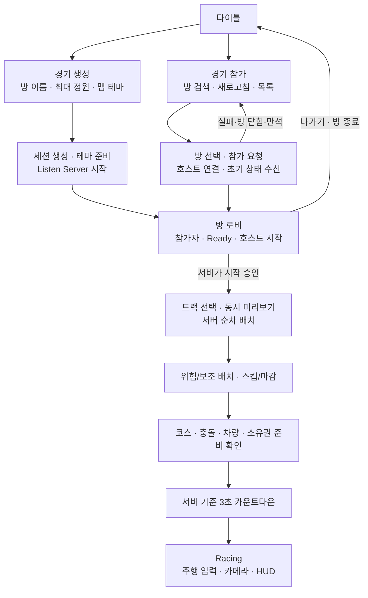

# MW 타이틀·방 생성·참가부터 게임플레이까지의 마일스톤

**문서 번호:** MW-LOBBY-MILESTONE-001 / v1.1 / 2026-10-28\
**분야:** Client + Server / UE 5.8.3 / ACharacter 기반 차량 / Listen Server\
**상태:** 구현 계획. 아래 항목은 아직 완료한 기능이나 테스트 결과가 아니다.

[08 Gameplay Framework 설명서](08_리슨서버_구조와_Gameplay_Framework.md)와 함께 읽는다. 이 문서는 **타이틀 → 방 생성/검색/참가 → 로비 → 건설 → 주행 시작**을 구현 가능한 단계로 나눈다. 일별 일정·인시의 원본은 [02 전체 마일스톤](02_클라이언트_마일스톤_4주.md), 경기 규칙은 [개발명세](MakeWay_클라이언트_개발명세서_v1.0.md)를 따른다.

## 1. 이번 요청으로 정한 목표

- 타이틀에 **경기 생성**, **경기 참가** 버튼을 둔다.
- 경기 생성 화면에서 **방 이름, 플레이 인원수, 맵 테마**를 정한다.
- 방을 만든 플레이어가 그 방의 Listen Host가 된다. 특정 개발자나 계정을 고정 호스트로 두지 않는다.
- 경기 참가 화면에서 현재 참가 가능한 방을 검색하고, 원하는 행을 눌러 입장한다.
- 여러 플레이어가 각각 호스트가 되어 **서로 독립된 여러 방을 동시에 운영**할 수 있다.
- 서비스 구독료나 유료 서버 임대를 필수로 요구하지 않는 방향으로 계획한다.

설계의 기본 해석은 **게임 실행 인스턴스 하나가 한 번에 한 방에 참여하거나 한 방을 호스팅**하는 것이다. 여러 방은 여러 호스트 인스턴스가 각각 만든다. 한 게임 인스턴스가 여러 경기 월드를 동시에 운영하는 서버 관리 기능은 별도 확장이다.

플레이 인원수는 기존 기획에 따라 **호스트를 포함한 최대 정원 2~4명**으로 해석한다. 우선 3인으로 검증한다. 시작 조건의 기본안은 최소 2명·현재 참가자 전원 Ready·필수 준비 완료 후 호스트 시작 버튼이다. 최대 정원이 4명이라고 반드시 4명이 모여야 시작하는 규칙은 두지 않는다.

## 2. LAN과 인터넷의 차이, 비용 기준

| 항목 | LAN 방 검색·참가 | 인터넷 방 검색·참가 |
|---|---|---|
| 이용 위치 | 보통 같은 공유기·같은 로컬 네트워크 | 서로 다른 집·다른 네트워크 |
| 방을 찾는 방법 | 로컬 네트워크에서 세션 탐색 | 공용 세션 서비스에 등록된 방 검색 |
| 접속 처리 | 로컬 주소·방화벽 등 확인 | 인증·방 검색 외에 공유기/NAT를 넘는 접속 경로 필요 |
| 이번 계획의 용도 | 초기 구현·문제 분리용 검증 | 사용자가 요청한 방 목록과 원격 플레이의 최종 목표 |

같은 Wi-Fi 이름이나 같은 건물이라는 사실만으로 LAN 검색이 보장되지는 않는다. 게스트 네트워크·클라이언트 격리·방화벽 등 실제 환경을 확인한다. 반대로 인터넷 연결이 있다고 LAN 검색 결과가 다른 집까지 전달되지는 않는다.

**인터넷 플레이가 유료 게임 서버 구독을 반드시 요구하는 것은 아니다.** 2026-10-26 Epic 공식 안내 기준으로 이번에 사용할 EOS의 세션·P2P 기능은 로열티·호스팅 요금 없는 무료 범위다. 기본 계획은 **무료 EOS + 플레이어 PC의 Listen Server**이며 유료 서버·유료 플러그인 구매를 전제로 두지 않는다. [EOS 공식 라이선스 안내](https://onlineservices.epicgames.com/licensing)

EOS의 세션 기능은 방 생성·검색·참가를, P2P 기능은 플레이어 간 연결을 돕는다. 실제 GameMode·점수·차량 판정은 호스트 PC에서 실행한다. P2P 전송을 사용해도 경기 권한이 모든 클라이언트에 분산되는 것은 아니다. [EOS Multiplayer](https://onlineservices.epicgames.com/multiplayer?lang=en-US)

무료 이용에도 개발자 계정·제품/환경 설정·인증·플러그인 연동 작업은 필요하다. 이 작업의 기술 검증을 LM-0에 둔다. 유료 구독이 필요한 대안으로 자동 변경하지 않는다. 무료 경로를 구현하지 못하면 해당 인터넷 게이트를 미통과로 기록하고, LAN만 가능한 상태와 구분해 남긴다.

## 3. 최종 화면과 경기 흐름



타이틀·검색·참가 중은 로컬 화면/세션 작업 상태다. 기존 경기 Phase에 Title·Searching·Joining을 섞지 않는다. 방에 접속한 뒤의 경기 상태는 기존 `Lobby → TrackPlacement → HazardPlacement → Countdown → Racing`을 사용한다.

초기 맵 전략은 **타이틀은 로컬 메뉴 월드, 방은 생성 때 선택한 테마를 적용한 경기 월드**다. 호스트가 해당 월드를 Listen으로 준비하고 참가자는 그 월드로 접속한다. 입장 후 로비·건설·주행은 한 경기 월드의 Phase 전환으로 처리한다. 로비의 시작 버튼을 누를 때 별도 맵 이동 체계를 추가하는 것은 첫 범위에 넣지 않는다.

테마 선택 UI는 승인된 테마 ID 목록을 사용한다. 현재 제작된 테마가 하나면 그 항목만 제공한다. 이 기능 때문에 신규 테마 에셋을 필수로 추가하거나 클라이언트가 보낸 임의 맵 경로를 실행하지 않는다.

**맵 테마 정본:** 테마와 레벨의 연결은 [06 공용 데이터 이식 6.3절](06_공용_데이터_이식.md)의 `MWAssetData + MWAssetManager` 경로를 사용한다. `MapThemeId`는 FName으로 전체 태그 이름(현재 `Asset.MapTheme.DevDefault`)을 전달하고, 생성자가 시작 카탈로그와 Asset Registry를 통해 승인된 맵 패키지 이름을 얻는다. 레벨 경로 하드코딩 표를 Subsystem/Widget에 중복하지 않는다. 추가할 코드·클래스·멤버와 실습 순서는 [10 방 생성 구현 가이드](10_AssetManager_맵테마_기반_방생성_구현가이드.md)를 따른다.

## 4. 세션과 Gameplay Framework의 역할

| 대상 | 맡는 일 | 상태의 범위 |
|---|---|---|
| `UMWMultiplayerSubsystem : UGameInstanceSubsystem` | 인증 연결, 생성·검색·참가·나가기, 비동기 작업 정리, 접속 주소 해석과 이동 연결 | 각 게임 프로세스에 하나. 맵 이동에도 필요한 작업 수명 유지. 자동 복제되지 않음 |
| OnlineSubsystem EOS / EOS 서비스 | 방 등록·검색·참가에 필요한 온라인 기능과 P2P 연결 | 선택한 제품·배포 환경의 서비스 |
| `AMWGameMode` | 입장 재검증·정원·호스트 권한·Ready/시작·경기 전환 | 해당 방의 호스트 서버 월드 |
| `AMWGameState` | 승인된 방 설정·현재 참가 인원·Phase·서버 마감 시각 | 해당 방 참가자에게 복제 |
| `AMWPlayerState` | 참가자 이름/식별·Ready·경기 기록 | 해당 방의 참가자별 상태 |
| `AMWPlayerController` | 입장 후 소유 플레이어의 Ready·시작 요청과 로컬 화면/입력 연결 | 서버와 소유 클라이언트 |
| `AMWVehicleCharacter` + Movement | 소유 차량 입력·이동·예측/보정 | 해당 방의 차량 |
| Widget | 생성 폼·검색 목록·로비 상태·오류/대기 표시 | 로컬 표시 |

**방을 검색할 때는 아직 그 방의 GameState를 받지 않았다.** 검색 목록은 세션 서비스 결과로 만들고, 입장 후의 실제 로비 정보는 서버 GameState/PlayerState를 기준으로 표시한다. 검색 인원수는 지연될 수 있어 최종 입장 가능 여부를 서버에서 다시 검사한다.

GameInstanceSubsystem을 쓰는 이유는 방 생성·참가·실패 정리가 타이틀과 경기 월드 사이를 넘기 때문이다. GameMode에 전 세계 방 목록을 넣거나, 로컬 Subsystem을 여러 방이 공유하는 서버 객체로 취급하지 않는다.

초기 설계에서는 UE 5.8.3 설치본의 `OnlineSubsystemEOS.uplugin`, `OnlineSessionInterface.h`, `OnlineSessionSettings.h`, `GameInstanceSubsystem.h`를 확인했다. 구현은 기존 **OnlineSubsystem 계열 API 하나**를 기준으로 시험하며 별도 Online Services 계열 API와 혼용하지 않는다. 2026-10-28 현재 EOS 활성 설정·로그인·방 입력 검사·카탈로그 기반 테마 해석은 존재하지만 `RequestCreateRoom` 본문과 실제 생성/검색/참가는 아직 없다. 현재 설치본의 패치 버전은 5.8.4이며 이 사실을 10 문서의 검증 범위와 구분해 기록한다. 제품 등록과 플러그인 설정 절차는 [Epic OSS EOS 문서](https://dev.epicgames.com/documentation/en-us/unreal-engine/online-subsystem-eos-plugin-in-unreal-engine)를 따른다.

## 5. 방 데이터와 여러 방의 구분

| 데이터 | 의미와 원본 |
|---|---|
| 서비스의 고유 SessionId | 방의 식별자. 검색 행 선택·참가 대상 구분에 사용 |
| `RoomName` | 사용자가 입력한 표시 이름. 같은 이름이 존재해도 같은 방은 아님 |
| `MaxPlayers` | 호스트 포함 최대 정원. 서비스 설정과 서버 입장 정책을 일치시킴 |
| `MapThemeId` | 전체 테마 태그 이름을 담는 FName. 호스트가 MWAssetManager의 시작 카탈로그에서 MWAssetData의 레벨 참조를 해석. 06 문서 6.3절이 정본 |
| 현재 참가 인원 | 목록은 서비스의 관측값, 입장 후는 서버 참가자 상태 기준 |
| `RoomStatus` / 참가 가능 여부 | 로비·시작 중·경기 중·종료 상태. 검색용 정보와 서버 입장 검사를 함께 갱신 |
| `Build/ProtocolId` | 같은 제품이라도 호환되지 않는 빌드가 잘못 접속하지 않게 하는 계약 |
| 세션 소유자 | 방을 만든 호스트. 클라이언트가 보낸 임의 `bIsHost`로 권한을 부여하지 않음 |

위 필드는 의미 계약이다. 실제 OSS/EOS 속성 이름·검색 필터·직렬화 형식은 LM-0에서 확정한다. 방 이름 길이·공백 처리도 명시적 입력 정책으로 정하며, 인원은 2~4와 유효한 테마 ID를 검사한다. 검색용 세션 설정이 GameState에 자동 복제되는 것은 아니므로 서버가 승인된 방 설정을 따로 적용한다.

로컬 세션 핸들의 이름으로 `GameSession`을 사용하더라도 이것은 각 실행 인스턴스 내부 이름이다. 모든 플레이어가 같은 이름을 썼다고 전 세계 방 하나를 공유하는 것이 아니다. 서로 다른 호스트의 서비스 SessionId·연결 대상·경기 월드는 독립적이어야 한다.

```text
호스트 A → SessionId A → 방 A의 GameMode/GameState/차량/트랙
호스트 B → SessionId B → 방 B의 GameMode/GameState/차량/트랙
참가자는 목록에서 선택한 SessionId의 방에만 접속
```

## 6. 마일스톤 전체 표

| 단계 | 산출물 | 완료 조건 | 선행 조건 |
|---|---|---|---|
| LM-0 | 무료 온라인 경로·인증·세션 계약의 최소 시험 | 유료 구독 없이 EOS에서 생성·검색·연결을 시험하고 비용/환경/한계를 기록 | 현재 기반 확인 |
| LM-1 | 타이틀·생성 폼·검색 화면 | 입력 검증·대기·실패·뒤로 가기가 동작 | LM-0의 데이터 계약 |
| LM-2 | Framework·임시 로비와 차량 시험 | 3인 상태 일치, Character의 기본 이동·충돌/복귀 시험 | 승인 데이터 연결 |
| LM-3 | 실제 방 생성·Listen Host | 생성한 사람이 호스트가 되고 승인 설정으로 로비 진입 | LM-0~2 |
| LM-4 | 방 검색·선택 참가·동시 여러 방 | 다른 네트워크에서 검색·참가하고 두 방의 상태가 독립 | LM-3 |
| LM-5 | 로비 Ready·호스트 시작·입장 잠금 | 시작 승인·거절·입장 경합이 서버 규칙대로 처리 | LM-4 |
| LM-6 | 트랙 건설·위험/보조 단계 | 동시 배치·중복·stale·시간초과·스킵 경로 처리 | LM-5, 기존 건설 계약 |
| LM-7 | 출발 준비·카운트다운 | 모든 유효 참가자의 실제 준비 확인 후 서버 기준 출발 | LM-6, 차량 시험 통과 |
| LM-8 | 주행·화면 전환·종료 정리의 통합 | 타이틀에서 출발까지 완주하고 나간 뒤 다시 생성/참가 가능 | LM-7 |

단계 번호는 의존 순서이며 개발일 수가 아니다. LM-1의 UI와 LM-2의 차량 시험 등 독립 작업은 기존 담당 안에서 병행할 수 있다. 일별 D1~D20 표와 중복되는 새 시간 예산을 만들지 않는다. EOS·인증·타이틀/방 목록은 기존 단순 접속보다 추가 범위이므로 LM-0의 실제 비용을 확인해 02 일정에 재배분해야 한다. 기존 D5 성공이나 360인시 내 완료를 보장하지 않는다.

## 7. 단계별 작업과 인수 조건

### LM-0. 무료 접속 경로와 계약부터 검증

**주 책임:** B의 세션/접속 설계, A의 로컬 진입·입력 연결. C에게 별도 온라인 백엔드 작업을 추가하지 않는다.

- EOS 개발 제품·배포 환경·필요 인증 방식을 정하고 서로 다른 테스트 사용자로 초기 연결을 시험한다.
- 세션 등록만 성공한 상태와 실제 게임 연결 성공을 구분한다. OSS EOS용 전송/NetDriver 경로와 인증·참가자 등록을 함께 검증한다.
- `CreateSession`, `FindSessions`, `JoinSession`, 연결 대상 해석, `Update/Start/End/DestroySession`의 필요한 호출·완료 콜백·정리 순서를 설치 버전에 맞춘다.
- LAN은 빠른 진단용으로 시험할 수 있지만, 다른 네트워크의 연결을 한 번은 조기에 시험한다. 같은 PC의 PIE 통과로 인터넷 성공을 주장하지 않는다.

**통과:** 무료 범위의 제품·인증·서비스/전송 경로로 실제 생성→검색→연결→종료 최소판을 확인하고, 필요한 설정과 재현 절차를 남긴다. 여기서는 임시 버튼/고정 맵을 쓸 수 있다. 실패하면 유료 대안을 결제하는 대신 실패 원인과 이후 단계의 독립 진행 가능 범위를 기록한다.

### LM-1. 타이틀·방 생성·참가 화면

- 타이틀의 경기 생성/경기 참가를 각각 연결한다.
- 생성 폼에서 방 이름·정원·테마를 입력하고 승인된 값으로만 요청한다.
- 참가 화면에 방 이름·인원/정원·테마·참가 가능 여부를 표시하고 새로고침·선택·참가를 제공한다.
- 검색 0건, 인증 실패, 생성 실패, 참가 실패를 다른 상태로 표시한다. 처리 중에는 중복 클릭을 막고 뒤로 가기/취소 이후 콜백을 정리한다.

**통과:** 잘못된 정원·없는 테마·빈 방 이름을 처리하고, 화면을 닫았다 다시 열어도 이전 대기 상태나 중복 이벤트가 남지 않는다. 임시 목록으로 화면을 검증했으면 실제 검색 성공과 구분한다.

### LM-2. Framework와 Character의 독립 최소판

- `AMWGameMode`, `AMWGameState`, `AMWPlayerState`, `AMWPlayerController`를 기본 설정에 연결한다.
- 승인된 데이터 로드와 로컬 입력 준비를 연결하고, 임시 로비에서 참가자/Ready를 표시한다.
- 고정 코스에서 ACharacter/CMC 기반 조향·제동·기본 드리프트·차량 충돌·가속/넉백·안전 이동 후 회복을 시험한다.
- 호스트와 원격의 표시 갱신 경로를 모두 연결한다. 임시 직접 접속은 개발용 증거이며 정식 방 검색의 대체 완료가 아니다.

**통과:** 호스트+원격 2명이 같은 개인/공용 상태를 보고 차량 기술 시험을 수행한다. 차량 시험은 LM-3~5의 세션 작업과 독립적으로 진행할 수 있다.

### LM-3. 생성한 사람이 실제 Listen Host가 되기

```text
생성 폼 확인 → 세션 생성 작업 → 승인 테마의 경기 월드 Listen 준비
→ GameMode/방 설정/호스트 참가자 초기화 → 참가 가능 상태 공개 → 호스트 로비 표시
```

- 세션 생성 완료와 맵/수신 준비 완료를 따로 확인한다. 준비 중인 방을 참가 가능한 로비로 표시하지 않는다.
- 정원에 호스트 한 명을 포함한다. 서비스 슬롯과 실제 서버 참가자 등록 방식이 일치하는지 확인한다.
- 중간에 맵 로드·수신·공개가 실패하면 이미 만든 세션을 정리하고 재생성이 가능한 화면으로 돌아간다.
- 같은 실행 인스턴스의 중복 생성은 막되, 다른 플레이어가 자신의 방을 만드는 것은 허용한다.

**통과:** A가 생성하면 A가 호스트, B가 생성하면 B가 호스트가 된다. 방 이름·정원·테마가 요청한 승인 값으로 로비에 표시되고, 생성 연타로 중복 방이 생기지 않는다.

### LM-4. 검색·참가와 여러 방의 독립성

```text
검색 → 현재 검색 결과 선택 → SessionId로 참가
→ 서비스 참가 결과 → 연결 대상 해석 → 호스트로 접속
→ 서버 입장 검사 → PlayerState/공용 상태 준비 → 로비 표시
```

- 서비스 참가 성공만으로 로비 입장 완료를 표시하지 않는다. 게임 월드 연결과 자기 Controller/PlayerState 준비를 확인한다.
- 검색 세대와 작업 ID로 오래된 검색/참가 콜백을 구분한다. 목록이 갱신되면 행 인덱스만으로 이전 방을 선택하지 않는다.
- 만석·이미 시작·호스트 종료·호환 불가·주소 해석 실패·접속 실패를 처리하고, 실패한 로컬 세션 흔적을 정리한다.
- 같은 이름의 두 방도 서로 다른 SessionId로 구분한다. 한 방의 인원·테마·Ready·트랙·종료가 다른 방에 섞이지 않아야 한다.

**통과:** 최소 4개 실행 인스턴스와 구분되는 사용자로 호스트 2명+각 참가자 1명을 구성해 두 방을 동시에 확인한다. 한 방 종료 후 다른 방이 유지되어야 한다. 실제 인터넷 검증은 서로 다른 네트워크를 포함하고, 실제 3PC 한 방 시험도 별도로 수행한다.

### LM-5. 로비 설정·Ready·호스트 시작

- 방 이름·정원·테마·참가자 목록은 서버가 승인한 GameState/PlayerState로 표시한다.
- 생성 때 정한 방 이름·정원·테마는 첫 구현에서는 방 수명 동안 고정한다. 변경 UI를 추가할 경우 호스트 검증·서비스 갱신·Ready 재설정 계약을 별도 구현한다.
- 각 참가자는 소유 Controller로 자신의 Ready를 요청한다. 호스트 시작 요청도 같은 서버 검증을 거친다.
- 서버는 최소 인원·현재 전원 Ready·필수 데이터 준비·호스트 여부·Lobby 여부를 확인한다.
- 시작을 승인하는 서버 경로에서 입장을 먼저 닫고 참가자 스냅샷을 확정한다. 서비스에도 시작 중/참가 불가를 반영한다. 광고 갱신 전에 도착한 입장 요청도 서버 검사로 거절한다.

**통과:** 원격의 시작 요청, 준비 안 된 상태, 중복 시작 요청은 경기 전환을 만들지 않는다. 마지막 입장과 시작의 경합을 검사하고, 참가자 이탈이 무한 Ready 대기를 만들지 않는다. 시작 전 실패는 로비로 복구하거나 명시 종료한다.

### LM-6. 건설 단계까지 연결

- TrackPlacement 진입에 맞춰 후보 선택/배치 입력·카메라·Ghost를 설치한다.
- 후보 선택→서버 배치 요청→검증/생성→확정 코스 복제→Ghost 갱신을 연결한다.
- 1인 1조각, 요청 ID·Epoch·Revision, stale 명시 거절, 18초 후 안전 대체/ConstructionBlocked를 기존 계약대로 구현한다.
- HazardPlacement는 슬롯 배치·명시 스킵·제한시간으로 종료할 수 있게 한다. 실제 범퍼·박스·패드 효과 통합은 기존 D10 범위를 유지한다.
- 휠 회전의 최종 배치 반영 계약은 미정이다. 화면 회전만으로 서버 확정 회전까지 완료했다고 기록하지 않는다.

**통과:** 3명 동시 요청·중복·오래된 요청·무입력을 처리하고, 다음 단계가 진행되거나 이유 있는 예외 결과로 끝난다. 입력 Context가 중복 활성화되지 않는다.

### LM-7. 실제 준비 확인과 카운트다운

- 서버는 승인된 Character를 한 번 생성·Possess하고 출발 위치와 이동 제한을 적용한다. 기본 자동 스폰과 별도 스폰으로 중복 생성하지 않는다.
- 각 클라이언트는 대상 코스 리비전의 Actor·에셋·충돌, 자기 차량·소유권·필수 입력 데이터의 실제 준비를 확인한다.
- 서버는 최신 리비전/참가자 기준의 준비 응답만 받는다. Phase 도착이나 임의 Delay를 준비 완료로 취급하지 않는다.
- 준비 제한시간을 넘으면 시작 취소/명시 예외 종료로 정리한다. Countdown에는 서버 기준 종료 시각과 출발 대기 제어를 적용한다.

**통과:** 트랙이나 차량이 늦게 준비되는 원격이 있어도 바닥 없이 출발하지 않는다. 3초 표시가 끝나기 전에 클라이언트가 임의로 주행을 활성화하지 않는다. Countdown 중 이탈도 제한시간과 참가자 정책으로 정리한다.

### LM-8. 주행 시작과 방 수명 통합

- 서버가 Racing으로 전환하면 Driving 입력·차량 카메라·최소 HUD를 활성화한다.
- WASD·LShift 기본 드리프트와 차량 이동·충돌·보정, 호스트/원격 화면을 확인한다. 주행 중 건설 입력이나 로비 UI가 남지 않게 한다.
- 원격 나가기는 해당 참가자·로컬 세션을 정리한다. 호스트 종료는 그 방만 종료하고 참가자는 실패 이유와 함께 타이틀로 돌아간다.
- 호스트가 다시 생성하거나 이전 참가자가 다른 방에 참가할 수 있도록 세션·비동기 구독·오류/이동 상태를 정리한다.

**통과:** Windows Development 패키지에서 경기 생성/검색/참가→Ready/시작→건설→준비 확인→카운트다운→3인 주행까지 진행한다. 끝난 뒤 재생성·재참가도 성공하고, 다른 방은 영향을 받지 않는다.

## 8. 실패·취소를 공통으로 다룰 규칙

| 상황 | 필요한 처리 |
|---|---|
| 생성/검색/참가 버튼 연타 | 진행 중 작업을 구분해 중복 생성·접속 방지 |
| 취소 후 성공 콜백 도착 | 이전 작업 ID를 검사하고 이미 확보한 자원/참여를 정리. 닫은 화면을 다시 열지 않음 |
| 검색 0건 | 정상 빈 결과로 표시하고 새로고침 제공 |
| 목록을 누르는 사이 만석/시작/종료 | 서버/서비스 최종 거절을 표시하고 목록으로 복구 |
| 세션 생성 후 Listen/맵 준비 실패 | 생성한 세션 정리·공개 중지·오류 표시 |
| 서비스 참가 성공 후 게임 연결 실패 | 로컬 참가 상태와 핸들을 정리한 뒤 재검색 가능 |
| 호스트 비정상 종료 | 연결 실패를 처리해 타이틀 복구. 방 목록은 즉시 사라진다고 보장하지 않고 재검색/오래된 결과 거절 |
| 나가기/세션 정리 실패 | 실패를 표시하고 정리·재시도 경로 유지. 성공했다고 가정하고 다음 생성과 겹치지 않음 |

세션 작업의 로컬 상태와 게임 Phase는 별개로 관리한다. 로컬 세션 작업은 대기·성공·취소·시간초과·실패로 닫히도록 만들고 맵 이동·종료 시 Delegate와 핸들을 정리한다. 세션 디렉터리의 표시를 최종 점수·입장 권한의 원본으로 사용하지 않는다.

## 9. 최종 인수 시나리오

| ID | 재현 | 기대 결과 |
|---|---|---|
| LP-01 | 서로 다른 사람이 번갈아 생성 | 생성자가 각 방의 호스트 |
| LP-02 | 같은 이름의 방 두 개 생성 | SessionId로 구분되고 원하는 방에 입장 |
| LP-03 | 호스트 2명+각 원격 1명 동시 실행 | 두 방의 설정·Ready·시작·종료가 독립 |
| LP-04 | 생성·검색·참가 연타와 취소 | 중복 방·늦은 화면 전환·참가 흔적 없음 |
| LP-05 | 남은 한 자리에 동시 참가, 시작과 참가 경합 | 정원 초과·경기 중 신규 입장 없음 |
| LP-06 | 호환 안 되는 빌드·사라진 방·만석 | 명시 거절과 재검색 가능 |
| LP-07 | 준비 안 된 클라·중복/원격 시작 요청 | 서버 전환은 유효한 호스트 요청에 한 번만 발생 |
| LP-08 | 트랙/충돌/차량 준비를 늦춤 | 준비 확인 전 출발 없음, 시간초과 처리 |
| LP-09 | 서로 다른 네트워크의 실제 패키지 | 무료 EOS 경로로 검색·게임 연결·주행 성공 |
| LP-10 | 나가기·호스트 종료 뒤 새 방 생성/참가 | 정리 후 다시 진행, 다른 방 정상 유지 |

실행 로그에는 빌드·커밋·사용 서비스/배포 환경·PC/프로세스/사용자 수·LAN/서로 다른 네트워크·관측 RTT·SessionId별 결과를 남긴다. 테스트 사용자와 실행 조건을 기록하되 자격 증명은 포함하지 않는다.

## 10. 전체 일정과 다음 범위

기존 CL-M0~M2는 Framework·차량·건설/주행의 기반 게이트다. 이번 LM-0~8은 그 기반에 **타이틀·실제 세션 생성/검색/참가·여러 방·정리 수명**을 더한 기능 인수 순서다. CL-M2의 LAN/3PC 건설·주행 성공만으로 LP-09의 인터넷 목표까지 완료로 표시하지 않는다.

LM-8은 게임플레이 **시작까지**의 완료다. 체크포인트·점수·거리 차 탈락/복귀·라운드 확장·최종 결과·재경기와 부스터/범퍼/박스/패드는 기존 CL-M3~M4에서 계속 구현한다. 이번 문서가 해당 필수 규칙을 삭제하거나 후순위 콘텐츠로 바꾸지 않는다.

신규 온라인 범위의 일별 배치는 LM-0 후 02 마일스톤에서 재산정한다. 프론트 UI는 초기 기능 확인용 최소 화면으로 시작하고, 기존 C의 TA/아이템 예산을 세션 작업에 중복 배정하지 않는다. 이번 작성에서는 문서 정합성·링크·diff만 확인하며 EOS 계정 설정·게임 구현·실행 검증은 하지 않는다.

## 11. 공식 근거와 프로젝트 선택

- 무료 범위와 사용 조건은 2절의 EOS 라이선스·Multiplayer 공식 안내를 2026-10-26 확인했다. 서비스 정책이 변경되면 실제 연동/출시 전에 다시 확인한다.
- OSS EOS 제품/인증/전송 설정은 4절 공식 문서와 설치 UE 5.8.3 소스를 기준으로 시험한다. 세션 검색 성공과 실제 게임 접속 성공은 별도 인수 항목이다.
- 세션 수명·설정·생성/검색/참가 API의 개요는 [Epic Session Interface](https://dev.epicgames.com/documentation/en-us/unreal-engine/online-subsystem-session-interface-in-unreal-engine)를 참고한다. 개별 함수의 호출 주체·결과·실행 환경은 설치 헤더와 실제 서비스로 재검증한다.
- 한 인스턴스 한 방, 생성 후 설정 고정, 호스트 시작 버튼, 단일 경기 월드의 Phase 전환은 이번 MW의 기본 설계안이다. 무료 서비스 기능 설명이 구현 난이도·접속 품질·기존 일정의 달성을 보장하지는 않는다.
