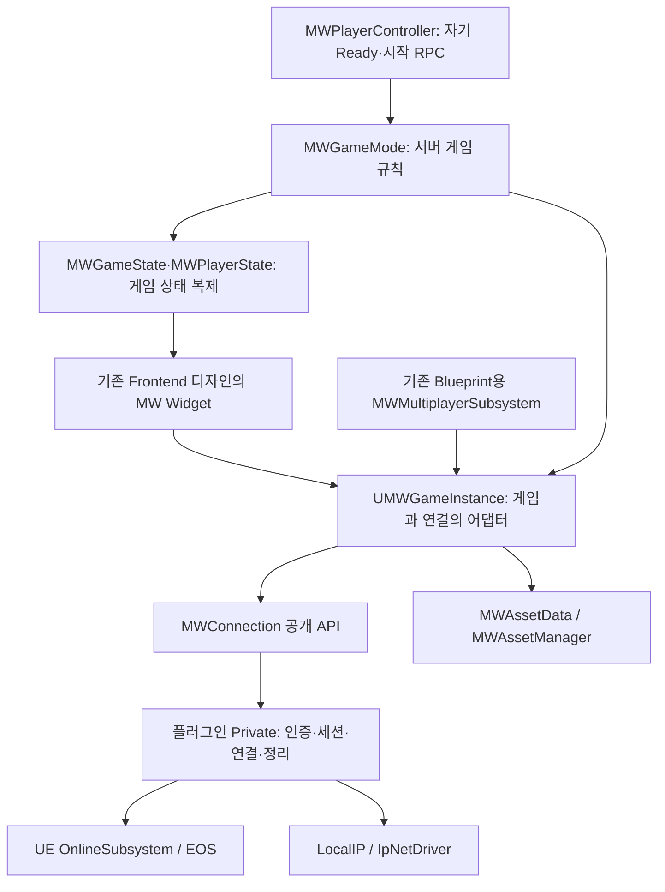

# 독립 연결 모듈 API와 ProjectMW 연동

> 2026-11-02 후속 설계 채택: 로비/게임플레이의 GameMode·GameState·PlayerController 분리와 `GameStart → VehicleSelection → 전원 선택 확정 → 테마 이동`의 정본은 [16번 문서](16_로비_게임플레이_분리와_차량선택_전환_계약.md)다. 이 문서의 기존 클래스 구성·즉시 이동 흐름과 검증은 분리 이전 구현 기록이다. 후속 설계의 구현·실행 검증 완료를 뜻하지 않는다.

> 후속 기능 이전: 로비/게임플레이 클래스 분리와 기존 기능 이전 결과는 16번 문서 9절을 따른다. 미구현 기능을 추가하지 말라는 사용자 지시로 차량 선택은 추가하지 않았으며 기존 즉시 테마 이동을 유지했다. 연결 모듈 API와 구현은 변경하지 않았다.

2026-11-02 / Client + Server / UE 5.8.4

사용자 지시에 따라 EOS·세션 처리를 `Plugins/MWConnection` Runtime 플러그인으로 분리했다. 게임 코드는 연결 모듈의 공개 API만 사용한다. 차량·건설·Ready·게임 Phase를 추가할 때 EOS 내부를 수정하지 않는 구조다.

이 문서는 **현재 연결 구조의 정본**이다. 10~14번 문서에서 `UMWMultiplayerSubsystem` 내부에 세션과 게임 시작을 함께 구현하던 설명은 과거 구현 기록이다. 테마 정본인 `MWAssetData → MWAssetManager` 계약은 유지한다.

## 1. 경계와 각 클래스의 역할



| 영역 | 책임 | 다른 영역에 대한 접근 |
|---|---|---|
| `MWConnection` | 로그인, 방 생성·목록·참가, 최초 로비 연결, 입장 허용, 종료·실패 정리 | 엔진 기본 클래스와 Private 온라인 인터페이스 사용. MW 게임 클래스·테마·차량은 모름 |
| `UMWGameInstance` | 모듈 API 호출, 게임 방 설정 변환, 테마 검사, 메뉴 이벤트 전달, 이동할 참가자 보관 | 프로젝트에서 플러그인 공개 헤더를 포함하는 유일한 구현 파일 |
| `AMWGameMode` | 참가자 ID, Ready·시작 권한, 시작 시 참가자 재검사, 테마 ServerTravel | EOS·세션 포인터·온라인 등록 플래그를 사용하지 않음 |
| `AMWGameState` | 방 설정·게임 Phase·참가자 목록 복제 | 연결 모듈을 조회하지 않음 |
| `AMWPlayerState` | 참가자 ID·호스트·Ready 보관 및 이동 시 복사 | 계정 인증이나 세션 등록을 관리하지 않음 |
| `AMWPlayerController` | 자기 클라이언트의 Ready·시작 요청, 로컬 UI·입력 | 서버 RPC와 게임 상태를 사용 |
| `UMWMultiplayerSubsystem` | 기존 Blueprint 노드 호환 | GameInstance에 전달만 함. 자체 세션 로직 없음 |

게임 모듈의 EOS·OnlineSubsystem 직접 Build 의존성을 제거했다. 연결 모듈 내부에는 온라인 처리가 존재하지만 게임 코드에는 노출하지 않는다. 온라인 실행에는 프로젝트 EOS 플러그인과 올바른 서비스 설정이 필요하다. `LocalIP` 실행은 EOS 로그인 없이 가능하다.

## 2. 새 C++ 코드가 사용하는 진입점

독립 플러그인 소비자는 다음 두 헤더만 사용한다.

```cpp
#include "MWConnectionSubsystem.h"
#include "MWConnectionTypes.h"

UMWConnectionSubsystem* Connection =
    GameInstance->GetSubsystem<UMWConnectionSubsystem>();
```

호출 모듈 Build.cs에 `MWConnection` 의존성을 추가한다. ProjectMW에는 이미 적용돼 있다. 공개 헤더에 플러그인 헤더를 포함하지 않으므로 현재 MW에서는 Private 의존성이다. 다른 모듈의 공개 헤더에서 타입을 직접 노출한다면 해당 모듈의 Public 의존성으로 선언해야 한다.

GameInstance마다 인스턴스가 하나 있으며 모든 API는 게임 스레드에서 호출한다. 프로젝트의 새 UI는 아래 5절의 GameInstance 경로를 사용한다. GameMode나 차량이 플러그인을 각각 구독할 필요는 없다.

## 3. 공개 API 전체

모든 `Request`의 마지막 인수는 `FText& OutError`, 반환형은 `bool`이다.

| API | 입력 | 완료 시 의미 |
|---|---|---|
| `RequestLogin` | 없음 | 온라인 계정 인증 완료 |
| `RequestHostRoom` | `FMWConnectionRoomOptions` | Listen 로비 준비. 온라인이면 호스트 등록·방 공개까지 완료 |
| `RequestRefreshRooms` | 없음 | 현재 방 목록 캐시 갱신 |
| `RequestJoinRoom` | `RoomHandle` | 선택한 온라인 방에 실제 연결하고 대상 세션·참가자 등록 확인 |
| `RequestJoinAddress` | `host:port` | LocalIP 서버 연결·로비 정보 수신 |
| `RequestSetRoomJoinable` | `bool` | 호스트의 입장 허용 변경. 온라인 공개 상태까지 갱신 |
| `RequestLeaveRoom` | 없음 | 연결·세션 정리와 복귀 맵 도착 확인 |
| `CanExecute` | `EMWConnectionAction` | 입력 없는 실행 가능 여부 조회. UI 활성화용 |
| `GetSnapshot` | 없음 | 현재 캐시의 복사본. 네트워크 요청 없음 |

요청의 반환값은 완료 여부가 아니다.

```text
false → 시작하지 못함. OutError 표시. 완료 이벤트 없음.
true  → 요청 접수. GameInstance가 살아 있는 동안 해당 작업 완료 이벤트 1회.
```

일반 작업은 동시에 하나만 진행한다. `LeaveRoom`으로 진행 중 작업을 취소할 수 있다. 취소한 작업은 `Cancelled`로 완료하며, 서로 다른 작업의 완료 알림 순서에 기대어 UI를 작성하지 않는다. GameInstance가 종료되면 구독·타이머를 해제하고 더 이상 완료 이벤트를 발행하지 않는다.

### 입력·결과 타입

| 타입 | 주요 필드 / 사용법 |
|---|---|
| `FMWConnectionRoomOptions` | `RoomName`, `MaxPlayers`(호스트 포함), `Properties` 문자열 맵 |
| `FMWConnectionRoomInfo` | `RoomHandle`, 이름, 현재·최대 인원, Properties, `bJoinable`, 참가 불가 이유 |
| `FMWConnectionResult` | `bSuccess`, `ErrorCode`, `Message` |
| `FMWConnectionSnapshot` | 연결 상태, 현재 작업, LocalIP 여부, 로그인 여부, Busy, 방 연결·호스트 여부, Room, Rooms, 오류 메시지 |

`RoomHandle`은 모듈이 현재 목록에서 반환한 값을 그대로 전달한다. 외부에서 세션 ID 형식을 해석하거나 직접 생성하지 않는다. 목록은 조회 시점 정보이므로 참가 시 만석·방 종료로 실패할 수 있다. 실제 접속 후 참가자 목록은 게임의 `GameState.PlayerArray`가 원본이다.

`Properties`는 게임이 정의하는 문자열 메타데이터다. 모듈은 `MapTheme` 태그를 해석하지 않는다. ProjectMW의 어댑터가 테마 ID를 이 값에 담고, 수신 시 게임 카탈로그로 검사한다.

모듈 일반 입력 제한은 방 이름 1~64자, 정원 1~64명, Properties 16개 이하, 키 1~32자·값 256자 이하다. ProjectMW의 방 이름 1~32자·정원 2~4명 제한은 게임 쪽에서 추가 검사한다.

### 이벤트

```cpp
SnapshotHandle = Connection->OnSnapshotChanged().AddUObject(
    this, &ThisClass::RefreshMenu);
ResultHandle = Connection->OnOperationCompleted().AddUObject(
    this, &ThisClass::HandleResult);
WorldHandle = Connection->OnLocalWorldReady().AddUObject(
    this, &ThisClass::HandleWorld);
```

콜백 서명은 다음과 같다.

```cpp
void RefreshMenu();
void HandleResult(EMWConnectionAction Action, const FMWConnectionResult& Result);
void HandleWorld(UWorld* World);
```

종료할 때 같은 이벤트와 핸들로 `Remove`한다. 외부는 이벤트를 발행할 수 없다. `OnLocalWorldReady`는 최초 타이틀·일반 이동·Seamless Travel 대상·복귀 월드에서 올 수 있다. 이 이벤트마다 방 생성을 반복하지 않는다.

### 사용 예

```cpp
FMWConnectionRoomOptions Options;
Options.RoomName = TEXT("연습 방");
Options.MaxPlayers = 3;
Options.Properties.Add(TEXT("MapTheme"), TEXT("Asset.MapTheme.DevDefault"));

FText Error;
if (!Connection->RequestHostRoom(Options, Error))
{
    // 즉시 거절: Error를 표시한다.
}
// 접수됐다면 HostRoom 완료 이벤트를 기다린다.
```

Host/Join 성공 완료 뒤에는 모듈이 로비 연결까지 끝낸 상태다. UI가 다시 OpenLevel·ClientTravel·RegisterPlayers를 호출하지 않는다.

## 4. 독립 실행 프로필

### OnlineEOS

기본 프로필이다. 기존 프로젝트 EOS 설정을 사용하며 별도의 서비스 요금제 구독을 추가하지 않았다. 새로운 세션 프로토콜은 `MW_DEV_V3`로, 이전 V2 방 목록과 섞이지 않는다.

선택 설정은 `Config/DefaultGame.ini`의 다음 섹션이다. 이 설정을 추가하지 않아도 기본값으로 동작한다.

```ini
[MWConnection]
Profile=OnlineEOS
Protocol=MW_DEV_V3
TimeoutSeconds=60
```

`LobbyMap`, `ReturnMap` 생략 시 엔진 Game Default Map을 사용한다. ProjectMW에서는 `L_Title`이다. 명시한다면 `/Game/Levels/L_Title` 패키지 경로를 사용한다. 플러그인이 ProjectMW 경로를 하드코딩하지 않는다.

### LocalIP

실행 인수 `-MWConnectionLocal` 또는 위 섹션의 `Profile=LocalIP`로 선택한다. 이 모드에서는 로그인·온라인 목록을 사용하지 않는다.

```text
호스트: RequestHostRoom(Options, Error)
참가자: RequestJoinAddress("127.0.0.1:7783", Error)
```

다른 컴퓨터라면 호스트의 실제 LAN 주소를 쓴다. `127.0.0.1`은 같은 PC에서만 사용한다. LocalIP를 선택하면 프로세스의 GameNetDriver를 리슨 드라이버 생성 전에 IpNetDriver로 설정한다. 한 프로세스에서 EOS와 LocalIP 프로필을 혼합하지 않는다. 서로 다른 프로필은 별도 프로세스로 실행한다.

프로젝트의 기존 방 목록 버튼은 이 모드에서 비활성화된다. 직접 주소 입력 UI는 새로 만들지 않았으며 Blueprint의 `RequestJoinAddress`를 통해 연결할 수 있다. 이 모드는 인터넷 NAT 우회·EOS 검색 완료를 의미하지 않는다.

## 5. ProjectMW Widget·Blueprint 사용법

새 UI는 다음 경로로 `UMWGameInstance`를 얻는다.

```text
Get Game Instance
    → Cast To MWGameInstance
    → 요청 / 조회 / 이벤트 바인딩
```

| 화면 동작 | 호출 | 결과 구독 / 조회 |
|---|---|---|
| 로그인 | `RequestLogin` | `OnLoginFinished`, `IsLoggedIn`, `IsLoginInProgress` |
| 생성 화면 | `GetAvailableMapThemeIds`, `RequestCreateRoom(FMWRoomSettings)` | `OnCreateRoomFinished`, `CanHostRoom` |
| 방 목록 갱신 | `RequestRefreshRooms` | `OnRoomsUpdated` 뒤 `GetAvailableRooms`, `GetRoomListRevision` |
| 방 선택·참가 | 목록의 SessionId와 Revision으로 `RequestJoinRoom` | `OnJoinRoomFinished` |
| 로컬 주소 참가 | `RequestJoinAddress` | `OnJoinRoomFinished` |
| 방 종료·나가기 | `RequestLeaveRoom` | `OnSessionStateChanged`, `GetSessionState`, `OnSessionError` |
| 진행·오류 표시 | 별도 요청 없음 | `IsSessionBusy`, `GetLastSessionError`, `OnSessionError` |

위 GameInstance의 Blueprint 요청은 기존 Widget 호환을 위해 `void`이며, 즉시 거절도 프로젝트 오류·완료 이벤트로 전달한다. **3절의 모듈 API bool 계약과 구분한다.** 방 선택 자체가 잘못됐거나 목록 Revision이 오래된 경우에는 `OnSessionError`를 표시하고 다시 선택한다.

`IsLoginRequired == false`이면 로컬 메뉴에서는 로그인 화면을 거치지 않는다. 생성 버튼은 `CanHostRoom`, 목록 버튼은 `CanBrowseRooms`를 사용한다. `IsSessionBusy == false`만으로 새 생성을 허용하지 않는다. `CleanupRequired`에서는 새 생성·참가가 차단된다.

기존 `WBP_LoginTest`의 `Get MWMultiplayerSubsystem` 노드를 유지하기 위해 호환 클래스만 남겼다. 기존 노드는 GameInstance에 전달되므로 로그인 로직이 두 벌 실행되지 않는다. 새 기능은 이 호환 클래스를 확장하지 않는다. 기존 Frontend 디자인 Widget 에셋은 수정하지 않았다.

## 6. Ready·게임 시작·테마 이동

현재 실행되는 흐름은 다음과 같다.

```text
타이틀에서 방 생성
 → L_Title?listen 로비
 → 목록 선택·참가 또는 LocalIP 주소 연결
 → 각 Controller의 RequestSetReady → 자기 소유 Server RPC
 → 서버 GameMode가 현재 참가자·Ready·시작 권한 검사
 → 호스트 RequestStartGame
 → GameInstance.PrepareForGameStart
 → 온라인 입장 잠금 완료 / LocalIP면 다음 Tick에 준비 완료
 → GameMode가 참가자·Ready 재검사
 → AssetManager로 승인 테마 목적지 해석
 → Seamless ServerTravel
 → L_Dev_Default: PreparingConstruction
```

온라인 계정·세션 등록의 검증은 연결 모듈이 맡는다. 게임 Ready 조건은 현재 연결된 게임 참가자와 서버가 발급한 `LobbyMemberId`를 사용하므로 EOS 계정 없이도 동작한다. 게임의 방 설정과 참가자 스냅샷은 GameInstance가 이동 동안 보관하고, PlayerState의 ID·Ready·호스트는 기존 CopyProperties로 유지한다.

테마 해석은 다음 계약을 유지한다.

```text
Asset.MapTheme.DevDefault
 → DA_AssetData의 ID·레벨 참조
 → UMWAssetManager
 → AssetData가 실제 UWorld 에셋인지 검사
 → /Game/Levels/L_Dev_Default 패키지 경로
```

플러그인은 테마 ID를 문자열 메타데이터로 운반할 뿐이며, 테마 로딩·유효성·경기 이동 규칙을 소유하지 않는다.

**계획된 차량 선택·건설·배치·카운트다운·주행은 이 분리 작업에서 추가하지 않았다.** 현재 시작 코드는 기존 동작대로 테마로 바로 이동한다. 최종 기획인 `시작 → 차량 선택 → 테마 이동`을 구현할 때는 `AMWGameMode::HandleStartPrepared` 이후에 차량 선택 단계를 연결하고, 선택 완료 후 현재 ServerTravel을 실행하도록 바꾼다. EOS 플러그인은 변경할 필요가 없다.

차량 선택은 PlayerState의 `VehicleAssetID` 하나, 소유 클라이언트의 기본 ID 자동 제출 RPC를 기준으로 구현한다. 문서 최초 작성 후 사용자가 선택 멤버·CopyProperties 복사 코드를 추가했으나, 선택 RPC·서버 확정·전원 선택 대기·복제 등록까지 완성된 것은 아니다. 현재 확인 상태와 초기값 주의점은 16번 문서 7절을 따른다. 게임 진행용 Token·MatchInstanceId·RoundEpoch·PhaseRevision·RequiredChecks를 추가하지 않았다. 플러그인 Private의 비동기 콜백 구분 번호는 게임 데이터나 공개 API로 전달하지 않는다.

## 7. 실패·정리 계약

- 생성·참가가 실패하면 부분 연결·세션을 정리하고 복귀한다. 정리를 확인하기 전에는 새 생성·참가를 허용하지 않는다.
- 제한시간 이후 온라인 응답이 와도 모듈 내부에서 처리한다. 외부에서 Delegate를 지우거나 세션 포인터를 수정하지 않는다.
- 결과가 불확실하면 `Unavailable / RestartRequired`를 제공한다. ProjectMW UI에는 기존 `CleanupRequired`로 변환한다. 정상 `None`으로 가장하지 않는다.
- `RequestLeaveRoom`은 남은 정리를 시도하는 공개 경로다. 해소되지 않는 작업을 반복 호출해 새 세션을 겹쳐 생성하지 않는다. 필요하면 게임을 재시작한다.
- 원격 참가자 한 명의 정상 이탈은 호스트 전체의 연결 실패로 처리하지 않는다.
- 게임 시작 준비 실패는 GameMode의 `FailStart → RequestLeaveRoom`으로 종료한다. 게임 단계 준비 재시도 시스템은 추가하지 않았다.
- GameInstance 종료 시 이벤트와 타이머는 해제한다. 온라인 방을 명시적으로 정리하려면 종료 전에 `RequestLeaveRoom` 완료를 확인한다. 강제 프로세스 종료의 서비스 정리 완료까지 보장하지 않는다.

## 8. 실제 검증 결과와 제한

검증용 코드는 공개 API 소비자로 실행했다. 테스트만을 위해 성공 상태를 직접 주입하거나 게임 RPC를 우회하지 않았다.

| 검증 | 결과 |
|---|---|
| 독립 프로젝트, 엔진 기본 GameInstance·GameMode, EOS 플러그인 비활성 | 두 별도 프로세스의 Host → 직접 주소 Join → 2인 확인 → 입장 잠금 → 각 Leave 통과. IpNetDriver 사용, 로그인 false |
| 독립 프로젝트, 실제 EOS | 로그인 → Host(호스트 등록·공개 포함) → 입장 잠금 → Leave → 목록 조회 → 같은 프로세스에서 재생성·잠금·종료·목록 재조회까지 통과. NetDriverEOS 사용 |
| ProjectMW, LocalIP 실제 3프로세스 | 호스트 ID 1·참가자 ID 2/3, 호스트 1명·전원 Ready 복제 확인. 실제 Ready/시작 RPC, 3명 모두 L_Dev_Default·PreparingConstruction 도착 및 타이틀 복귀 통과 |
| 잘못된 생성 입력·없는 RoomHandle·로컬 로그인 요청 | 즉시 거절, Busy 오염 없음 |
| 연결 불가능한 직접 주소 | 참가 실패·정리 후 복구 통과 |
| 생성 접수 직후 Leave | Host 취소 결과 1회·Leave 성공 1회, 뒤늦은 Listen 시작 없음 |
| 모듈 경계 검사 | 공개 API에 SDK 타입 없음, 플러그인에 MW 게임 의존 없음, 프로젝트의 직접 소비자는 GameInstance.cpp 하나 |
| Blueprint 호환성 | 로비 Widget 7개 및 BP_MWGameMode·BP_MWTitleGameMode·BP_MWPlayerController 컴파일 통과 |
| 테스트 코드 제거 후 최종 빌드 | MWEditor Win64 Development 및 MW Win64 Development 모두 성공 |

전체 Blueprint 13개 중 다음 3개는 부모 C++ 클래스가 없어 컴파일되지 않았다. 해당 클래스는 이번 변경 전 소스에도 없었다. 에셋은 저장·수정하지 않았다.

- `/Game/Developers/user/BP_MWDriveTestGameMode`
- `/Game/Developers/user/BP_MWDriveTestPlayerController`
- `/Game/Gameplay/Vehicles/BP_MWVehicleCharacter`

`DA_Driving_InputData`에는 기존 `Input.Action.Drive.Reverse` 태그 경고도 있었다. 이 상태에서 프로젝트 전체 에셋 무오류 또는 패키징 완료로 기록하지 않는다.

이번 변경 후 서로 다른 EOS 계정의 2인 JoinSession, 서로 다른 PC·인터넷 NAT 환경, 패키징 실행은 재검증하지 않았다. LocalIP 3인 검증과 실제 EOS 1인 API 검증의 범위를 구분한다. 이전 문서의 EOS 2인 성공 기록을 새 모듈의 재검증 결과로 옮기지 않는다.

사용자 요청에 따라 이번 검증의 테스트 전용 C++·Python·PowerShell, 임시 프로젝트·로그·결과 JSON·임시 백업을 모두 삭제했다. 최종 Editor DLL과 게임 실행 파일에서도 검증 클래스·실행 인수 문자열이 남지 않은 것을 확인했다. 검증 결과는 이 문서에 남기고 일반 개발용 빌드 결과물은 유지했다.

### 8.1. 생성 후 로비가 계속 준비 중으로 보이는 문제 수정

2026-11-02 실제 PIE에서 서버 상태가 이미 `Hosting`인데 `WBP_RoomLobby`는 `로비 정보를 준비 중입니다...`, Ready 버튼 비활성 상태에 머무는 문제를 확인했다. 당시 L_Title 리슨 로딩은 약 0.06~0.07초였다. 같은 위젯의 `Refresh`를 한 번 호출하자 추가 네트워크 요청 없이 방 정보·버튼이 즉시 정상화됐다.

원인은 연결 모듈 분리 시 누락된 UI 갱신 구독이다. 위젯은 생성·참가가 아직 진행 중일 때 구성되고 GameState 알림으로 먼저 Refresh될 수 있다. 이후 모듈이 호스트 등록·공개 또는 실제 참가 확인을 마쳐 `Hosting / Joined`가 되어도 GameState의 값이 다시 바뀌지 않으면 UI를 갱신할 계기가 없었다.

`UMWRoomLobbyWidget`이 GameInstance의 `OnSessionStateChanged`, `OnSessionError`를 구독하고 `Refresh`하도록 수정했다. Construct에서는 AddUniqueDynamic, Destruct에서는 같은 함수를 RemoveDynamic한다. PlayerController나 게임 규칙에 EOS 구독을 다시 추가하지 않았다.

수정 후 실제 EOS에서 생성 → 종료 → 재생성 → 종료를 실행했다. 로그인 시간을 제외한 생성 요청부터 Hosting 관찰까지 각각 약 **5.33초 / 4.67초**였고, 두 번 모두 완료 시점에 다음을 확인했다.

- 로비 표시 및 방 이름 `Latency Verification`, 인원 `1 / 3명` 표시
- Ready·나가기 버튼 활성화
- 준비 대기 안내 대신 정상 로비 안내 표시
- 종료 후 타이틀 복귀

위 시간은 당시 PIE 환경의 관찰값이며 EOS 응답 시간과 에디터 프레임 속도의 영향을 받는다. 네트워크 생성 시간을 단축한 변경으로 기록하지 않는다. 이번 수정은 생성 완료 후 화면이 계속 대기하는 결함을 해결한다. 임시 관찰 콜백은 해제하고 메모리의 검증 데이터도 삭제했다. 별도 테스트 소스·스크립트 파일은 추가하지 않았다.

## 9. 앞으로 수정할 위치

| 추가할 기능 | 수정 위치 |
|---|---|
| 차량 목록·Definition | MW 데이터·AssetManager 계약 |
| 차량 선택·자동 기본 ID 제출 | 채택 설계의 LobbyPlayerController RPC / LobbyGameMode 검증 / 공용 MWPlayerState.VehicleAssetID |
| 건설·배치 완료 조건 | 채택 설계의 GameplayGameMode·GameplayGameState 및 배치 시스템 |
| 생성·Possess·입력 준비·카운트다운 | 게임 규칙과 차량·로컬 입력 코드 |
| Widget 표시·버튼 | 기존 MW Widget / GameInstance의 공개 Blueprint API |
| 로그인·연결·세션 서비스의 결함 | MWConnection Private 내부 |
| 새로운 온라인 기능 | 먼저 공개 API 계약 추가 후 Private 구현 |

기존 기능을 사용하는 게임 개발자는 로그인 구현·EOS Delegate·SessionSettings·등록 처리·정리 순서를 이해하거나 고칠 필요가 없다. 공개 요청과 완료 이벤트, 게임에 필요한 상태만 사용하면 된다. 공개 API의 자세한 계약은 [플러그인 README](../../../Plugins/MWConnection/README.md)를 따른다.
