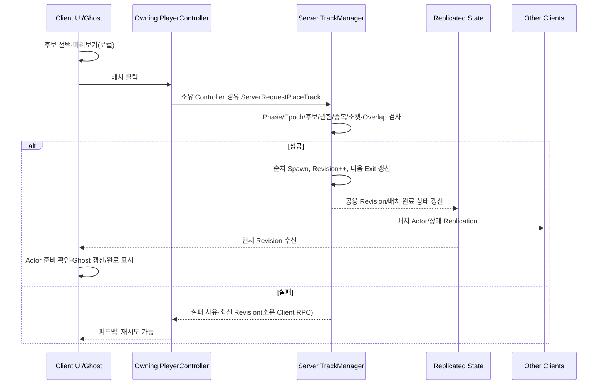
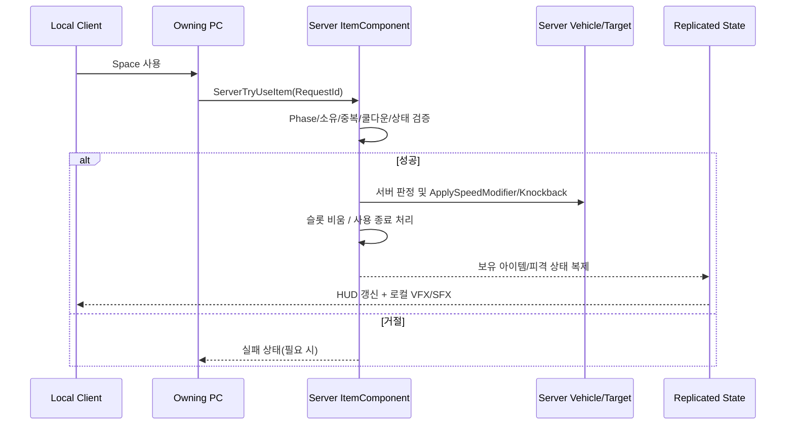

# Make Way 개선형 멀티플레이 — 클라이언트 C++ 개발명세서

**문서 번호:** MW-CL-SPEC-001  
**버전:** v1.2 / 2026-10-22 (파일명은 기존 참조 유지)\
**상태:** 구현 제안안 — D1 설계 합의, D3 차량 이동 검증 후 동결  
**기준:** 기획 Draft v0.4, 클라이언트 마일스톤 v1.2, `05_클라이언트_개발순서_및_설계검토.md`\
**환경:** Unreal Engine **5.8.3** C++/Blueprint, Windows, 3인 Listen Server 우선 / 4주 / 팀 전체 360인시  
**이 문서의 의미:** 실제 소스 분석 및 컴파일 검증 완료 문서가 아니다. 아래의 클래스명·API·폴더는 **제안 설계**이며 D1 팀 합의로 확정한다.

**v1.2 규칙 정정:** 선두와 기준 거리 이상 벌어지면 서버가 자동 탈락시킨다. 기본 레이스에서는 다음 유효 체크포인트에 복귀한다. 거리 측정 방식·임계값은 D3 계약에서 결정할 미정 항목이며, D6~D8 경기 규칙 통합/검증에 포함한다.

**v1.1 변경:** 로컬 기본 모듈과 5.8.3 설치를 확인했다. 구현/컴파일/주행 검증은 미실시다. D3 외부 효과 시험·조기 패키징·stale 거절·준비 확인·동일 Pawn 복귀를 채택한다. 판단 근거와 외부 출처는 [설계 검토](05_클라이언트_개발순서_및_설계검토.md)에 기록한다.

---

## 0. 핵심 결정 요약

**게임 핵심 루프:** 로비 → 트랙 3개 후보 선택·동시 미리보기 → 서버 순차 배치 → 위험/보조 요소 배치 → 3초 카운트다운 → 레이싱 → 체크포인트 점수 → 라운드 결과 → 기존 트랙 유지·확장 또는 최종 결과.

**시간과 우선순위**

- 3명 × 6시간 × 주 5일 × 4주 = **360인시(계획)**. A 120h, B 120h, C 120h 가운데 C의 **클라이언트 작업 72h + TA 48h**. 이 문서는 C의 클라이언트 몫 72h만 다룬다.
- **D2 첫 패키지 / D3:** 별도 프로세스·LAN 접속 및 3인 이동/충돌/가속/넉백/텔레포트 시험, 이동 방식 결정.
- **D5:** 실제 3PC 패키지 접속, 동시 트랙 선택과 서버 배치, 코스 주행 성공.
- **D8 목표:** 아이템 없이 2라운드 이상·점수·거리 차 탈락/복귀·최종 결과. D9~D10 통합 복구 여유.
- **D10:** 3인 2라운드 이상 진행해 최종 결과까지 완주. 최소 아이템 1종 + 위험 요소 1종.
- **D14 마감 / D15 시작:** 콘텐츠 조건부 목표(트랙 5, 아이템 3, 위험 2, 보조 2, 차량 1, 맵 1), **D15부터 신규 기능 동결**.
- **D18:** 실제 3대 PC 릴리스 후보 회귀·기본 네트워크 QA 완료.
- **D20:** 플레이 가능한 릴리스, README, 설계/디버깅/테스트 증거.
- 기획 원안 수량(트랙 5/위험 2/보조 2/아이템 3)은 **D14 조건부 목표**다. D10/릴리스가 위험하면 기획 v0.4의 범위 조절에 따라 보류하고 릴리스 포함/보류를 기록한다.

### 0.1 원안의 미해결 충돌과 이 문서의 적용 기준

| ID | 기획 원문 충돌 / 빈칸 | 임시 적용 기준 | 최종 승인 시점 |
|---|---|---|---|
| DEC-01 | 선두와의 거리 차 자동 탈락 | **P0 필수**. 기본 레이스는 다음 유효 체크포인트 복귀, 서든데스는 복귀 없음. 측정 방식·임계값·선두 선정/판정 재개 조건은 미정 | 규칙 반영 / D3 계약 확정·D6~D8 검증 |
| DEC-02 | 점수 목표 20/35/50 및 매 라운드 기존 체크포인트 재지급 | 초기 시험값으로만 사용, **D10~D14 실제 매치 시간 측정 후 조정** | D14 |
| DEC-03 | '선두 다음 유효 체크포인트에서 복귀' 중 전원 이탈/선두 정지 | 서버 타임아웃 시 안전 위치 복귀 또는 라운드 종료. 기본값은 실험 설정값 | D6 |
| DEC-04 | 아이템/복귀 수명 | 동일 Pawn 복귀. 복귀/라운드 시작·종료에 슬롯과 임시 효과 초기화 | v1.1 채택 |
| DEC-05 | 트랙/위험 요소 설치 시간 명시 불완전 | **트랙 18초는 기획안 값**. 위험/보조 배치 타임아웃은 D5 UX 측정으로 결정 | D5 |
| DEC-06 | 2~4인 설계, 실제 검증 범위 | **3인 우선 실증**, 2/4인은 추가 QA 후 지원 명시 | D18 |
| DEC-07 | 원작 특정 트랙 명칭·특성 미확인 | 본 프로젝트 구현 항목과 원작 검증 항목을 분리 | 지속 |
| DEC-08 | 차량 이동 구현 수단 미정 | 후보 최대 2개, D3 원격 충돌·가속/넉백/복귀 포함 판정. 검토 문서 4절 참조 | D3 |
| DEC-09 | 중도 참여/호스트 이탈 | 경기 중 새 참가/재접속 거부, **호스트 이탈 시 매치 종료**, 로비에서 재접속 | v1.1 채택 |
| DEC-10 | 결승선의 별도 Actor 여부 | '마지막 트랙의 Exit' 기반 논리적 결승 마커 우선, 이전 결승은 체크포인트 역할 | D3 |

---

## 1. 시스템 요구사항 및 검증 가능한 완료 조건

### 1.1 기능 요구사항(Functional Requirements)

| ID | 우선 | 요구 | 담당 | 완료 증거 |
|---|---|---|---|---|
| FR-01 | P0 | 3인 Listen Server 접속/Ready/시작, 각 PlayerState 유지 | B | 호스트+원격 2인 상태 일치 영상/로그 |
| FR-02 | P0 | W/S 가속·브레이크, A/D 조향, 충돌 대응, 3인칭 카메라 | A | 조작/카메라/충돌 기록 및 3인 동기화 |
| FR-03 | P0 | 모든 인원이 동시에 3개 후보 중 하나를 선택하고 Ghost 확인 | B | 각 클라이언트 화면, 선택/수정 자유 |
| FR-04 | P0 | 서버가 단일 연결점에 대한 배치 요청을 순차 처리 | B | 동시 요청 3개 → 정확히 3조각, 중복 없음 |
| FR-05 | P0 | 소켓 방향·장애물 중첩·권한·기한 검사 | B + C(TA 데이터) | 정상 승인/거절 사유 로그 |
| FR-06 | P0 | 기존 트랙 유지, 정상 건설 라운드마다 1인 1조각 누적 | B | 3→6→9…개. 유효 대체도 없으면 명시적 예외 종료 |
| FR-07 | P0 | 서버 체크포인트 순서·중복 방지 및 점수 | A(감지), B(규칙) | 서버 점수 정합성 표 |
| FR-08 | P0 | 거리 차 자동 탈락·추락·파괴→대기→안전 복귀, 전원 이탈 복구 | A + B | 거리 경계·탈락/복귀·동시 이탈·안전 지점 기록 |
| FR-09 | P0 | 아이템 1칸, 서버 획득·사용·피격 판정 | C | 부스터 정상/중복 사용 거절 |
| FR-10 | P0 | 기본 범퍼+가속 패드+아이템 박스 판정 | C + B(설치 검증) | 3인 충돌/효과와 배치 재현 |
| FR-11 | P0 | 라운드·매치 종료, 점수/동점/서든데스·시간초과 처리 | B | 한 매치 자동 진행 가능 |
| FR-12 | P0 | 로비·건설·레이스·결과 최소 UI, HUD | A(로비/결과), B(건설/규칙 데이터), C(레이스 HUD) | 3 화면 상태 일치 |
| FR-13 | P1 | 기본 트랙 5종, 아이템 3종, 위험 2종, 보조 2종 | 담당별 | 실제 3인 플레이에서 사용 |
| FR-14 | P0 진행성 / P1 품질 | 관측 RTT 약 100ms·명시한 손실 조건에서 진행 불능 없음, 주행 품질 기록 | 전원 | D3부터 지연 비교, D8부터 손실 검사 |
| FR-15 | P2 | 추가 맵·차량 외형·특수 트랙·드리프트 | 후순위 | D15 이전 버퍼가 있을 때만 |

### 1.2 비기능 요구사항(Non-functional Requirements)

- **권한:** 규칙/배치/점수/아이템 결과는 서버 결정. UI/Ghost는 로컬 미리보기이며 차량은 채택한 이동 솔루션의 입력 예측/보정을 허용한다. 클라 예측이 서버 확정 판정을 대체하지 않는다.
- **성능:** 실제 사용한 PC/빌드/코스/플레이어/트랙 수를 적고 Unreal Insights/Networking Insights 또는 stat 명령으로 측정. 사전 근거 없는 '60FPS 보장' 등 금지.
- **안정성:** 중복 요청, stale 리비전, 레이스 중 배치, 페이즈 이탈 RPC, 3명 동시 추락, 플레이어 연결 종료 시 크래시·영구 교착 없음.
- **협업:** 런타임 게임 규칙과 Editor 검사 코드 분리; 바이너리 `.umap`/`.uasset` 경로 예약과 단일 수정자; 모든 main 반영은 공통 Git 규칙의 PR·독립 리뷰·순차 병합.
- **지원 범위:** 3인 Listen Server P0. 2/4인은 추가 QA 후 지원 명시. 경기 중 참가/재접속 및 Dedicated Server는 이번 필수에서 제외.

---

## 2. 3인 소유권·공유 파일 규칙

| 영역 | 1차 소유자 | 수정 가능한 파일/유형(예시) | 팀원에 제공할 계약 |
|---|---|---|---|
| 차량/카메라/체크포인트 감지/복귀·로비/결과 표시 | **A** | `Vehicle/*`, `Camera/*`, `Race/CheckpointTrigger.*`, `UI/Match*` | 효과 API·감지 후보 이벤트·표시 Widget |
| 건설/서버 규칙/복제 상태/점수 | **B** | `Construction/*`, `Game/*`, `Race/Score*`, `UI/Construction*` | 배치/Phase/결과 데이터·점수 최종 검사 |
| 아이템/위험/보조/레이스 HUD | **C** | `Items/*`, `Hazards/*`, `UI/Race*`, `UI/Item*` | 아이템/효과·레이스 HUD 소비 |
| 공통 트랙 DataAsset 스키마 | **B 승인 + C(TA) 제작** | `Data/TrackPieceDefinition.*`(D2부터 안정화) | Socket/Bounds/Slot/Checkpoint 계약, 필수/옵션 필드 |
| 트랙/차량/이펙트 에셋 | **C(TA)** | `Content/Art/**`, `Content/Data/Tracks/**` | D3 초기 트랙 3종/차량 1종, D14 조건부 트랙 총 5종 |
| 테스트 메인 맵·GameMode BP 연결 | **B** | `Content/Maps/MP_Core.umap`, `BP_*GameMode*` | 변경 전 파일 잠금, A/C는 별도 테스트 맵 활용 |

> 클래스/경로는 **제안 이름**이다. D1 실제 프로젝트 이름을 반영해 확정. 단순 소유권은 변경 권한의 독점이 아니라 사전 인터페이스 합의 및 리뷰 책임이다.

### 2.1 제안 모듈/폴더(과한 모듈 분리 금지)

```text
Source/MW/
  Game/         MWGameMode, MWGameState, MWPlayerState, MWPlayerController
  Vehicle/      MWVehiclePawn, MWVehicleMovementComponent, MWVehicleCameraComponent
  Construction/ MWTrackManager, MWTrackPiece, MWTrackPieceDefinition, MWPlacementTypes
  Race/         MWCheckpointTrigger, MWRaceProgressComponent, MWRaceRules
  Items/        MWItemComponent, MWItemDefinition, MWPickupBox, MWItemEffects
  Hazards/      MWHazardBase, MWUtilityBase, MWHazardDefinition
  UI/           (C++ 데이터 바인딩) + Widget Blueprint
Content/
  Maps/MP_Core.umap      # B 소유
  Art/                    # C 소유
  Data/Tracks/             # C 제작, 스키마 B 승인
  UI/                      # 위젯 담당자별 파일 분리
Source/MWEditor/           # 필요 시 C(TA)가 신설. Runtime에서 Editor 의존 금지
```

비슷한 작은 기능에 Actor, Subsystem, Interface를 무조건 만들지 않는다. 실제 중복/교체 필요가 생겼을 때 추가한다.

기본 조합은 `AGameModeBase`/`AGameStateBase`와 프로젝트 Phase enum이다. 엔진 MatchState와 별도 FSM을 중복 운영하지 않는다. GAS/게임 기능 플러그인 전면 도입은 첫 구현에서 제외하고, 선택한 차량 솔루션이 필요로 하는 네트워크 의존성은 함께 검증한다.

---

## 3. Gameplay Framework 및 상태 권한

### 3.1 클래스별 책임(설계 초안)

| 클래스 | 서버/클라 | 주요 데이터 | 역할 / 금지 책임 |
|---|---|---|---|
| `AMWGameMode` | 서버만 | 규칙, 타임아웃, 점수 계산, 상태 전환 | 경기를 판정; 클라이언트 UI가 GameMode를 직접 읽도록 하지 않음 |
| `AMWGameState` | 서버+복제 | `Phase`, `RoundIndex`, `PhaseEndServerTime`, `CurrentTrackRevision`, 종료 상태 | 모든 클라이언트가 봐야 하는 공용 상태; 부정행위 판정 X |
| `AMWPlayerState` | 서버+복제 | 점수, 레이스 순위, 준비/배치 완료 | 라운드가 바뀌어도 남는 개인 게임 상태 |
| `AMWPlayerController` | 서버+소유 클라 | 서버 RPC 진입점, 입력 모드, 개별 UI | 클라 권한의 요청을 서버에 보냄; 다른 클라의 Controller 참조 X |
| `AMWVehiclePawn` | 서버+복제 | 차량 위치·회전·상태/이동 | 주행·충돌·피격·카메라 장착; 점수 소유 X |
| `AMWTrackManager` | 서버+복제 | 서버 트랙 목록, 마지막 연결점, 리비전 | 서버 스폰/배치 판정/현 코스 정보 |
| `AMWTrackPiece` | 서버 스폰→복제 | PieceId, 연결 순서, Static Mesh/정적 메타데이터 | 개별 트랙의 주행 콜리전·체크포인트 부착 |
| `UMWItemComponent` | 동일 수명을 유지하는 Pawn 부착 | 현재 아이템, 사용 중 상태 | 복귀/라운드 경계에서 초기화; 점수 계산 X |
| `AMWHazardBase` | 서버 스폰→복제 | 설치 슬롯 ID, 활성화 상태 | 범퍼 등 게임플레이 충돌; UI/맵 건설 판단 X |

UE GameMode는 서버에만, GameState/PlayerState는 클라이언트로 복제되는 것이 기본 프레임워크의 역할이다. 참고: [Epic Game Mode/Game State](https://dev.epicgames.com/documentation/unreal-engine/game-mode-and-game-state-in-unreal-engine), [Replicate Actor Properties](https://dev.epicgames.com/documentation/unreal-engine/replicate-actor-properties-in-unreal-engine).

### 3.2 라운드 상태 머신

```text
Lobby
  └─Ready 충족 → TrackPlacement
TrackPlacement
  ├─N명 1회씩 성공 / 18s 후 유효한 대체 조각 보완 → HazardPlacement
  └─제한된 대체 후보도 모두 배치 불가 → ConstructionBlocked 예외 결과
HazardPlacement
  └─각 참가자의 슬롯 배치/스킵, 서버 제한시간 → Countdown
Countdown (3s)
  └─Racing
Racing
  ├─모든 완주/유효 타임아웃 → RoundResults
  └─복귀 대기/서든데스 판정은 서버 처리
RoundResults
  ├─목표 충족 단독 1명 → MatchResults
  ├─목표 충족 복수 → SuddenDeathCountdown → SuddenDeathRace → MatchResults
  └─계속 → TrackPlacement (기존 코스 유지·확장)
MatchResults → Lobby 또는 재경기 초기화
```

- 상태 변경은 **서버 GameMode에서만**. 클라에서 Phase UI를 직접 바꿔 '경기 시작'을 성립시키지 않는다.
- 타이머 UI는 `PhaseEndServerTime - GameState.GetServerWorldTimeSeconds()` 기반으로 표시한다. 로컬 타이머 만료는 요청/비주얼만; 서버가 최종 처리.
- `RoundEpoch`(라운드별 증가 ID)와 `Phase`를 요청에 연계해 **늦게 온 과거 RPC**를 거절한다. 각 PlayerState에 `PlacedTrackThisRound` 등 최소 플래그 기록.
- 관련 Phase/RoundEpoch/종료 시각은 한 구조체로 복제한다. 리비전 수신이 트랙 Actor/충돌 준비를 보장하지는 않는다. 클라의 리비전별 준비 확인 후 서버가 Countdown을 시작하며, 준비 제한시간 초과는 시작 취소/예외 종료로 정리한다.
- 각 클라의 트랙 등록/제거·OnRep·에셋 준비 이벤트에서 준비 상태를 재평가한다. 임의 Delay를 복제 동기화로 사용하지 않는다. 중도 참가를 거부해도 기존 클라이언트의 상태 정합성은 보장해야 한다.

---

## 4. 트랙 건설·동시 배치 시스템 — B 중심

### 4.1 트랙 데이터 계약(클라이언트+TA 공동)

D2에 트랙 좌표계를 합의한다. 권장안은 다음과 같다.

- UE 기본 단위 **centimeter**; 로컬 진행 방향 **+X**.
- StaticMesh 소켓 `Snap_In`, `Snap_Out`의 **+X를 해당 지점의 주행 진행 방향**으로 둔다. B는 출구 월드 소켓 변환과 새 조각의 입구 로컬 소켓 변환을 이용해 **서버에서 최종 액터 Transform 계산**한다.
- 데이터: `PieceId`(안정적인 ID), `Mesh`, `EntrySocketName`, `ExitSocketName`, `PlacementFootprint`(중첩 테스트), `CheckpointLocalTransform`, `SafeRespawnLocalTransform`(필요 시), `HazardSlots[]`, `UtilitySlots[]`, `DriveWidth`, `CenterlineSamples`(최소 버전은 수동 설정 가능).
- 연결 검증: 소켓 존재/축 오차/연결 규격/현재 Phase/플레이어 1인당 1회/중첩/위험한 스폰 공간 침범 방지. 직전 접합부의 정상 접촉은 검사에서 허용하되 다른 트랙과의 실질 교차는 거절.
- '한 번에 전부 자동 생성'하지 않는다. D2~D3에는 **3종의 검증된 DataAsset**이 우선이다.
- P0는 단일 In/Out 소켓 자동 정렬이다. 좌/우 커브는 별도 데이터 후보이며 임의 Q/E 회전·런타임 미러링은 제외한다. 회전 변형을 추가하면 허용 VariantId와 변환을 서버 계약에 포함한다.
- 체크포인트와 안전 복귀 Transform은 D5 수동 인수, D8 정적 검사 대상으로 앞당긴다. 작은 고정 카탈로그에서 메시/DA 참조를 유지하고 Cook 포함 여부를 패키지에서 확인한다.

**오버랩 설계 판단:** 단순 Actor Bounds Overlap은 인접한 도로 접합까지 충돌로 오판하기 쉽다. 게임 규칙용 `PlacementFootprint`를 메시 충돌과 분리하고, 접합부 여유값·이웃 조각 예외를 검사한다. P0는 1개 또는 소수의 단순 Box 후보로 처리하고 복잡한 도로 모양의 충돌 판정은 실제 문제 발생 시 확장한다.

### 4.2 서버 요청 계약(컴파일용 코드가 아닌 의사 시그니처)

```cpp
// 제안 인터페이스: 실제 파라미터/Unreal 매크로는 D1 확정 후 구현
ServerRequestPlaceTrack(
    FName OfferedPieceId,
    int32 RoundEpoch,
    int32 SeenTrackRevision,
    uint32 ClientRequestId);

// 서버의 최종 처리 결과(클라이언트 미리보기 갱신용)
OnRep_TrackRevision();
ClientPlacementRejected(ClientRequestId, Reason, LatestTrackRevision);
```

- **전제:** 요청 RPC는 **소유한 PlayerController**를 통해 서버로 도달한다. 단순 클라 생성 `ATrackPiece`에 Server RPC를 쏘지 않는다.
- 클라는 후보 3개 가운데 서버가 허용한 `OfferedPieceId`만 전송. 임의 패키지 경로/ActorClass를 RPC로 보내지 않는다.
- 서버는 Epoch/선택 권한/남은 수량/중복 ID/Phase/마감/Revision을 검사한다. 요청 ID의 범위는 플레이어+RoundEpoch이며, 완료 상태도 함께 검사한다.
- **게임 스레드의 동기 검증→Spawn/등록 성공→확정**을 기본으로 한다. 확정 시 완료 플래그/Revision/Exit를 갱신하고 실패 시 부분 상태를 남기지 않는다. 별도 FIFO는 비동기 처리가 필요할 때 추가한다. 서로 다른 Controller의 송신 순서를 추정하지 않고 서버 처리 순서를 쓴다.
- **Stale 리비전은 명시 거절**한다. 선택을 보존하고 최신 Ghost에서 플레이어가 다시 확인한다. 자동 리베이스 후 서버 수용/무한 자동 재요청을 혼용하지 않는다.
- 18초 후 제한된 기본 후보에도 동일 검증/등록을 적용한다. 유효 후보가 하나도 없으면 `ConstructionBlocked` 예외 결과로 종료한다. 직선 강제 스폰·무한 탐색으로 N개를 맞추지 않는다.
- 배치 결과는 Replicated Actor와 TrackManager의 `Revision/Count/ExitTransform` 구조체로 표현한다. 규모상 별도 Fast Array/Replication Graph는 우선 도입하지 않는다. 선택한 Network Physics 솔루션이 요구하는 Iris 등은 별도 의존성 검증 후 허용한다.

### 4.3 배치 요청 시퀀스



### 4.4 수용 기준(AT: Acceptance Tests)

- **AT-CON-01:** 호스트 1+원격 2가 동시에 배치 요청→stale 거절 후 재확인을 거쳐 정확히 3조각/순서 ID/각 1회 점유. 최초 3요청의 무조건 승인은 요구하지 않는다.
- **AT-CON-02:** 같은 요청 ID를 여러 번 보내도 중복 스폰 없음.
- **AT-CON-03:** 2명이 오래된 리비전으로 배치→명시 거절·선택 보존·최신 Ghost 재확인, 영구 교착 없음.
- **AT-CON-04:** 소켓 없음/미승인 Piece/규격 불일치/트랙 간 충돌/레이스 중 RPC는 거절됨.
- **AT-CON-05:** 1명 무입력→18초 후 유효 대체로 진행. 모든 대체가 실패하면 제한된 시간 안에 명시적 예외 결과. 중첩 스폰/교착 없음.
- **AT-CON-06:** 누적 3→6→9 조각 확인, 기존 위험 요소·체크포인트와 연결 정보 유지.

---

## 5. 차량 이동·카메라·체크포인트 — A 중심

### 5.1 차량 이동 정책

- 조작: W/S 가속·브레이크, A/D 조향, Space 아이템, Shift 드리프트는 P2.
- 차량별 차이는 **외형만**, 이동 파라미터는 동일. 공용 튜닝 데이터(최고속도, 가속, 감속, 조향 각속도, 횡슬립 감쇠, 지면 판정, 넉백)를 `UDataAsset` 또는 하나의 설정 구조체로 관리.
- 서버 이동 권한과 시각적 부드러움은 별개. D3에 **호스트 1+원격 2**, 별도 프로세스/지연 조건에서 조향·차량 충돌·접지·시험 가속/넉백/텔레포트 후 회복까지 검증한다. 후보 최대 2개와 선택/실패 근거를 기록한다.
- 엔진 내장 CharacterMovement 등을 그대로 차량에 억지로 사용하라고 강제하지 않는다. UE가 제공하는 컴포넌트의 네트워크 동작과 구현 비용을 검증한 뒤 선택한다.
- 위치를 모든 Tick마다 Reliable Server RPC로 전송하는 구조 금지. 권한 기반 입력/이동 시스템 또는 검증된 엔진 이동 솔루션을 쓴다.

### 5.2 외부 효과 API 계약 — A → C(D3 시험 / D5 계약 / D7~D8 통합)

| 의미상 API | 호출자 | 검증해야 할 조건 | 필요 이유 |
|---|---|---|---|
| `ApplySpeedModifier(EffectId, Multiplier, Duration)` | 서버 아이템/가속 패드 | 서버 호출, 지속시간 중복 정책, 종료 원복 | 부스터/가속 패드 공통 |
| `ApplyKnockback(Direction, Strength, Source)` | 서버 망치/기관총/범퍼 | 대상 유효, 힘 상한, 중복 히트 제한 | 넉백 처리 단일화 |
| `RequestSafeRespawn(Reason)` | 서버 레이스 규칙 | 현재 Phase·복귀 금지 조건 | 거리 차 탈락/추락/파괴 복귀 |
| `OnServerCheckpointPassed(Index, Pawn/PS)` | 체크포인트 Trigger | 다음 순서·이미 지급 여부 검증(B와 분담) | B 점수 로직 연결 |

> 위 이름은 확정 함수 시그니처가 아니다. A는 **게임플레이 효과 인터페이스 의미와 서버 호출 전제**를 먼저 제공하고, C는 내부 이동 변수를 직접 수정하지 않는다.

입력 예측/재시뮬레이션 사용 시 효과·텔레포트를 해당 솔루션의 지원 경로에 연결한다. 점수/픽업/아이템 소모는 서버에서 1회만 처리하며 물리 재생 콜백의 중복 Overlap이나 효과 재생으로 재지급하지 않는다. 게임 스레드→물리 스레드에 필요한 상태를 전달하고 UObject 임의 접근을 피한다.

### 5.3 서버 체크포인트 이벤트 및 복귀

- 각 트랙 조각의 유효 CheckpointIndex를 서버가 고유·순차 할당. 새 결승선이 생성되면 기존 결승은 다음 경기부터 일반 체크포인트 역할.
- `RaceProgress`는 각 PlayerState 또는 서버-소유한 진행 상태에 `NextCheckpointIndex`와 `AwardedCheckpointIdsThisRound`를 기록한다.
- 서버 Overlap 발생 시 순서 검사(다음 체크포인트만 인정), 중복 여부 검사, 상태 검사 → **B 점수 계산 함수 호출**.
- 추락/파괴 상태: 서버 확인→PendingRespawn→선두 다음 유효 체크포인트에서 동일 Pawn을 안전 이동. 박스/범퍼/차량을 포함한 충돌 여유를 검사하고 여러 복귀 차량은 후보 위치를 나눠 배치한다. 복귀 시 물리 속도·입력·아이템/임시 효과와 이동 솔루션의 보정 상태를 초기화한다. 파괴/재생성 연출은 후순위다.
- 이동으로 건너뛴 체크포인트는 점수 지급 금지. 복귀 후 다음 체크포인트 인덱스를 안전한 순서로 설정하고 건너뛴 구간에 대한 지급을 막는다.
- 전원이 동시에 떨어지거나 선두가 체크포인트에 영원히 도달하지 못하는 경우를 대비해 서버 타임아웃/구조 복귀. 무한 Pending 상태 금지.
- 선두와 기준 거리 이상 벌어지면 서버가 자동 탈락시킨다. 기본 레이스는 추락/파괴와 같은 PendingRespawn→선두 다음 유효 체크포인트 복귀 경로를 사용한다. 서든데스는 거리 차 탈락을 포함해 Respawn을 비활성화한다.
- 각 조각 출구 체크포인트를 사용하고 마지막 인덱스가 결승 역할을 겸한다. 별도 결승 Overlap으로 체크포인트 점수를 두 번 주지 않는다. A는 감지 후보, B는 순서·중복·방향·상태의 최종 검사 담당이다.

#### 거리 차 자동 탈락 계약

- **확정 규칙:** 거리 차 자동 탈락은 P0다. 서버가 유효 레이스 참가자의 선두와 뒤처진 거리를 판정한다. 기본 레이스에서는 일시 이탈 후 기존 안전 복귀를 수행하며, 건너뛴 체크포인트는 미지급한다.
- **D3 선행 결정:** 거리 측정 방식(직선거리/코스 진행거리), 임계값과 단위, 선두 선정·완주/이탈 시 대체 기준, 평가 주기, 복귀 후 판정 재개 조건을 A/B가 확정한다. 지금 문서에 미정 수치를 임의로 넣지 않는다. 코스 진행거리나 새 메타데이터가 필요하면 TA 계약과 인수 일정을 먼저 갱신한다.
- **상태 보호:** 서버 Racing 또는 SuddenDeathRace에서만 평가하고 Phase/Epoch·활성 상태를 확인한다. 선두 자신, 복귀 대기자, 완주자, 연결 이탈자를 중복 탈락시키지 않는다. 탈락·복귀·점수 처리는 단일 상태 전환 경로로 확정한다.
- **경계 처리:** 커브/고저차, 차량 위치 보정, 선두 교체와 복귀 직후를 시험한다. 판정 주기나 완충 처리를 도입하면 이유와 값을 기록한다. 클라이언트 경고/HUD는 서버 상태를 소비하며 탈락을 확정하지 않는다.

### 5.4 수용 기준

- **AT-VEH-01:** 세 화면에서 3인 차량 좌표/방향이 지속적으로 관측되고 주행 가능.
- **AT-VEH-02:** 충돌 후 조향 회복 가능, 큰 충돌로 Pawn이 영구 제어불능 상태에 빠지지 않음.
- **AT-RACE-01:** Checkpoint 2를 건너뛰고 3을 통과해도 3점 등 비정상 지급 없음.
- **AT-RACE-02:** 같은 Checkpoint 10회 왕복→해당 라운드 점수 단 1회.
- **AT-RACE-03:** 추락 후 안전 복귀/건너뛴 점수 없음/남은 레이스 진행 가능.
- **AT-RACE-04:** 전원 추락·선두 정지·로컬 클라 이탈→매치가 시간 내 정리됨.
- **AT-RACE-05:** 확정한 거리 지표의 임계값 미만/이상에서 정상 유지/자동 탈락이 구분된다. 기본 레이스는 다음 유효 체크포인트에서 복귀하고 건너뛴 점수는 지급하지 않는다. 호스트/원격 표시가 일치한다.
- **AT-RACE-06:** 커브·선두 교체·차량 보정·복귀 직후·중복 판정에서 잘못된 재탈락이나 중복 처리 없음. 서든데스의 거리 차 탈락자는 복귀하지 않는다.

---

## 6. 점수·승패·라운드 — B 중심

- 3인 체크포인트 점수: 해당 체크포인트 **유효 통과 순서** 3/2/1. 2인 2/1, 4인 4/3/2/1. 복귀/미통과/순서 건너뛰기에는 지급하지 않는다.
- 기록 키는 `(RoundEpoch, CheckpointIndex, PlayerStateId)`로 서버 관리. 'PlayerIdx 0~N'처럼 탈퇴 후 재사용되는 단순 배열 인덱스로 영구 식별하지 않는다.
- 기존 트랙 체크포인트는 다음 라운드에서 다시 점수 지급(기획안). 그래서 **초기 목표 점수 20/35/50은 10~15분 보장이 아니며 조정이 필요**.
- **라운드 종료 시** 단독 목표 달성→매치 종료, 복수 달성→서든데스. 레이스 도중 점수 초과만으로 즉시 종료하지 않는다. 모두 낙하/완전 동률 정책은 D8 결정한다.
- 라운드 시작 때 참가자 ID와 점수 인원수를 고정한다. 중도 이탈자를 대기/완주 집계에서 제거하되, 한 라운드 도중 점수 배율을 바꾸거나 이미 지급한 점수를 다시 계산하지 않는다.
- 제한 라운드/총 트랙 상한은 설정으로 분리. **상한 도달 시 승자 선택 규칙**(누적 점수→유효 체크포인트 수→완주 시간 등)도 D8 문서화.
- 경기 종료/다음 라운드 시작은 서버 `GameMode`에서 1회만. 클라이언트의 '다음' UI 클릭만으로 상태 변경하지 않음.
- **점수 측정 케이스:** 인원별 3라운드 이상 시뮬레이션, 10~15분 매치 목표에 맞춰 변경 전/후 실제 시간과 점수 그래프 기록.

---

## 7. 아이템·위험 요소·보조 요소 — C 중심

### 7.1 ItemComponent 데이터와 수명

- `CurrentItemId` 또는 명시적 None 상태; 최대 **1칸**. 서버가 소유·검증하고 변경 시 `RepNotify` 또는 적절한 소유자 대상 상태 반영.
- 사용 요청은 소유한 PlayerController 또는 네트워크 소유 Pawn/Component를 경유하며, **클라이언트가 적중 결과·피해량을 정해 보내지 않는다**.
- 검증: Racing Phase, 아이템 소유, Cooldown/이미 사용 중인지, 재사용/중복 요청, 대상 유효성, 효과 거리/라인오브사이트, 플레이어 사망/복귀 처리.
- P0는 동일 Pawn 수명을 유지하고 ItemComponent를 Pawn에 부착한다. 복귀/라운드 시작·종료 때 보유 아이템과 사용 중 효과를 초기화한다. Pawn 재생성 시 지속 보유 복구는 이번 필수에서 제외한다.

### 7.2 D10 필수와 D14 조건부 아이템

| 기능 | 서버 규칙 | 클라이언트 표현 | 제약 / 고의적 단순화 |
|---|---|---|---|
| **부스터**(D7) | 보유/사용 확인→일시 속도 변경→서버 만료 처리 | 아이콘·잔여 표시·VFX·SFX | A의 공통 속도 API 사용; 중복 효과 정책 고정 |
| **망치**(D11) | 1회 근접 판정/쿨다운/서버 넉백 | 스윙 연출·히트 피드백 | 넉백만 P0, 물리 파괴 시스템 안 만듦 |
| **기관총**(D12) | 버튼 1회 요청→서버 제한된 발사 묶음/타이머→서버 히트스캔과 약한 넉백 | 발사·피격 FX, 탄환 시각 효과 | 매 총알 Reliable RPC 금지, 서버가 발사 빈도 통제 |

부스터는 D10 필수, 망치/기관총을 포함한 3종은 **D14 조건부 목표**다. D15부터 동결한다. 기관총의 서버 과거 위치 되감기 피격 판정은 필수에서 제외하고 지연 시 품질을 기록한다.

### 7.3 위험/보조 요소 최소 구현

- 위험 D10 필수: **범퍼**. D14 목표 두 번째는 **정적 바리게이트**를 기본 후보로 삼고 D11 확정한다. 별도 Launch API/착지 검증이 필요한 발사대는 D3 결과와 잔여 시간에 따라 대체 선택한다.
- 보조 P0: **가속 패드**(A의 속도 API), **아이템 박스**(서버 Pickup/슬롯 제공).
- B가 Hazard/Utility 슬롯 점유·충돌·중복 검사를 소유하고, C는 배치된 Actor의 실제 서버 효과를 소유. A는 차량에 적용할 효과 API 제공.
- 트랙 조각 수와 Hazard 개수는 독립 집계. 위험/보조로 체크포인트를 막거나 안전 복귀 영역을 침범하는 설치는 서버에서 거절.
- P1 사이드팬/바닥환풍기/움직이는 범퍼는 P0 안정성 확보 후. P2 루프, 기차, 시소 등은 이번 4주 필수에서 제외.

### 7.4 아이템 사용 시퀀스



### 7.5 HUD 구성과 소유권

| UI | 정보 원천 | 담당 |
|---|---|---|
| 아이템 1칸·잔량/사용 불가 | 서버 ItemComponent replicated state | **C** |
| 차량 속도·카메라 FOV | A 차량 Movement 로컬 관측값 | **A 제공 / C 레이스 HUD** |
| 점수·순위·진행 체크포인트 | B GameState/PlayerState 서버 복제 | **B 데이터 / C 레이스 HUD** |
| 트랙 후보 3개·Ghost·배치 제한시간 | B 선택 UI/GS 시간, C 제공 메타데이터 | **B** |
| 로비·라운드/최종 결과·서든데스 안내 | B GameState/PS | **B 데이터 / A Widget** |

블루프린트는 Widget 구성·애니메이션·스타일을 담당하고 서버 게임플레이 규칙을 작성하지 않는다.

Widget 생성 시 현재 상태를 읽고 상태 변경 이벤트를 구독한다. 서버 변경 경로와 원격 OnRep에서 같은 로컬 갱신 함수를 사용해 Listen Host도 표시가 갱신되게 한다.

---

## 8. 로비/네트워크/접속 정책

- Listen Server 우선. 호스트는 서버 겸 플레이어, 다른 2명은 원격 클라이언트. PIE 3창만으로 '외부 3PC 성공'을 주장하지 않는다.
- 로그인/친구 초대/외부 매칭/Steam OSS 연동은 4주 P0 아님. 로컬 네트워크 또는 지정된 단순 접속 경로부터 검증.
- 서버 Ready 검사 후 Start. 방 인원·목표 점수 변경은 호스트 권한으로 제한. 현재 참가 인원수와 목표 점수는 Server GameState로 공유.
- 경기 중 참가자 퇴장 시: 서버는 미배치/미완주 상태를 정리해 TimeOut 교착 방지. **중도 참여/재접속 완전 복구는 P2**로 두되, 현재 정책을 UI에 명시.
- 호스트 종료 시 Listen Server 세션 종료(Host Migration 미구현). Dedicated Server 테스트 안 했다면 지원이라고 표현하지 않는다.
- 경기 중 새 참가/재접속은 서버에서 명시 거부하고 실패 이유를 표시한다. 로비 재접속은 허용한다. P0는 한 맵에서 Phase/재경기 초기화를 처리하며 별도 Seamless Travel 체계는 필요할 때 검토한다.
- NetMulticast는 모든 클라이언트에만 필요한 일시적 FX에 선택적으로. **지속되어야 하는 상태는 Property Replication** 사용.

---

## 9. 테스트 전략: 빌드/권한/경합/지연/패키징

### 9.1 테스트 시나리오 표

| ID | 재현 조건 | 기대 결과 | 담당/시점 |
|---|---|---|---|
| NT-01 | PIE Listen Server+2 Clients | 로비 Ready, 차량·트랙 상태 3화면 일치 | B / D1~5 |
| NT-02 | 한 PC 3클라 동시에 배치 | N=3 트랙만 생성/순차 연결/리비전 일치 | B / D5 |
| NT-03 | 동일 `RequestId` 3회 전송 | 중복 0회, 정상 1회 | B / D5 |
| NT-04 | 서버 TrackRevision 변경 직후 오래된 요청 | 명시 거절 후 Ghost 갱신·재확인, UI 안 멈춤 | B / D5 |
| NT-05 | Racing 중 배치 RPC 강제 호출 | 서버 거절, TrackPiece 추가 0 | B / D8 |
| NT-06 | 아이템 없는 상태에서 Space 연속 | 서버 효과 0회, 음수 슬롯 없음 | C / D7 |
| NT-07 | 근거리 망치가 범위 밖 목표 요청 | 서버 피격 0회 | C / D12 |
| NT-08 | 한 체크포인트 왕복 10회 | 점수 1회만 지급 | A/B / D8 |
| NT-09 | 3명 동시 추락 | 타임아웃/복귀 처리, 영구 교착 없음 | A/B / D9 |
| NT-10 | 복귀가 체크포인트 2개를 건너뜀 | 건너뛴 체크포인트 점수 0 | A/B / D9 |
| NT-11 | 2라운드 재건설·결승 갱신 | 기존 Piece 유지, 신규 Piece와 순서가 올바름 | B / D10 |
| NT-12 | 관측 RTT 약 100ms 및 5% 손실 등 **송수신 설정/실측 분리** | 진행 불능/중복 배치 없음; 주행 품질 기록 | 지연 D3부터 / 손실 D8부터 / D13~17 회귀 |
| NT-13 | 3대 물리 PC 패키지 | 호스트+2원격 접속, 매치 종료까지 진행 | 전원 / D16~18 |
| NT-14 | Editor 모듈 없는 패키지·카탈로그 Cook 확인 | Runtime 의존성/자산 누락 없이 실행 | B/C / D2·D5·D10 및 이후 게이트 |
| NT-15 | 경기 중 원격 클라 이탈 | 남은 플레이어 페이즈/점수 정리, 서버 크래시 없음 | B / D9부터·D17 회귀 |
| NT-16 | 새 트랙 Actor가 Phase/Revision보다 늦게 준비 | 리비전별 준비 확인 후 출발, 제한시간 초과는 예외 처리 | B / D5·D10 |
| NT-17 | 경기 중 새 참가/재접속 | 명시 거부, 기존 경기와 로비 재접속 정상 | B / D9~D10·D17 |

**네트워크 조건:** 측정 환경과 엔진 버전을 기록하고, Unreal의 Network Emulation 도구를 사용하되 에뮬레이션 통과를 실제 WAN 품질 검증으로 과장하지 않는다. [Epic Network Emulation](https://dev.epicgames.com/documentation/unreal-engine/using-network-emulation-in-unreal-engine).

### 9.2 버그 심각도 및 동결 기준

- **Critical:** 패키징 실패, 서버 크래시, 3인이 매치를 끝내지 못함, 진행 상태 영구 교착, 중복 점수로 종료 불가능.
- **Major:** 특정 클라에 트랙 누락, 서버-클라 아이템 판정 불일치, 자주 발생하는 차량 텔레포트/복귀 불능.
- **Minor:** UI 텍스트/애니메이션 문제, 경미한 일시 VFX 누락, 측정 가능한 조작감 문제.
- D15 이후 신규 콘텐츠 중지. Critical 0을 D18 출구 조건으로 하고, 재현 가능한 Major도 원칙적으로 수정 또는 문서화한 범위 축소 필요.

---

## 10. 개발 일정 및 공통 통합 게이트(D1~D20)

일별 일정·시간의 단일 원본은 [클라이언트 마일스톤 v1.1](02_클라이언트_마일스톤_4주.md)의 2~3절이다. 큰 순서와 변경 근거는 [개발 순서 및 설계 검토](05_클라이언트_개발순서_및_설계검토.md)를 사용한다.

**시간 예산 유지:** A/B 각 120h, C 클라이언트 72h+TA 48h. 일별 C의 TA+클라이언트 합은 6h이며 조기 패키징/QA도 이 안에 포함한다. D8 매치 목표, D10 필수 통합, D14 콘텐츠 마감, D15 동결, D18 릴리스 후보, D20 릴리스로 운영한다.

### 10.1 변경·통합 정책

1. 오전 15분 현재 빌드/브랜치 상태 확인 → 개인 구현 → 중간 API 전달 → 통합 테스트 → PR 리뷰/버그 기록.
2. 통합 PR에는 '재현 절차, 테스트한 서버/클라 수, 바뀐 게임플레이 규칙, 소유자 승인'을 포함한다.
3. `.umap` 충돌 예방: 공용 맵은 B 통합, A/C는 개별 테스트 레벨/Actor BP 작업. `MP_Core.umap`은 제안 이름이므로 실제 경로를 확인해 예약하고 main 반영/인계 후 잠금을 해제한다.
4. 게임 규칙 변경은 B 검토, 차량 효과 변경은 A 검토, 트랙 데이터/리소스 규격 변경은 C+ B 검토. 깨진 인터페이스 변경은 같은 검증 가능한 PR에 소비자 코드까지 포함한다. 승인/검증이 끝나지 않았으면 통합일을 맞추려고 병합하지 않는다.
5. D5/D10 미통과 시 추가 아이템/배경/맵 제작을 중지하고 게이트를 복구한다.

---

## 11. 버전 관리와 완료 정의(DoD)

### 11.1 브랜치·파일 소유

브랜치·리뷰·병합·에셋 잠금·충돌/복구의 단일 원본은 [3인 팀 Git 공통 규칙](../GIT_COLLABORATION_GUIDE.md)이다.

- 실제 저장소는 Git + Git LFS를 사용한다. `.uasset`/`.umap` 추적은 설정되어 있지만 `lockable`과 차단 실효성은 별도 도입/검증 사항이다. Perforce 도입을 현재 미결정 전제로 두지 않는다.
- 최신 main에서 `feature/a-vehicle-knockback`처럼 짧은 작업 브랜치를 만든다. 사람별 상시 브랜치를 재사용하지 않는다.
- PR은 **검증 가능한 기능 단위**로 만들고 최신 main 반영 후 독립 리뷰를 받는다. merge commit 방식으로 PR 한 개씩 순차 반영하며, 매일 강제 병합하지 않는다.
- 일반 변경은 다른 팀원 1명 이상, 고위험 변경은 나머지 두 팀원이 검토한다. 현재 GitHub 보호 설정의 실제 적용 여부는 공통 규칙의 확인 표와 구분한다.

### 11.2 시스템별 완료 조건

- C++ 컴파일, 에디터 Play, 기본 packaged 빌드가 대상 범위에서 성공.
- Listen Server 3인으로 정상 요청 / 실패 요청 / 중복 요청을 검증(네트워크 기능이면 필수).
- 로그와 재현 절차가 PR에 있으며, 의도와 안전한 API 계약이 기술 문서에 기록됨.
- 공통 Git 규칙의 위험도별 독립 리뷰·관련 검증을 완료한다. D18 이후 릴리스 빌드에 포함되어 다시 실행됨.
- 'TA 에셋'이나 '원작 효과'가 실제 사용자 재생산권을 가진 상태인지 목록에서 확인. 사용 권한 불확실한 추출물은 외부 배포 빌드에서 제외.

---

## 12. 작업별 포트폴리오 증거

| 담당 | 증명할 기술 질문 | 남길 자료 |
|---|---|---|
| A | 서버 권한 이동에서 조작 반응과 일관성을 어떻게 확보했나? | Movement 선택 비교, 네트워크 재현 영상, RTT/손실 결과, 충돌·복귀 버그 PR |
| B | 동시 트랙 건설을 어떻게 충돌 없이 순차 처리했나? | 요청→검증→스폰→복제 시퀀스, 동일 RPC/리비전 테스트, 점수·페이즈 상태 다이어그램 |
| C | 아이템과 위험 요소를 어떻게 안정적으로 네트워크에 적용했나? | Item 소유/피격 흐름, 서버 중복/범위 거절 테스트, HUD 동기화, TA Validator 연동 증거 |

**문서 및 영상 메타데이터:** 날짜, 엔진 버전, OS, 하드웨어, 빌드(Development/Shipping), 실행 프로세스 수, LAN/WAN, RTT, 인원, 트랙 개수, 재현 커밋/PR, 결과를 모두 기록한다.

---

## 13. D1에 반드시 닫을 결정 10개

1. 확인한 Unreal Engine **5.8.3**, Windows 타겟과 빌드 구성, 공유 Git 저장소·Git LFS 추적/잠금·브랜치 보호 적용 상태 기록.
2. 차량 이동 기술(시제품 비교 시작; **최종 선택은 D3**).
3. `Snap_In`/`Snap_Out` 로컬 좌표 및 최소 폭·규격, `TrackPieceDefinition` 책임.
4. 트랙/위험 요소/아이템 데이터 ID 타입과 소유 Runtime Module.
5. `AMWPlayerController`의 Server RPC 호출 경로(Actor ownership).
6. TrackRevision 충돌은 명시 거절·선택 보존·최신 Ghost 재확인으로 구현.
7. 경기 중 참가/재접속 거부, 원격 이탈 정리, 호스트 종료 정책 적용.
8. 체크포인트 재진입/복귀 점수 처리 및 장기 교착 탈출.
9. 동일 Pawn 복귀·Pawn ItemComponent·복귀/라운드 경계 초기화 적용.
10. 공용 테스트 맵·바이너리 파일 담당자·통합 시간.

## 14. 공식 참고 및 문서 경계

- [Epic — Gameplay Framework](https://dev.epicgames.com/documentation/unreal-engine/gameplay-framework-in-unreal-engine)
- [Epic — Game Mode and Game State](https://dev.epicgames.com/documentation/unreal-engine/game-mode-and-game-state-in-unreal-engine)
- [Epic — Replicate Actor Properties](https://dev.epicgames.com/documentation/unreal-engine/replicate-actor-properties-in-unreal-engine)
- [Epic — Using Network Emulation](https://dev.epicgames.com/documentation/unreal-engine/using-network-emulation-in-unreal-engine)

확인된 엔진은 5.8.3이다. 추가로 검토한 Networked Physics/Chaos/Mover·복제 순서·패키징·개발자 프로젝트 출처와 적용 한계는 `05_클라이언트_개발순서_및_설계검토.md` 7절에 기록한다. **구체 API·이동 품질의 컴파일/실행 검증은 미실시**이며, 제안 시그니처는 실제 구현에서 검증한다.
