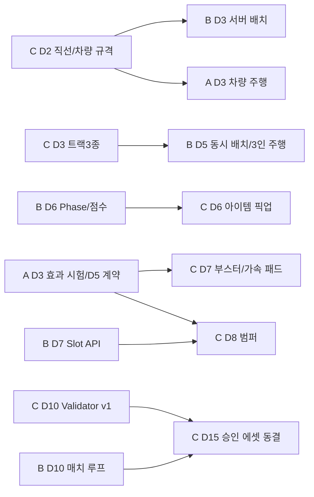

# Make Way 개선형 멀티플레이 — Technical Artist 개발명세서

**문서 번호:** MW-TA-SPEC-001  
**버전:** v1.1 / 2026-10-22 (기존 파일명 유지)  
**상태:** 설계 초안 — D1 에셋 실측 및 자동화 코드 점검 후 동결할 항목 표시  
**기준:** 기획 Draft v0.3 / TA 마일스톤 v1.1 / `05_클라이언트_개발순서_및_설계검토.md`  
**책임자:** C (클라이언트 + TA), **TA 개발 예산 48h / C 클라이언트 72h / C 합계 120h**  
**연동 대상:** 클라이언트 개발명세서 `MakeWay_클라이언트_개발명세서_v1.0.md`의 트랙 DataAsset·건설·아이템·차량 계약

> **구현 검증 상태:** 이 문서는 신규 설계안이다. 실제 Unreal 프로젝트 코드, 원본 추출물, 자동화 도구 브랜치를 **이번 문서 작성에서 검사하지 않았다.** 따라서 '이미 구현됨', 'AssetFlow가 지원함', '추출 가능', '원작과 동일 물리' 등은 주장하지 않는다. 에셋 출처·사용권·형식·오브젝트 계층은 D1에 확인한다.

> **v1.1 적용:** 로컬 프로젝트 기본 모듈 `MW`와 설치 엔진 **5.8.3**을 확인했다. 아트/도구 구현 검증은 미실시다. TA 48h와 일별 시간은 유지하며 D5 체크포인트/복귀 데이터 인수, D8 슬롯/복귀 정적 확인, D2부터 패키지 검사를 반영한다. 기능 추가는 D14까지, D15부터 동결한다.

---

## 0. 작업 정의 — TA 업무와 단순 에셋 작업의 구별

이 프로젝트에서 TA의 목적은 '다수 리소스를 빠르게 가져오기'가 아니다. **트랙을 수작업으로 임포트·수정·검사할 때 발생하는 연결 오류와 반복작업 비용을 줄여, 클라이언트 게임플레이를 안정적으로 지원하는 것**이다.

| 작업 | 분류 | 취업 포트폴리오 증거 |
|---|---|---|
| 원본 메시·텍스처 추출 및 UE5 임포트 | 리소스 **마이그레이션** | 사용 가능 포맷, 법적 사용 범위, 변환 이슈/대응 |
| 스케일/피벗/소켓/콜리전 규격 정의 | 게임용 에셋 파이프라인 설계 | 잘못된 규격을 검출한 실제 예시 |
| `Track Asset Validator` 개발 | **Editor Tool / Validation** | 코드·결과 리포트·실제 사용 전후 작업시간 |
| 반복 참조·머티리얼 인스턴스 설정 일부 자동화 | 반복작업 자동화 | 수작업 절차 vs 자동화 절차, 오류 감소 |
| 트랙 1~5종을 B에게 공급·주행 검증 | 게임개발 기술 지원 | 인수 계약과 통합 빌드 통과 영상 |
| Material/CPU/GPU/Replication 비용 개선 | 측정 기반 최적화 | Insights/프로파일 전후 비교, 재현 조건 |
| 아이템/위험 요소 C++ 핵심 구현 | **클라이언트 포트폴리오** | 별도의 CL-SPEC 담당 시스템. TA 시간에 포함하지 않음 |

### 0.1 TA의 P0/P1/P2 범위

**P0 (48h 안에서 구현·증명)**

1. D2까지 **차량 1, 직선 트랙 1종**(필요 시 합법적 플레이스홀더) 검사/전달.
2. D3까지 **기본 트랙 3종**(직선·커브·경사 우선; 준비 실패 시 같은 규격의 임시 메시)을 B에게 전달.
3. 트랙 **DataAsset+StaticMesh의 소켓/참조/메타데이터/콜리전**의 오류를 실제 에셋에서 찾는 Validator v1 구현.
4. 잘못된 에셋이 배치되지 않도록 **승인 상태(Valid/Invalid)**를 Content 제작 워크플로에 연결.
5. D10까지 아이템 박스/가속 패드/범퍼의 콜리전·리소스 준비, D15까지 트랙 5종 목표, TA Editor 기능 패키징 분리.
6. 수동 검사 대비 검증·정리 시간, 발견 오류 사례 **실제 측정**.

**P1 (게이트 전부 충족할 때만)**

- 좌/우 커브 변형 자동 생성, 표준 Material Instance 자동 생성, Batch 검사 결과 CSV 내보내기, 이슈 목록 UI.
- 위험 2종(범퍼 + 발사대 후보) 등 목표 에셋 정리, 체계적 규칙 강화.

**P2 (이번 4주 제외 권장)**

- Unity 에셋 형식 전체 자동 복원, 임의 메쉬의 완전 자동 주행 중심선 생성, '버튼 한 번에 모든 시스템 이전' UI.
- 루프·코르크스크루·시소·기차/동적 물리 콜리전, 대규모 셰이더 R&D, 범용 DCC Exporter 제작.
- 사용할 증거가 없는 플러그인 범용화/에디터 전체 리디자인.

---

## 1. 원본 리소스와 마이그레이션 요구사항

### 1.1 확인된 요구와 확인되지 않은 실물

- **기획에서 정한 게임 콘텐츠:** 차량 1종 P0 / 목표 외형 3, 트랙 5종 P0 / 목표 7, 위험 요소 2종, 보조 요소 2종, 아이템 3종, 맵 1종.
- **D3 우선 트랙 제안:** 직선, 커브, 경사/점프램프. **D15 추가 2종 후보:** S자 커브, 좁은 다리 또는 끊어진 도로. 5종의 최종 선택과 실측 플레이성은 D5 결정.
- **기존 자동 임포트 툴의 실제 명칭/브랜치:** 미확인. 이전 대화/계획서에서 `AssetFlow`라는 통칭을 사용했으나, 이번 문서는 **기존 툴이 정상 작동한다고 가정하지 않는다**.
- **Unity 또는 다른 게임에서 가져온 원본 자료:** 해당 형식/소유권/배포 허용 여부를 현재 확인하지 못함. 원작 파일을 추출할 수 있어도 재배포 권한과 동일하지 않음.
- **외부 공개 빌드:** 사용 권리 증빙이 가능한 자작/허가된 에셋으로만 제작. 원작 추출 리소스는 학습·분석 자료와 공개 대상 패키지로 분리 관리.

### 1.2 Asset Manifest 필수 스키마

`Docs/Assets/AssetManifest.csv` 또는 팀 저장소의 합의된 위치에 기록한다.

| 필드 | 형식/예시 | 필요한 이유 |
|---|---|---|
| `AssetId` | `TRK_STRAIGHT_A` | 콘텐츠 추적의 안정 ID |
| `Category` | `Track/Vehicle/Hazard/Utility/Texture` | 파이프라인 분기 |
| `SourceType` | `SelfMade/Licensed/Extracted/Placeholder` | 출처와 용도 구별 |
| `SourcePathOrRef` | 로컬 상대 경로/원본 식별자 | 재현 가능성 |
| `RightsStatus` | `Approved/Restricted/Unknown` | 패키징·공개 허용 판정 |
| `SourceFileHash` | SHA-256(가능할 경우) | 변환 전후 추적 |
| `ConversionMethod` | 수동/도구명·버전·옵션 | 변환 재현 |
| `TargetAssetPath` | `/Game/Art/Tracks/SM_...` | UE5 경로 및 참조 추적 |
| `UnitsAxisPivot` | `cm`, `+X`, 원점 기준 | 연결 오류 원인 추적 |
| `ValidationStatus` | `Pass/Fail/NotRun/Blocked` | 게임 투입 제한 |
| `ValidatorReport` | 로그/JSON 파일 | 실패 증거 |
| `Owner/Date/Commit` | `C, D3, commit` | 팀 협업·증거 |

**예시 1행은 실제 에셋을 뜻하지 않는다.** 모든 원본·파일명과 결과값은 D1 실물 조사 후 입력한다.

### 1.3 외부 리소스 이전 단계

```text
S0 사용권/출처 점검
  → S1 원본 목록화(차량·트랙·텍스처 분류)
  → S2 메시/텍스처 포맷 점검 및 선택 변환
  → S3 UE5 Import(축·스케일·피벗·노멀·UV·LOD·콜리전)
  → S4 Runtime 데이터 정의(Snap_In/Out, Slot, Checkpoint)
  → S5 Track Asset Validator(필수 데이터/규격)
  → S6 B 건설 / A 차량 실주행 검증
  → S7 승인·Manifest 갱신·릴리스 후보 등록
```

- S0에서 `RightsStatus=Unknown` 또는 `Restricted`면 **공개 패키지 후보에서 제외**. 개발용 증거/원본 분석 자료와 릴리스 후보를 분리.
- S1에서 원본 Scene Hierarchy와 Prefab/SerializedFile 등 실제 관계가 있으면 추적한다. **차량/트랙을 이름 문자열만으로 무작위 선택하지 않는다.** 정확한 원본 연결이 불명확하면 임포트하지 않고 조사 또는 플레이스홀더로 전환한다.
- S2의 추출/변환 도구는 이미 개발 중인 기능이 있는지 **D1 소스·실행 보고서 검토** 후 결정. 재구현 금지(필요한 수정만).
- S3에서 메시 Import가 성공해도 스케일/피벗/콜리전/소켓·주행 가능성이 모두 통과된 것은 아니다.
- S6는 **에디터 검증의 대체 불가능한 별도 단계**다. Runtime 건설 중첩·물리 접지·차량 점프는 실제 3인 주행 테스트로 판정한다.

### 1.4 단계별 오류 및 복구 정책

| 실패 | 탐지 위치 | 조치 | 일정 보호 |
|---|---|---|---|
| 추출물 누락/원본 매핑 불명 | S1 | 원본 ID/계층 재확인, 임의 다른 자산 사용 금지 | D2 이후 플레이스홀더 사용 |
| 파일은 있으나 포맷 불일치 | S2 | 변환 옵션 기록·다른 포맷 시험 | D3까지 해결 안 되면 대체 메시 |
| 축/스케일 반대, UV/노멀 손상 | S3 | 재임포트 설정 고정·재검증 | 단순 메시로 교체 |
| Snap 소켓 누락/방향 오류 | S4~S5 | DataAsset/StaticMesh 수정 또는 Fix 제안 | B의 스냅 구현을 멈추게 하지 않음 |
| 콜리전 없음/터널링 | S5~S6 | BodySetup/단순 콜리전/채널/물리 세팅 검사 | 위험 트랙 제거, 직선/커브 유지 |
| 설치 슬롯이 복귀 공간 침범 | S5~S6 | 슬롯 위치 수정; 서버 최종 검사 유지 | 해당 슬롯 비활성화 |
| 재임포트로 레퍼런스 깨짐 | S5 | Redirector/참조 검사·명시적 재연결 | 승인 버전 롤백 |
| 사용권 확인 실패 | S0/S7 | 공개 빌드에서 제외·대체 리소스 사용 | 법적 불확실성을 기술 문제로 숨기지 않음 |

---

## 2. TA↔클라이언트 공통 데이터 계약 — 제일 먼저 확정

### 2.1 설계 원칙

- **Runtime에 선언**된 `UMWTrackPieceDefinition : UDataAsset`(또는 팀에서 합의한 데이터 클래스)을 B/C 모두 사용한다.
- Editor Validator는 이 DataAsset/StaticMesh를 **읽어 검사**한다. Runtime 프로젝트가 Editor Validator 클래스를 include하는 방향은 금지.
- StaticMesh의 `Snap_In`/`Snap_Out` **소켓 로컬 +X축이 그 지점의 주행 진행 방향**이라는 규칙을 D2에 합의한다. 월드 +X로 고정하지 않는다. UE 단위 cm, 허용오차는 스냅 실측으로 결정한다.
- **소켓 검증과 스폰 위치의 충돌 판단을 분리:** Editor는 정적 개별 에셋 규격, B 서버는 지금까지 누적된 월드의 타 조각/위험/복귀 공간과 비교하는 실제 배치 규칙 담당.
- Hazard/Utility 위치는 트랙 **Slot 배열**로 관리. Dynamic Actor 참조를 DataAsset에 직접 영구 저장하지 않는다.

### 2.2 제안 필드 표

| 필드 | 타입 개념(제안) | 필수 | Validator 검사 | 소비자 |
|---|---|---:|---|---|
| `PieceId` | `FName` 또는 `FGameplayTag`(추가 의존 없이 FName 우선) | 예 | 빈값/중복 | B 서버 트랙 선택 |
| `TrackMesh` | `TSoftObjectPtr<UStaticMesh>` 또는 직접 참조 | 예 | resolve 가능·참조 유효 | B Actor / C Import |
| `EntrySocketName` | `FName` (`Snap_In`) | 예 | 메시 소켓 존재 | B 연결 검사 |
| `ExitSocketName` | `FName` (`Snap_Out`) | 예 | 메시 소켓 존재 | B 연결 검사 |
| `DriveWidthCm` | float | 예 | >0, 합의된 범위 | A 주행·B 건설 |
| `PlacementFootprints` | local Box/Shape 정의 | 예 | 1개 이상·양수 extents | B 서버 중첩 검사 |
| `CheckpointLocalTransform` | `FTransform` | 예 | 유한 값, 주행 영역 내 추정 | A/B 체크포인트 |
| `SafeRespawnLocalTransform` | `FTransform` + 필요 시 복수 후보 | 복귀 지점에 필수 | D5 인수/D8 정적 확인, 실제 월드 여유는 A/B | A 복귀 |
| `HazardSlots[]` | `FTransform + SlotId + TypeMask` | 예(빈 배열 허용) | ID 중복·NaN·규격 외 | B 설치·C 효과 |
| `UtilitySlots[]` | 위와 동일 | 예(빈 배열 허용) | 동일 | B/C |
| `CenterlinePoints[]` | local spline control points | D14 조건부(사용 기능이 있을 때) | 점 2개 이상·길이>0 | A 보조/카메라/체크포인트 |
| `CurvePreviewType` | Enum/옵션 | 선택 | 유효 enum | HUD 커브 예고(후순위) |
| `IsReleaseApproved` | Boolean + 기록 참조 | 개발 과정용 | 핵심 오류가 있으면 승인 금지 | C 승인 리스트/패키징 |

**정적 메타데이터 규격:** 임포트된 `UStaticMesh`에 Socket을 정의한다. 일관된 스케일이 중요하므로 Actor의 비균일 Scale을 기본 금지하고, 예외는 B의 배치 검사 승인 필요.

**런타임에서 실제 필요한 값만 우선 사용**한다. Centerline은 소비 기능이 있을 때 수동 정의하고 커브를 실제 형상에 맞게 샘플링한다. 모든 곡선을 입출구 2점만으로 충분히 표현했다고 취급하지 않는다. 사용하지 않는 경우 선택 필드로 두고 D14까지 확장 여부를 판정한다.

P0는 단일 In/Out 자동 정렬, 좌/우는 별도 데이터 후보로 제공한다. 임의 회전/런타임 미러링은 제외한다. 경사가 D3 차량 시험을 통과하지 못하면 초기 3종 중 해당 조각은 평면 변형으로 대체하고 미지원으로 기록한다. 체크포인트/복귀 후보는 D5부터 수동 인수하며 자동 검사 완료까지 미루지 않는다.

### 2.3 전달 계약 (C → A/B)

| 인계 시점 | TA 산출물 | B에게 전달 | A에게 전달 | 반려 조건 |
|---|---|---|---|---|
| D2 | `TRK_STRAIGHT_A`, Vehicle 1종 실물 또는 플레이스홀더 | 소켓 위치/축, DataAsset 1개, Footprint | 주행용 메시/Collision Test Map | 소켓 없음, 기준 축 불명, 메시 이동 불가 |
| D3 | 트랙 3종(직선·커브·경사 우선) | 3개 Definition + 승인상태 + 각 Exit/Entry 테스트 | 차량 접지·추락·카메라 경사 테스트 | 스폰 후 주행·스냅 실패 |
| D5 | 초기 통합 에셋 세트 고정 | 실제 서버 배치 로그/문제 이슈 | 3인 차량 주행 영상/문제 이슈 | 3인 시연 중 게임 진행 불능 |
| D8~D10 | 범퍼·가속 패드·아이템 박스 메타데이터, Validator v1 | Hazard/Utility 슬롯 배치 검사 | 넉백/속도 적용 충돌 데이터 | 캐릭터 리스폰 공간 침범/중복 슬롯 |
| D11~D15 | 트랙 5종 목표, 공통 MI 정리, Validator 기준 동결 | 추가 유형의 연결/중첩 테스트 | 새 커브/점프의 조작감 테스트 | 기존 스냅/접지 회귀 |
| D2/D5/D10, D18 회귀 | 패키지 포함 목록·Editor 분리 | 카탈로그 참조/Cook·게임 실행 확인 | 3PC 시각·콜리전 확인 | Editor 의존/누락 참조 |

---

## 3. 핵심 TA 툴: Track Asset Validator

### 3.1 목적/입력/출력

**문제:** 외부 에셋을 각각 수동 설정할 때 입출구 소켓 방향, 씬 스케일, 트랙 콜리전, 위험 설치 슬롯, 체크포인트 위치가 일관되지 않으면 B의 서버 배치에서 예측하기 어려운 오류가 생긴다.

**입력:** 선택된 `UMWTrackPieceDefinition` 1종 또는 지정 폴더 내 DataAsset N종, 연계된 StaticMesh/Material/Collision/Slot 데이터.

**출력:** 에셋별 `Pass/Warning/Fail/NotRun`과 **오류 코드·대상·설명·수정 권장안**, 총 검사 시간, 검사 엔진/툴 버전, 원본 Asset Path. 결과를 Content Browser 검증 결과 또는 텍스트/JSON/CSV(선택)로 확인한다.

**범위:** P0는 Content Browser에서 UE Data Validation 실행 + 명확한 로그. '누르면 실행되지 않는 버튼 UI' 제작 금지. 배치 UI/일괄 자동 수정은 P1이다.

### 3.2 권장 UE 구조

```text
Source/MW/
  Construction/MWTrackPieceDefinition.h/.cpp  # Runtime. A/B/C 공동 계약, B 최종 서명 승인
  Construction/MWPlacementTypes.h              # Runtime. 슬롯/풋프린트 등
Source/MWEditor/
  Validation/MWTrackAssetValidator.h/.cpp      # Editor-only, C 소유
  Validation/MWTrackValidationRules.h/.cpp     # 필요한 경우만 분리
  AssetTools/MWTrackAutoSetup.*                 # P1, 안전한 규칙만 지원
Docs/TA/
  AssetManifest.csv
  TrackAssetContract.md
  ValidationReports/
  TestCases/
```

- 가능한 한 Unreal 내장 `Data Validation` 기능과 `UEditorValidatorBase`를 확장한다. [Epic `UEditorValidatorBase` API](https://dev.epicgames.com/documentation/en-us/unreal-engine/API/Plugins/DataValidation/UEditorValidatorBase).
- UE **5.8.3**의 DataValidation 플러그인/Build.cs 의존성을 D1 확인한다. `UnrealEd` 등 의존성은 반드시 Editor 모듈에만 배치한다.
- Runtime 모듈에는 Editor 코드의 타입이나 헤더가 들어가지 않도록 설계한다. Shipping/Development 패키지 테스트로 분리 여부 검증.
- `IsDataValid`를 사용하는 직접 DataAsset 검사와 `UEditorValidatorBase`를 혼합할 필요가 없다면 한 가지로 단순화. 검사 대상과 프로젝트 엔진 버전에 맞춰 D4 판정.

### 3.3 상세 검증 규칙(단계별 목표)

**일정상 주의:** D10의 Validator v1에서 아래 18개 규칙을 모두 자동 검사하는 것은 48h TA 예산에 맞지 않는다. **D10 필수 자동 검사는 TRK-001~005, 007, 009의 7개**로 제한한다. D13~D14에 핵심 안정성이 확보되면 TRK-006, 010, 012, 014를 추가한다. 나머지는 **P1 또는 수동 출시 체크리스트**이며, 코드 구현 여부를 완료 체크리스트에 별도로 표기한다.

**v1.1 보완:** TRK-010/011/012가 아직 자동화되지 않아도 D5 체크포인트/복귀 데이터 인수와 D8 해당 슬롯/안전 구역 수동 정적 확인은 필수다. 표의 단계는 자동화 목표이며 최초 검수일을 뜻하지 않는다. 추가 자동화는 D14까지이며 D15부터 동결한다.

| 코드 | 검사 단계 | 검증 항목 | 실패/경고 조건 | 자동 수정 정책 |
|---|---|---|---|---|
| `TRK-001` | D10 자동 | `PieceId` | 빈 값 또는 중복 | ID 임의 덮어쓰기 금지(제안만) |
| `TRK-002` | D10 자동 | TrackMesh 유효성 | null/로드 실패 | 자동 수정 불가 |
| `TRK-003` | D10 자동 | Entry socket | `Snap_In` 없음 | 명명 후보 안내, 임의 위치 생성 금지 |
| `TRK-004` | D10 자동 | Exit socket | `Snap_Out` 없음 | 상동 |
| `TRK-005` | D10 자동 | Socket Transform | NaN/Inf, 축·Scale 규격 위반 | 수동 수정, 진단값 출력 |
| `TRK-006` | D14 자동화 조건부 | 스냅 거리·축 관계 | Entry/Exit 동일 위치, 연결 규격 위반 | 정상 커브의 출구 방향 전환을 오류로 취급하지 않음 |
| `TRK-007` | D10 자동 | Collision 존재/정책 | 승인한 충돌 데이터/설정이 없음 | 정적 도로의 복합 충돌도 허용 후보, 실제 접지는 A 테스트 |
| `TRK-008` | Warning/Fail | Collision Channel | 설정과 프로젝트 룰 충돌 | 프리셋과 Diff 표시 |
| `TRK-009` | D10 자동 | Placement Footprint | 미정의/음수 extents/규칙 위반 | 단순 Box 후보 제안만 |
| `TRK-010` | D5 수동 / D14 자동화 조건부 | Checkpoint 데이터 | Null/NaN/주행 방향 심각한 반전 | 자동 생성 금지(정확성 검증 필요) |
| `TRK-011` | D5/D8 수동 필수 | Safe Respawn | 위치가 연결부/위험 Slot과 중첩(정적 예상) | 위치 수정 안내, 실제 월드 검사는 A/B |
| `TRK-012` | D8 수동 / D14 자동화 조건부 | Hazard/Utility Slot | SlotId 중복, 좌표 비정상 | ID/좌표 오류 보고 |
| `TRK-013` | P1/수동 | 메시에 할당된 재질 | 미연결/기본/누락 Material | 명시 승인 시 MI 연결 가능(P1) |
| `TRK-014` | D14 자동화 조건부 | Scale/Bounds | 기준보다 비정상적 크기 | 단위/스케일 경고, 자동 스케일 금지 |
| `TRK-015` | P1/수동 | Centerline | 길이 0/점 부족 | 단순 2점 후보(P1), 수동 확인 |
| `TRK-016` | **수동 필수** | 릴리스 권리/승인 | Manifest 권리 Unknown/Restricted | 공개 후보에서 제외; Validator가 법적 판단을 대신하지 않음 |
| `TRK-017` | P1/수동 | 의존성 누락 | 참조된 텍스처·재질이 로드되지 않음 | 경로 오류만 안내 |
| `TRK-018` | P1/수동 | 런타임 자산 누락 | DataAsset이 서버 로드 시 필요한 클래스를 찾지 못함 | 참조 고정, 패키지 검사 |

**검증 불가능·검증이 아닌 것:** 위 검사는 실제 플레이에서 모든 트랙이 연결·주행 가능함을 증명하지 않는다. 런타임 누적 트랙 월드 중첩, 서버 RPC 경합, 프레임 저하, 접지 실패는 B/A 통합 테스트가 최종 판단한다. Collider가 존재해도 형상·접지 품질이 맞지 않을 수 있다.

### 3.4 검사 결과 모델(제안)

```text
TrackValidationResult {
  AssetPath: string
  AssetId: string
  Status: Pass | Warning | Fail | NotRun
  Issues: [{ RuleId, Severity, PropertyPath, Message, SuggestedAction }]
  ValidatorVersion: string
  CheckedAtUtc: timestamp
  DurationMs: number
  EngineVersion: string
}
```

- `Fail`이면 해당 에셋은 **정식 트랙 후보 목록에서 제외**(서버의 화이트리스트/승인 DataAsset 목록을 사용).
- `Warning`은 기록하고 승인 여부를 담당자가 판단. 공개 빌드 사용 권한은 별도 출처 검토가 필요하므로 `Warning` 통과가 저작권 허용을 뜻하지 않는다.
- 검사 로그/리포트에 파일 로컬 전체 사용자 경로·민감 자료를 무분별하게 쓰지 않는다.
- 배치 UI의 **빨간 Ghost는 B의 서버/로컬 Placement Validator 결과**를 표시한다. TA 에디터 검사 실패 사유와 연결할 수 있지만 둘을 같은 판단기로 구현했다고 착각하지 않는다.

### 3.5 미니 테스트 프로젝트와 실패 샘플

| Test ID | 입력 에셋/데이터 | 기대 결과 |
|---|---|---|
| V-01 | 정상 직선 1종 | D10 필수 자동 규칙 Pass |
| V-02 | `Snap_In` 삭제 | TRK-003 Fail |
| V-03 | `Snap_Out` 반전 | TRK-005 또는 006 Fail(합의 규칙에 따름) |
| V-04 | `TrackMesh=nullptr` | TRK-002 Fail, 크래시 없음 |
| V-05 | Collision 제거 | TRK-007 Fail |
| V-06 | `CheckpointLocalTransform`에 NaN | TRK-010 Fail |
| V-07 | SlotId 중복 | TRK-012 Fail |
| V-08 | Material 참조 제거 | TRK-013/017 경고 또는 Fail 정책 기록 |
| V-09 | 10종을 반복 검사 | 항목·순서·결과 안정, 예외 에셋 하나로 전체 중단 X |
| V-10 | 같은 원본 3종 재임포트 | ID/소켓/경로 변화 여부 비교 기록 |
| V-11 | Editor 모듈 제외 패키지 | Development/Shipping 중 목표 구성 패키지 성공 |
| V-12 | B가 서버에서 실패 에셋 선택 RPC | 허용 후보 아님→배치 거절, 모든 클라 상태 일치 |

테스트용 Fail 에셋은 `Content/Dev/ValidatorTests/` 등 릴리스 제외 위치에 두거나 검증 데이터로만 관리한다. 릴리스 후보 DataAsset 폴더와 혼합하지 않는다.

---

## 4. 자동 설정/수정 도구 — P0 최소, P1 확장

### 4.1 무엇을 자동화할 것인가

| 기능 | 우선순위 | 자동화 허용 조건 | 하지 말 것 |
|---|---|---|---|
| 파일/에셋 명명·폴더 검증 | P0 | 읽기 전용 검사, 규칙 위반 목록 | 기존 경로를 고지 없이 이동 |
| StaticMesh/DA 필수 참조 검사 | P0 | Data Validation 표준 실행 | 런타임에서 에디터 클래스 호출 |
| 기본 Track Definition 생성 지원 | P1 | 메시별 사용자 선택+기본 필드 초안 생성, 최종 승인 | 소켓 위치/방향을 검증 없이 확정 |
| 공용 MI 생성·연결 | P1 | 정해진 Texture Naming Table과 preview/diff | 불확실한 텍스처 채널 추측하여 덮어쓰기 |
| Batch 재임포트 | P1 | 동일 원본·기존 Import Settings 로그/백업 | 라이선스 미확인 원본을 공개 폴더로 복사 |
| Auto Collision 후보 생성 | P2 | 충돌 요구가 단순하고 사람이 결과 시각 확인 | 주행 안전성 '검증 완료'로 자동 표시 |
| 전체 원본 게임 씬 자동 재구축 | 제외 | — | 4주 기간에 새 플랫폼 제작 |

### 4.2 실행 예시: 승인된 임포트 에셋 3개 검사

1. C가 `AssetManifest.csv`에 사용권과 입력 파일을 기록한다.
2. UE Editor에서 메시/DA를 선택하고 **Validate Assets** 또는 확정된 메뉴를 실행한다.
3. Validator는 선택 파일/의존 데이터만 검사하고 오류 코드+속성 경로를 출력한다.
4. C가 잘못된 소켓/콜리전/Slot 수정. 재임포트가 필요한 경우 옵션/원본을 기록.
5. Validator 재실행 후 `Pass` + B의 **서버 스냅/Overlap 테스트**까지 확인한다.
6. 승인이 끝난 DataAsset만 B의 트랙 후보 목록(서버 권한) 및 실제 레이싱 빌드에 반영한다.

### 4.3 도구 안정성/되돌리기

- 자동 수정 도구는 실행 전 대상 개수·변경 필드·예상 결과를 Preview로 보여준다(P1 기능이라면).
- 수정은 Undo/Transaction 가능 범위와 소스 관리 커밋을 이용한 롤백을 우선; 엔진 API 특성상 재임포트가 Undo로 완전히 복원되지 않을 수 있으므로 원본·임포트 설정 백업 필수.
- 중간 에셋 오류 1개 때문에 전체 폴더 Batch가 실패해도 나머지 검사 결과를 잃지 않게 부분 실패 보고.
- '고쳤다'는 결과와 '검사에서 Pass'를 구분. 변경 후 반드시 재검사.
- 동일 입력에 같은 결과를 내야 한다(결정적 검증). 자동 생성은 중복 리소스를 무한히 생성하지 않게 Idempotency 고려.

---

## 5. 리소스별 상세 품질 규격

### 5.1 트랙 Static Mesh

- Unreal 단위 **cm**, 중심축 +X, 소켓 네이밍 `Snap_In/Out`을 D2 기준으로 확정.
- 정면/법선, UV 및 재질 인덱스, 지면과 경계의 충돌, 동적 차량 접지, 메시 임포트 시 피벗 보존 확인.
- 소켓 Entry/Exit 사이 중심선과 실제 주행 메시가 대략 연속인지 A 차량 실제 주행 테스트로 확인.
- 경사/점프 트랙은 차체 모델과 이동 구현 확정 전 '정상 주행'을 보장하지 않는다.
- `PlacementFootprint`는 렌더링 메시 Bounds와 다를 수 있으며 **B의 논리 배치 중첩 검사**를 위해 별도로 정의한다.
- 주행용 Collision과 배치 Footprint를 혼동하지 않는다. 정적 도로는 필요하면 Complex As Simple을 후보로 시험하되, 해당 도로 메시 자체는 물리 시뮬레이션하지 않는다. 차량의 단순 충돌/접지 쿼리와 실제 주행으로 검증하고 곡선 도로 전체를 하나의 볼록 껍질로 막지 않는다. [Epic 충돌 규격](https://dev.epicgames.com/documentation/en-us/unreal-engine/simple-versus-complex-collision-in-unreal-engine).
- 위험/보조 슬롯은 스폰·체크포인트 안전 구역과 겹치지 않게 배치. 서로 다른 슬롯 ID를 가진다.

### 5.2 차량 메시

- 1종 주행 모델/외형을 이번 목표로 유지하며 D15 이후 새 외형 추가는 하지 않는다.
- 앞 방향(+X)과 차량 물리 루트/비주얼 메시의 상대 Transform을 A와 합의.
- 콜리전 단순 형태, 차폭·차고 및 카메라 부착 위치를 A에게 전달.
- 바퀴/서스펜션 또는 Physics Asset 구성은 **A가 채택한 Movement 구현**에 따라 결정. 단순 아케이드 Pawn에는 불필요한 Chaos 설정을 강제하지 않는다.
- Unity 추출 차량을 사용할 경우 드로우콜/재질 개수, 분리 서브메시, 텍스처가 실제 주행 모델보다 과도한지 측정.

### 5.3 위험/보조 요소

| P0 리소스 | C(TA) 제공 | C(클라) 적용 | B 검사 |
|---|---|---|---|
| 범퍼 | 메시/충돌 기준, 슬롯 스케일, 선택 VFX | 서버 넉백 이벤트/쿨다운 | Track Slot 검증, 복귀 공간 침범 거절 |
| 정적 바리게이트(2번째 위험 기본 후보) | 단순 메시·충돌/통행 폭 | 추가 가속 없이 정적 장애물 | 출입구 봉쇄/안전 통행 폭 검사 |
| 가속 패드 | 방향/속도 배율 데이터 기본값 | A Speed Modifier API 호출 | Utility Slot 승인 |
| 아이템 박스 | 픽업 Collider/리소스, 상태 표시 | 서버 Pickup→1칸 Inventory | Utility Slot 승인 |

두 번째 위험은 D11에 확정한다. 발사대로 대체하려면 D3 검증 결과·점프/착지·효과 API 비용을 포함해 판단한다. 바리게이트는 범퍼와 다른 정적 장애물이며, 슬롯 배치 후 통행 폭이 남아야 한다.

### 5.4 머티리얼·텍스처

- 원본의 Albedo/Normal/Roughness/Metallic/Occlusion 등 채널은 추출물에 실제 존재하는 것만 확인. 없는 지도를 임의로 만들어 '원작 동일'이라고 하지 않는다.
- 공용 Master Material 1~2개(실제 필요할 때만), 소재별 MI 적용. Shader permutation 증가를 막기 위해 불필요한 Static Switch 추가 금지.
- 렌더링 결과가 비슷하다는 이유로 sRGB/Normal 채널 설정을 무시하지 않는다. Texture Compression/Color Space는 UE5에서 검증.
- 프로젝트 기본 화면 스타일과 매칭되도록 Track/Hazard/Vehicle 간 머티리얼 파라미터의 명명·스케일 표준화.
- 재료 수·Draw Call·Shader 비용이 실제 병목이라는 증거가 없으면 '머티리얼 최적화'를 포트폴리오 핵심 성과로 주장하지 않는다.

---

## 6. 성능 분석·최적화 명세

### 6.1 측정해야 하는 질문

1. 누적 트랙 수 3 / 6 / 9 / 12 / 18에서 Game Thread·Render Thread·GPU Frame Time이 어떻게 변하는가?
2. Hazard/Utility Actor가 0/2/6/12개일 때 Tick, Collision, Replication 비용은 얼마나 증가하는가?
3. 메시별 머티리얼 슬롯/텍스처 메모리가 과도한가? Track Mi 구조를 정리했을 때 **실측 비용**이 변하는가?
4. Validation 도구가 수작업 검수보다 얼마나 빠르고, 어떤 **실제 오류 유형**을 잡는가?

### 6.2 측정 환경 기록 필드

`Date, Commit, UEVersion, OS, GPU, CPU, RAM, BuildConfig, MapName, TrackCount, HazardCount, PlayerCount, TestDuration, NetworkMode, Reproduction, BeforeValue, AfterValue, Unit, Tool, ScreenshotPath`

- 측정 수치는 **빈칸으로 시작**. A/B/C가 실측하기 전 목표치/개선 %를 실제 결과로 채우지 않는다.
- Shader complexity screenshot 같은 정성 그림은 원인·효과 가설 자료이지 최적화 결과의 유일한 증거가 아니다.
- 평균 FPS보다는 프레임 시간 분포, CPU/GPU 비용, Mesh Draw Calls, Texture/VRAM, 네트워크 부하 등 병목 특성에 맞는 지표를 사용.

### 6.3 최적화 후보(측정 전 제안)

| 현상 | 조사 도구 | 조건부 대응 | 검증 |
|---|---|---|---|
| Track Piece별 draw call 증가 | `stat RHI`, GPU Profiler, Insights | MI/mesh merge/인스턴싱(정적·안전할 때만) | 같은 트랙 수 전후 프레임시간 |
| 에셋 텍스처 메모리 과다 | Memory Insights, Texture Statistics | 해상도·압축 설정 재조정 | 텍스처 품질/메모리 변화 |
| Hazard Actor Tick 비용 | Unreal Insights | 비필요 Tick 비활성/이벤트 기반 | GameThread ms 비교 |
| 다수 Actor Replication 부하 | Networking Insights | 실제 비용 확인 후 업데이트 빈도 조절 | 대역폭/replicated actor 비교 |
| Asset Validation 느림 | Validator 실행 시간 로그 | 반복 로드/중복 검사 제거 | 동일 입력셋 전/후 시간 |

5종 트랙·최대 18조각 규모에서 복잡한 Instancing/Replication Graph부터 도입하는 것은 과설계일 가능성이 높다. 실제 트레이스로 병목이 확인될 때만 변경한다.

---

## 7. 20일 TA 개발 일정(48h 고정) + 클라이언트 의존성

> 총 **48h** = W1 22h / W2 10h / W3 12h / W4 4h. **C의 나머지 시간 72h는 클라이언트 명세서**, A/B는 각각 120h. 각 날짜의 TA+클라 합이 반드시 6h가 되도록 구성.

| 일 | TA(h) | 주요 TA 작업 | 인수/테스트 시점 | C 클라(h) |
|---|---:|---|---|---:|
| D1 | 5 | 조사/Manifest를 이날 시간 안에 종료, 미확보 시 대체 결정 | B/A에게 임시 규격과 대체 메시 공유 | 1 |
| D2 | 5 | 차량 1·직선 1 임포트 및 cm/축/피벗 검증 | B에게 Track Schema, A에게 테스트 메시 | 1 |
| D3 | 5 | 커브·경사 포함 트랙 3종(대체 메시 허용) | B 스냅, A 주행 1차 테스트 | 1 |
| D4 | 4 | Validator Rule TRK-002/003/004 등 최소 검사 | 잘못된 소켓 1종 재현 | 2 |
| D5 | 3 | 체크포인트/복귀 데이터 수동 인수·스냅/콜리전/Cook 수정 | **Gate D5: 실제 3PC 패키지 건설→주행**, 기준 성능 기록 | 3 |
| D6 | 2 | 아이템 박스/가속 패드 최소 Mesh/Collision | C의 P0 보조 요소 연결 | 4 |
| D7 | 2 | 범퍼 충돌·Slot 규격 | A D5 효과 계약/B D7 슬롯 승인과 연동 | 4 |
| D8 | 2 | 복귀 공간/체크포인트/슬롯 수동 정적 확인 | A/B 판정과 대조, 범용 임포터 개선 보류 | 4 |
| D9 | 2 | Validator 방향/슬롯/충돌 검사 확장 | Pass/Fail 샘플 보고 | 4 |
| D10 | 2 | Validator v1을 실제 게임 데이터에 적용 | **Gate D10: 2라운드 완료 + 도구 실적** | 4 |
| D11 | 3 | 목표 5종용 트랙 2종 확보/대체, 메타데이터 | B/A 추가 트랙 회귀 확인 | 3 |
| D12 | 3 | 실제 참조 오류/측정 결과에 따른 에셋 수정, MI 정리는 필요 시만 | 패키지·외관·동일 조건 측정 회귀 | 3 |
| D13 | 2 | 중복 슬롯/오류 방향/안전 구역 검사 강화 | B 서버 배치 거절 사례 대조 | 4 |
| D14 | 2 | 동일 N종 에셋 수동 vs 도구 검사 시간 측정 | 절감 시간 실제 수치(있으면) | 4 |
| D15 | 2 | 승인 에셋 목록/경로/규격 동결 | **Gate D15: 콘텐츠/툴 동결** | 4 |
| D16 | 1 | 패키징 후보 Missing References 검사 | B 릴리스 에셋 목록 전달 | 5 |
| D17 | 1 | D5부터 수집한 기준 장면/성능 측정 회귀 | A/B 동일 조건 비교 | 5 |
| D18 | 1 | 기존 Editor 분리·Cook/패키지 회귀 | **Gate D18: 3PC 릴리스 후보** | 5 |
| D19 | 0.5 | Validator 사용 영상/측정 증거 색인 | 포트폴리오 초안 | 5.5 |
| D20 | 0.5 | 출처/라이선스/실행 가이드 최종 점검 | **Gate D20: 최종 재현 가능** | 5.5 |
| **합계** | **48** | | | **72** |

### 7.1 '서로 기다리지 않는' 구체적 의존성



- **D2 에셋이 늦어지면** B는 규격이 같은 기본 StaticMesh/Box Component로 건설 코드를 진행한다. TA는 그 자리에 에셋을 대체하는 기능만 책임.
- **D3 트랙 3종 중 일부가 불완전하면** B의 서버 배치 구현을 멈추지 않는다. 단, 실제 원본 에셋을 준비했다고 주장하지 않는다.
- **D10 게임 매치가 실패하면** C의 3주차 신규 트랙/MI 개선을 줄이고 72h 클라이언트 작업의 게임 완성을 우선한다. 작업시간 재배분은 작업표에 수정 기록.
- **D15부터 Freeze:** 트랙 리임포트도 변환/콜리전/소켓 변경이면 B/A 회귀 후만 승인.

---

## 8. 완료 정의(Definition of Done)와 TA QA 체크리스트

각 TA 작업은 다음 모두 만족할 때만 완료 표시한다.

1. 사용 권한/출처/원본 식별자가 Manifest에 기록되어 있다(공개 에셋일 경우 Approved 필수).
2. UE5 에셋이 정상 로드되며 임포트 설정, 축, 피벗, 메시 재질·콜리전이 확인된다.
3. 트랙의 입구/출구 소켓과 데이터 계약이 실제 게임에서 소비 가능하다.
4. Validator에서 **D10 필수 7개 규칙**이 실행되어 **문제 코드·에셋명·오류 사유**가 출력된다. 다른 규칙은 실제 구현 여부를 기재한다.
5. B 서버의 실제 스냅/중복 배치 검증과 A 실제 차량 주행 회귀를 통과한다(연동 대상인 경우).
6. CI/로컬 빌드 수준에서 Editor Runtime 의존성 누출이 없고 최종 패키지에서 에셋 누락이 없다.
7. 잘못된 에셋 1종 이상을 의도적으로 만들어 실제 검출했고, 수정 후 Pass를 확인한다.
8. 소유자 C가 다른 팀원이 사용 가능한 체크리스트/사용 방법을 작성한다.
9. 자동화의 시간 절감과 검출 오류 수는 **측정 조건과 함께** 남긴다. 실측이 없으면 `미측정`으로 표시한다.
10. 검토 PR 또는 커밋, Test Map, 스크린샷/영상, 로그 경로가 증거 인덱스에 있다.

### 8.1 작업별 QA 최소 조건

| 검증 항목 | 반복 횟수 / 조건 | 결과 기재 |
|---|---|---|
| 직선/커브/경사 각 1개 | 처음 설치 + 3인 코스 누적 | 접합 위치·주행·복귀 안정 |
| 실패 소켓/Collision DataAsset | 5개 이상의 의도적 오류 패턴 | 정확한 RuleId, Fail/Warning 구분 |
| Batch 5종 이상 검사 | 동일 입력 3회 | 결과 일치, 누락/크래시 없음 |
| 재임포트 반복 | 차량/직선 1개씩 최소 2회 | 참조·Socket·Scale 유지 여부 |
| P0 위험/보조 | 3인 실행 + 복귀/아이템 획득 | 서버 판정·효과 검증(게임 코드 C 소유) |
| Editor 없는 패키지 | 목표 플랫폼 Development 빌드 및 가능하면 Shipping | Editor 모듈 참조 실패/에셋 미포함 없음 |
| 전후 시간 측정 | 같은 N종·동일 검수 항목·동일 PC | 사람 수작업과 Validator 시간 비교 |

---

## 9. 포트폴리오 구성과 협업 증거

### 9.1 TA 사례 기술 문서 구조

1. **문제:** 트랙 소켓·Collision·Slot이 잘못되어 서버 건설/주행 중 문제가 발생한 **실제 사례**.
2. **기존 처리:** 임포트→정렬→메타데이터 수동 설정→미완성 코드/게임에서 반복 확인.
3. **설계:** DataAsset 계약과 Editor Validator 분리, RuleId/Fail/Warning·리포트 형식 선정.
4. **구현:** C++ Editor 코드의 검사 함수 일부, Error Message 샘플, 통합 흐름.
5. **검증:** 오류 샘플 5종/실제 정상 5종, B/A 실게임 테스트, 테스트 스크린샷.
6. **정량 자료:** 수동 검사 및 자동 검사 시간, 탐지된 오류 수, 재임포트 회귀 수치. 모두 실측 전엔 공란.
7. **기여 범위:** C가 검증 툴/에셋 파이프라인의 설계·개발·디버깅 책임, B는 서버 배치, A는 차량 이동, C 클라 코드는 별도 기여.
8. **한계:** 도구는 개별 Asset 규칙은 검사하지만 실제 월드 오버랩/물리 접지/서버 지연 문제까지 보장하지 못함.

### 9.2 채용 기술 질문(코드 리뷰 대비)

- 왜 미리보기에 빨간 Ghost가 떴는가? **서버 배치 거절**과 **에셋 검증 실패**는 어떻게 구분하는가?
- 왜 `UEditorValidatorBase`가 Runtime 코드에 포함되면 안 되는가?
- 임포트 성공과 게임에 쓸 수 있는 에셋의 차이는 무엇인가?
- Source Mesh/Import Setting/DataAsset의 수정 중 무엇을 자동화하고 무엇을 수동 확인하는가?
- 자동차 물리 이동 결정 전 차량 아트 리그/Collision 규칙을 어느 정도까지 고정할 수 있는가?
- 수동 검사 대비 툴 개선을 **어떤 통제된 실험으로 검증**했는가?
- 소켓은 정상이지만 레이스 중 차량이 추락한다면 TA 검사와 A/B 구현의 경계를 어디로 잡는가?

---

## 10. 소유권·코드 리뷰·변경 관리

브랜치·바이너리 예약·리뷰·순차 병합·복구는 [Git 공통 규칙](../GIT_COLLABORATION_GUIDE.md)을 따른다. 대량 재임포트/이름 변경과 공용 에셋·스키마 변경은 고위험 검토 대상이다.

- Runtime DataAsset 스키마의 **최종 승인자는 B + C**. A는 주행/복귀 공간 계약에 승인권을 갖는다. 새 필드를 무조건 추가하지 않고 현재 구현이 실제 사용하는지 확인.
- 필요 시 신설하는 `MWEditor` 모듈과 Validator 구현은 C 담당이다. 본인/다른 팀원의 수정 모두 공통 규칙에 따른 PR·독립 리뷰를 거친다.
- 아트 `.uasset` 변경은 큰 바이너리 diff를 볼 수 없으므로 변경 기록(이전/이후 스크린샷, 변경 소켓 좌표, 검사 로그)을 추가한다.
- 메인 `MP_Core.umap` 수정 권한은 B 우선. TA 테스트용 맵은 C가 별도 관리.
- `Content/Art` 네이밍 예시: `SM_TRK_*`, `SM_VEH_*`, `M_Master_*`, `MI_*`, `T_*`, `DA_TRK_*`. 이 이름은 **규칙 제안**이지 기존 AssetFlow 출력과 일치한다고 확정하지 않는다.
- 권리 미확인 에셋을 개인 PC 로컬 테스트에서 사용했다는 이유로 팀 저장소·외부 패키지에 자유롭게 공유 가능한 것으로 판정하지 않는다.

---

## 11. D1~D5 실제 시작 체크리스트

**D1 (5h TA)**

- [ ] 원본 추출/변환 결과물과 그 출처 확인. 현재 도구 소스·빌드·실행 로그·버전 확인.
- [ ] 확정 UE5 버전, 프로젝트 타겟 플랫폼, 실제 Git 저장소·LFS 추적/잠금·main 보호 적용 상태.
- [ ] 차량 1·트랙 3 후보의 파일 경로·형식·수치(크기·피벗) 정리.
- [ ] 공개 가능한 자산/불명확한 자산/사용 불가를 분류. 접근 불가시 플레이스홀더 확정.
- [ ] B/A와 DataAsset·소켓축·콜리전 계약 1차 합의.

**D2 (5h TA)**

- [ ] 차량 1/직선 1 메시(또는 허가된 대체)의 Import Test.
- [ ] `Snap_In/Out`, cm 단위, Footprint, Checkpoint 최소 메타데이터 전달.
- [ ] B는 자기 브랜치에서 트랙을 서버 스폰; A는 테스트맵에서 주행.

**D3 (5h TA)**

- [ ] 커브/경사 추가(부족 시 같은 계약의 플레이스홀더).
- [ ] B의 트랙 스냅과 A의 카메라·차량 접지 회귀 확인.
- [ ] 문제 발생 시 빠르게 파일/메타데이터/런타임 로직 중 원인 담당 지정.

**D4 (4h TA)**

- [ ] `TrackMesh`, Entry/Exit 소켓, PieceId, Collision 검증 v0 실행.
- [ ] Fail 샘플 1종과 Pass 샘플 1종의 로그 확보.

**D5 (3h TA)**

- [ ] 3인 트랙 건설→주행 Gate 참석. TA 때문에 막힌 이슈 수정.
- [ ] 소켓 기준/폴더/에셋 승인 목록을 D5 기준으로 일단 고정.

---

## 12. 문서 경계 및 참고자료

**근거 문서:** 게임 기획안의 2장 콘텐츠, 2.2.4 공통 트랙 데이터, 2.3.3 위험 배치 제약, 3.3 건설 프로세스, 9장 TA 요구, 11장 4주 계획, 12~14장 범위·검증·미확정 사항. 이전의 `TA 마일스톤` 및 `TA 마이그레이션 실행계획`과 예산·D일차 연동.

**UE 공식 확인 사항:** [UEditorValidatorBase — Epic 문서](https://dev.epicgames.com/documentation/en-us/unreal-engine/API/Plugins/DataValidation/UEditorValidatorBase). 일반 개념은 공식 문서를 바탕으로 했지만, **선택한 엔진 버전에 따라 클래스·모듈/파라미터 API를 실제 프로젝트에서 다시 검증해야 한다**.

**추가로 확정해야 할 사실:** 실제 차량/트랙 원본 파일 목록, 추출/변환 툴 소스 및 성공 결과, 공개 배포 허용 범위, 차량 Movement 방식(D3), 두 번째 위험 요소 선택(D8), 최종 5번째 트랙 타입(D5), 명명/소켓 허용 오차(D2). 이 사실은 지금 확인되지 않아 **미확정으로 표시**했고 임의 수치나 추출 성공 판정을 작성하지 않았다.
